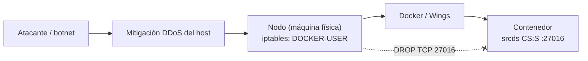

# DDoS al servidor de juego: flood al RCON

Qué pasó el 2026-10-28, cómo se resolvió y qué pedirle a cualquier host nuevo para que no vuelva a pasar.

## Resumen

- **Síntoma:** el servidor real (CS:S v34, Pterodactyl) se caía solo. Antes de cada caída, la consola mostraba cientos de líneas `RCON Server ProcessAccept Error: Too many open files` y después `Segmentation fault (core dumped)`. Más tarde aparecieron también miles de `Banning <ip> for rcon hacking attempts`.
- **Causa:** un flood de conexiones **TCP** al RCON. En CS:S el RCON escucha **solo por TCP**, en el mismo número de puerto que el juego (27016). El RCON de v34 no se puede apagar desde el servidor. Cada conexión ocupa un descriptor de archivo, y cuando se termina el límite (`ulimit -n`) el srcds hace segfault.
- **Solución:** el host bloqueó **todo el TCP entrante al puerto del juego**, directamente en el **nodo** (iptables, cadena `DOCKER-USER`). Bloquearlo solo en la mitigación del borde no alcanzó.
- **Por qué no afecta a nada:** el juego, la lista de servidores (A2S) y SourceTV usan solo UDP. Nosotros no usamos RCON: el servidor se maneja desde la consola del panel.

## Cómo llega el tráfico



- **Contenedor:** la "caja" aislada donde corre el srcds (lo que se ve en el panel, rutas `/home/container/...`).
- **Docker:** el programa que crea y maneja los contenedores. **Wings** es el agente de Pterodactyl que le da órdenes a Docker en el nodo.
- **Nodo:** la máquina física. Su firewall lo maneja el host; nosotros no lo podemos tocar desde el panel.

## Cronología

| Paso | Qué se vio | Qué se hizo |
|---|---|---|
| 1 | Ataques mixtos en el panel de mitigación: UDP QueryReflect a :27016 y TCP SeqAttack, RSTFlood y "Puerto 0" a :80 | La mitigación del host frenó casi todo |
| 2 | Caídas con `ProcessAccept Error: Too many open files` y segfault | Se le pidió al host bloquear el TCP 27016 |
| 3 | Desde afuera el TCP 27016 aparecía cerrado, pero la consola seguía mostrando `Banning ... for rcon hacking attempts` | Se dedujo que las conexiones llegaban por otra ruta (el bloqueo estaba solo en el borde) |
| 4 | — | Se le pidió al host poner el DROP en el nodo, en `DOCKER-USER`, para IPv4 e IPv6. **Funcionó** |

Las IPs de los `Banning ...` **son reales**, no falsificadas: para que el motor las banee tienen que completar el handshake TCP y mandar una clave mala. Es una botnet o proxies residenciales.

## Qué pedirle a un host nuevo

Pedirlo apenas se contrata, sin esperar a que haya un ataque:

> No uso RCON. Necesito que bloqueen **todo el TCP entrante al puerto del juego** (27016, o el que me asignen) **en el nodo**: iptables, cadena `DOCKER-USER` o la que use Wings, para IPv4 e IPv6, no solo en la mitigación. El juego usa solo UDP. Si es posible, también un filtro de juegos Source (A2S) en el UDP del juego y subir el `ulimit -n` del contenedor.

Una regla de referencia, para que el host la adapte:

```bash
iptables  -I DOCKER-USER -p tcp --dport 27016 -j DROP
ip6tables -I DOCKER-USER -p tcp --dport 27016 -j DROP
```

En `DOCKER-USER` el puerto que se ve es el del contenedor, ya traducido. En Pterodactyl suele ser el mismo que el externo, pero el host lo tiene que confirmar.

Si algún día hace falta RCON desde afuera, en vez de un DROP total se pide permitir el TCP al puerto solo desde nuestras IPs.

## Cómo verificar

1. **TCP cerrado y UDP andando**, desde cualquier PC con PowerShell:

   ```powershell
   $t = New-Object System.Net.Sockets.TcpClient; $r = $t.BeginConnect('<ip>', 27016, $null, $null); "TCP abierto: " + ($r.AsyncWaitHandle.WaitOne(4000) -and $t.Connected); $t.Close()
   ```

   Tiene que dar `False`. Que el servidor siga apareciendo en la lista de servidores confirma que el UDP anda.

2. **Consola del panel:** no tienen que volver a aparecer `ProcessAccept Error` ni `Banning ... for rcon hacking attempts`. Si siguen apareciendo, las conexiones están llegando por otra ruta y el bloqueo tiene que bajar al nodo.
3. **Después de un ataque:** `listip` en la consola. Si quedó una lista enorme de IPs baneadas, reiniciar el servidor para vaciarla **sin** correr `writeip`.

## Lo que no sirve

- **`rcon_password` vacío, `sv_rcon_banpenalty` o `sv_rcon_maxfailures`:** la conexión se acepta y ocupa un descriptor antes de pedir la clave. Además, los baneos por IP no frenan una botnet.
- **Subir solo el `ulimit -n`:** retrasa la caída, no la evita.
- **Bloquear solo en la mitigación del borde:** desde afuera el puerto parece cerrado, pero las conexiones llegaban igual por otra ruta.
