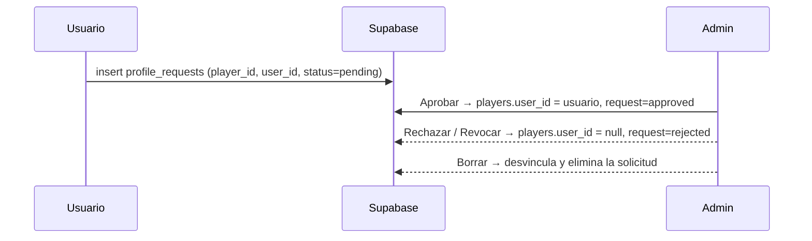
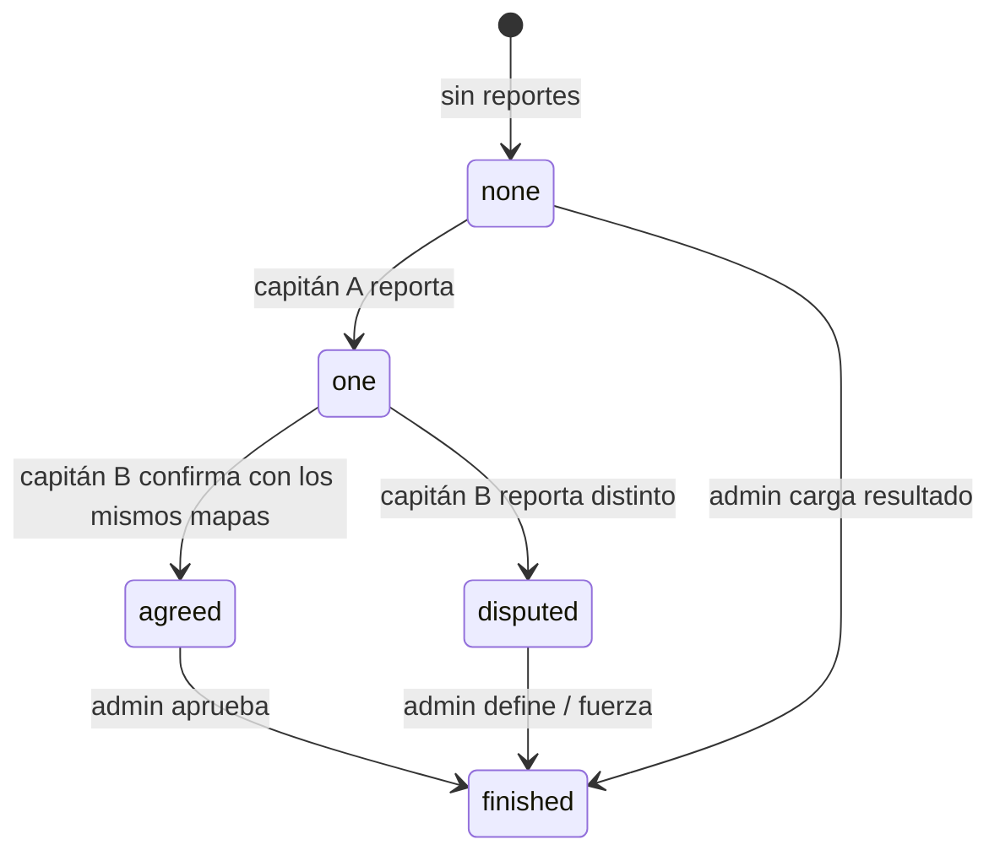

# Funcionalidades

## Roles

| Rol | Cómo se obtiene | Qué puede hacer |
|---|---|---|
| Visitante | Sin sesión | Ver partidas, resultados, torneos, ranking, equipos, jugadores públicos y palmarés. |
| Usuario | Registro con email, contraseña y *tag* | Editar su perfil, solicitar un equipo, reclamar un perfil de jugador, inscribir su equipo en torneos, chatear, publicar/aceptar PCW. |
| Capitán | `teams.captain_id = usuario` | Vetar mapas, reportar resultados, ceder la capitanía. |
| Admin | `profiles.role = 'admin'` | Todo lo anterior más los paneles de administración. |

## Secciones públicas

| Sección | Contenido |
|---|---|
| **Inicio** | Partidas en vivo, próximas 4, últimos 4 resultados, 3 torneos y top 4 del ranking. |
| **Partidas** | Todas las partidas en vivo y próximas (excluye PCW, byes y partidas huérfanas). |
| **Resultados** | Partidas terminadas, más recientes primero. |
| **Torneos** | Listado; al entrar: información, posiciones (si hay fase de grupos), bracket, equipos y partidas. El dueño de un equipo puede inscribirse o cancelar mientras el torneo esté en *Inscripciones*, sin fixture generado y con cupo. |
| **PCW** | Búsqueda de prácticas entre equipos (ver más abajo). |
| **Palmarés** | Torneos finalizados con premio y campeón. |
| **Ranking** | Equipos ordenados por puntos (3 por victoria) usando partidas oficiales terminadas sin empate. |
| **Equipos** | Grilla de equipos, plantel con stats; formulario para solicitar un equipo y panel "Mi capitanía". |
| **Jugadores** | Lista paginada y buscable ordenada por rating. Cada jugador tiene perfil con pestañas Info, Equipos, Partidas, Logros y Mapas. |

### Perfil de jugador

- Datos cargados por el admin: rating, K/D, HS %, ADR, mapas, victorias/derrotas, historial de equipos, logros, biografía, medallas y stats por mapa.
- Si el jugador está vinculado a una cuenta, se suman los datos que el usuario edita (país con bandera, nombre real, rol, Steam, FACEIT, Discord, avatar).
- **Privacidad** (`public`, `members`, `private`): oculta el cuerpo del perfil a visitantes o a todos salvo el dueño y los admins. *Ojo:* el filtro se aplica en el navegador (ver [SEGURIDAD.md](SEGURIDAD.md)).

## Cuenta y perfil propio

- **Registro**: email, contraseña y tag (2–24 caracteres). Si Supabase exige confirmar el email, el tag se guarda en `localStorage` (`pendingTag`) y se aplica con `set_my_tag` en el primer login.
- **Mi Perfil**: nickname (tag), nombre real, país, rol, Steam (SteamID64, link o nombre), FACEIT, Discord y avatar. El avatar se recorta en el navegador a 256×256 JPEG (máx. 5 MB de origen) y se sube al bucket `avatars`.
- Cada login actualiza `profile_details.last_seen`.

## Flujo: verificación de perfiles

El admin también puede vincular una cuenta directamente desde el formulario de jugador; la app impide vincular una cuenta a dos jugadores.

## Flujo: equipos

1. Un usuario envía **Solicitar equipo** (nombre + sigla) → `team_requests` (una por usuario).
2. El admin aprueba → se crea el equipo con ese usuario como `owner_id` y `captain_id`.
3. El admin arma el plantel (`teams.members`, ids de `players`) y puede cambiar el capitán.
4. El capitán puede **ceder la capitanía** a otro miembro con cuenta verificada (RPC `set_team_captain`).

## Flujo: torneos (admin)

1. **Crear torneo**: nombre, formato (eliminación simple, doble eliminación, todos contra todos, grupos + playoffs), BO de partidas y de la final, cupos, premio, fechas y reglas. Estado inicial: *Inscripciones*.
2. **Participantes**: se inscriben solos o los agrega el admin. El orden de la lista es la siembra (se puede subir/bajar o sortear).
3. **Generar fixture**: valida mínimos (2 equipos, 3 para doble eliminación, suficientes para los grupos, `min_teams`), borra partidas previas del torneo, inserta las nuevas y marca `generated=true`, estado *En curso*. Desde ese momento no se pueden cambiar formato ni equipos.
4. **Generar playoffs** (sólo grupos + playoffs): cuando todas las partidas de grupo están terminadas.
5. **Cargar resultados** mapa por mapa; el bracket avanza solo. Al definirse el campeón el torneo pasa a *Finalizado*.
6. **Reiniciar fixture**: borra todas las partidas y vuelve a *Inscripciones*.

Eliminar un torneo borra también sus partidas e inscripciones. Las partidas que quedaron de torneos eliminados se marcan como "huérfanas" y pueden borrarse en bloque desde *Partidas Globales*.

## Flujo: veto de mapas

Pool fijo: `dust2_ob, cbble, inferno, nuke, mirage, tuscan, season, train, cache`.

Secuencia (`vetoSeq`), alternando turnos empezando por el equipo 1:

| Formato | Secuencia | Resultado |
|---|---|---|
| BO1 | 8 bans | Juega el mapa restante |
| BO3 | ban, ban, pick, pick, 4 bans | 2 picks + decisivo |
| BO5 | ban, ban, pick ×4, ban, ban | 4 picks + decisivo |

Sólo el capitán del equipo en turno puede actuar, y nunca en partidas terminadas. Cada acción es una fila en `match_vetos`. Un admin puede reiniciar el veto.

## Flujo: reporte de resultados

- Cada capitán envía mapas y rondas, la alineación (hasta 7 jugadores), hasta 3 capturas (redimensionadas a 1280 px, JPEG, bucket `proofs`) y una nota. Un reporte por equipo y partida (`upsert` sobre `match_id,team_id`).
- La serie no puede quedar empatada.
- El admin ve los pendientes en *Admin → Torneos → Resultados pendientes* y puede aprobar el reporte de cualquiera de los dos o corregir el resultado manualmente.
- En PCW, si ambos reportes coinciden (y no hay empate), el trigger `autoapply_pcw` cierra la partida automáticamente, sin pasar por un admin.
- Del lado del servidor, `validate_report` exige: partida no terminada, 1–5 mapas sin superar el BO, rondas 0–99, alineación ≤ 7 jugadores del plantel y capturas sólo del bucket `proofs`.

## Flujo: PCW (prácticas)

1. Un usuario publica un anuncio: nombre de equipo opcional, BO, fecha opcional, mapas, nota y roster (1 a 7: jugadores registrados y/o *tags* invitados). RPC `create_pcw_post`. Límites del servidor: **un anuncio abierto a la vez** y **6 por día** por usuario.
2. Los anuncios se muestran abiertos durante 7 días o hasta 2 h después de la fecha propuesta. Los equipos de anuncios de más de 7 días sin partida se limpian al publicar uno nuevo.
3. Otro usuario lo acepta con su roster → RPC `accept_pcw` (no se puede aceptar el propio ni repetir jugadores o tags entre ambos rosters). Crea la partida (`matches.kind='pcw'`), marca el anuncio como `matched` y la app abre el detalle.
4. Se juega con el mismo veto y reporte de resultados.
5. El autor puede cancelar el anuncio (`cancel_pcw_post`) y los capitanes o admins pueden cancelar la práctica (`cancel_pcw_match`).

Las PCW no cuentan para el ranking ni aparecen en Partidas/Resultados; tienen su propia lista de "Prácticas recientes".

## Chat de partida

En el detalle de cada partida, cualquier usuario logueado puede escribir (máx. 200 caracteres). Se muestran los últimos 50 mensajes y se actualiza por *polling* cada 5 s.

## Administración

| Panel | Funciones |
|---|---|
| **Torneos** (`#cadm`) | Resultados pendientes, CRUD de torneos, fixture, CRUD de partidas sueltas (equipos, torneo, mapa, IP de servidor, fecha, estado, rondas, demo y video). |
| **Jugadores** (`#padm`) | CRUD de jugadores con foto (bucket `photos`), stats, privacidad y cuenta vinculada; otorgar/quitar medallas; stats por mapa. |
| **Equipos** (`#tadm`) | Aprobar/rechazar solicitudes; CRUD de equipos, capitán y plantel (un jugador no puede estar en dos equipos desde este selector). |
| **Verificaciones** (`#vadm`) | Buscar y filtrar solicitudes de reclamo de perfil; aprobar, rechazar, revocar o borrar. |
