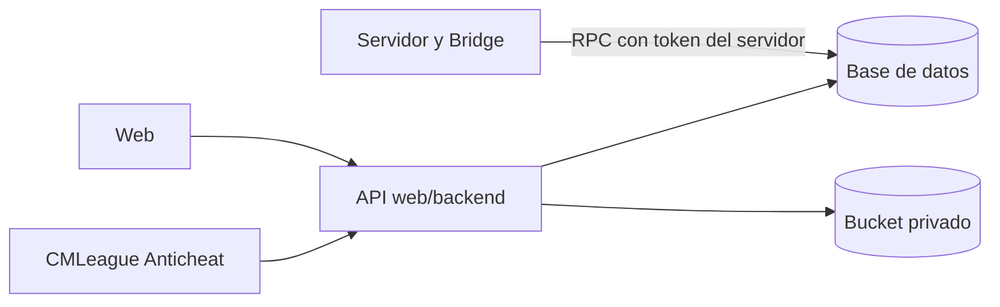

# CMLeague Anticheat: guía para el equipo

Actualizado el 2026-10-31. Estado general de este y de los otros proyectos: [Retake, 2v2 y CMLeague Anticheat](RESUMEN_RETAKE_2V2_ANTICHEAT.md).

## Qué es y qué no es

CMLeague Anticheat es una aplicación de Windows, obligatoria para jugar mixes, que junta evidencia para que el staff la revise. Funciona con la cuenta de `cmleague.lat`, como FACEIT, y es independiente del EAC que trae ClientMod.

**Es un prototipo funcional probado en local.** Todavía no se usó con jugadores ni se desplegó.

| Hace | No hace |
| --- | --- |
| Vincula la PC con la cuenta del jugador, sin ver su contraseña | No sanciona ni decide quién hace trampa |
| Durante la sesión, captura la ventana del juego solo si está al frente | No captura fuera del juego ni fuera de la sesión |
| Durante la sesión, lista los programas abiertos con ruta, hash y firma | No lee la memoria de otros programas ni inyecta nada |
| Expulsa de los mixes a quien juega sin la aplicación, si el servidor lo tiene activado | No crea baneos ni antecedentes al expulsar |
| Muestra en el perfil público solo el estado | No publica capturas ni procesos |

## Cómo lo usa un jugador

Una vez vinculado, el jugador solo tiene que abrir la aplicación antes de entrar al servidor.

1. Tener el SteamID vinculado a su perfil en `cmleague.lat`. Sin eso no puede aprobar el equipo.
2. Abrir `CMLeagueAC.exe` y aceptar instalarlo. No pide administrador y no se abre solo con Windows.
3. Leer y aceptar la pantalla de qué recopila.
4. Tocar **Vincular con cmleague.lat**. Se abre la web.
5. Comprobar que el código de la web sea el mismo de la aplicación y tocar **Aprobar este equipo**.
6. Con la aplicación en **Listo para jugar**, entrar a un servidor de CMLeague. Pasa a **Sesión activa**.
7. Al salir del servidor se cierra la sesión y deja de recopilar.

Si la aplicación no está abierta cuando empieza un mix, el servidor avisa y expulsa a los 20 segundos. Para desinstalarla se usa Configuración de Windows, y eso borra también sus datos locales.

## Cómo lo usa el staff

La revisión se hace en **Administración › Anticheat**, solo para admins, y cada lectura de evidencia queda registrada.

| Para qué | Cómo |
| --- | --- |
| Ver sesiones | Filtrar por abiertas, perdidas o cerradas |
| Revisar una sesión | Elegirla: muestra capturas, solicitudes y programas. **Actualizar** trae lo nuevo |
| Pedir una captura | Escribir el motivo y tocar **Pedir**. El jugador ve el aviso; hay un límite de una por minuto y solo se toma con el juego al frente |
| Comprobar la integridad | **Verificar** |
| Conservar por un caso abierto | **Conservar por caso abierto**: no vence a los 30 días |
| Abrir los mixes si el servicio falla, desde la web | **Abrir mixes 1 hora** y **Cerrar** |
| Abrir los mixes con la red caída, en un servidor | `sm_ac_open <minutos>`; con `0` se cierran |
| Ver el estado del plugin | `sm_ac_status` |

El panel muestra hechos observados y nunca dice "limpio" ni "cheater": la conclusión es de una persona. Un dato que falta, como una ruta sin acceso, no es indicio de nada.

## Cómo funciona por dentro

La aplicación nunca recibe credenciales amplias, y el servidor de juego no recopila nada del jugador.



| Dato | Quién lo ve | Cuánto dura |
| --- | --- | --- |
| Tiene agente, sesiones de 30 días, última sesión | Público | Se calcula de las sesiones |
| Capturas y procesos | Solo admins, con registro | 30 días; más si se conserva por un caso abierto |
| Registro de acciones de admin | Nadie por la API pública | No se borra con la sesión |

**Integridad:** cada captura y lote de procesos va en una cadena firmada por el equipo. **Verificar** recalcula firmas, cadena, hashes y archivos, y da verificada, fallida o incompleta. Eso prueba que nada cambió desde el envío, no que el equipo del jugador dijera la verdad.

**Expulsión:** con la aplicación cerrada en plena partida, el servidor expulsa unos 2 minutos y 15 segundos después del último latido. A los 90 segundos sin latido deja de contar como activa, y el Bridge comprueba cada minuto.

## Cómo mostrarlo en local

La demo corre en una PC con Windows y no toca producción. La API de producción (`api.cmleague.lat`) todavía no tiene las rutas del anticheat, así que `CMLeagueAC.exe` no puede vincular contra ella: **para presentarlo se usa `agent\demo.bat`.**

Ramas: `kyan/anticheat-backend` para base, API, aplicación y Bridge, y `kyan/anticheat-web` para la web.

1. En `web/backend`, con Docker abierto y desde Git Bash: `pnpm install --frozen-lockfile`, `pnpm db:start` y `pnpm db:reset`.
2. Crear `web/backend/.dev.vars` desde `.dev.vars.example` y agregar `FRONTEND_URL=http://localhost:5199`, `AC_API_SECRET` (32 caracteres o más), más `SUPABASE_SERVICE_KEY` con la clave local de `pnpm exec supabase status`.
3. Cargar el hash del secreto en la base local:

   ```sql
   update ac_config set api_secret_hash = encode(sha256(convert_to('<secreto>', 'UTF8')), 'hex') where id = 1;
   ```

4. Levantar la API en el puerto 8799: `PORT=8799 pnpm dev:node`.
5. En `web/frontend` de la otra rama: `pnpm install --frozen-lockfile`, un `.env.local` con `VITE_API_URL=http://localhost:8799`, y `pnpm dev --port 5199`.
6. Registrar una cuenta en `http://localhost:5199`. Para ver el panel, ponerle `role = 'admin'` en `profiles` de la base local.
7. Compilar con `agent\build.bat` y abrir `agent\demo.bat`. Aceptar y tocar **Vincular**.
8. Preparar la cuenta con `pnpm ac:demo preparar <email>`, y recién ahí aprobar el código en la web.
9. Abrir el juego al frente y correr `pnpm ac:demo abrir <email>`, que hace de Bridge. La aplicación pasa a **Sesión activa** en hasta 30 segundos.
10. Ver la sesión en **Administración › Anticheat**: pedir una captura, tocar **Actualizar** y **Verificar**.
11. Cerrar con `pnpm ac:demo cerrar <email>` y mostrar que deja de recopilar.

**Cuidados:**

- En Windows, `db:reset` falla si Git dejó los `.sql` con CRLF. Hay que convertirlos a LF para cargar y restaurarlos después con `git checkout`.
- Las pruebas automáticas borran el secreto local al terminar: hay que repetir el paso 3. Tampoco corren con la aplicación abierta.
- `ac:demo` no expulsa. Para ver la expulsión hace falta el Bridge en un servidor.
- Esta secuencia completa, con estos comandos juntos, no se ensayó de punta a punta: conviene hacerla una vez antes de presentar.

## Estado real

El sistema funciona de punta a punta en local, pero no se probó con jugadores en un servidor real y **no se puede repartir todavía**.

| Parte | Probado | Falta |
| --- | --- | --- |
| API, base y permisos | 392 pruebas unitarias y 184 de integración | Desplegar con el corte |
| Aplicación | Con el juego de Kyan: vincula, inventaría, captura, sube y la sesión cierra | Otras PC |
| Captura en pantalla completa | Funcionó en una PC | Tirones, Alt+Tab, superposiciones, otros modos, Windows 11 |
| Integridad | Detecta filas, archivos y entradas alterados | Almacenamiento inmutable real |
| Borrado a 30 días | Respeta sesiones abiertas y conservadas | Instalar el cron en el VPS |
| Bridge | En `cssds`, con Kyan conectado: expulsa sin aplicación y sin SteamID válido; no expulsa con la aplicación abierta | SteamID real: en `cssds` se simuló |
| Instalador | Instala y desinstala sin dejar rastro | Certificado de firma: sin él, Windows y los antivirus lo advierten |
| Web | Panel, capturas y vinculación en el navegador | Mezclar con el backend; mostrar el estado en el perfil |

**Límites que no se resuelven con más código:**

- El equipo es del jugador: puede falsear lo que informa. Trampas externas, en kernel o con nombres cambiados no se ven.
- La IP no distingue dos PC de una misma casa, y una VPN en uno solo de los dos programas puede expulsar a alguien legítimo.
- Se recopilan datos de personas identificadas, en varios países y quizá de menores. **Antes de usarlo con jugadores hace falta revisión legal.**

## Qué hace falta de cada uno

Para avanzar hay que decidir el pase a las ramas de todos y quién responde por los datos.

| Quién | Qué |
| --- | --- |
| Daniel | Revisar `kyan/anticheat-backend` y decidir si entra al backend y en qué orden con el corte; instalar el cron; arreglar `db:reset` en Windows con `*.sql text eol=lf` |
| Esteban | Revisar `kyan/anticheat-web`; decidir dónde va el estado del anticheat en el perfil, que todavía no se muestra |
| Kyan | Hacer las pruebas de campo; comparar la interfaz con Gamers Club, FACEIT, Esportal y Akros, porque solo se encontró documentación de FACEIT |
| Todos | Decidir quién responde legalmente por los datos, conseguir el certificado de firma y confirmar que RBK sigue afuera |

Nada de esto se subió a `main` ni a las ramas de Daniel y Esteban.
