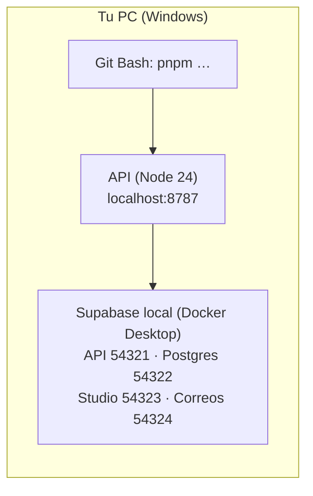
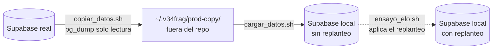

# Backend en local: Windows con Docker Desktop

Paso a paso para levantar la API (`web/backend`) y su Supabase local en una PC con **Windows 10/11 y Docker Desktop**. El resumen y la referencia de scripts están en [`web/backend/README.md`](../web/backend/README.md).

La Supabase local corre en Docker y **nunca toca la Supabase real**. Probado el 2026-10-20 en Windows 11 con Docker Desktop (motor 29.1), Node 24.18 y pnpm 12.8.1.



## 1. Instalar lo necesario (una sola vez)

| Programa | Versión | Para qué | Comprobar |
|---|---|---|---|
| [Git for Windows](https://git-scm.com/download/win) | la actual | Git y **Git Bash** (los scripts del proyecto son de bash) | `git --version` |
| [Docker Desktop](https://www.docker.com/products/docker-desktop/) | 4.x o más nuevo | Contenedores de la Supabase local | `docker --version` |
| [nvm-windows](https://github.com/coreybutler/nvm-windows/releases) | la actual | Instalar Node 24 | `nvm version` |
| Node | **24** (`web/backend/.nvmrc`) | La API | `node --version` |
| pnpm | **12.8.1** (por Corepack, viene con Node) | Paquetes. **Nunca npm** | `pnpm --version` |

### Docker Desktop

1. Instalarlo con la opción **"Use WSL 2 instead of Hyper-V"** marcada. Si Windows pide instalar o actualizar WSL, aceptar (`wsl --update` en una PowerShell de administrador) y reiniciar.
2. Abrirlo y esperar a que abajo a la izquierda diga **Engine running**.
3. En **Settings → Resources** conviene darle al menos **4 GB de memoria**: la Supabase local levanta unos 10 contenedores.
4. No hace falta ninguna distribución de Linux (Ubuntu, etc.): Docker Desktop trae la suya (`docker-desktop`).

### Node 24 y pnpm

En una terminal (después de instalar nvm-windows, abrir una nueva):

```bash
nvm install 24
nvm use 24
corepack enable pnpm        # en PowerShell de administrador si da "permiso denegado"
pnpm --version              # tiene que decir 12.8.1 dentro de web/backend
```

Corepack toma la versión de pnpm de `packageManager` en `web/backend/package.json`, así que no hay que instalar pnpm a mano.

## 2. Usar Git Bash, no PowerShell

**Todos los comandos de esta guía se corren en Git Bash** (Inicio → "Git Bash", o la terminal de VS Code / WebStorm con el perfil Git Bash).

Los scripts `db:*` llaman a `bash scripts/db-local.sh`. Desde PowerShell o cmd, `bash` es el de WSL (`C:\Windows\System32\bash.exe`), que no encuentra Linux y falla con:

```
<3>WSL (11 - Relay) ERROR: CreateProcessCommon:875: execvpe(/bin/bash) failed: No such file or directory
```

Desde Git Bash, `bash` es el de Git y funciona. (`pnpm dev:node`, `pnpm test` y `pnpm typecheck` sí andan en PowerShell; solo los `db:*` necesitan Git Bash.)

## 3. Clonar e instalar

```bash
git clone <url del repo> v34frag
cd v34frag/web/backend
pnpm install --frozen-lockfile
cp .dev.vars.example .dev.vars
```

- **`--frozen-lockfile`:** instala exactamente lo de `pnpm-lock.yaml`. Si pnpm se queja de que el lock no coincide, no lo actualices: avisa.
- **Antigüedad mínima de 7 días** (`pnpm-workspace.yaml`): si alguien agregó un paquete publicado hace menos, la instalación falla a propósito.
- **`.dev.vars`** ya apunta a la Supabase local (`http://127.0.0.1:54321`) con la clave pública de demostración que trae toda Supabase local. No hace falta el `.env` de la raíz para esto.

## 4. Levantar la Supabase local

Con Docker Desktop en **Engine running**:

```bash
pnpm db:start
```

- **La primera vez** baja las imágenes de Supabase (varios GB): puede tardar 5–15 minutos según la conexión. Las siguientes, menos de un minuto.
- Después carga el esquema real (`supabase/schema/`), las migraciones que todavía no están en producción y el replanteo (`supabase/replanteo/`). Tiene que terminar con `Esquema cargado.`
- Para cargar la base **sin el replanteo** (como producción hoy): `REPLANTEO=0 pnpm db:reset`.

| Qué | Dónde |
|---|---|
| API de Supabase | http://127.0.0.1:54321 |
| Postgres | `127.0.0.1:54322` (usuario `postgres`, clave `postgres`) |
| **Studio** (ver tablas, correr SQL) | http://127.0.0.1:54323 |
| **Correos** de Auth (confirmaciones, recuperar contraseña) | http://127.0.0.1:54324 |

`pnpm exec supabase status` muestra las URL y claves locales.

## 5. Levantar la API

```bash
pnpm dev:node
```

Abrir http://localhost:8787/api/docs (documentación interactiva) y http://localhost:8787/api/health.

`pnpm dev` hace lo mismo con el runtime de Cloudflare Workers (`wrangler`), que es la alternativa de despliegue. Para el día a día, `dev:node`.

## 6. Pruebas

```bash
pnpm typecheck
pnpm test          # unitarias, sin Docker
pnpm test:int      # integración, contra la Supabase local (necesita db:start)
```

## 7. El día a día

| Quiero… | Comando |
|---|---|
| Apagar la Supabase local (libera memoria) | `pnpm db:stop` (no guarda los datos) |
| Volver a prenderla | `pnpm db:start` |
| Borrar todo y recargar el esquema (después de cambiar `supabase/replanteo/` o `supabase/migrations/`) | `pnpm db:reset` |
| Regenerar los tipos de TypeScript después de cambiar el esquema | `pnpm db:types` |

Docker Desktop puede quedar cerrado cuando no se trabaja en el backend; hay que abrirlo antes de `db:start`.

## 8. Base local con los datos de producción (opcional)

`pnpm db:start` deja la base con la estructura de producción pero **vacía**. Para probar con los jugadores, mixes y equipos reales se copia la base de producción y se carga en la local. Producción **no se modifica**, porque `pg_dump` solo lee.



### Cuidados

- **La copia tiene datos personales:** los emails y los hashes de contraseñas de `auth.users`. Por eso se guarda **fuera del repo**, en `~/.v34frag/prod-copy/` (en Windows, `C:\Users\<tu usuario>\.v34frag\prod-copy\`). **Nunca se commitea, ni se sube a un chat o a la nube.**
- **Solo la saca quien tenga las variables `PG_*`** (Session pooler de Supabase) en el `.env` de la raíz. Si otra persona necesita la copia, Daniel le pasa el acceso o la copia por un canal privado.
- **Al terminar,** `pnpm db:reset` para no dejar los datos cargados.

### Requisitos extra

- **`pg_dump` 17 o más nuevo** (solo para copiar). Se instala desde el [instalador de PostgreSQL para Windows](https://www.postgresql.org/download/windows/), marcando solo **Command Line Tools**. Después se agrega `C:\Program Files\PostgreSQL\18\bin` al `PATH` y se abre una terminal nueva. Para comprobarlo, `pg_dump --version`.
- En el `.env` de la raíz: `PG_HOST`, `PG_PORT`, `PG_USER` y `PG_PASSWORD`.
- La Supabase local corriendo (`pnpm db:start`).

### Pasos (en Git Bash, desde la raíz del repo)

```bash
cd v34frag
P=docs/bitacora/2026-10-14-replanteo-modelo-datos/pruebas

# 1. Copiar los datos de producción (unos segundos). Pisa la copia anterior.
bash $P/copiar_datos.sh
cat ~/.v34frag/prod-copy/FECHA       # fecha de la copia, en UTC

# 2. Cargarlos en la base local: la rearma con la estructura de producción (REPLANTEO=0) y carga la copia.
bash $P/cargar_datos.sh
```

- **El paso 2 borra lo que haya en la base local** (hace un `db:reset`).
- Para probar **la base como quedaría después del corte**, con el replanteo aplicado sobre los datos reales, se corre `bash $P/ensayo_elo.sh` en lugar del paso 2. Carga la copia, aplica `supabase/replanteo/` en orden y comprueba que el ELO y las victorias y derrotas de todos queden idénticos. Las fotos del ELO quedan junto a la copia.
- Después se levanta la API como siempre (`pnpm dev:node`) y `/api/v1/players` ya trae a los jugadores reales.
- **Si la copia es vieja:** puede fallar la carga, por ejemplo por una columna que una migración posterior cambió. En ese caso se repite el paso 1.
- Para dejar la base vacía otra vez, se corre `cd web/backend && pnpm db:reset`.

## 9. Problemas frecuentes

| Síntoma | Causa | Solución |
|---|---|---|
| `WSL (11 - Relay) ERROR … execvpe(/bin/bash) failed` | `pnpm db:*` corrido desde PowerShell o cmd | Correrlo en Git Bash (sección 2) |
| `WSL (11 - Relay) ERROR …` con `copiar_datos.sh` o `cargar_datos.sh` | Corrido con `bash` desde PowerShell | Lo mismo: Git Bash |
| `failed to connect to the docker API at npipe:////./pipe/dockerDesktopLinuxEngine` | Docker Desktop cerrado o arrancando | Abrirlo y esperar **Engine running** |
| `$'\r': command not found` al correr un `.sh` | El script quedó con finales de línea de Windows (CRLF) | Los `.gitattributes` del repo fuerzan LF en los `.sh`. Si igual pasa con un script que no modificaste: borrarlo y `git checkout -- <ruta del script>` para que Git lo vuelva a escribir con LF |
| `StatusDbNotReadyError … container is not ready: starting` | Docker Desktop recién abierto: vuelve a prender los contenedores de la última vez y Postgres todavía no está listo | Esperar unos 30 segundos y repetir `pnpm db:start` |
| `port is already allocated` (54321–54324) | Otra Supabase local (de otro proyecto) o un `db:start` anterior colgado | `pnpm exec supabase stop --all` y volver a `pnpm db:start` |
| `La base local ya tiene el esquema` y faltan cambios nuevos | `db:start` no recarga una base que ya tiene datos | `pnpm db:reset` |
| `La Supabase local no está corriendo: pnpm db:start` en `test:int` | Los contenedores están apagados | `pnpm db:start` |
| `pnpm` no existe o es otra versión | Corepack no activado | `corepack enable pnpm` y abrir una terminal nueva |
| `pg_dump: command not found` | Falta PostgreSQL o su `bin` no está en el `PATH` | Sección 8, requisitos extra |
| `pg_dump: error: aborting because of server version mismatch` | El `pg_dump` es más viejo que el servidor de Supabase | Instalar PostgreSQL 17 o 18 |
| `Falta la copia: correr copiar_datos.sh` | No hay copia en `~/.v34frag/prod-copy/` | Paso 1 de la sección 8 |
| `A new version of Supabase CLI is available` | Aviso de la CLI de Supabase | Ignorarlo: la versión está fijada en `package.json` y se actualiza con un cambio aparte |
| Docker usa mucha memoria (`vmmem` en el Administrador de tareas) | Es la VM de WSL de Docker | `pnpm db:stop` y cerrar Docker Desktop; o bajar la memoria en Settings → Resources |
