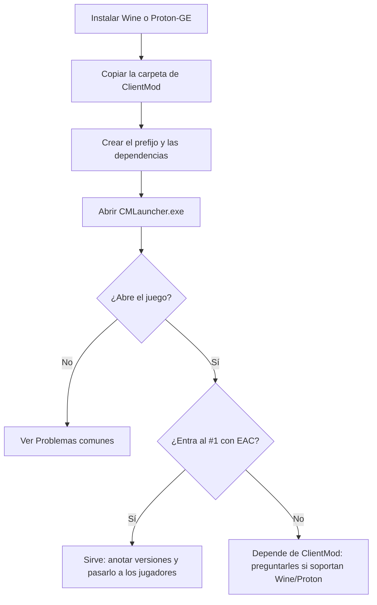

# ClientMod en Linux: guía paso a paso

ClientMod (CS:S v34, de [clientmod.ru](https://clientmod.ru)) solo existe para Windows y no tenemos su código, así que no se puede compilar para Linux. Lo que se puede hacer es correr la versión de Windows con **Wine/Proton**. Esta guía explica cómo hacerlo y cómo comprobar si sirve para jugar en nuestros servidores.

> **Sin probar todavía.** Los pasos son los habituales para un juego de Source en Wine, pero nadie del equipo los probó con ClientMod. El paso 6 (EAC) decide si sirve o no: hacelo antes de recomendárselo a los jugadores.



## Qué hace falta

- Una distribución de Linux al día (Ubuntu 24.04, Fedora, Arch, Mint…) con los drivers de video instalados:
  - **NVIDIA:** el driver propietario.
  - **AMD o Intel:** Mesa, que viene con la distribución.
- La carpeta de ClientMod de Windows (`CSSv34_ClientMod`, la que tiene `CMLauncher.exe`). Se puede copiar de una PC con Windows o bajar el instalador de clientmod.ru e instalarlo con Wine (paso 3).
- Unos 10 GB libres.

## 1. Instalar Wine

Hay dos caminos. **El A es el más fácil.**

### A. Con Lutris (recomendado)

1. Instalar Lutris:
   - Ubuntu o Mint: `sudo apt install lutris`
   - Fedora: `sudo dnf install lutris`
   - Arch: `sudo pacman -S lutris`
   - En cualquiera: el Flatpak `net.lutris.Lutris`.
2. Abrir Lutris una vez. Descarga solo su versión de Wine y lo que necesita para DXVK.
3. En **Preferencias › Runners › Wine**, instalar también una versión **wine-ge** o **GE-Proton**, que trae arreglos para juegos.

### B. Con Steam (Proton)

1. Instalar Steam y entrar con la cuenta.
2. Instalar **ProtonUp-Qt** (Flatpak `net.davidotek.pupgui2`) y bajar con él la última **GE-Proton**.
3. Reiniciar Steam.

## 2. Ubicar la carpeta del juego

Copiar `CSSv34_ClientMod` a una carpeta fija sin espacios ni tildes, por ejemplo:

```
~/Juegos/CSSv34_ClientMod/
```

Revisar que adentro estén `CMLauncher.exe`, `hl2.exe` y la carpeta `cstrike/`.

## 3. Crear el juego en Lutris (camino A)

1. **+ › Agregar un juego instalado localmente**.
2. Pestaña **Información del juego**:
   - Nombre: `CS:S v34 ClientMod`.
   - Runner: **Wine**.
3. Pestaña **Opciones del juego**:
   - Ejecutable: `~/Juegos/CSSv34_ClientMod/CMLauncher.exe`.
   - Directorio de trabajo: `~/Juegos/CSSv34_ClientMod`.
   - Prefijo de Wine: `~/Juegos/prefijo-clientmod` (una carpeta nueva, solo para esto).
   - Arquitectura del prefijo: **32 bits** si Lutris lo deja elegir, porque el v34 es un juego de 32 bits. Si no, 64 también suele andar.
4. Pestaña **Opciones del runner**:
   - Versión de Wine: la wine-ge/GE-Proton del paso 1.
   - **DXVK activado** (pasa el DirectX 9 del juego a Vulkan; anda mejor).
5. Guardar.

Si no tenés la carpeta del juego y tenés el **instalador** de clientmod.ru: en el menú del juego elegido, **Ejecutar un EXE en el prefijo de Wine** y elegir el instalador. Instalá en `C:\CSSv34_ClientMod` (va a quedar dentro del prefijo, en `drive_c/`) y después apuntá el ejecutable ahí.

### Camino B (Steam)

1. **Juegos › Añadir un juego que no es de Steam** y elegir `CMLauncher.exe`. Si el diálogo no muestra los `.exe`, elegí "Todos los archivos".
2. En el juego agregado: **Propiedades › Compatibilidad**, tildar **Forzar el uso de una herramienta de compatibilidad** y elegir **GE-Proton**.
3. En **Propiedades › Opciones de lanzamiento** no hace falta poner nada todavía.

## 4. Dependencias de Windows

Probá primero sin nada: con DXVK muchas veces alcanza. Si el launcher no abre, falta una ventana o el juego se cierra al arrancar, instalar con **winetricks** (en Lutris, menú del juego › **Winetricks**; en Steam, con **protontricks** y el ID del juego agregado):

| Paquete | Para qué |
|---|---|
| `vcrun2005`, `vcrun2008`, `vcrun2010` | Librerías de C++ que usan el v34 y el launcher |
| `d3dx9` | DirectX 9 (si no se usa DXVK o falta alguna `d3dx9_*.dll`) |
| `dotnet40` o `dotnet48` | Solo si el launcher de ClientMod está hecho en .NET y no abre |
| `corefonts` | Si los textos del launcher se ven mal o vacíos |

Instalá de a uno y probá después de cada uno, así sabés cuál hizo falta y lo anotás.

## 5. Primer arranque

1. Abrir el juego desde Lutris o Steam. Tiene que aparecer el launcher de ClientMod.
   - En Windows el launcher pide administrador. En Wine no hay UAC: se abre sin preguntar.
2. Apretar **Jugar**. Tiene que abrirse la ventana "CS:S v34 ClientMod".
3. En el juego:
   - **Opciones › Video:** la resolución del monitor, pantalla completa o "ventana sin bordes".
   - Activar la consola (**Opciones › Teclado › Avanzado**) y probar que abre con la tecla a la izquierda del `1`.
4. Si se ve mal o va lento, probar las opciones de lanzamiento en el launcher o en las propiedades del juego:
   ```
   -novid -dxlevel 90 -fullscreen
   ```

## 6. Probar en nuestros servidores (el paso clave)

1. Con el juego abierto, en la consola:
   ```
   connect 190.104.34.3:27022
   ```
   (es el #1; si tiene contraseña, antes `password <contraseña>`).
2. Fijarse en lo que pase:
   - **Entra y se puede jugar:** el EAC de ClientMod acepta Wine. Seguí con el paso 7.
   - **Lo echa por EAC o el anticheat no arranca:** el EAC de ClientMod no está habilitado para Linux. **Esto no lo podemos arreglar nosotros.** Solo los de ClientMod pueden activar el soporte de EAC para Wine/Proton. Hay que escribirles (Discord o foro de clientmod.ru) y preguntarles si lo soportan o piensan hacerlo.
   - **Entra pero el servidor lo marca como "Original client"** (lo dice el log de SourceMod con `clientmod_logging 1`): el juego anda, pero el servidor no reconoce ClientMod. Eso va a ClientMod también.
3. Jugar una partida de prueba: humo (`clientmod_smoke_type 2`), sonidos, killfeed con íconos y FPS estables (con `fps_max 600` en el servidor, revisar que no tenga tirones).

## 7. Si funciona: dejarlo documentado

Anotar en esta guía, en una tabla, lo que anduvo:

| Dato | Valor |
|---|---|
| Distribución y versión | |
| Placa de video y driver | |
| Lutris o Steam | |
| Versión de Wine/Proton | |
| DXVK (sí/no, versión) | |
| Dependencias de winetricks que hicieron falta | |
| Versión de ClientMod | |
| ¿EAC OK? | |
| Fecha de la prueba y quién la hizo | |

Con eso se le puede pasar la guía a un jugador. Si a alguien no le anda, lo primero es comparar con esta tabla.

## Problemas comunes

| Síntoma | Qué probar |
|---|---|
| El launcher no abre o se cierra solo | `dotnet48` y `vcrun2010` con winetricks; otra versión de wine-ge |
| Pantalla negra al apretar Jugar | Activar o desactivar DXVK; `-dxlevel 90` en las opciones de lanzamiento |
| El juego abre, pero en una ventana chica o en otra pantalla | `-fullscreen -w <ancho> -h <alto>`; en Lutris, "Escritorio virtual" desactivado |
| Textos vacíos o cuadraditos | `corefonts` |
| Sin sonido | `sudo apt install pipewire-alsa` (o el paquete de PulseAudio de la distribución); en winetricks, `sound=pulse` |
| Tirones cada tanto | Esperar a que DXVK compile los shaders (mejora tras unos minutos); desactivar el compositor del escritorio en pantalla completa |
| Lo echa al conectar por EAC | No se arregla de nuestro lado: ver el paso 6 |
| El mouse se escapa de la ventana | Pantalla completa en lugar de ventana; en Lutris, desactivar "Escritorio virtual" |
