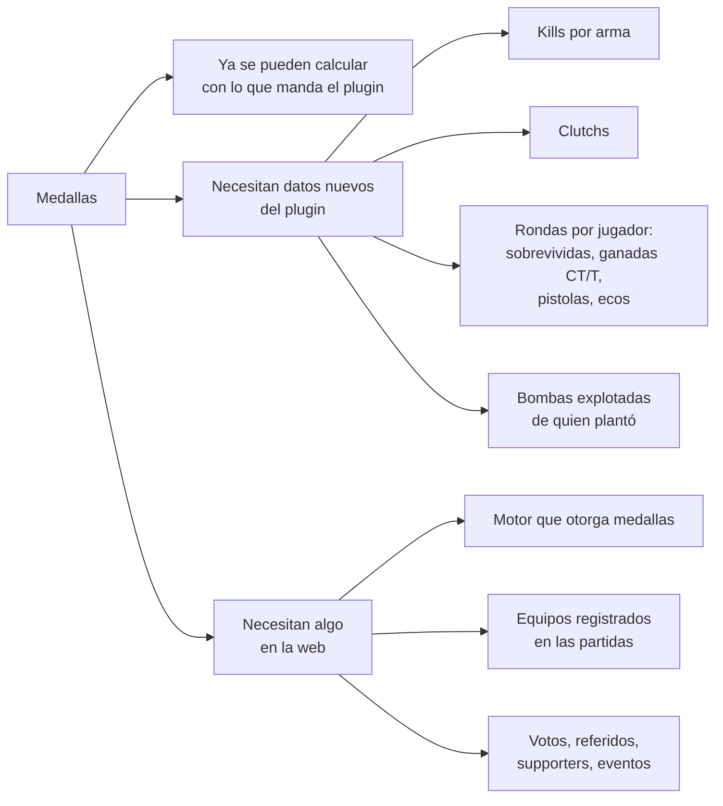

# Medallas: qué datos necesitamos del `csstv_reporter`

Documento para Daniel. Kyan armó las medallas SVG del perfil y de los equipos de CM League (en `Pictures\CM-League-Logo\CMLeague_medallas_editables_SVG\`, carpetas `perfil/`, `equipos/` y `nuevas/`). Para poder otorgarlas automáticamente, la web tiene que tener los datos de cada una. Este documento cruza cada medalla con lo que el plugin ya manda y dice qué falta agregar.

Revisado contra el plugin **1.8.0** (`server/addons/sourcemod/scripting/csstv_reporter.sp`, `csstv/stats.inc` y `csstv/json.inc`) el 2026-10-29. Es una propuesta: no hay nada implementado.

## Resumen

- **Ya alcanza con lo que hay:** la mayoría (victorias, kills, daño, HS, KDA, ADR, entry, 4K, aces, plantadas, defuses, mapas, rachas, temporadas, ELO, barrida, remontada, muro CT/T, pistolas 2-0, overtime). Lo hace la web con los resultados que ya se guardan.
- **Hay que agregar al plugin:** kills por arma, clutchs, cuatro contadores por ronda (sobrevividas, ganadas de CT, ganadas de T, pistolas ganadas, ecos ganados) y bombas explotadas.
- **Hay que hacer en la web:** el motor que revisa los resultados y otorga las medallas, y algunas medallas que no salen del juego (fair play, reclutador, supporter, eventos, staff y caster).

## Lo que el plugin ya manda (schema 1)

Por partida: `map`, `started_at`, `ended_at`, `max_rounds`, `overtimes`, `status`, `end_reason`, equipos `a` y `b`, `demo`, marcador final, ganador y el **registro de rondas** (`n`, `winner`, `a_side`, `reason`).

Por jugador: `steamid`, `name`, `team`, `rounds`, `kills`, `deaths`, `assists`, `headshots`, `damage`, `k1`…`k5`, `first_kills`, `first_deaths`, `plants`, `defuses`, `teamkills`, `suicides`.

## Medalla por medalla

**Estado:** ✅ ya se puede calcular · 🔌 falta en el plugin · 🌐 falta en la web

### Perfil

| Medalla | De dónde sale | Estado |
|---|---|---|
| Mixes jugados, victorias, racha de victorias, primer mix, primera victoria | Partidas del jugador y `winner` | ✅ |
| Veterano (temporadas), fundador (jugó la S1) | Fechas de las partidas | ✅ |
| Kills totales, daño total | `kills`, `damage` acumulados | ✅ |
| % HS, KDA, ADR | `headshots`, `kills`, `deaths`, `assists`, `damage`, `rounds` | ✅ |
| Entry kills | `first_kills` | ✅ |
| 4K, aces | `k4`, `k5` | ✅ |
| Plantadas, defuses | `plants`, `defuses` | ✅ |
| ELO máximo | Historial de ELO de la web | ✅ |
| Maestro de mapa (victorias por mapa) | `map` + `winner` | ✅ |
| MVP del mix | La web elige al mejor de cada partida con una fórmula (por ejemplo rating o ADR + kills). **Hay que definir la fórmula** | 🌐 |
| Premios de temporada: top fragger, rey del HS, mejor AWP, más mejorado, MVP, top 10 | Ranking de la temporada. Mejor AWP necesita kills por arma | ✅ / 🔌 (AWP) |
| Clutch (1vX ganados) | No se registra | 🔌 |
| Kills con AWP, Scout, Deagle, AK/M4, cuchillo, HE, SMG, escopetas, Famas/Galil, Elites | No se registra el arma | 🔌 |
| Rondas de pistola ganadas | Se puede sacar del registro de rondas + equipo del jugador, pero falla si cambia de equipo en la partida. Mejor contarlo en el plugin | 🔌 (recomendado) |
| Bombas explotadas | Solo hay `plants`; falta saber cuáles explotaron | 🔌 |
| Rondas ganadas de CT / de T | Igual que pistolas: mejor por jugador en el plugin | 🔌 (recomendado) |
| Ecos ganados | Hace falta saber cuánto valía el equipo al empezar la ronda | 🔌 |
| Rondas sobrevividas | No se registra | 🔌 |
| Prestigio | Regla de la web (completar la progresión y reiniciar) | 🌐 |
| Fair play, reclutador, supporter, caster, staff, eventos y aniversario | No salen del juego: votos, referidos o carga manual del admin | 🌐 |
| Pionero (jugó el primer mix de la plataforma) | Jugadores de la primera partida guardada (la de `started_at` más viejo). Se otorga una sola vez | ✅ |
| Beta tester | Lista cargada a mano por un admin | 🌐 |

### Equipos

| Medalla | De dónde sale | Estado |
|---|---|---|
| Partidas, victorias, racha, temporadas, ELO, fundador | Partidas del equipo | 🌐 (ver nota) |
| Campeón, finalista, semifinal, participante, bicampeón, tricampeón, invicto | Torneos de la web | 🌐 |
| Barrida 16-0 | Marcador final | ✅ + nota |
| Remontada (ganar después de ir 8 rondas abajo) | Registro de rondas (marcador ronda a ronda) | ✅ + nota |
| Muro CT / Asalto T (mitad 15-0 o casi) | Registro de rondas (`a_side` + `winner`) | ✅ + nota |
| Pistolas 2-0 | Rondas 1 y primera del segundo tiempo | ✅ + nota |
| Overtime | `overtimes` > 0 y ganador | ✅ + nota |
| Química (los 5 con K/D positivo) | Stats de cada jugador del equipo | ✅ + nota |
| Matagigantes, rivalidad, top 3, top 10, mejor equipo, plantel estable, fortaleza por mapa | Ranking y partidas del equipo | 🌐 |

**Nota sobre equipos:** hoy el plugin nombra los equipos "Equipo <nick>" y en los mixes se arman al azar. Las medallas de equipo solo tienen sentido en partidas entre equipos registrados (torneos y PCW). Hace falta que cada partida quede asociada a los equipos de la web, ya sea porque el plugin recibe el equipo (por ejemplo desde la configuración del torneo) o porque la web vincula la partida con el partido del torneo. **Decisión pendiente para Daniel.**

## Cambios propuestos en el plugin

Todo va como claves nuevas en el JSON. Se puede subir `schema` a 2; la web tiene que seguir aceptando el 1.

### 1. Kills por arma

- **Dónde:** `Event_PlayerDeath` ya recibe el evento; el campo `weapon` de `player_death` trae el nombre (`awp`, `scout`, `deagle`, `ak47`, `m4a1`, `knife`, `hegrenade`, `glock`, `usp`, `elite`, `mp5navy`, `p90`, `ump45`, `tmp`, `mac10`, `m3`, `xm1014`, `famas`, `galil`, etc.).
- **Qué guardar:** un contador por jugador y por arma (solo kills a enemigos, igual que `ST_KILLS`).
- **JSON:** `"weapon_kills": {"awp": 12, "deagle": 3, ...}`, solo con las armas que tienen kills, para no agrandar el payload.
- **Opcional:** HS por arma (`"weapon_hs"`), por si más adelante hay medallas de "HS con Deagle".

### 2. Clutchs

- **Regla propuesta:** cuando un jugador queda como el único vivo de su equipo, se anota contra cuántos enemigos vivos quedó (N). Si su equipo gana la ronda y N ≥ 1, cuenta como clutch 1vN ganado.
- **Dónde:** en `player_death` (recalcular vivos por equipo) y en `round_end`.
- **JSON:** `"clutches": {"1v1": 2, "1v2": 1, "1v3": 0, "1v4": 0, "1v5": 0}`, o solo el total `"clutches_won"` si alcanza. Las medallas usan el total, pero el desglose sirve para el perfil.
- **Duda para Daniel:** ¿cuenta un 1v1? En la medalla se usa el total.

### 3. Contadores por ronda y por jugador

Se calculan en `Stats_RoundEnd`, que ya recorre a los jugadores al terminar cada ronda.

| Clave JSON | Qué cuenta |
|---|---|
| `rounds_survived` | El jugador estaba vivo al terminar la ronda |
| `rounds_won_ct` | Ganó la ronda jugando de CT |
| `rounds_won_t` | Ganó la ronda jugando de T |
| `pistol_won` | Ganó una ronda de pistola: la primera de cada mitad del reglamentario (las de prórroga no, porque empiezan con plata de prórroga) |
| `eco_won` | Ganó una ronda en la que su equipo era eco (ver punto 4) |

### 4. Ecos

- **Regla propuesta:** al terminar el freezetime (`round_freeze_end`), sumar el valor del equipo de cada jugador (armas, chaleco y casco, granadas y kit) con una tabla de precios. Si el promedio de su equipo está por debajo de un umbral (por ejemplo $1500) y el del rival por encima de otro (por ejemplo $3500), la ronda es eco para ese equipo.
- **Excluir** las rondas de pistola.
- **En v34** no hay un netprop de valor de equipo, así que hay que calcularlo con lo que tiene cada jugador. Los umbrales podrían ser cvars (`csstv_eco_max`, `csstv_eco_rival_min`).

### 5. Bombas explotadas

- **Dónde:** `Event_BombPlanted` guarda quién plantó; `Event_BombExploded` ya existe y suma uno a ese jugador.
- **JSON:** `"bombs_exploded": 3`.

### 6. Lo que no se puede en v34

Para que no se piense en medallas que después no se pueden otorgar:

- **Flashes efectivas (flash assists):** `player_blind` llegó con la versión Orange Box. En v34 creemos que no existe; habría que confirmarlo en el servidor de pruebas.
- **Wallbang, noscope, kills a través del humo:** `player_death` de v34 no trae esos campos.

## Lo que falta en la web

1. **Motor de medallas:** después de guardar cada partida (o con un proceso nocturno), revisar los acumulados del jugador y del equipo y otorgar las medallas y los niveles que correspondan.
2. **Modelo de datos:** hoy `player_medals` tiene `title`, `icon` y `color`. Para estas medallas hace falta guardar la clave de la medalla (`kills`, `awp`, `mapa_dust2`…), el nivel (bronce a diamante), la temporada cuando aplica y la fecha. También una tabla equivalente para equipos.
3. **Íconos:** cada SVG tiene un nombre fijo (`awp_500.svg`, `bloqueada_awp_500.svg`, `equipo_campeon.svg`…), así que la clave de la medalla y el nivel alcanzan para elegir el archivo.
4. **Medallas que no salen del juego:** votos de fair play al final del mix, un sistema de referidos (reclutador), una marca de supporter y la carga manual por un admin para eventos, caster y staff.
5. **Fórmula del MVP del mix** y la regla de prestigio.

## Preguntas abiertas para Daniel

1. ¿Cómo se asocia una partida a equipos registrados (para las medallas de equipo)?
2. ¿Qué fórmula se usa para el MVP del mix?
3. ¿Los clutchs cuentan desde 1v1 o desde 1v2?
4. ¿Qué umbrales de plata definen una ronda eco?
5. ¿Las medallas se calculan al guardar cada partida o con un proceso periódico?
