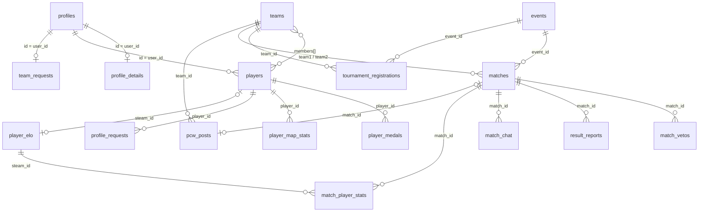

# Modelo de datos (Supabase)

> El esquema vive sólo en el proyecto Supabase (`wmzfwsizashpszxlvpeb`), no en este repositorio.
> Todas las tablas (✔) salen del export de `information_schema`, las políticas de `pg_policies` y las funciones de `pg_proc`.

## Diagrama

## Tablas confirmadas

### `events` ✔ (torneos)

| Columna | Tipo | Null | Default | Notas |
|---|---|---|---|---|
| `id` | uuid | no | `gen_random_uuid()` | |
| `name` | text | no | | |
| `starts_on`, `ends_on` | date | sí | | |
| `format` | text | sí | `'playoffs'` | `playoffs`/`single`, `double`, `rr`, `groups`, `swiss` (heredado, sin fixture) |
| `stage` | text | sí | `'Inscripciones'` | `Inscripciones` \| `En curso` \| `Finalizado` |
| `prize`, `rules` | text | sí | | |
| `min_teams`, `max_teams` | int | sí | | |
| `best_of`, `final_bo` | int | no | `1` | |
| `group_count`, `advance` | int | no | `2` | Sólo formato grupos |
| `double_rr` | bool | no | `false` | Ida y vuelta |
| `generated` | bool | no | `false` | Fixture generado |
| `champion` | uuid | sí | | Equipo campeón |
| `seeds` | uuid[] | no | `'{}'` | Orden de siembra |

### `matches` ✔

| Columna | Tipo | Null | Default | Notas |
|---|---|---|---|---|
| `id` | uuid | no | `gen_random_uuid()` | En fixtures lo genera el cliente |
| `kind` | text | no | `'official'` | `official` \| `pcw` |
| `event_id` | uuid | sí | | null = partida suelta |
| `stage` | text | sí | | `group`, `ko`, `upper`, `lower`, `grand`; null = manual |
| `grp`, `round`, `pos` | int | sí | | Posición en el fixture |
| `team1`, `team2` | uuid | sí | | null = por definir |
| `dead1`, `dead2`, `bye` | bool | no | `false` | Huecos y pases automáticos |
| `next_win`, `next_lose` | uuid | sí | | Partida destino de ganador / perdedor |
| `next_win_slot`, `next_lose_slot` | int | sí | | 1 o 2 |
| `best_of` | int | no | `1` | |
| `status` | text | no | `'upcoming'` | `upcoming` \| `live` \| `finished` |
| `score1`, `score2` | int | sí | | Mapas ganados de la serie |
| `maps` | jsonb | sí | | `[{map, r1, r2}]` |
| `winner` | uuid | sí | | |
| `map` | text | sí | | Mapas jugados, separados por coma |
| `starts_at` | timestamptz | sí | | |
| `server_ip`, `demo_url`, `video_url` | text | sí | | |
| `lineup1`, `lineup2` | uuid[] | no | `'{}'` | **No usadas por el front** |
| `played_at` | timestamptz | sí | | **No usada por el front** |

### `match_vetos` ✔
`id` uuid PK · `match_id` uuid · `seq` int · `team_id` uuid · `map` text · `action` text (`ban`/`pick`) · `by_user` uuid · `created_at` timestamptz (`now()`). Todas NOT NULL.

### `match_chat` ✔
`id` serial · `match_id` uuid · `user_id` uuid · `user_email` text · `message` text (NOT NULL) · `created_at` timestamptz · `tag` text (**no usada por el front**). Trigger `chat_rate_limit`: 1 mensaje cada 2 s por usuario.

### `pcw_posts` ✔
`id` uuid · `team_id` uuid · `by_user` uuid · `best_of` int (`1`) · `maps` text · `starts_at` timestamptz · `note` text · `status` text (`'open'`; luego `matched` o `cancelled`) · `match_id` uuid (partida creada al aceptar) · `created_at` timestamptz.

### `player_medals` ✔
`id` uuid · `player_id` uuid · `title` text · `icon` text (`'🏆'`) · `color` text (`'#4a9be8'`, **no usada por el front**) · `created_at`.

### `player_map_stats` ✔
`id` serial · `player_id` uuid · `map_name` text · `rating` numeric · `kd` numeric · `maps` int.

### `match_player_stats` ✔ — sin uso en el front
`id` serial · `match_id` uuid · `steam_id` text · `team` int · `kills`, `deaths`, `assists`, `headshots`, `damage` int · `created_at`. Parece pensada para importar estadísticas desde el servidor de juego.

### `player_claims` ✔ — sin uso en el front
`id` uuid · `user_id` uuid · `player_id` uuid · `status` text (`'pending'`) · `created_at`. Cumple la misma función que `profile_requests`; probablemente es una versión anterior.

### `profiles` ✔
Una fila por usuario de Auth, creada por el trigger `handle_new_user`.

| Columna | Tipo | Null | Default | Notas |
|---|---|---|---|---|
| `id` | uuid | no | | = `auth.users.id` |
| `role` | text | no | `'user'` | `'admin'` habilita los paneles |
| `tag` | text | sí | | Nickname (2–24). Se cambia con `set_my_tag` |
| `updated_at` | timestamp (sin zona) | sí | | |
| `player_id` | uuid | sí | | **No usada por el front** (el vínculo real es `players.user_id`) |

### `public_profiles` ✔ (vista)
`id`, `tag`. Permite que todos vean los tags sin exponer `role`. La tabla `profiles` en sí sólo deja leer el propio perfil.

### `profile_details` ✔
`user_id` uuid (NOT NULL) · `avatar_url`, `real_name`, `country`, `game_role`, `steam`, `faceit`, `discord` text · `joined_at`, `last_seen` timestamptz · `updated_at` timestamptz (`now()`).

### `players` ✔

| Columna | Tipo | Null | Default | Notas |
|---|---|---|---|---|
| `id` | uuid | no | `gen_random_uuid()` | |
| `nick` | text | no | | Se usa en la URL `#jugador/<nick>` |
| `photo_url` | text | sí | | Bucket `photos` |
| `rating`, `kd`, `hs`, `adr` | numeric | sí | | |
| `maps`, `wins`, `losses` | int | sí | | |
| `team_history`, `achievements`, `bio` | text | sí | | Texto libre; historial = una línea por equipo |
| `privacy` | text | no | `'public'` | `public` \| `members` \| `private` |
| `user_id` | uuid | sí | | Cuenta vinculada |

### `teams` ✔

| Columna | Tipo | Null | Default | Notas |
|---|---|---|---|---|
| `id` | uuid | no | `gen_random_uuid()` | |
| `name` | text | no | | |
| `tag` | text | sí | | Sigla (`PCW` en equipos de práctica) |
| `owner_id`, `captain_id` | uuid | sí | | Usuarios |
| `members` | uuid[] | no | `'{}'` | Ids de `players` |
| `kind` | text | no | `'official'` | `official` \| `pcw` |
| `guests` | text[] | no | `'{}'` | Tags invitados (equipos PCW) |

### `team_requests` ✔
`user_id` uuid (NOT NULL, una por usuario) · `name` text (NOT NULL) · `tag` text · `status` text (`'pending'`; `approved`/`rejected`).

### `tournament_registrations` ✔
`id` uuid · `event_id` uuid · `team_id` uuid · `created_at` timestamptz.

### `result_reports` ✔

| Columna | Tipo | Null | Default |
|---|---|---|---|
| `id` | uuid | no | `gen_random_uuid()` |
| `match_id`, `team_id`, `by_user` | uuid | no | |
| `maps` | jsonb | no | | 
| `lineup` | uuid[] | no | `'{}'` |
| `proof` | text[] | no | `'{}'` |
| `note` | text | sí | |
| `created_at`, `updated_at` | timestamptz | no | `now()` |

El front hace `upsert` con `onConflict: 'match_id,team_id'`, así que debe existir un UNIQUE sobre esas columnas.

### `profile_requests` ✔
`id` uuid · `player_id` uuid · `user_id` uuid · `status` text (`'pending'`) · `created_at` timestamptz. Todas NOT NULL.

## Funciones (confirmadas)

Todas las que modifican datos son `SECURITY DEFINER` con `search_path = public`.

### Llamadas desde el front (RPC)

| Función | Qué valida y hace |
|---|---|
| `set_my_tag(p_tag)` | Requiere sesión; tag de 2–24 caracteres; inserta o actualiza `profiles.tag`. |
| `set_team_captain(p_team, p_user)` | Sólo el capitán actual o un admin. Si no es admin, el nuevo capitán debe ser un jugador del plantel con cuenta vinculada. |
| `create_pcw_post(p_name, p_best_of, p_maps, p_starts_at, p_note, p_players, p_guests)` | Limpia anuncios viejos (`pcw_cleanup`); BO1/3/5; **un anuncio abierto por usuario** y **máx. 6 por día**; crea el equipo PCW (`pcw_make_side`) y el anuncio. Corta mapas a 120 y nota a 200 caracteres. |
| `accept_pcw(p_post, p_name, p_players, p_guests)` | Bloquea el anuncio (`FOR UPDATE`); no se puede aceptar el propio; rechaza jugadores o tags repetidos entre ambos rosters; crea la partida `kind='pcw'` y marca el anuncio `matched`. Devuelve el id de la partida. |
| `cancel_pcw_post(p_post)` | Autor o admin, sólo si sigue `open`; borra el anuncio y su equipo PCW si no tiene partidas. |
| `cancel_pcw_match(p_match)` | Capitanes o admin, sólo si no terminó; marca el anuncio `cancelled`, borra la partida y los equipos PCW huérfanos. |

### Auxiliares

| Función | Uso |
|---|---|
| `is_admin()` | `profiles.role = 'admin'` del usuario actual. Usada en casi todas las políticas. |
| `is_team_captain(team)` / `is_match_captain(match)` | Si el usuario es capitán del equipo / de alguno de los dos equipos de la partida. |
| `pcw_make_side(name, players, guests)` | Crea el equipo PCW: roster de 1–7, jugadores existentes y sin repetir, tags de 2–24 sin `<>` ni repetidos. Nombre por defecto "Pick de <tag>", sigla `PCW`. |
| `pcw_cleanup()` | Borra equipos PCW de anuncios abiertos de más de 7 días sin partidas. (El anuncio en sí queda.) |
| `norm_maps(jsonb)` | Normaliza mapas para comparar reportes (minúsculas, sin espacios, orden). |

### Triggers

| Función | Tabla (inferida) | Qué hace |
|---|---|---|
| `handle_new_user` | `auth.users` AFTER INSERT | Crea `profiles` (tag de los metadatos del registro o `user_xxxxxx`) y `profile_details` con `joined_at`. |
| `chat_rate_limit` | `match_chat` BEFORE INSERT | Rechaza si el usuario escribió hace menos de 2 s. |
| `validate_report` | `result_reports` BEFORE INSERT/UPDATE | La partida debe tener ambos equipos y no estar terminada; el equipo debe jugarla; 1–5 mapas y no más que el BO; rondas 0–99; alineación ≤ 7 y **subconjunto del plantel**; ≤ 3 capturas y todas del bucket `proofs`. |
| `autoapply_pcw` | `result_reports` AFTER INSERT/UPDATE | **En PCW, si los dos reportes coinciden y no hay empate, cierra la partida automáticamente** (estado, mapas, marcador, ganador). Las partidas oficiales siguen requiriendo aprobación de un admin. |

## Storage

| Bucket | Ruta | Lectura | Subida | Borrado |
|---|---|---|---|---|
| `avatars` | `<user_id>/<ts>.jpg` | Pública | El dueño de la carpeta | El dueño (también puede actualizar) |
| `photos` | `p<base36 ts>` | Pública | Admin | Admin |
| `proofs` | `<match_id>/<user_id>-<ts>-<i>.jpg` | Pública | Capitán de la partida, si no terminó | Admin |

## Match Reporter (migración `20261011120000_csstv_match_reporter.sql`)

Cambios para recibir los mixes del servidor. Detalle de instalación en [GUIA_SERVIDOR.md](GUIA_SERVIDOR.md).

| Objeto | Cambio |
|---|---|
| `matches.kind`, `teams.kind` | Nuevo valor `mix`. Cada mix crea dos equipos `mix` temporales; `score1/score2` guardan **rondas**. |
| `matches` | `external_id` (UNIQUE, `match_uid` del plugin) y `server_id`. |
| `players` | `steam_id` (SteamID64, UNIQUE) y `stats_auto` (recalcular stats desde los mixes). |
| `match_player_stats` | `player_id`, `nick`, `rounds`, `k1`–`k5`, `first_kills`, `first_deaths`, `plants`, `defuses`, `teamkills`, `suicides`, `rating`; UNIQUE (`match_id`, `steam_id`); FK a `matches` con borrado en cascada; RLS (lectura pública, escritura admin). |
| `game_servers` | Servidores autorizados: `name`, `token_hash` (SHA-256), `active`, `last_seen_at`. Solo admin. |
| `ingest_chunks` | Partes en tránsito del envío; sin acceso directo. |
| `ingest_server_chunk(token, uid, part, total, data)` | Recibe el resultado en partes base64 (plugin). Devuelve el id de la partida al completar. |
| `ingest_server_match(token, payload)` | Recibe el resultado completo (script de Python). |
| `link_steam_id(steam, player)` | Admin: vincula o desvincula (`player = null`) y traslada los mixes anteriores. |
| `create_server_token(name)`, `rotate_server_token(server)` | Admin: alta de servidor y cambio de token. |
| `recompute_player_stats(player)` | Recalcula rating (HLTV 1.0), K/D, HS %, ADR, mapas, victorias y derrotas. |

## ELO de jugadores (migración `20261011180000_player_elo.sql`)

Detalle de reglas y fórmulas en la [bitácora](bitacora/2026-10-11-elo-jugadores/DOCUMENTACION.md).

| Objeto | Cambio |
|---|---|
| `player_elo` | Nueva. `steam_id` (PK, SteamID64) · `elo` int (`1000`, ≥ 100) · `peak_elo` int (`1000`) · `mu` (`25`) y `sigma` (`8.333`) double precision (TrueSkill) · `matches` int (`0`) · `updated_at`. RLS: lectura pública, sin escritura directa. Se une a `players` por `steam_id`. |
| `match_player_stats` | `elo_before`, `elo_after`, `elo_delta` int y `win_prob` numeric (probabilidad de victoria de su equipo). `null` si el jugador no contó. |
| `elo_apply_match(match)` | Interna. Aplica un mix terminado: TrueSkill para la probabilidad, ±30 base, bonus ±5 por rating, piso 100. Idempotente. Bloquea el mix y las filas de `player_elo`. |
| `elo_recompute_all()` | Admin (o SQL Editor). Reinicia `player_elo` y aplica todos los mixes por `played_at`. Devuelve la cantidad. |
| `ingest_server_chunk`, `ingest_server_match` | Redefinidas: después de `csstv_ingest` llaman a `elo_apply_match`. |
| `csstv_ncdf(x)`, `csstv_npdf(x)` | Normal acumulada y densidad. |

## Pendiente de confirmar

- En qué tablas está **habilitado** RLS (las políticas no se aplican si RLS está deshabilitado).
- Tabla y momento exactos de cada trigger.
- Claves primarias, foráneas, `ON DELETE` y restricciones UNIQUE.
- Si `player_claims` y `match_player_stats` siguen en uso por algún otro sistema.
