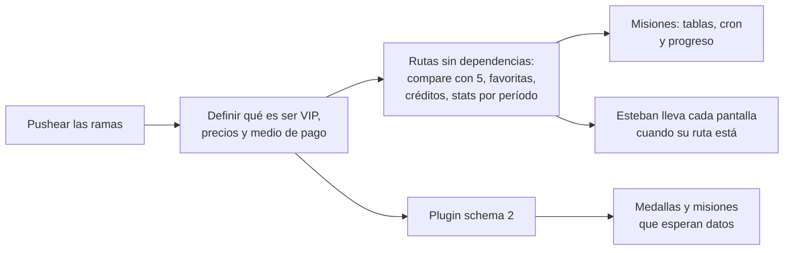

# Prototipos del 2026-10-29: qué tiene que hacer cada uno

Kyan armó hoy los prototipos de los beneficios VIP y de las misiones. Este documento junta en un solo lugar lo que le toca a cada uno. El detalle está en la bitácora de cada prototipo (enlazada en cada fila).

- **Daniel:** backend, plugin y servidores.
- **Esteban:** frontend, que incluye **todo el perfil de jugador**.

## Cómo verlos

Están en el frontend nuevo, en la copia `C:/Users/Agus/Documents/repo-mm-ejemplo`, rama `kyan/ejemplo-matchmaking`:

1. Levantar la configuración `frontend-mm-ejemplo` de `.claude/launch.json` (puerto 5173).
2. Abrir las rutas `/demo/…`.

No usan la API: los datos están en memoria. Solo existen en `pnpm dev`.

> **Las ramas no están en GitHub todavía.** `kyan/ejemplo-matchmaking` (prototipos) y `kyan/pruebas` (bitácora) están solo en la PC de Kyan. Hay que pushearlas para que Daniel y Esteban las vean.

| Prototipo | Ruta | Bitácora |
|---|---|---|
| Exportar stats en imagen o PDF | `/demo/exportar` | [`2026-10-29-exportar-stats`](bitacora/2026-10-29-exportar-stats/) |
| Buscador y filtros avanzados | `/demo/buscador` | [`2026-10-29-buscador-avanzado`](bitacora/2026-10-29-buscador-avanzado/) |
| Desglose de la fórmula de ELO | `/demo/elo` | [`2026-10-29-desglose-elo`](bitacora/2026-10-29-desglose-elo/) |
| Vista previa del próximo recálculo (cierre de temporada) | `/demo/recalculo` | [`2026-10-29-proximo-recalculo`](bitacora/2026-10-29-proximo-recalculo/) |
| Comparador de hasta 5 jugadores | `/demo/comparador` | [`2026-10-29-comparador-5`](bitacora/2026-10-29-comparador-5/) |
| Widget para la bio de Twitch y Twitter | `/demo/bio` | [`2026-10-29-widget-bio`](bitacora/2026-10-29-widget-bio/) |
| Partidas favoritas | `/demo/favoritas` | [`2026-10-29-partidas-favoritas`](bitacora/2026-10-29-partidas-favoritas/) |
| Créditos con los VIP | `/demo/creditos` | [`2026-10-29-creditos`](bitacora/2026-10-29-creditos/) |
| Stats avanzadas post-torneo, 24 h antes para VIP | `/demo/torneo-stats` | [`2026-10-29-stats-torneo`](bitacora/2026-10-29-stats-torneo/) |
| Misiones semanales y Primeros pasos | `/demo/misiones` | [`2026-10-29-misiones-semanales`](bitacora/2026-10-29-misiones-semanales/) |
| Página Hacete VIP (planes, beneficios y vencimiento) | `/demo/vip` | [`2026-10-29-hacete-vip`](bitacora/2026-10-29-hacete-vip/) |
| Configs de los jugadores | `/demo/configs` | [`2026-10-29-configs-jugadores`](bitacora/2026-10-29-configs-jugadores/) |

Del mismo día, pero de antes, están la tienda, la progresión VIP, el fondo de miniperfil y el widget para OBS. Esos tienen migraciones sin correr y están en [`PENDIENTES.md`](PENDIENTES.md) (puntos 1.5 a 1.7).

## Reglas que valen para todos

- **El VIP se chequea en el servidor.** En cada ruta de un beneficio VIP, la API ignora o no devuelve lo que es VIP si el jugador no lo es. Los prototipos ponen un candado o una marca de agua, pero eso solo es la vista: con la URL o una captura se saltea.
- **Qué es "ser VIP" está sin definir del todo:**
  - Premium y VIP como niveles, y si los meses de VIP cuentan seguidos o acumulados.
  - Qué pasa con lo ganado cuando se vence. Para las monedas y los cosméticos ya se decidió congelar; para las favoritas se propone lo mismo.
  - Ver `MEDALLAS_DATOS_REPORTER.md` y la bitácora de la progresión VIP.
  - La propuesta completa de qué pasa con cada beneficio al vencerse está en la [bitácora de Hacete VIP](bitacora/2026-10-29-hacete-vip/DOCUMENTACION.md).
- **Niveles:** los mismos pisos de ELO en el backend, la base y el frontend (`0, 501, 751, 901, 1051, 1201, 1351, 1531, 1751, 2001`). Un test del buscador (`features/search/levels.test.ts`) avisa si se desincronizan.
- **Copias de reglas de la base:** algunos prototipos copian reglas de la base en TypeScript y tienen tests. Si las reglas cambian en la base, hay que cambiarlas también ahí:
  - `features/elo/formula.ts` copia `elo_apply_match`, con los mismos redondeos de Postgres.
  - `features/season/preview.ts` copia el cierre de temporada de `24_temporadas.sql`.

## Daniel

### Rutas de la API

| Ruta | Para qué | Notas |
|---|---|---|
| Stats de un jugador por período (temporada, 30 días, histórico) | Exportar stats y widget de la bio | Devuelve lo de `ExportStats` (`features/export/demo.ts`) con `avatar_url` |
| Filtros nuevos en `GET /api/v1/ranking/players` (o `/search/players`) y en `GET /api/v1/mixes` | Buscador avanzado | Los parámetros de `searchSchema` (`features/search/filters.ts`). `levelBounds` tiene que aceptar cualquier rango de niveles |
| Búsquedas guardadas en la cuenta | Buscador avanzado | Hasta 5 por jugador |
| Desglose del ELO de cada mix del jugador | Desglose de ELO | Faltan `rating`, `rounds`, el total de rondas y el peso, o devolver directamente `base`, `bonus` y `weight` |
| Tu fila de `season_live_standings` con 3 vecinos de cada lado y las reglas de la temporada | Próximo recálculo | Más el cambio promedio por victoria y por derrota, de `match_player_elo` |
| `GET /api/v1/players/compare` con hasta 5 jugadores | Comparador | Hoy recibe `a` y `b`. Tiene que devolver `together` de cada uno contra el primero |
| `GET /api/v1/players/{nick}/card.png?f=twitch\|firma\|og&tema=…` | Widget de la bio | Imagen dinámica con caché de unos minutos |
| `cmleague.lat/embed/{nick}` y Open Graph en `cmleague.lat/{nick}` | Widget de la bio | El embed sin `X-Frame-Options: DENY` |
| `PUT` y `DELETE /api/v1/me/favorites/{match_id}` y `favorites=true` en mixes | Favoritas | |
| `GET /api/v1/credits` (pública) | Créditos | Los VIP activos con `show_in_credits` y sus meses |
| Stats del torneo por jugador | Stats post-torneo | Sin VIP, no devuelve nada hasta 24 h después de la final. La hora de corte sale del servidor. Las entradas ya existen (`first_kills`); los clutches esperan el schema 2 |
| Suscripción: medio de pago, alta y baja manual, y una sola función "¿es VIP?" (con días de gracia) | Hacete VIP y todos los beneficios | Es lo primero: todo lo demás depende de saber quién es VIP |
| Subir, ver la lista, ver el contenido y descargar configs, y la cola de moderación | Configs | Ver y descargar, solo VIP y no si está en revisión. La revisión corre en el servidor y abre los `.rar` |
| Semana del jugador, Primeros pasos, reclamar y administrar el catálogo | Misiones | Reclamar paga con el mismo registro que la tienda, con el motivo "Misión: …" |

### Tablas nuevas

| Tabla | Para qué |
|---|---|
| `match_favorites (user_id, match_id, created_at)` | Favoritas |
| `missions` | Catálogo de misiones, con la columna `once` para Primeros pasos |
| `mission_weeks (week, mission_id)` | Las misiones de cada semana, guardadas al abrirla, para que editar el catálogo no cambie semanas viejas |
| `mission_progress (user_id, week, mission_id, value, claimed_at)` | Progreso. `week` en null para Primeros pasos |
| Búsquedas guardadas y la preferencia `show_in_credits` | Buscador y créditos |
| Suscripciones (`user_id`, plan, inicio, fin, estado) y su historial | Hacete VIP |
| Configs publicadas (una por jugador, ya limpias), en un bucket de storage | Configs |

**Procesos:**

- **El cron del lunes a las 06:00 de Argentina** arma la semana de misiones con `pickWeek` (`features/missions/rotation.ts`).
- **El progreso de las misiones** se suma con cada mix guardado y con cada evento de la web, con las **reglas anti-abuso** de la [bitácora de misiones](bitacora/2026-10-29-misiones-semanales/DOCUMENTACION.md): mixes cancelados no cuentan, clips distintos, un login por día…

### Plugin: lo que hay que pedir en el schema 2

Está en [`MEDALLAS_DATOS_REPORTER.md`](MEDALLAS_DATOS_REPORTER.md). Destraba a la vez las medallas y 9 misiones que hoy esperan:

| Dato | Lo usan |
|---|---|
| `weapon_kills` (kills por arma) | Medallas por arma; misiones de AWP, Deagle y cuchillo |
| `clutches` | Medalla de clutch; dos misiones; stats del torneo |
| `rounds_survived`, `pistol_won`, `eco_won` (y `rounds_won_ct` / `rounds_won_t`) | Medallas; misiones de sobrevivir, pistolas y eco |
| `bombs_exploded` | Medalla; misión VIP |

Cuando salga, se despliega **en nuestro servidor y en RBK en la misma tanda** (RBK con el build licenciado). Del lado de la web, alcanza con sumar `"plugin_v2"` a `READY_SOURCES` en `features/missions/catalog.ts`.

### Preguntas abiertas

1. Las preguntas de `MEDALLAS_DATOS_REPORTER.md`:
   - Equipos registrados en las partidas.
   - Fórmula del MVP.
   - Clutch desde 1v1 o desde 1v2.
   - Umbrales de eco.
   - Si las medallas se calculan al guardar o con un proceso.
2. Qué es "verificado". Se propuso Steam vinculado y mail confirmado, pero el ranking VIP se descartó, así que queda para cuando haga falta.
3. Si se vence el VIP, ¿las favoritas quedan visibles sin poder marcar nuevas?

Las stats del torneo ya pueden mostrar las entradas, porque `first_kills` está en el schema 1. Los clutches no: llegan con el schema 2, y hasta entonces esa columna y ese premio no se muestran.

## Esteban

Todo lo que va en el perfil de jugador es suyo. Cada prototipo dice qué archivo hay que llevar a la web real.

| Pantalla | Dónde va | Prototipo | Espera de Daniel |
|---|---|---|---|
| Exportar stats | Botón en el perfil propio | `features/export/` (canvas y PDF sin librerías) | Stats por período |
| Buscador avanzado | `/players` (hoy es un `Placeholder`) y el listado de mixes | `features/search/` | Filtros en la API |
| Desglose de ELO | Perfil o sala del mix | `features/elo/` | Desglose por mix |
| Próximo recálculo | Perfil o arriba del ranking de la temporada | `features/season/` | Tu fila de standings |
| Comparador de 5 | `/players/compare` | `features/compare5/`: es el comparador actual con más tarjetas, así que alcanza con generalizar `CompareView` y `EloCompareChart` a N | `compare` con 5 |
| Widget de la bio | Perfil, al lado del widget para OBS | `features/bio/` | `card.png`, embed y Open Graph |
| Favoritas | Listado de mixes | `features/vip/Favorites.tsx` | Rutas de favoritas |
| Créditos | Página `/creditos` y switch en Perfil → Preferencias | `features/vip/Credits.tsx` | `GET /credits` |
| Stats post-torneo | Pestaña en `/events/$id` | `features/vip/TournamentStats.tsx` | Stats del torneo |
| Misiones | Botón con popout en la barra de arriba, página de Misiones y Admin → Misiones | `features/missions/` | Tablas, progreso, cron y rutas |
| Hacete VIP | Página `/vip` y "Mi suscripción" en la cuenta. Cambiar `VIP_URL` de `features/vip/upsell.tsx` por `/vip` | `features/vip/VipPage.tsx` y `plans.ts` | Suscripciones y medio de pago |
| Configs | Pestaña Config del perfil | `features/configs/` | Storage, revisión y rutas |

**Faltó revisar:** ninguno de estos prototipos se revisó en modo claro ni en el celular. Tampoco se probaron con datos reales.

## Orden sugerido

## Urgente, de antes de hoy

- **El deploy del Worker con la ruta `/crash` sigue pendiente desde el 2026-10-14** ([`PENDIENTES.md`](PENDIENTES.md), punto 1.1). Sin eso, cada volcado de crash del servidor se pierde. Lo tiene que correr Daniel o Kyan.
