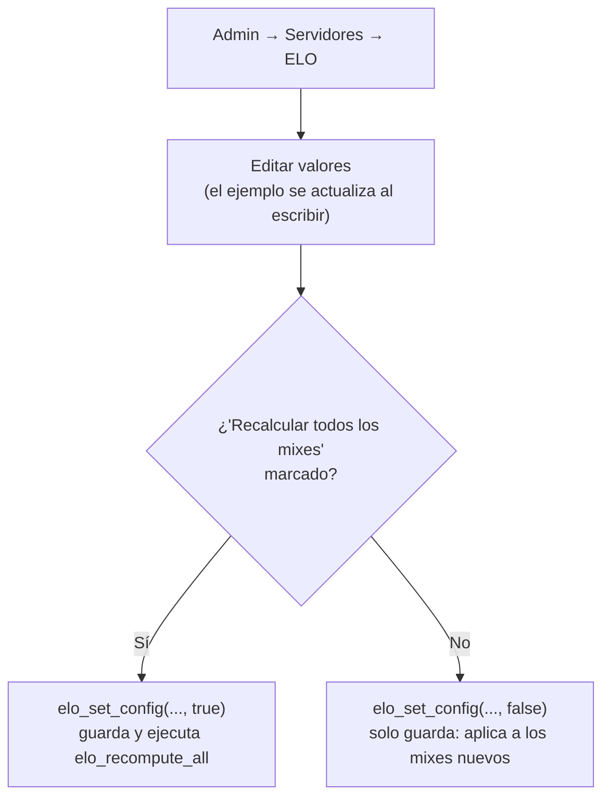

# ELO configurable: documentación

Los parámetros del cálculo del ELO viven en la tabla `elo_config` (una sola fila, `id = 1`). `elo_apply_match` los lee cada vez que aplica un mix.

## Parámetros

| Columna | Default | Rango | Efecto |
|---|---|---|---|
| `base` | 30 | 5 – 100 | Cambio con equipos parejos. Fórmula: `round(2 × base × (resultado − probabilidad))` |
| `bonus_max` | 5 | 0 – 20 | Tope del bonus por rating (0 = sin bonus) |
| `bonus_factor` | 10 | 0 – 50 | Bonus = `round((rating − 1.00) × bonus_factor)`, limitado a ±`bonus_max` |
| `elo_floor` | 100 | 0 – 1000 | El ELO nunca baja de este valor |
| `start_elo` | 1000 | 100 – 5000, ≥ `elo_floor` | ELO de un jugador nuevo (y el que muestra la web para quien no tiene mixes) |
| `updated_at`, `updated_by` | | | Último cambio y quién lo hizo |

Fijos en `elo_apply_match` (no configurables): μ₀ 25, σ₀ 8.33, β 4.17, τ 0.083 (TrueSkill), y las reglas de mínimo +1 para el ganador y −1 para el perdedor.

Los **niveles 1–10** no dependen de esta tabla: son los rangos de FACEIT, definidos en la tabla `LV` de `index.html`. Si se sube el ELO inicial, los jugadores nuevos empiezan en un nivel más alto (con 1200, nivel 5).

## Cómo se cambia

| Función | Quién | Qué hace |
|---|---|---|
| `elo_set_config(base, bonus_max, bonus_factor, floor, start_elo, recompute)` | Admin (o SQL Editor) | Valida los rangos con mensajes claros, guarda y, si `recompute`, recalcula todo. Devuelve la cantidad de mixes recalculados. |

También se puede editar desde Supabase → Table Editor → `elo_config` (los `check` de la tabla rechazan valores fuera de rango). En ese caso, para aplicarlo a los mixes ya jugados hay que correr `select elo_recompute_all();`.

**Sin recalcular**, el ELO actual de cada jugador queda como está y los mixes nuevos usan los valores nuevos. **Recalculando**, todo el historial se rehace como si siempre se hubieran usado.

## Permisos

- `elo_config`: lectura pública; sin escritura directa para `anon` ni `authenticated`.
- `elo_set_config`: `authenticated`, y dentro valida `is_admin()`.

## Cambio relacionado

El check de `player_elo.elo` pasó de `>= 100` a `>= 0` (`player_elo_elo_min`), porque el mínimo ahora es configurable.
