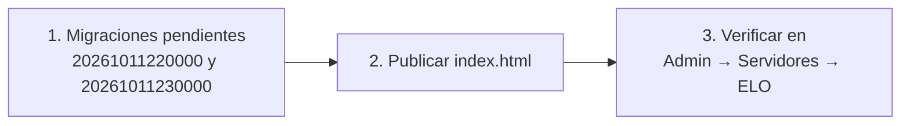

# ELO configurable: guía de implementación

## Estado

| Paso | Estado |
|---|---|
| Migración `20261011230000_elo_config.sql` | Hecha y probada en local |
| Web (`index.html`) | Hecha; sintaxis verificada; sin prueba en navegador |
| Aplicar en Supabase | Hecho (2026-10-11); `elo_config` con los valores por defecto |
| Publicar `index.html` | Hecho por FTP (2026-10-11) |

## Archivos

| Archivo | Cambio |
|---|---|
| `supabase/migrations/20261011230000_elo_config.sql` | Tabla `elo_config`, RLS, `elo_set_config`, check de `player_elo.elo` a `>= 0` y `elo_apply_match` leyendo la configuración. |
| `index.html` | Carga `elo_config` (`eloCfg`); `eloOf` usa el ELO inicial configurado; formulario en Admin → Servidores → ELO con ejemplo en vivo y casilla "Recalcular todos los mixes". |
| `docs/bitacora/2026-10-11-elo-jugadores/pruebas/pruebas_elo.sql` | Pruebas T14 a T18. |
| `docs/MODELO_DATOS.md`, `docs/FUNCIONALIDADES.md` | Tabla y función nuevas; dónde se configura el ELO. |

## Despliegue

1. **Supabase → SQL Editor**: aplicar, en orden, `20261011220000_steamid64_cuentas_nuevas.sql` (si todavía no está) y `20261011230000_elo_config.sql`. Después `select elo_recompute_all();` (para lo de las cuentas nuevas; la configuración por defecto no cambia ningún valor).
2. **Publicar `index.html`**. Si se publica antes de la migración, todos los visitantes ven el aviso "Error cargando elo_config".
3. **Verificar**: Admin → Servidores → ELO muestra 30 / 1000 / 5 / 10 / 100 y el ejemplo "gana +30 / pierde −30… con rating 1.40: +34".

## Pruebas (2026-10-11, PostgreSQL 18 local)

Las 13 pruebas anteriores del ELO pasan sin cambios con la configuración por defecto, más:

| # | Prueba | Resultado |
|---|---|---|
| T14 | Configuración por defecto | 30 / 5 / 10 / 100 / 1000 |
| T15 | Base 20 e inicio 1200 | 3v3 parejo: ±20; los nuevos empiezan en 1200 |
| T16 | Bonus 0 | +30 +30 −30 −30 con ratings 1.80 y 0.20 |
| T17 | Base 200, inicial menor que el mínimo, usuario no admin | Rechazados; `anon` solo lee la tabla |
| T18 | Guardar base 20 recalculando y volver a 30 | 12 mixes recalculados a ±20; al volver, los valores originales |

La migración se aplicó dos veces seguidas sin error (re-ejecutable).

## Revertir

Volver a los valores por defecto desde la web (30 / 5 / 10 / 100 / 1000, recalculando) deja el ELO igual que antes de este cambio. Para quitar la tabla: volver a ejecutar `20261011220000_steamid64_cuentas_nuevas.sql` (restaura `elo_apply_match` con constantes), `drop function elo_set_config(integer, integer, numeric, integer, integer, boolean); drop table elo_config;` y publicar el `index.html` anterior.
