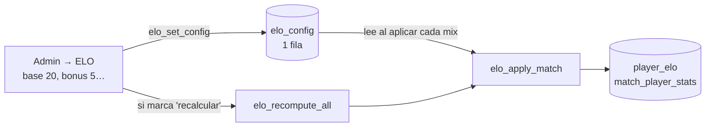

# Plan: parámetros del ELO configurables desde la web

> Planeación original, aprobada el 2026-10-11 en la conversación ("ármala con la sección en la web").

## Decisiones tomadas

| Tema | Decisión |
|---|---|
| Dónde se guardan | Tabla nueva `elo_config` con **una sola fila**. |
| Qué se configura | Base, tope del bonus, factor del bonus, ELO mínimo y ELO inicial. Los parámetros de TrueSkill (μ, σ, β, τ) quedan fijos en la función. |
| Quién la cambia | Solo admin. Lectura pública (la web la usa para mostrar el ELO inicial). |
| Dónde se edita | Supabase (Table Editor) **y** una sección **Admin → Servidores → ELO** en la web. |
| Mixes ya jugados | Al guardar se puede elegir recalcular todos (`elo_recompute_all`) o aplicar solo a los mixes nuevos. |

## Cómo funciona

## Tabla `elo_config`

| Columna | Default | Rango permitido | Qué controla |
|---|---|---|---|
| `base` | 30 | 5 – 100 | Puntos con equipos parejos: el cambio base es `2 × base × (resultado − probabilidad)` |
| `bonus_max` | 5 | 0 – 20 | Tope del bonus por rating |
| `bonus_factor` | 10 | 0 – 50 | Puntos por cada 1.00 de rating sobre o bajo 1.00 (10 → 0.10 de rating = 1 punto) |
| `elo_floor` | 100 | 0 – 1000 | ELO mínimo |
| `start_elo` | 1000 | 100 – 5000, ≥ mínimo | ELO de un jugador nuevo |
| `updated_at`, `updated_by` | | | Último cambio |

Con los valores por defecto, el ELO se calcula **exactamente igual que hoy**.

## Cambios

| Archivo | Cambio |
|---|---|
| `supabase/migrations/2026101123xxxx_elo_config.sql` | Tabla, RLS, `elo_set_config(...)` y `elo_apply_match` leyendo la configuración. Requiere `20261011220000`. |
| `index.html` | Carga `elo_config`; `eloOf` usa el ELO inicial configurado; formulario en Admin → Servidores → ELO con ejemplo en vivo y opción de recalcular. |
| Docs | `MODELO_DATOS.md`, `FUNCIONALIDADES.md` y la bitácora. |

## Pruebas

- Las 13 pruebas del ELO pasan sin cambios con la configuración por defecto.
- Base 20 → 5v5 parejo da ±20 más el bonus.
- ELO inicial 1200 → los jugadores nuevos empiezan en 1200.
- Bonus 0 → sin bonus.
- Valores fuera de rango y usuarios que no son admin → rechazados.
- Recalcular con la configuración nueva reproduce los valores esperados.
