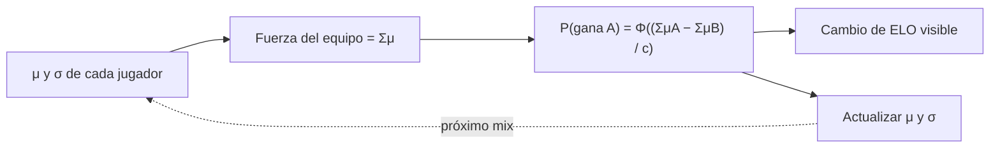
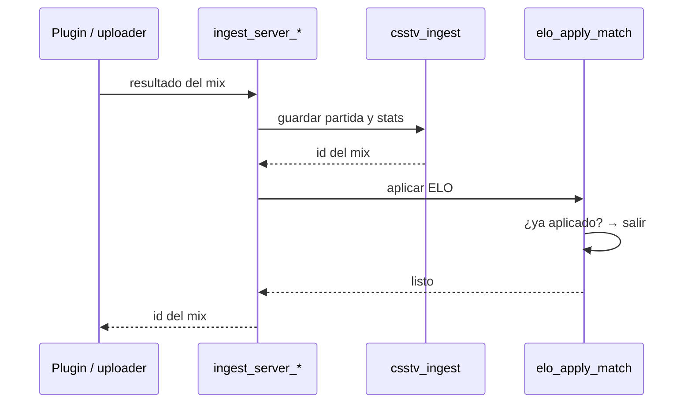

# ELO de jugadores: documentación

Cada mix reportado por el servidor cambia el ELO de los jugadores que lo jugaron. El ELO se muestra con los niveles 1–10 de FACEIT en la lista de jugadores, en el perfil y en el detalle del mix.

## Reglas

> Desde `20261011230000`, base, bonus, mínimo e inicial se configuran en la tabla `elo_config` (Admin → Servidores → ELO). Los valores de esta tabla son los por defecto. Ver [ELO configurable](../2026-10-11-elo-configurable/DOCUMENTACION.md).

| Regla | Valor |
|---|---|
| ELO inicial | 1000 (nivel 4) |
| Partidas que cuentan | Solo mixes (`matches.kind = 'mix'`, `status = 'finished'`) |
| Cambio base | `60 × (resultado − probabilidad de ganar)` → ±30 con equipos parejos |
| Bonus por rendimiento | `(rating HLTV − 1.00) × 10`, redondeado y limitado a −5 … +5 |
| Mínimos | El ganador suma al menos +1 y el perdedor resta al menos −1 |
| Piso | El ELO nunca baja de 100 |
| Empate | Resultado 0.5: solo cambia por la diferencia de probabilidad y el bonus |
| Quién recibe ELO | SteamID64 válido (`7656119` + 10 dígitos, o `765612` + 11 en las cuentas nuevas, desde `20261011220000`) y al menos 1 ronda jugada |
| Quién cuenta en la fuerza del equipo | Todos los que jugaron al menos 1 ronda. Los que no tienen SteamID64 (`STEAM_ID_LAN`, `NOSTEAM:…`, bots) cuentan como un jugador nuevo (μ 25, σ 8.33) y no reciben ELO (desde `20261011200000`) |

`resultado` vale 1 si ganó, 0.5 si empató y 0 si perdió. El rating es el HLTV 1.0 que ya calcula `csstv_rating` para cada jugador en cada mix.

## Cómo se calcula la probabilidad (TrueSkill)

Cada SteamID tiene `μ` (habilidad estimada, empieza en 25) y `σ` (incertidumbre, empieza en 8.33).



```
c = √( Σ (β² + σ² + τ²) de todos los jugadores )      β = 25/6, τ = 25/300
```

La fuerza es una **suma**, así que un equipo con un jugador más es favorito: en un 4 contra 3 entre jugadores nuevos, el de 4 tiene un 84,5 % de probabilidad: si gana suma +9 y si pierde resta −51 (sin bonus).

Después del mix, TrueSkill mueve `μ` hacia el resultado (más cuanto mayor es `σ`) y reduce `σ`. En un empate `μ` no cambia. Por eso los jugadores nuevos dejan de ser "parejos" rápido: después de un 16‑10 entre jugadores nuevos, el ganador pasa a tener ~74 % de probabilidad en la revancha y, si vuelve a ganar, recibe +12 a +15.

## Niveles

| Nivel | ELO | Color |
|---|---|---|
| 1 | hasta 500 | `#9aa0a6` |
| 2 | 501 – 750 | `#1ca82a` |
| 3 | 751 – 900 | `#1ca82a` |
| 4 | 901 – 1050 | `#e0a800` |
| 5 | 1051 – 1200 | `#e0a800` |
| 6 | 1201 – 1350 | `#e0a800` |
| 7 | 1351 – 1530 | `#e0a800` |
| 8 | 1531 – 1750 | `#ff6309` |
| 9 | 1751 – 2000 | `#ff6309` |
| 10 | 2001+ | `#e5361f` |

El nivel no se guarda en la base: lo calcula la web con la tabla `LV` de `index.html`.

## Datos

### `player_elo` (nueva)

| Columna | Tipo | Default | Notas |
|---|---|---|---|
| `steam_id` | text PK | | SteamID64 |
| `elo` | int | 1000 | `check (elo >= 100)` |
| `peak_elo` | int | 1000 | ELO máximo alcanzado |
| `mu`, `sigma` | double precision | 25, 8.333 | TrueSkill |
| `matches` | int | 0 | Mixes que contaron |
| `updated_at` | timestamptz | `now()` | |

RLS: lectura pública. Sin políticas de escritura: solo la modifican las funciones.

### `match_player_stats` (columnas nuevas)

| Columna | Notas |
|---|---|
| `elo_before`, `elo_after`, `elo_delta` | ELO del jugador antes y después de ese mix. `null` si no contó. |
| `win_prob` | Probabilidad de victoria de su equipo (0–1, 4 decimales). |

El jugador se une a su ELO por `players.steam_id = player_elo.steam_id`. Al vincular un SteamID con `link_steam_id`, el jugador hereda el ELO acumulado; al desvincularlo, el ELO se queda con el SteamID.

## Funciones

| Función | Quién | Qué hace |
|---|---|---|
| `elo_apply_match(match)` | Interna | Aplica un mix. Bloquea el mix y las filas de `player_elo` en orden de SteamID. Si el mix ya tiene ELO aplicado, no hace nada. |
| `elo_recompute_all()` | Admin o SQL Editor | Bloquea `player_elo`, la vacía, limpia las columnas de ELO de `match_player_stats` y aplica todos los mixes por `coalesce(played_at, starts_at), id`. Devuelve la cantidad de mixes. |
| `ingest_server_chunk`, `ingest_server_match` | Servidor | Después de `csstv_ingest` llaman a `elo_apply_match`. |
| `csstv_ncdf(x)`, `csstv_npdf(x)` | Interna | Normal acumulada (Abramowitz‑Stegun 7.1.26) y densidad. |



## Pantallas

| Lugar | Qué muestra |
|---|---|
| Jugadores (`#players`) | Columnas Nivel y ELO. Orden: ELO, luego cantidad de mixes, luego nick. Sin mixes = 1000. |
| Perfil, cabecera | Fila "ELO": insignia, ELO y máximo. |
| Perfil, estadísticas | Barra "Nivel N → N+1 · faltan X ELO". |
| Perfil, partidas | Cambio de ELO de cada mix (verde / rojo). |
| Detalle del mix | Insignia del nivel con que jugó (`elo_before`) y columna ELO con el cambio. |
| Admin → Servidores | Botón **Recalcular ELO**. |
| Borrar un mix (admin) | Recalcula el ELO de todos automáticamente. |

Funciones de la web: `eloRow(p)`, `eloOf(p)`, `lvlOf(elo)`, `lvlBadge(elo, grande)`, `eloDelta(d)`. Los datos se cargan en `eloBySteam` desde `player_elo`.
