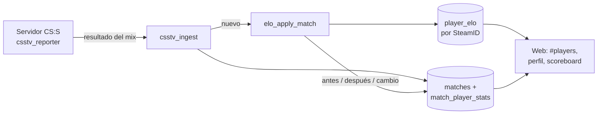
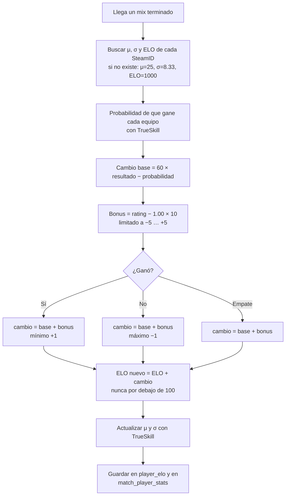
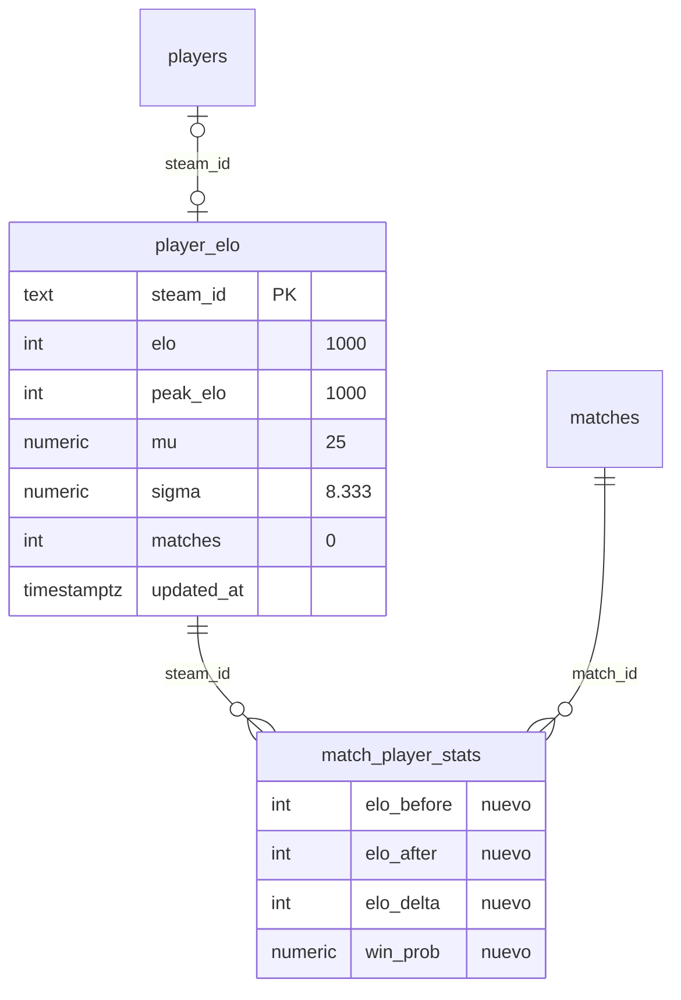
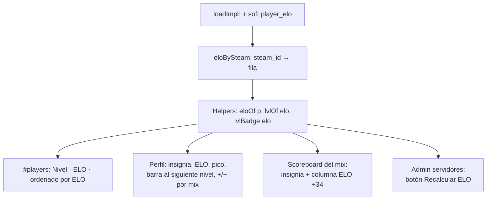
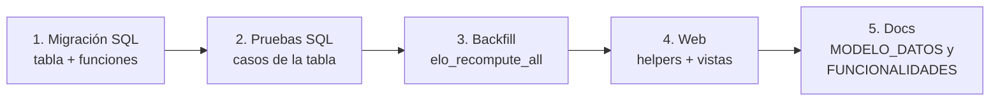

# Plan: ELO de jugadores (TrueSkill + niveles FACEIT)

> Planeación original, aprobada el 2026-10-11. Los cambios hechos durante la implementación están en [GUIA_IMPLEMENTACION.md](GUIA_IMPLEMENTACION.md#cambios-respecto-al-plan).
> Versión web con diagramas y calculadora: https://claude.ai/artifact/EVJB9XPj9AX4F7AvNbdNnV (privada).

## Decisiones tomadas

| Tema | Decisión |
|---|---|
| Método | **Híbrido**: TrueSkill (μ/σ por jugador) calcula la probabilidad de victoria de cada equipo y el ELO visible cambia con base **±30**. |
| ELO inicial | **1000** para todos (nivel 4). |
| Partidas que cuentan | **Solo mixes** reportados por el servidor. |
| Rendimiento individual | **Bonus de ±5** según el rating HLTV 1.0 del mix (`match_player_stats.rating`). |
| Jugadores sin vincular | El ELO se guarda **por SteamID**; al vincularlo, el jugador lo hereda. |
| Dónde se ve | **`#players` se ordena por ELO** y muestra el nivel. También aparece en el perfil y en el scoreboard del mix. |

## 1. Visión general



Todo el cálculo corre **en Postgres** (como el resto de la lógica que debe ser confiable). El navegador solo lee.

## 2. Cómo se calcula el cambio de ELO de un mix



### Paso a paso

**1. Probabilidad (TrueSkill).** Cada jugador tiene `μ` (habilidad estimada) y `σ` (qué tan seguro está el sistema).

```
fuerza del equipo     = suma de μ de sus jugadores
incertidumbre (c)     = √( Σ (β² + σ²) de todos los jugadores )
P(gana A)             = Φ( (fuerza A − fuerza B) / c )
```

`Φ` es la normal acumulada. Parámetros estándar: `μ₀ = 25`, `σ₀ = 25/3`, `β = σ₀/2`, `τ = σ₀/100`.

**2. Cambio base (±30).**

```
resultado = 1 si ganó, 0.5 si empató, 0 si perdió
base      = redondear( 60 × (resultado − P(gana su equipo)) )
```

| Situación | Probabilidad | Gana | Pierde |
|---|---|---|---|
| Equipos parejos | 50 % | **+30** | **−30** |
| Favorito | 70 % | +18 | −18 |
| No favorito | 30 % | +42 | −42 |

Al principio todos tienen el mismo `μ`, así que los primeros mixes dan exactamente ±30.

**3. Bonus por rating.**

```
bonus = limitar( redondear((rating − 1.00) × 10), −5, +5 )
```

| Ejemplo (equipos parejos) | Cuenta | Cambio |
|---|---|---|
| Gana, rating 1.40 | +30 + 4 | **+34** |
| Gana, rating 0.60 | +30 − 4 | **+26** |
| Pierde, rating 1.50 | −30 + 5 | **−25** |
| Pierde, rating 0.50 | −30 − 5 | **−35** |

Reglas de seguridad: el ganador siempre suma al menos **+1** y el perdedor siempre resta al menos **−1**.

**4. Actualizar μ/σ (TrueSkill, 2 equipos).** Aquí aprende el sistema: los jugadores nuevos (σ alto) se mueven más en μ, y σ baja con cada mix. Esto afecta la *probabilidad* de los próximos mixes, no el ±30.

```
t = (Σμ ganador − Σμ perdedor) / c
v = φ(t) / Φ(t)          w = v · (v + t)
ganador:  μ += σ²/c · v      perdedor: μ −= σ²/c · v
ambos:    σ² ← σ² · (1 − σ²/c² · w)      (antes se suma τ² a σ²)
```

En empate (15‑15 sin prórroga) solo se aplica `τ` y no cambia `μ`.

## 3. Niveles (los mismos que FACEIT)

```mermaid
flowchart LR
  L1["Nv 1<br/>100–500"]:::g --> L2["Nv 2<br/>501–750"]:::v --> L3["Nv 3<br/>751–900"]:::v --> L4["Nv 4<br/>901–1050"]:::a --> L5["Nv 5<br/>1051–1200"]:::a
  L5 --> L6["Nv 6<br/>1201–1350"]:::a --> L7["Nv 7<br/>1351–1530"]:::a --> L8["Nv 8<br/>1531–1750"]:::n --> L9["Nv 9<br/>1751–2000"]:::n --> L10["Nv 10<br/>2001+"]:::r
  classDef g fill:#d9d9d9,color:#000
  classDef v fill:#1ce400,color:#000
  classDef a fill:#ffc800,color:#000
  classDef n fill:#ff6309,color:#000
  classDef r fill:#fe1f00,color:#fff
```



| Nivel | ELO | Color |
|---|---|---|
| 1 | 100 – 500 | Gris |
| 2 | 501 – 750 | Verde |
| 3 | 751 – 900 | Verde |
| 4 | 901 – 1050 ← **inicio (1000)** | Amarillo |
| 5 | 1051 – 1200 | Amarillo |
| 6 | 1201 – 1350 | Amarillo |
| 7 | 1351 – 1530 | Amarillo |
| 8 | 1531 – 1750 | Naranja |
| 9 | 1751 – 2000 | Naranja |
| 10 | 2001+ | Rojo |

El nivel **no se guarda**: el front lo calcula a partir del ELO (`lvlOf(elo)`), así cambiar los rangos no requiere migración.

## 4. Cambios en la base de datos

Nueva migración `supabase/migrations/2026101xxxxxxx_player_elo.sql`.



| Objeto | Qué hace |
|---|---|
| Tabla `player_elo` | Una fila por SteamID64. RLS: lectura pública, sin escritura directa. |
| Columnas en `match_player_stats` | `elo_before`, `elo_after`, `elo_delta`, `win_prob` para el historial y el scoreboard. |
| `csstv_ncdf(x)` / `csstv_npdf(x)` | Normal acumulada y densidad (Postgres no tiene `erf`; se usa la aproximación de Abramowitz‑Stegun). |
| `elo_apply_match(match)` | Aplica el cálculo de la sección 2 a un mix. Bloquea las filas de `player_elo` (`FOR UPDATE`) para que dos mixes simultáneos no se pisen. Si el mix ya tiene `elo_after`, no hace nada (idempotente). |
| `csstv_ingest` | Al final llama a `elo_apply_match(v_id)`. Como ya devuelve antes si el `match_uid` existe, un reenvío no aplica el ELO dos veces. |
| `elo_recompute_all()` | Solo admin. Reinicia `player_elo` y vuelve a aplicar todos los mixes terminados en orden de `played_at`. Sirve para la carga inicial con los mixes existentes y para corregir después de borrar un mix. |
| `link_steam_id` | Sin cambios: como el ELO va por SteamID, el jugador lo hereda al vincularlo. |

Jugadores que **no** cuentan en un mix: SteamID que no es SteamID64 (bots o `desconocido`) y jugadores con `rounds = 0`.

## 5. Cambios en la web (`index.html`)



| Lugar | Cambio |
|---|---|
| Carga | `soft(sb.from('player_elo').select('*'))` → mapa `eloBySteam`. |
| Helpers | `eloOf(p)` (1000 si no tiene SteamID o mixes), `lvlOf(elo)`, `lvlBadge(elo)`: círculo con el número y el color del nivel, con variables CSS para tema claro/oscuro. |
| `#players` | Columnas `Jugador · Nivel · ELO · Equipo · Rating · K/D · Acción`. Orden por ELO y, en empate, por cantidad de mixes. |
| Perfil | Tarjeta con insignia, ELO actual, ELO máximo y "faltan X para nivel N". En el historial de mixes, el cambio de cada uno (`+34` verde / `−25` rojo). |
| Detalle del mix | Insignia junto al nick y columna `ELO` con el cambio. |
| Admin (`#sadm`) | Botón **Recalcular ELO** → `rpc('elo_recompute_all')`. |

## 6. Orden de implementación



1. **Migración**: tabla, columnas, `csstv_ncdf`/`csstv_npdf`, `elo_apply_match`, `elo_recompute_all`, llamada desde `csstv_ingest`, RLS y `grant`.
2. **Pruebas SQL**: mix 5v5 con todos nuevos → ±30; ganador con rating 1.40 → +34; perdedor con 1.50 → −25; reenviar el mismo `match_uid` no cambia nada; un empate no cambia μ.
3. **Backfill**: ejecutar `elo_recompute_all()` una vez para los mixes que ya existen.
4. **Web**: carga, helpers, `#players`, perfil, scoreboard y botón de admin.
5. **Docs**: actualizar `MODELO_DATOS.md` y `FUNCIONALIDADES.md`.

## Puntos a tener en cuenta

- **Orden de llegada**: si la cola del servidor envía un mix viejo después de uno nuevo, se aplica en el orden de llegada (como FACEIT). `elo_recompute_all()` sí respeta `played_at`.
- **Borrar un mix** no revierte el ELO automáticamente; hay que usar **Recalcular ELO**.
- **Equipos desiguales (5v4)**: la suma de μ ya refleja la ventaja, así que el equipo con más jugadores gana menos ELO si gana.
- **Piso de 100**: igual que en FACEIT, el ELO no baja de 100.
