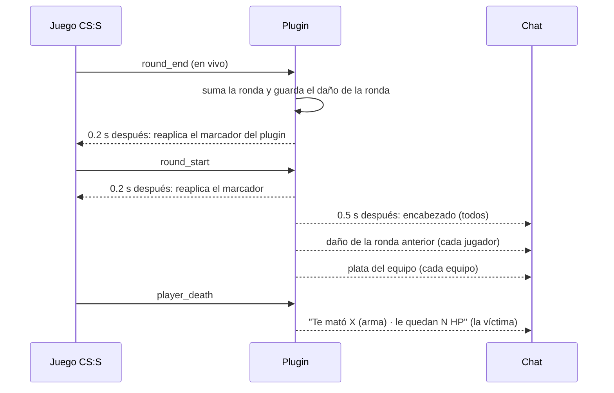
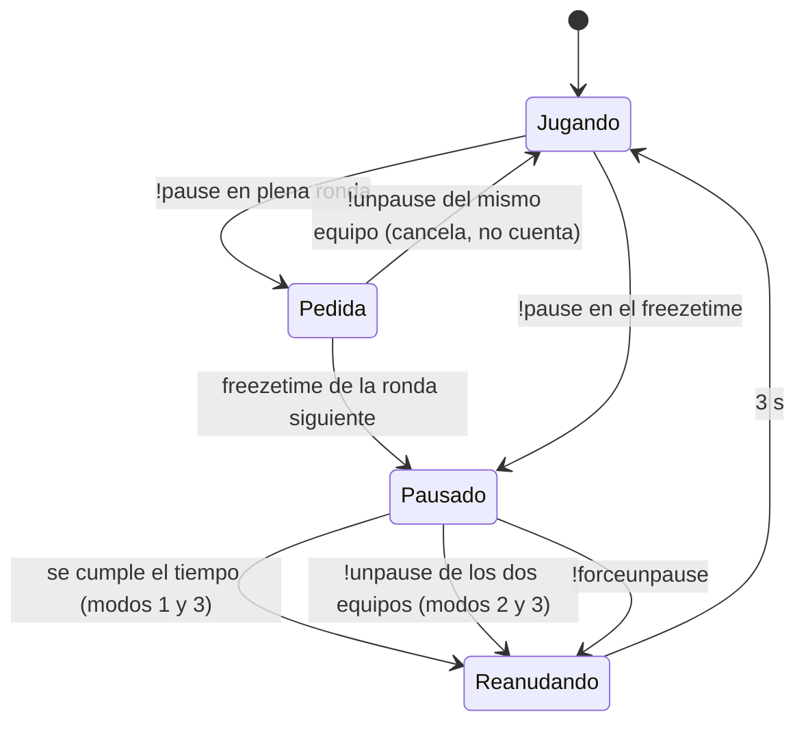

# Mejoras de calidad de vida en el servidor: documentación

Plugin `csstv_reporter` **1.1.0**. El código nuevo está en `server/addons/sourcemod/scripting/csstv/qol.inc`; `stats.inc` guarda el daño por ronda y `csstv_reporter.sp` conecta todo a los eventos. No hay cambios en la base de datos ni en la web.

## Qué ve cada jugador

| Función | Quién lo ve | Cvar |
|---|---|---|
| Encabezado: "Ronda 13/30 · Equipo A (CT) 7 - 5 Equipo B (T)"; en prórroga "Prórroga 1 · ronda 1/6 · …" | Todos | `csstv_round_header` |
| "Última ronda antes del cambio de lado." / "Match point para el Equipo X." | Todos | `csstv_round_header` |
| Daño de la ronda anterior: una línea por rival con daño en algún sentido; "sin daño" si no hubo | Cada jugador | `csstv_damage_report` |
| Plata del equipo: total y cada jugador de mayor a menor (líneas de hasta ~150 caracteres, nicks cortados a 14) | Cada equipo | `csstv_team_money` |
| Al morir: asesino, arma, vida y chaleco que le quedan (o "también está muerto"); `!hp` lo repite | La víctima | `csstv_hp_on_death` |

El daño usa el mismo "daño real" que se envía a la web: el daño que pasa de la vida que le quedaba a la víctima no cuenta, y tampoco el daño a compañeros. Los golpes cuentan solo si hicieron daño.

## Marcador

CS:S guarda su propio contador de victorias por lado. `mp_restartgame` lo pone en 0 y el juego lo vuelve a escribir en el scoreboard al terminar cada ronda. El plugin reaplica su marcador (`ApplyTeamScores`) 0.2 s después de cada `round_start` y `round_end`, siempre que no esté en calentamiento. El número de cada equipo va en el lado donde juega en ese momento.

## Cambio de lado

`ChangeClientTeam` deja al jugador sin clase y esperando elegir modelo. Los bots nunca eligen, así que no reaparecían y la ronda siguiente no terminaba nunca. Este error ya estaba en la 1.0.0. Ahora, después de `ChangeClientTeam`, el plugin:

1. Asigna el modelo equivalente del otro lado: `m_iClass` T 1–4 ↔ CT 5–8 (si no tenía, uno al azar).
2. Marca al jugador como activo (`m_iPlayerState = 0`) para que reaparezca con el reinicio.

No se usa `CS_SwitchTeam`, porque su firma en la gamedata no es la de v34 y tumba el servidor. Tampoco `FakeClientCommand(… "joinclass")`, que también lo tumba con bots.

## Pausa táctica

| Cvar | Default | Uso |
|---|---|---|
| `csstv_pause_mode` | 3 | 0 desactivadas · 1 con tiempo · 2 hasta `!unpause` de los dos · 3 lo que pase primero |
| `csstv_pause_max` | 2 | Pausas por equipo (A/B, no por lado) y por partida |
| `csstv_pause_time` | 60 | Segundos (modos 1 y 3). Avisos a los 30 y 10 s, y de 5 a 1 |

- **Cómo pausa:** pone `m_fRoundStartTime` (el momento en que termina el freezetime) en `ahora + csstv_pause_time`, o en `ahora + 3600` si la pausa es sin tiempo. Ese valor se renueva mientras dure. Para terminar la pausa lo pone en `ahora + 3`.
- **Qué pasa durante la pausa:** el reloj de la ronda no corre porque se cuenta desde ese momento, la compra sigue abierta y el chat y los timers funcionan.
- **Pausa del admin:** `!forcepause` funciona con cualquier modo, incluso el 0, no cuenta para el límite y no tiene tiempo.
- **Cuándo no se puede pausar:** en el LO3, durante los reinicios del medio tiempo y la prórroga, ni fuera de la partida. La pausa se borra sin aviso al terminar o cancelar la partida y al cambiar de mapa.
- **Por qué no la pausa del motor:** en v34, `pause` desde la consola del servidor no hace nada y, enviado como un bot, tumba el servidor.

## Demo

| Cvar | Default | Uso |
|---|---|---|
| `csstv_demo` | 1 | `tv_record csstv_demos/<match_uid>` al "¡EN VIVO!"; `tv_stoprecord` al terminar, cancelar o cambiar de mapa |
| `csstv_demo_keep` | 50 | Después de cada demo, borra los más viejos (por fecha de modificación) hasta dejar este número. 0 = no borra |

- **Requisito:** `tv_enable 1` desde que carga el mapa, con `+tv_enable 1` en la línea de arranque. Si no está activa, se anota en el log y no se graba.
- **Nombre del archivo:** el motor lo guarda en minúsculas (`srv1-20261011t125908-2fff.dem`), mientras que el `match_uid` en la web tiene mayúsculas (`srv1-20261011T125908-2fff`). Para relacionarlos hay que comparar sin distinguir mayúsculas.
- **Tamaño:** unos 4 KB/s con 6 bots.

## Comandos nuevos

| Comando | Quién |
|---|---|
| `sm_hp` (`!hp`) | Jugadores |
| `sm_pause` (`!pause`), `sm_unpause` (`!unpause`) | Jugadores de CT o T |
| `sm_forcepause`, `sm_forceunpause` | Admin con flag `b` |

## Compilación de depuración

Si se compila con `spcomp csstv_reporter.sp CSSTV_DEBUG=1 …`:

- Los bots también reciben los mensajes personales.
- Cada mensaje de chat, cada respuesta a un comando y cada marcador reaplicado se copia al log de SourceMod.
- Los bots reciben un SteamID falso y fijo según su nombre (`STEAM_0:x:9990xxxxx`), para que la web les aplique ELO. Los mixes que se envían así quedan en la web: hay que borrarlos al terminar.
- Se agrega `csstv_debug_fakecmd <userid> <comando>` para ejecutar comandos de SourceMod como un jugador. Solo comandos `sm_*`: los del juego, enviados como un bot, tumban v34.

El `.smx` del repositorio se compila **sin** esta opción.
