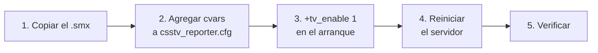

# Mejoras de calidad de vida en el servidor: guía de implementación

## Estado

| Paso | Estado |
|---|---|
| Prueba de pausa (paso 0) | Hecha: la pausa del motor no sirve; se usa el freezetime |
| Plugin 1.1.0 | Hecho, compilado con SourceMod 1.8.0.5963 sin warnings |
| Pruebas con bots en el servidor de Daniel | Hechas, ver abajo |
| Instalado en el servidor de prueba de Daniel | Sí (la 1.0.0 quedó en `plugins/disabled/csstv_reporter_1.0.0.smx`) |
| Prueba con jugadores reales | **Pendiente** |
| Servidor real | Subido por SFTP el 2026-10-11 (plugin 1.1.0, cvars nuevas al final de `csstv_reporter.cfg`, `start.sh` con `+tv_enable 1`; respaldos en `plugins/disabled/csstv_reporter_1.0.0.smx`, `csstv_reporter.cfg.bak` y `start.sh.bak`). **Falta reiniciar** y verificar en la consola del panel |

## Archivos

| Archivo | Cambio |
|---|---|
| `server/addons/sourcemod/scripting/csstv/qol.inc` | Nuevo: marcador, mensajes de ronda, `!hp`, pausa y demo. |
| `server/addons/sourcemod/scripting/csstv/stats.inc` | Golpes por ronda (`g_iRoundHits`) y copia de la ronda anterior (`Stats_SnapshotRound`). |
| `server/addons/sourcemod/scripting/csstv_reporter.sp` | Versión 1.1.0; conexión con eventos; arreglo del cambio de lado. |
| `server/addons/sourcemod/plugins/csstv_reporter.smx` | Recompilado. |
| `server/cfg/sourcemod/csstv_reporter.cfg` | Cvars nuevas. |
| `docs/GUIA_SERVIDOR.md` | "Durante la partida", "Pausa táctica", "Demos", comandos, archivos y problemas. |

## Instalación



1. Copiá `server/addons/sourcemod/plugins/csstv_reporter.smx` a `cstrike/addons/sourcemod/plugins/`.
2. Agregá el bloque "Durante la partida", "Pausa táctica" y "Demo" de `server/cfg/sourcemod/csstv_reporter.cfg` al `csstv_reporter.cfg` del servidor. Si no se agregan, se usan los valores por defecto.
3. Para grabar demos, agregá `+tv_enable 1` antes de `+map` en la línea de arranque. En el servidor de prueba es `start_server.bat`:
   ```
   srcds.exe -console -game cstrike -port 27015 +maxplayers 20 +tv_enable 1 +map de_dust2 -tickrate 66 -insecure
   ```
   La SourceTV ocupa un lugar de jugador: con `+maxplayers 20` quedan 19.
4. Reiniciá el servidor o cambiá de mapa.
5. En la consola: `csstv_reporter_version` debe responder `1.1.0`, y `status` debe mostrar la línea `sourcetv:`.

Para volver a la 1.0.0, copiá `plugins/disabled/csstv_reporter_1.0.0.smx` (servidor de prueba) sobre `plugins/csstv_reporter.smx`.

## Pruebas hechas (2026-10-11, servidor de Daniel, bots)

Los scripts usados están en [`pruebas/`](pruebas/).

| Herramienta | Uso |
|---|---|
| `rcon.py` | Cliente RCON mínimo |
| `scenario.sh` | Escenario completo del mix con bots |
| `csstv_spike_pausa_motor.sp` | Prueba de la pausa del motor |
| `csstv_spike_freezetime.sp` | Prueba del freezetime y del marcador |

El servidor se levantó en el puerto **27035**, porque ClientMod ocupa el 27015 en esa PC, con `-condebug +tv_enable 1`. Durante las pruebas `csstv_send` quedó en 0, y los resultados de los mixes de bots se borraron de la cola al terminar.

| # | Prueba | Resultado |
|---|---|---|
| 0a | `pause` desde la consola del servidor | No pausa (el tiempo de juego sigue) |
| 0b | `pause` enviado como un bot (`FakeClientCommand`) | **El servidor se cae** |
| 0c | Alargar y cortar el freezetime con `m_fRoundStartTime` | Funciona: 12 → 28 s y corte inmediato (`round_freeze_end`) |
| 0d | Timers de SourceMod con el juego detenido | Siguen corriendo |
| 1 | Marcador sin reaplicar | El juego lo pisa al terminar la ronda (7-8 → 1-0) |
| 2 | Marcador reaplicado 0.2 s después | Se mantiene, también en medio tiempo (CT 2 - 0 T con A de T) y prórroga (CT 2 - 3 T) |
| 3 | Encabezado, último round y match point | Correctos en tiempo reglamentario y prórroga |
| 4 | Daño de la ronda anterior | Correcto y simétrico (Dave → Irving 100 (2) = Irving ← Dave 100 (2)) |
| 5 | Plata del equipo | Total y lista ordenada, solo para ese equipo |
| 6 | Mensaje al morir | "Te mató Jerry (usp) · le quedan 68 HP y 0 de chaleco." |
| 7 | Pausa pedida en plena ronda (última antes del medio tiempo) | Empieza en el freezetime de la ronda siguiente, después del cambio de lado |
| 8 | Pausa con tiempo (15 s) | Avisos 10, 5…1 y termina sola |
| 9 | Límite de pausas | "Tu equipo ya usó su pausa." |
| 10 | `!unpause` de los dos equipos | Termina antes; la ronda arranca a los 3 s |
| 11 | `!forcepause` en plena ronda / `!forceunpause` | Empieza en la ronda siguiente (prórroga), recuerda cada 30 s, termina con el admin |
| 12 | Pausa pedida durante el reinicio | Rechazada: "Solo se puede pausar durante la partida." |
| 13 | Demo | Graba al "¡EN VIVO!" y cierra al terminar o cancelar; 2,6 MB por 7 rondas con 6 bots |
| 14 | `csstv_demo_keep 2` | Borró los 6 demos más viejos |
| 15 | Mix completo con medio tiempo y prórroga | Terminó 2-4 y guardó el resultado |
| 16 | `CS_SwitchTeam` | **El servidor se cae**: no se usa |
| 17 | Kills y muertes en el medio tiempo (agregado después, a pedido de Daniel) | Iguales antes y después del cambio para los 6 jugadores (por ejemplo Don 7/2, Keith 0/3) |
| 18 | Reconexión a mitad del mix (bot sacado y vuelto a agregar con el mismo nombre) | Salió con 1/1 y recuperó 1/1 al reaparecer |

### Error encontrado y corregido

En el plugin 1.0.0, después del medio tiempo los jugadores quedaban sin clase. Con bots, nadie reaparecía y la ronda no terminaba nunca. Con jugadores reales seguramente aparecía el menú de modelos. Ver "Cambio de lado" en [DOCUMENTACION.md](DOCUMENTACION.md).

## Prueba de Daniel en el juego (2026-10-11)

Servidor de prueba con `sv_lan 1`: con `sv_lan 0` la validación de Steam lo expulsaba con "This Steam account is being used in another location". Daniel contra bots, con la compilación de depuración.

| Prueba | Resultado |
|---|---|
| Daño, plata, encabezado y `!hp` | Llegan al jugador |
| Mix con bots con SteamIDs falsos, enviado a la web | Llegó con ELO, después de crear un token nuevo para el servidor de prueba (el anterior daba HTTP 401) |
| Marcador después del medio tiempo | Daniel vio que se reiniciaba: se refería también a las kills y muertes de cada jugador, que el plugin no restauraba. Se agregó (pruebas 17 y 18). Del lado del servidor, `m_iScore` de cada equipo (lo que se envía al TAB) tiene el valor correcto. Falta ver qué muestra el TAB y si ClientMod tiene un marcador propio |
| Se le cortó el juego una vez | El servidor siguió normal según el log; fue el cliente (servidor y juego en la misma PC) |

## Servidor real (ExtremeHost, Linux)

- El `.smx` sirve igual en Linux: no hace falta recompilar.
- `start.sh` tenía `-tv_enable 1`: con guion el motor lo ignora (las cvars van con `+`). Se corrigió a `+tv_enable 1`. **Si el panel de ExtremeHost regenera `start.sh` al reiniciar**, el cambio se pierde y hay que poner `+tv_enable 1` en la configuración de arranque del panel.
- `start.sh` también dice `-tikrate 66` (debería ser `-tickrate`); no se tocó, y en v34 el valor por defecto ya es 66.
- No hay carpeta de logs de SourceMod accesible por SFTP ni acceso RCON: la verificación después de reiniciar se hace desde la consola del panel:
  ```
  csstv_reporter_version      // 1.1.0
  status                      // debe aparecer la línea "sourcetv:"
  csstv_pause_mode            // 3
  ```

## Colores, prefijo y formato del daño (1.2.0, 2026-10-11)

Probado con bots en el servidor de prueba (compilación de depuración, `csstv_chat_colors 1`):

| Prueba | Resultado |
|---|---|
| Prefijo | `[v34frag]` en todos los mensajes; `csstv_reporter_version` = 1.2.0 |
| Daño | `Damage Given to "Steve" - 100 in 5 hits` / `Damage Taken from "Steve" - 16 in 1 hit`; singular "hit" con 1; simétrico entre jugadores |
| Plata, encabezado, `!hp` | Mismo texto que antes, con las etiquetas de color |

**Falta ver los colores en el juego.** El log los guarda sin color y los bots no reciben mensajes. El servidor de prueba no tiene `clientmod.smx`, así que para verlos ahí con ClientMod hay que poner `csstv_chat_colors 2`; en el servidor real (que sí tiene la API) alcanza con el valor por defecto.

**Servidor real (2026-10-11):** subida la 1.2.0 por SFTP (respaldo de la 1.1.0 en `plugins/disabled/csstv_reporter_1.1.0.smx`), agregadas `csstv_chat_tag` y `csstv_chat_colors` a `csstv_reporter.cfg` (respaldo `csstv_reporter.cfg.bak-1.1.0`) y `se_scoreboard 2` al final de `server.cfg` (respaldo `server.cfg.bak`). **Falta reiniciar** y verificar con `sm plugins list` / `clientmod_version` (ver "API de ClientMod" en `GUIA_SERVIDOR.md`).

## Pendiente: prueba con jugadores reales

Con bots no se puede verificar lo que ve el cliente. Hace falta un mix corto con al menos 2 personas (una por equipo), con `csstv_maxrounds 4`, `csstv_min_players 2` y `csstv_send 0`:

- [ ] El scoreboard (TAB) muestra el marcador correcto después del medio tiempo y después de cada ronda.
- [ ] En el medio tiempo **no** aparece el menú de modelos y todos reaparecen en el otro lado.
- [ ] Los mensajes se ven bien en el chat de ClientMod: tildes, `·`, `»` y `$21.350`.
- [ ] El daño coincide con el "Damage Given / Taken" de la consola del juego.
- [ ] Durante una pausa, el contador del freezetime en pantalla muestra el tiempo alargado y se puede comprar.
- [ ] `!hp` después de morir.
- [ ] El demo se reproduce en el juego (`playdemo csstv_demos/<nombre>`).

## Cambios respecto al plan

| Plan | Implementación | Motivo |
|---|---|---|
| Pausa del motor (`sv_pausable` + `pause`), con el freezetime como alternativa | Solo freezetime (`m_fRoundStartTime`) | La pausa del motor no se puede activar desde el servidor y tumba v34 con bots. El freezetime permite todos los modos, incluida la salida anticipada con `!unpause`. |
| Al terminar la pausa, la ronda arranca | Arranca a los 3 s | Para que nadie quede desprevenido. |
| — | Arreglo del cambio de lado (clase del jugador) | Error de la 1.0.0 encontrado al probar el medio tiempo con bots. |
| — | Compilación de depuración `CSSTV_DEBUG` | Para verificar los mensajes personales con bots desde el log. |
| Demos con el nombre del `match_uid` | El motor los guarda en minúsculas | Comportamiento del motor; documentado. |
