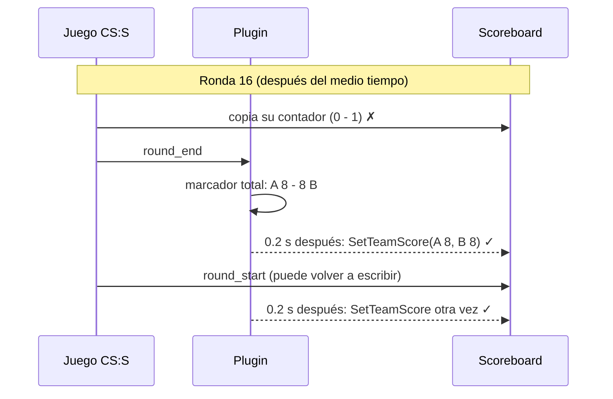
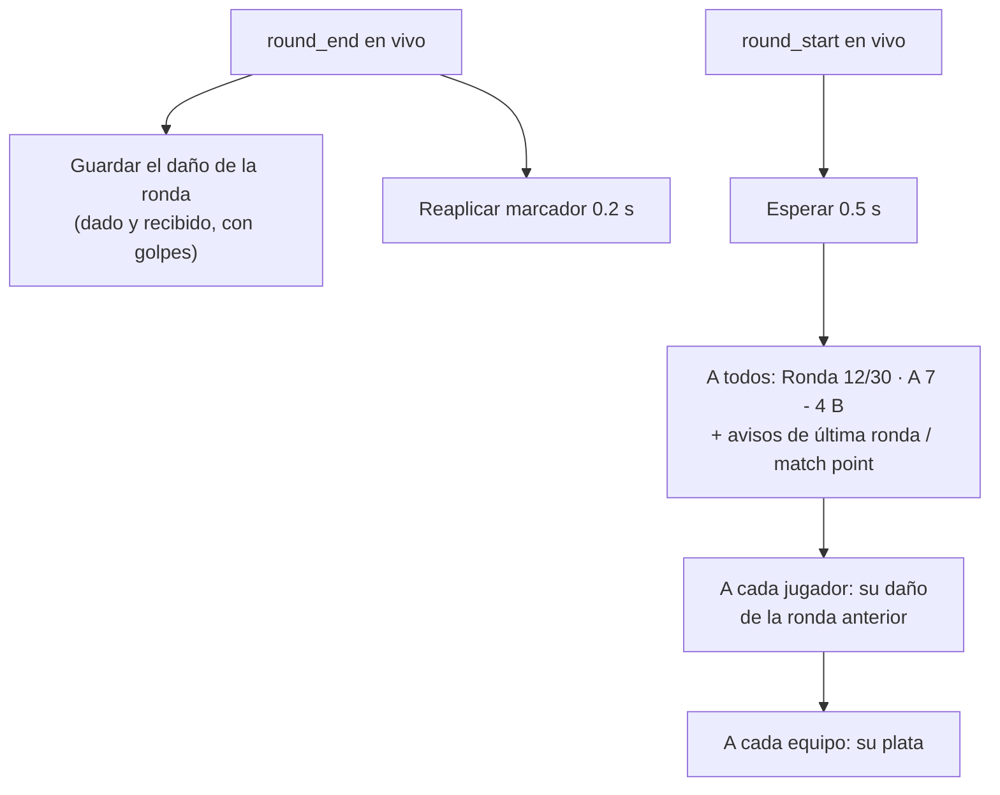
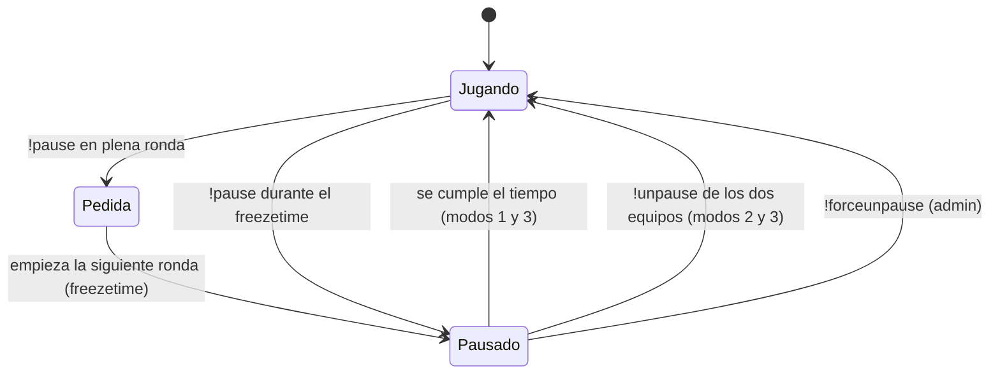
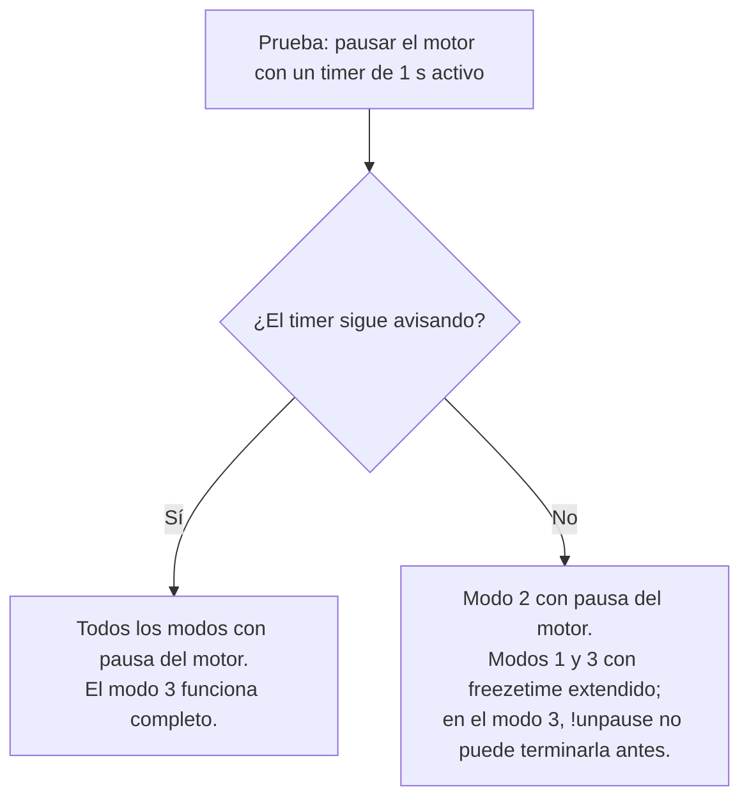
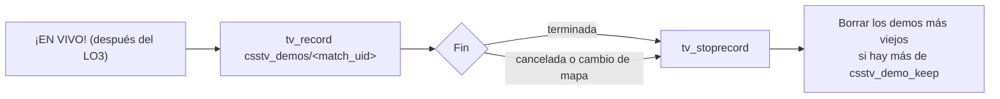
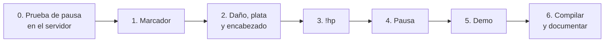

# Plan: mejoras de calidad de vida en el servidor (QoL)

> Planeación original, aprobada el 2026-10-11. Los cambios hechos durante la implementación están en [GUIA_IMPLEMENTACION.md](GUIA_IMPLEMENTACION.md#cambios-respecto-al-plan).

Cambios en el plugin `csstv_reporter` (CS:S v34, SourceMod 1.8). No hay cambios en la base de datos ni en la web.

## Decisiones tomadas

| # | Mejora | Decisión |
|---|---|---|
| 1 | Marcador al cambiar de lado | Se mantiene el marcador total del plugin en el scoreboard, también en la prórroga. |
| 2 | Daño de la ronda anterior | Al empezar la ronda, cada jugador ve **una línea por rival** con quien hubo daño: lo que dio y lo que recibió, con golpes. |
| 3 | Plata del equipo | Al empezar la ronda, cada equipo ve **su total y la plata de cada compañero**, de mayor a menor. |
| 4 | Encabezado de ronda | "Ronda 12/30 · A 7 - 4 B", con avisos de última ronda del medio tiempo y de match point. |
| 5 | `!hp` al morir | Al morir, el chat dice quién te mató, con qué arma y cuánta vida le quedó. `!hp` lo repite. |
| 6 | Pausa táctica | Configurable: límite por equipo, duración en segundos y 4 modos (desactivada, con tiempo, hasta `!unpause`, o ambos). Solo en el freezetime. |
| 7 | Demo automática | La SourceTV graba un demo por mix con el `match_uid` como nombre. Se guarda solo en el servidor, con un límite de demos. |

## 1. Marcador al cambiar de lado

**Problema.** El plugin ya pone su marcador con `SetTeamScore` después del reinicio del medio tiempo. Pero CS:S guarda su propio contador de victorias por lado: `mp_restartgame` lo pone en 0 y, en cada fin de ronda, el juego copia ese contador al scoreboard. Por eso el marcador vuelve a 0, o a 1-0 después de la primera ronda.

**Solución.** Volver a aplicar el marcador del plugin un instante (0.2 s) después de **cada** inicio y fin de ronda, cuando el juego ya terminó de escribir el suyo.



El marcador sigue al equipo: si A juega de T, el número de A va en el lado T.

## 2–4. Mensajes al empezar la ronda

Todo se imprime durante el freezetime, 0.5 s después de `round_start` para que la plata ya esté actualizada. Orden: encabezado, daño y plata.



**Ejemplo de lo que ve un jugador CT:**

```
[CSSTV] Ronda 13/30 · Equipo A (CT) 7 - 5 Equipo B (T)
[CSSTV] Daño ronda 12:
[CSSTV] → s1mple: diste 100 (3) · recibiste 27 (1)
[CSSTV] → fallen: diste 54 (2) · recibiste 0
[CSSTV] Plata del equipo: $21.350
[CSSTV] s1mple $7.200 · fallen $5.900 · fer $4.100 · taco $3.350 · cold $800
```

| Mensaje | Quién lo ve | Detalle |
|---|---|---|
| Encabezado | Todos | En prórroga: "Prórroga 1 · ronda 3/6 · A 16 - 17 B". |
| Última ronda del medio tiempo | Todos | Cuando `g_iSegRound + 1 == mitad`. |
| Match point | Todos | Cuando a un equipo le falta una ronda para ganar el segmento. |
| Daño | Cada jugador | Solo rivales con daño en algún sentido. Si no hubo daño: "Daño ronda 12: sin daño". No se muestra en la primera ronda ni después del LO3. |
| Plata | Cada equipo | Se lee de `m_iAccount`. La plata del rival nunca se muestra. Los nombres se cortan para que la línea entre en el chat (~190 caracteres); si no entran, se parten en dos líneas. |

**Daño.** El plugin ya guarda el daño entre jugadores de la ronda en curso (`g_iRoundDmg`, usado para las asistencias). Se agrega el conteo de golpes (`g_iRoundHits`) y, al terminar la ronda, se copian ambos a `g_iPrevDmg` / `g_iPrevHits` para mostrarlos en la siguiente. Se usa el mismo "daño real" que va a la web (sin contar daño por encima de la vida que quedaba). El daño a compañeros no se muestra.

## 5. `!hp` al morir

```
[CSSTV] Te mató s1mple (ak47) · le quedan 37 HP y 100 de chaleco.
```

- Se envía solo a la víctima, en `player_death`, durante la partida en vivo.
- `!hp` repite el último mensaje de la ronda; si el asesino sigue vivo, muestra su vida actual.
- No se envía si fue suicidio, por la bomba o por un compañero.

## 6. Pausa táctica

Se puede configurar el **límite de pausas por equipo**, la **duración en segundos** y el **modo**, incluido apagarla.

| Modo (`csstv_pause_mode`) | Cómo termina la pausa |
|---|---|
| `0` | Pausas desactivadas |
| `1` | Con tiempo: termina sola a los `csstv_pause_time` segundos |
| `2` | Sin tiempo: dura hasta que **los dos equipos** escriben `!unpause` |
| `3` | Con tiempo, pero los dos equipos pueden terminarla antes con `!unpause` (por defecto) |

En cualquier modo, un admin puede usar `!forcepause` y `!forceunpause`, y las pausas del admin no cuentan para el límite.



| Regla | Valor |
|---|---|
| Quién puede pedirla | Cualquier jugador de un equipo |
| Cuándo ocurre | Solo en el freezetime. Si se pide durante la ronda, queda pedida para la siguiente. |
| Límite | `csstv_pause_max` pausas por equipo y por partida (por defecto 2). Se avisa cuántas le quedan al equipo. |
| Duración | `csstv_pause_time` segundos (por defecto 60). Avisos a los 30 y 10 segundos y cuenta regresiva de 5 a 1. |
| Medio tiempo y LO3 | No se puede pausar mientras se reinicia la ronda. |

### Cómo se pausa y qué falta verificar

CS:S v34 no tiene `mp_pause_match`. Hay dos formas de pausar, y cuál sirve para la pausa con tiempo depende de algo que hay que verificar en el servidor de prueba.

| | Pausa del motor (`sv_pausable 1` + `pause`) | Freezetime extendido (`mp_freezetime`) |
|---|---|---|
| Qué hace | Congela todo el servidor | La siguiente ronda empieza con un freezetime largo |
| Chat y comandos durante la pausa | Hay que verificarlo en v34 | Sí |
| Se puede terminar antes con `!unpause` | Sí | No: el freezetime no se puede acortar |
| Pausa con tiempo | Solo si los timers de SourceMod siguen corriendo con el motor en pausa (**hay que verificarlo**) | Sí, siempre |

La documentación de SourceMod no dice si los timers corren con el servidor en pausa. Su reloj sigue los ticks del servidor, así que es probable que se detengan. Por eso el **primer paso de la implementación** es una prueba corta en el servidor de Daniel, con un plugin mínimo:



## 7. Demo automática



- Solo graba si `tv_enable 1` está activo **desde que cargó el mapa** (la SourceTV entra al cargar el mapa). Si no, lo anota en el log y sigue sin grabar.
- Los demos quedan **solo en el disco del servidor**, en `cstrike/csstv_demos/<match_uid>.dem`. El nombre coincide con el `match_uid` del mix en la web.
- Para que el disco no se llene, el plugin conserva los últimos `csstv_demo_keep` demos (por defecto 50) y borra los más viejos.
- Subirlos a la web queda para otro requerimiento. Ver "Almacenamiento de demos".

### Almacenamiento de demos (para un requerimiento futuro)

Hoy Supabase solo tiene los buckets `avatars`, `photos` y `proofs`. No hay espacio pensado para demos.

| | Plan Free | Plan Pro (US$25/mes) |
|---|---|---|
| Almacenamiento de archivos | 1 GB (una fuente dice 500 MB) | 100 GB incluidos, luego US$0.021/GB |
| Descargas (egress) | ~5 GB/mes | 250 GB incluidos, luego US$0.09/GB |

Son cifras de guías de terceros de 2026. Hay que confirmarlas en el panel de Supabase (Settings → Billing / Usage), donde además se ve cuánto se usa hoy.

**Tamaño estimado de un demo** de un mix 5v5 MR15 a 66 tick: entre 30 y 80 MB sin comprimir, y entre 8 y 20 MB comprimido (los demos se comprimen muy bien). Se va a medir con los primeros demos del servidor de prueba.

| Implicación | Detalle |
|---|---|
| Espacio | Con 1 GB entran ~15–30 demos sin comprimir o ~50–120 comprimidos, compartidos con avatares, fotos y capturas. |
| Descargas | Cada descarga cuenta como egress. Con ~5 GB/mes en Free, son unas 250–600 descargas de demos comprimidos al mes. |
| Cómo subirlos | System2 no puede enviar más de 2 KB por pedido, así que el plugin no puede subirlos. Habría que extender `csstv_uploader.py` para comprimir y subir. |
| Seguridad | El servidor no puede subir con la anon key a un bucket abierto. Hace falta una función que, con el token del servidor, entregue una URL de subida firmada. |
| Retención | Hay que decidir cuánto tiempo se guardan (por ejemplo, 30 días o los últimos N) y borrarlos automáticamente. |
| Alternativas | Guardarlos en otro servicio más barato para archivos grandes, como Cloudflare R2 (10 GB gratis y sin costo de descarga), o servirlos directo desde la máquina del servidor. |

## Cvars nuevas

Todas en `cfg/sourcemod/csstv_reporter.cfg`.

| Cvar | Default | Qué controla |
|---|---|---|
| `csstv_round_header` | 1 | Encabezado de ronda y avisos |
| `csstv_damage_report` | 1 | Reporte de daño |
| `csstv_team_money` | 1 | Plata del equipo |
| `csstv_hp_on_death` | 1 | Mensaje al morir y `!hp` |
| `csstv_pause_mode` | 3 | 0 desactivadas · 1 con tiempo · 2 hasta `!unpause` · 3 con tiempo o `!unpause` |
| `csstv_pause_max` | 2 | Pausas por equipo y por partida |
| `csstv_pause_time` | 60 | Segundos de cada pausa (modos 1 y 3) |
| `csstv_demo` | 1 | Grabar demo |
| `csstv_demo_keep` | 50 | Demos que se conservan en el servidor (0 = todos) |

## Archivos

| Archivo | Cambio |
|---|---|
| `server/addons/sourcemod/scripting/csstv_reporter.sp` | Cvars, comandos (`!hp`, `!pause`, `!unpause`, `!forcepause`, `!forceunpause`), marcador, mensajes de ronda, demo. Versión 1.1.0. |
| `server/addons/sourcemod/scripting/csstv/stats.inc` | Golpes por ronda y copia de la ronda anterior. |
| `server/addons/sourcemod/scripting/csstv/qol.inc` | Nuevo: encabezado, daño, plata, `!hp` y pausa. |
| `server/addons/sourcemod/plugins/csstv_reporter.smx` | Recompilado con SourceMod 1.8. |
| `server/cfg/sourcemod/csstv_reporter.cfg` | Cvars nuevas. |
| `docs/GUIA_SERVIDOR.md` | Comandos y cvars nuevas, requisitos de SourceTV. |

## Orden de implementación



## Pruebas

Se compila con el `spcomp.exe` del servidor de prueba de Daniel (`E:\CSS DEDICATED SERVER\server`, ver [GUIA_SERVIDOR.md](../../GUIA_SERVIDOR.md#servidores-de-prueba-locales)) y se prueba ahí, con bots y con jugadores reales para lo que necesite más de una persona (pausa, plata del equipo):

- [ ] Medio tiempo: el scoreboard muestra 8-7 (no 0-0) y sigue sumando después de la ronda 16.
- [ ] Prórroga: el marcador total se mantiene.
- [ ] Daño: coincide con el "Damage Given/Taken" de la consola del juego.
- [ ] Plata: cada equipo ve solo la suya.
- [ ] `!hp` y mensaje al morir.
- [ ] Pausa, en cada modo: `!pause` en plena ronda espera a la siguiente; el chat funciona en pausa; termina por tiempo o con `!unpause` de ambos según el modo; respeta el límite.
- [ ] Demo: aparece `csstv_demos/<match_uid>.dem`, se puede reproducir y se anota su tamaño; con `csstv_demo_keep 2` se borran los más viejos.
