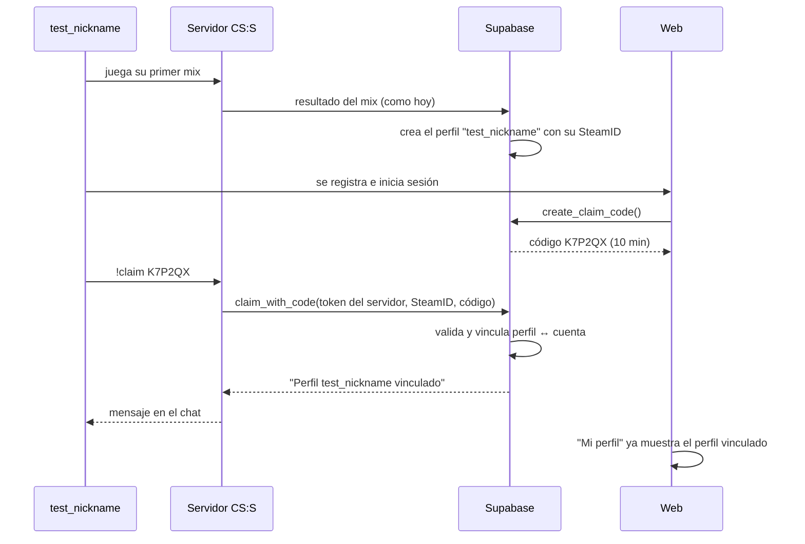
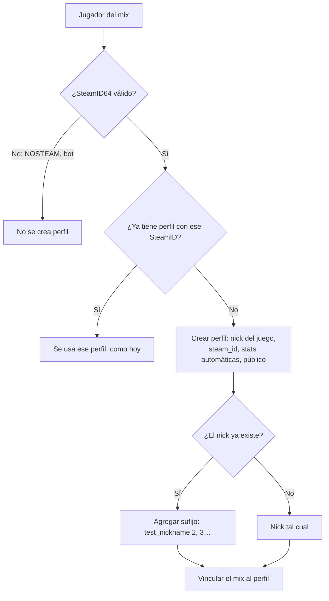
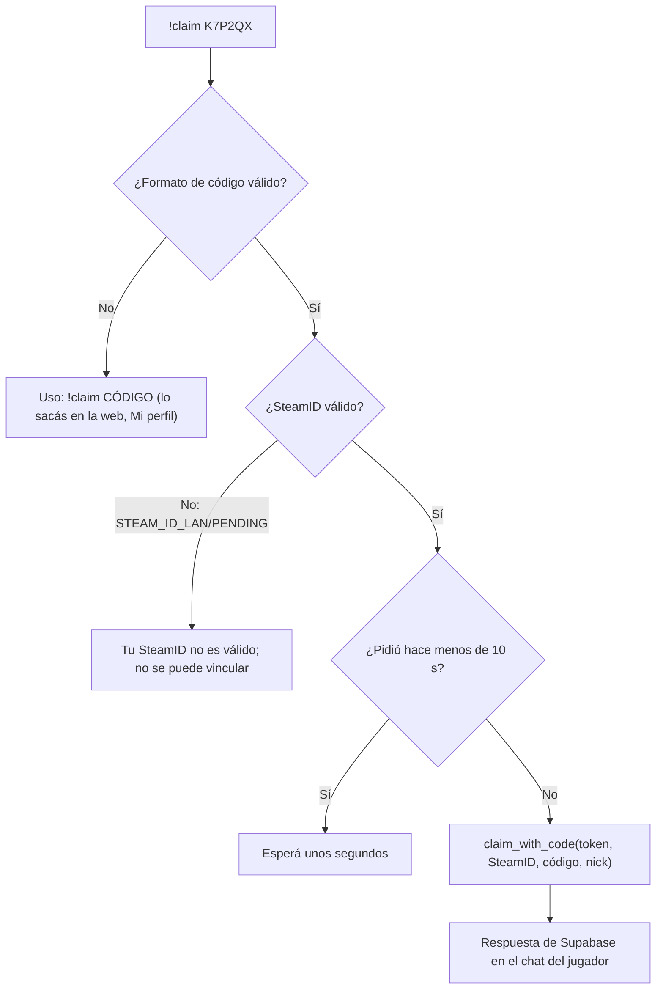
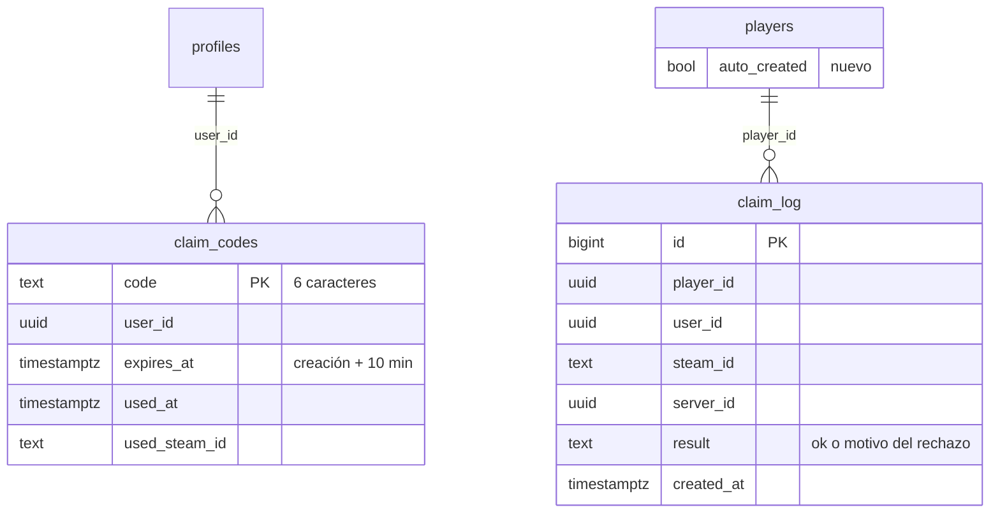
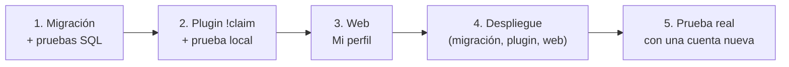

# Plan: perfiles automáticos y reclamo desde el servidor (`!claim`)

> Planeación original. Estado: **propuesta**, pendiente de aprobación.

## Decisiones tomadas

| Tema | Decisión |
|---|---|
| Perfil automático | Se crea **al terminar el primer mix** del jugador, con su nick y SteamID. |
| Cómo se prueba la cuenta web | **Código de un solo uso generado en la web** (6 caracteres, válido 10 minutos). En el juego: `!claim K7P2QX`. |
| Aprobación | **No hace falta.** Se vincula al instante; el admin puede desvincular y cada reclamo queda registrado. |

## 1. El flujo completo

**Por qué es seguro:** el código solo lo ve quien inició sesión en esa cuenta, y el SteamID lo manda el servidor, no el jugador. Para vincular hacen falta las dos cosas a la vez.

## 2. Perfil automático al terminar el primer mix

En `csstv_ingest`, por cada jugador del mix con **SteamID64 válido** que todavía no tiene perfil:

| Regla | Detalle |
|---|---|
| Nick | El del juego al momento del mix, recortado a 2–24 caracteres. Sin distinguir mayúsculas, si ya existe se agrega " 2", " 3", etc. |
| Cambios de nick | El perfil conserva el primer nick (la URL `#jugador/<nick>` no cambia sola). El admin lo puede renombrar. |
| Marca | Columna nueva `players.auto_created` (true), para distinguirlos en el admin. |
| Mixes anteriores | **Carga inicial:** se crean perfiles para los SteamID64 que ya jugaron mixes y no están vinculados (la lista "SteamID sin vincular" de hoy). Se ejecuta una vez con la migración. |
| ELO | Sin cambios: ya va por SteamID, así que el perfil nace con el ELO que ya tenía. |

Efecto en la web: **Jugadores** y el ranking de ELO pasan a mostrar a todos los que jugaron mixes, estén registrados o no. "SteamID sin vincular" queda casi vacía: solo quedarían los que entraron con un SteamID que después se desvinculó.

## 3. Código de reclamo (web)

En **Mi perfil**, una tarjeta nueva **Vincular con el servidor**:

| Estado | Qué muestra |
|---|---|
| La cuenta no tiene perfil vinculado | Botón **Generar código** → `K7P2QX` grande, cuenta regresiva de 10 min y la instrucción "Entrá al servidor y escribí `!claim K7P2QX`". |
| Esperando | La página consulta cada 5 s; cuando se usa el código, muestra "Vinculado con *test_nickname*" y recarga. |
| Ya tiene perfil vinculado | "Tu cuenta está vinculada a *test_nickname*". Sin botón. |

El "Reclamar este perfil" con aprobación del admin **sigue existiendo** para quien no pueda entrar al servidor.

## 4. Comando `!claim` (plugin)

- Funciona en cualquier momento: calentamiento o partida.
- Usa System2, igual que el envío de resultados, pero con su propio pedido y respuesta. El cuerpo es chico (menos de 2 KB).
- Si el servidor está en modo `csstv_send 0` (sin System2), responde que el comando no está disponible.

## 5. Base de datos

| Objeto | Qué hace |
|---|---|
| `players.auto_created` | Marca los perfiles creados por el servidor. |
| `claim_codes` | Códigos de un solo uso. RLS: cada usuario ve solo los suyos; se crean solo con la función. |
| `claim_log` | Registro de cada intento de reclamo (aceptado o rechazado). Solo admin. |
| `create_claim_code()` | Usuario logueado. Borra sus códigos sin usar y crea uno nuevo. Alfabeto sin caracteres confusos (sin 0/O/1/I/L). Máximo 5 por hora. |
| `claim_with_code(token, steam, código, nick)` | Servidor. Valida y vincula (ver tabla siguiente). Devuelve `{ok, mensaje, nick}`. |
| `csstv_ingest` | Redefinida: crea el perfil automático (sección 2). |
| Carga inicial | Crea los perfiles de los SteamID64 sin vincular que ya jugaron mixes. |

**Validaciones de `claim_with_code`:**

| Caso | Resultado |
|---|---|
| Token de servidor inválido | Error (como la ingesta) |
| SteamID inválido | "Tu SteamID no es válido" |
| Más de 5 intentos fallidos de ese SteamID en 10 min | "Demasiados intentos, esperá unos minutos" |
| Código inexistente, vencido o ya usado | "Código inválido o vencido" |
| La cuenta ya tiene otro perfil vinculado | "Tu cuenta ya está vinculada a X" (lo resuelve un admin) |
| El perfil de ese SteamID es de otra cuenta | "Ese perfil ya pertenece a otra cuenta" |
| No hay perfil con ese SteamID | Se crea (nick del juego) y se vinculan sus mixes |
| Todo bien | `players.user_id` = la cuenta; el código queda usado; se cierran las solicitudes de reclamo pendientes de ese perfil |

## 6. Riesgo conocido

En un servidor no-Steam (v34 + ClientMod, `csstv_validate_steamid 0`) **el SteamID no está garantizado**: alguien con un emulador podría usar el SteamID de otro y reclamar su perfil. Esto ya afecta hoy a las estadísticas y al ELO; el reclamo no lo empeora, pero lo hace más visible. Mitigación:

- `claim_log` registra quién reclamó qué, desde qué servidor y cuándo.
- El admin puede desvincular la cuenta del perfil (como hoy en Verificaciones → Revocar).

## Archivos

| Archivo | Cambio |
|---|---|
| `supabase/migrations/2026101xxxxxxx_reclamo_perfil.sql` | Tablas, columnas, funciones, `csstv_ingest` redefinida y carga inicial. |
| `server/addons/sourcemod/scripting/csstv/claim.inc` | Nuevo: comando `!claim` y su pedido HTTP. |
| `server/addons/sourcemod/scripting/csstv_reporter.sp` | Incluir `claim.inc`. Versión 1.2.0. |
| `index.html` | Tarjeta "Vincular con el servidor" en Mi perfil; marca de perfil automático en Admin → Jugadores. |
| `docs/GUIA_SERVIDOR.md`, `docs/FUNCIONALIDADES.md`, `docs/MODELO_DATOS.md` | Flujo nuevo. |

## Orden de implementación

## Pruebas

**SQL (PostgreSQL local):** perfil automático al primer mix, sufijo de nick repetido, NOSTEAM y bots sin perfil, carga inicial, código creado/vencido/usado, límite de códigos por hora, límite de intentos fallidos, cuenta con otro perfil, perfil de otra cuenta, reclamo que crea el perfil y vincula mixes anteriores, permisos.

**Servidor de prueba:** `!claim` con código válido, inválido y vencido; jugador con `STEAM_ID_LAN`; respuesta en el chat.

**Prueba real:** una cuenta nueva juega un mix en el servidor real, se registra y reclama con `!claim`.
