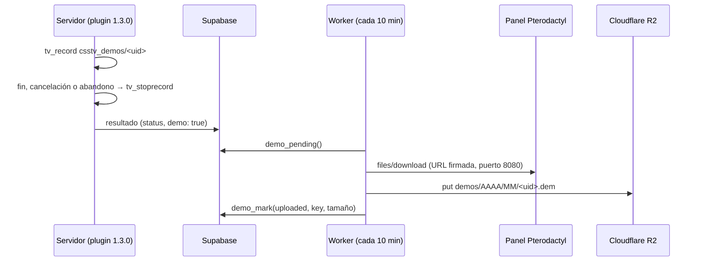
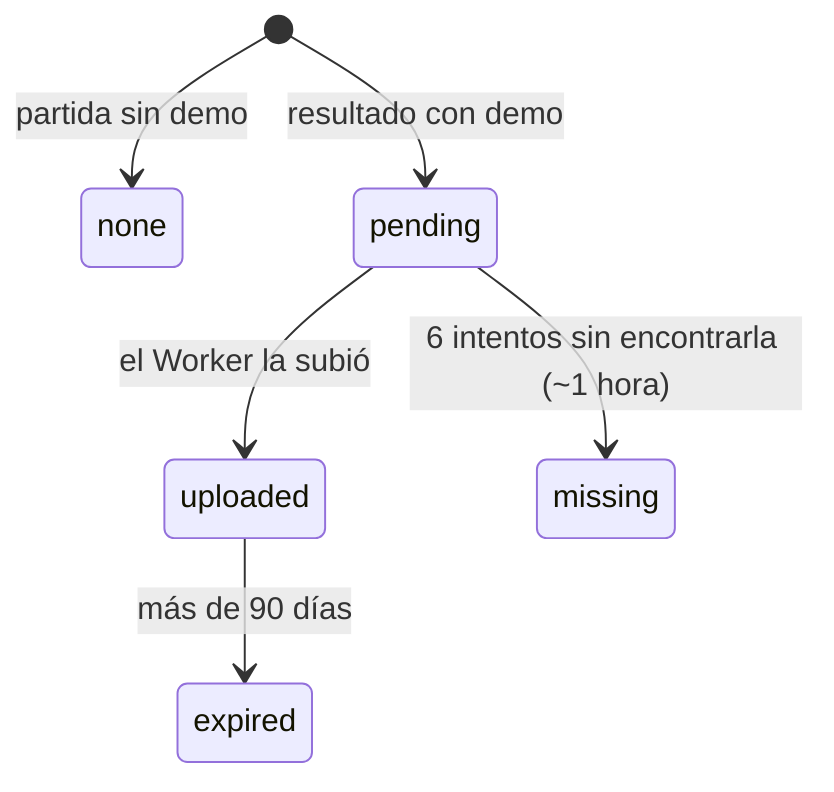

# Demos en Cloudflare R2 y partidas canceladas: documentación

## Qué hace

1. Cada mix graba una demo de SourceTV en el servidor, con el id de la partida como nombre: `cstrike/csstv_demos/<match_uid>.dem`. El mismo id queda en `matches.external_id`.
2. Al terminar (o cancelarse) la partida, el plugin envía el resultado con `"demo": true`; la partida entra a Supabase con `demo_status = 'pending'`.
3. Cada 10 minutos, un Worker de Cloudflare pide las partidas pendientes, baja cada demo por la API del panel (Pterodactyl) y la sube a R2 sin cargarla en memoria.
4. La web la ofrece en `https://v34frag-demos.agusb06-ab.workers.dev/demo/<match_uid>`, con un nombre legible.

## Partidas canceladas

| Cómo se cancela | Motivo (`cancel_reason`) |
|---|---|
| `!cancelmatch` de un admin | `admin`, con su nick en `cancelled_by` |
| Cambio de mapa a mitad de partida | `map_change` |
| Menos de `csstv_abandon_players` (4) jugadores en CT+T durante `csstv_abandon_seconds` (180) seguidos | `abandoned` |

- Con al menos una ronda jugada se guarda con `status = 'cancelled'`, marcador parcial, estadísticas de cada jugador y demo. No tiene ganador.
- No cuenta para el ELO (`elo_apply_match` solo usa `finished`) ni para las stats del perfil (`recompute_player_stats` también).
- Sin rondas jugadas no se guarda y la demo se borra a los 3 segundos.
- Si el servidor se cae, no llega resultado: la demo queda en el servidor y la borra `csstv_demo_keep`.

## Partidas cortas

`!live mrN` (de `mr1` a `mr30`): gana el primero en llegar a N+1. La prórroga usa `csstv_ot_maxrounds`, pero nunca más rondas que el reglamentario (un `mr3` empatado juega prórrogas MR3). El resultado lleva `max_rounds` con las rondas reales del reglamentario.

## Estado de la demo (`matches.demo_status`)

| Columna | Qué guarda |
|---|---|
| `demo_key` | Ruta en R2: `demos/2026/10/srv1-20261012T161559-719f.dem` |
| `demo_size` | Bytes subidos (iguales a los del servidor; el Worker lo verifica) |
| `demo_attempts` | Intentos del Worker |
| `demo_uploaded_at` | Cuándo se subió (para el vencimiento) |

## El Worker (`cloudflare/demo-worker/`)

| Parte | Detalle |
|---|---|
| Cron `*/10 * * * *` | `demo_pending` (hasta 10) → listar demos del servidor → bajar y subir cada una → `demo_mark`. Si la demo no está, `retry`. |
| Cron `17 6 * * *` | `demo_expire(90)`. R2 borra los archivos con la regla `demos-90-dias`. |
| `GET /demo/<uid>` | Descarga pública. 404 si no existe o no está subida, 410 si venció. Nombre: `v34frag_2026-10-12_dust2_16-12.dem` (las canceladas terminan en `_cancelada`). |
| `GET /run?key=…` | Corre la subida a mano (para probar). Protegida con `ADMIN_KEY`. |
| Verificación | El tamaño del listado, el de la descarga y el que guardó R2 tienen que coincidir; si no, no se marca como subida. |
| Borrado en el servidor | `DELETE_AFTER_UPLOAD` (hoy `"false"`). Con `"true"`, borra la demo del servidor después de subirla. |

Secretos del Worker (con `wrangler secret put`): `PTERO_PANEL_API_KEY`, `DEMO_WORKER_TOKEN`, `ADMIN_KEY`. La clave pública de Supabase y la URL están en `wrangler.toml`.

## Funciones de Supabase

| Función | Quién | Qué hace |
|---|---|---|
| `csstv_ingest` | plugin | Acepta `status`, `cancel_reason`, `cancelled_by` y `demo`. Sin esos campos funciona como antes. |
| `demo_pending(token, limit)` | Worker | Partidas `pending` de servidores con `panel_server_id`, de la más vieja a la más nueva. |
| `demo_mark(token, uid, result, key, size)` | Worker | `uploaded` (valida la ruta y el tamaño) o `retry`. Devuelve el estado en que quedó. |
| `demo_expire(token, days)` | Worker | Marca `expired` las subidas hace más de `days` días. |
| `create_demo_worker_token(name)` | admin con sesión en la web | Crea un token del Worker. Desde el SQL Editor se usa el `insert` del final de la migración. |

El token del Worker vive en `demo_workers` (solo su hash) y no sirve para enviar resultados; el de un servidor no sirve para el Worker.

## Dónde está cada cosa

| Recurso | Dónde |
|---|---|
| Bucket | `csstv-demos`, en la cuenta de Cloudflare de Agus (`fedc1b83…`) |
| Worker | `v34frag-demos`, misma cuenta |
| API key del panel | Cuenta `agusb06.ab` del panel de ExtremeHost |
| Servidor en el panel | `55f80fed` (`game_servers.panel_server_id`) |
