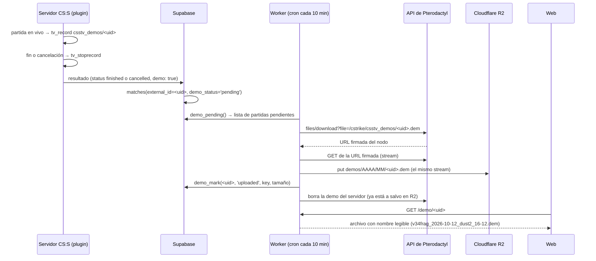
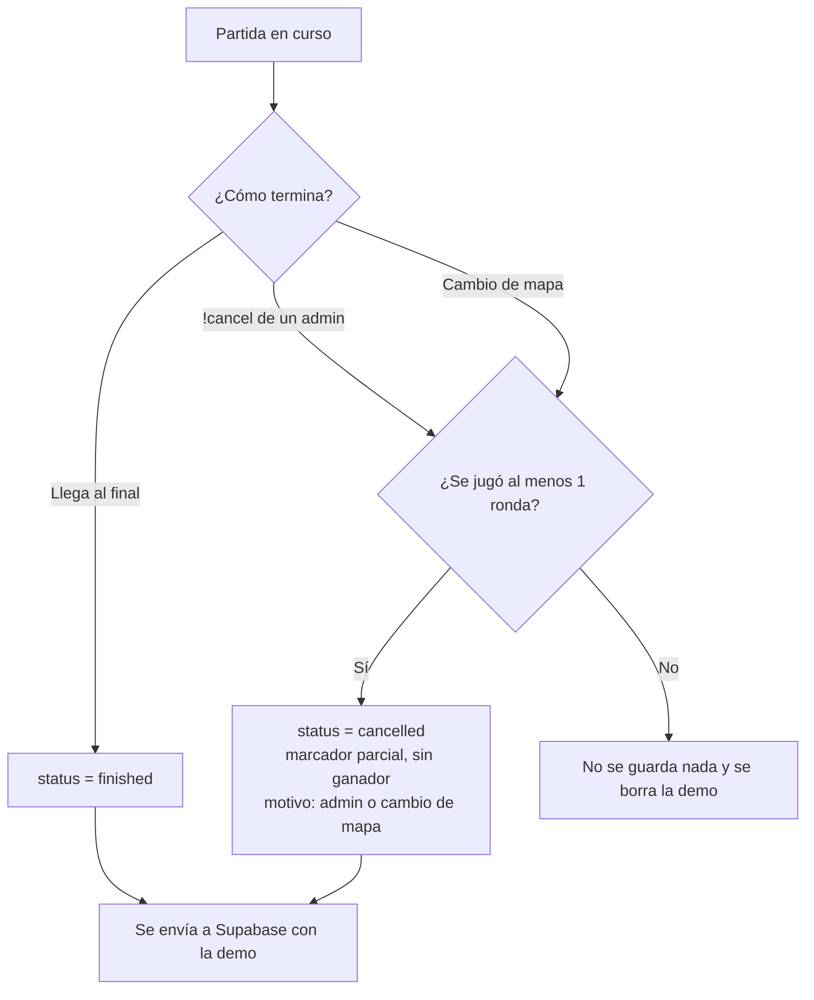
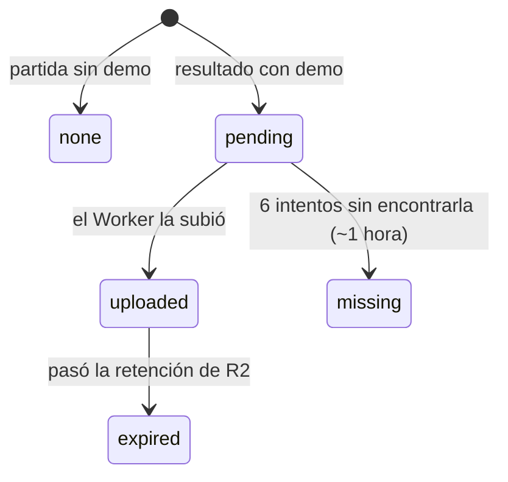

# Plan: demos en Cloudflare R2 (Worker) y partidas canceladas

> Planeación original. Estado: **propuesta**, pendiente de aprobación.

## Decisiones tomadas

| Tema | Decisión |
|---|---|
| Cómo salen las demos del servidor | Un **Cloudflare Worker** con cron las baja por la **API de Pterodactyl** (el panel de ExtremeHost) y las sube a R2. No hace falta SSH, Python ni cron en el servidor del juego. |
| Cómo se asocia una demo a su partida | Por el **`match_uid`**. El plugin ya graba `csstv_demos/<match_uid>.dem`, y Supabase guarda ese mismo valor en `matches.external_id`. |
| Partidas canceladas | **Se guardan** con estado `cancelled`, con su marcador parcial y **con su demo**. No cuentan para ELO, estadísticas ni rankings. |

## 1. El flujo completo

## 2. Partidas canceladas

Hoy `!cancel` y el cambio de mapa a mitad de partida descartan todo. Con este cambio:

| Regla | Detalle |
|---|---|
| Qué se guarda | Marcador parcial, rondas jugadas, estadísticas de cada jugador y demo. `winner` siempre vacío. |
| Motivo | Campo nuevo `cancel_reason`: `admin` (con el nick de quien canceló en `cancelled_by`) o `map_change`. |
| Mínimo | Al menos **1 ronda completa**. Con 0 rondas no hay nada que mostrar y la demo se borra al instante. |
| ELO | No se aplica. `elo_apply_match` ya ignora todo lo que no sea `finished`. |
| Estadísticas y rankings | No cuentan. `recompute_player_stats`, la lista de mixes y el perfil ya filtran por `finished`. Las estadísticas de la partida igual se guardan, para verlas en el detalle. |
| Web | Las canceladas aparecen en el historial con la etiqueta **"Cancelada"** y el motivo; el detalle muestra el marcador parcial y la demo. |
| `!claim` (si se aprueba) | Una partida cancelada **no** crea perfiles automáticos; solo las terminadas. |
| Caída del servidor | No llega resultado: la demo queda huérfana y la borra la limpieza de siempre (`csstv_demo_keep`). |

## 3. Cambios en la base de datos

Migración nueva:

| Tabla | Cambio |
|---|---|
| `matches` | `status` admite `cancelled` (hoy `upcoming`, `live`, `finished`). |
| `matches` | `cancel_reason` text (`admin`, `map_change`), `cancelled_by` text. |
| `matches` | `demo_status` text, default `none`: `none` · `pending` · `uploaded` · `missing` · `expired`. |
| `matches` | `demo_key` text (ruta en R2), `demo_size` bigint, `demo_attempts` int, `demo_uploaded_at` timestamptz. |
| `game_servers` | `panel_server_id` text: el id del servidor en Pterodactyl (no es secreto; lo usa el Worker para saber de dónde bajar). |

Funciones:

| Función | Quién la usa | Qué hace |
|---|---|---|
| `csstv_ingest` (modificada) | plugin | Acepta `status` y `cancel_reason` en el resultado (si no vienen: `finished`, como hoy). Pone `demo_status = 'pending'` si `demo` es true. |
| `demo_pending(p_token)` | Worker | Devuelve hasta 10 partidas `pending` con su `external_id`, `panel_server_id`, mapa, fecha y marcador. |
| `demo_mark(p_token, p_uid, p_status, p_key, p_size)` | Worker | Marca el resultado de un intento. |

El Worker se autentica con un **token propio** (guardado con hash, igual que el de los servidores), no con la clave `service_role`.

## 4. Cambios en el plugin (`csstv_reporter`)

| Cambio | Detalle |
|---|---|
| Resultado | Campos nuevos: `"status"` (`finished`/`cancelled`), `"cancel_reason"`, `"cancelled_by"`, `"demo"` (true si `tv_record` realmente arrancó). Siguen en `schema: 1`: son opcionales y Supabase acepta el formato viejo. |
| `!cancel` | En lugar de descartar: para la demo, arma el resultado con `status: cancelled` y lo pone en la cola, igual que `FinishMatch`. Con 0 rondas, descarta y borra la demo. |
| Cambio de mapa | Igual que `!cancel`, con motivo `map_change`. Se envía cuando cargue el mapa siguiente (la cola ya funciona así). |
| Limpieza | `csstv_demo_keep` sigue como red de seguridad; normalmente el Worker borra cada demo después de subirla. |
| Versión | 1.3.0 (o 1.4.0 si `!claim` sale antes). |

## 5. El Worker

| Parte | Detalle |
|---|---|
| Cron | Cada 10 minutos: `demo_pending` → por cada partida, bajar de Pterodactyl y subir a R2 en stream (sin cargar el archivo en memoria). |
| Ruta en R2 | `demos/AAAA/MM/<match_uid>.dem` |
| Verificación | Compara el tamaño subido con el del servidor antes de marcar `uploaded` y antes de borrar la demo del servidor. |
| Descarga pública | `GET /demo/<match_uid>`: lee de R2 y responde con `Content-Disposition` para que baje como `v34frag_2026-10-12_dust2_16-12.dem`. |
| Retención | Regla de expiración del bucket a **90 días**; un cron diario marca `expired` las que pasaron ese plazo. |
| Secretos del Worker | `PTERO_API_KEY`, `DEMO_WORKER_TOKEN`, `SUPABASE_URL`, `SUPABASE_ANON_KEY` (con `wrangler secret put`, nunca en el repo ni en el chat). El bucket se conecta con un *binding*, sin claves S3. |
| Código | `cloudflare/demo-worker/` en el repo (`wrangler.toml` + `src/index.js`). |

Límites del plan gratis que aplican: 100 000 solicitudes/día, 50 subrequests por ejecución (10 demos por ejecución usan ~40), 10 GB en R2 (~2000 demos de 5 MB) y descargas sin costo.

## 6. Requisitos antes de empezar

| Requisito | Cómo se verifica |
|---|---|
| ExtremeHost permite crear **API keys** en el panel (*Account → API Credentials*) | Daniel la crea y la pone en `.env` como `PTERO_API_KEY`, junto con `PTERO_PANEL_URL` y `PTERO_SERVER_ID`. |
| La URL firmada de descarga responde desde fuera del panel | Prueba con `curl` antes de escribir el Worker. |
| Cuenta de Cloudflare con R2 activado y bucket creado | Daniel ya lo tenía preparado (pausado). |

## 7. Orden de implementación

1. Verificar la API de Pterodactyl (requisito bloqueante).
2. Migración SQL (estados, columnas, `csstv_ingest`, `demo_pending`, `demo_mark`).
3. Plugin 1.3.0: partidas canceladas y campo `demo`. Pruebas con bots en el servidor local.
4. Worker: subida, descarga pública y retención. Prueba con una demo real.
5. Web: etiqueta "Cancelada", botón "Descargar demo" en el detalle del mix.
6. Despliegue: migración → Worker → plugin → web.
