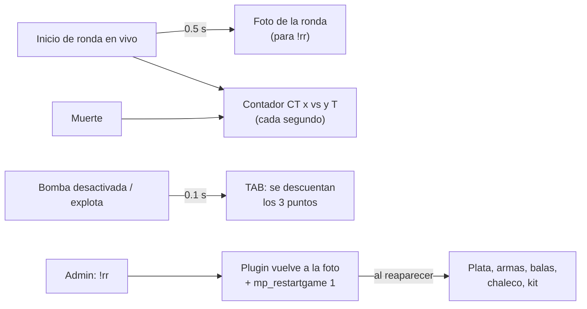
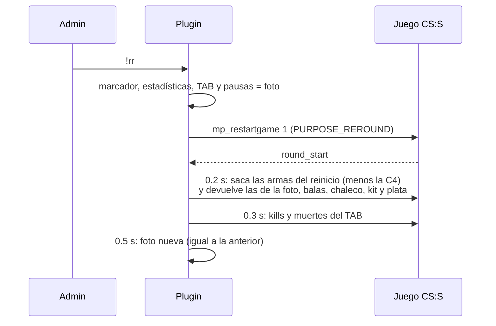

# QoL del servidor, segunda tanda: documentación

## Qué hace

La versión **1.4.0** del plugin `csstv_reporter` agrega seis mejoras a los mixes en CS:S v34. No cambia la base de datos, la web ni el Worker, y el resultado que se envía a Supabase tiene el mismo formato.

1. **Cambio de lado sin muertos.** Durante la partida, quien está en CT o T no puede cambiar de equipo. Si un jugador vivo elige un modelo (por ejemplo, en el menú que abre el medio tiempo), ya no muere: el modelo se usa la próxima vez que aparezca.
2. **`!team`.** Comando de admin para mover a un jugador de equipo durante la partida.
3. **`!rr`.** Comando de admin que repite la ronda actual: todo vuelve a como estaba al empezarla.
4. **Contador de vivos.** `CT 5 vs 4 T` fijo arriba al centro durante la partida.
5. **TAB sin los puntos de la bomba.** Desactivar la bomba o hacerla explotar ya no suma 3 "kills" en el TAB.
6. **Créditos.** Cada 12 minutos el chat muestra `Plugin made by kyan & daniloev`.

## Cambio de lado y equipos bloqueados

**El problema.** En el medio tiempo el plugin pasa a cada jugador al otro lado con `ChangeClientTeam`, le asigna el modelo equivalente y lo marca activo (`m_iPlayerState = 0`) para que reaparezca con el reinicio. A los jugadores reales el juego les abre igual el menú de modelos. Si alguien elegía tarde, el `joinclass` le llegaba al motor con el jugador ya vivo y lo dejaba muerto.

**La solución.** Con `csstv_lock_teams 1`, mientras la partida está iniciando, en vivo o en medio tiempo, el plugin escucha tres comandos del cliente:

| Comando | Si… | Qué hace el plugin |
|---|---|---|
| `jointeam`, `chooseteam` (tecla `M`) | el jugador está en CT o T | Lo bloquea: "Durante la partida no se puede cambiar de equipo. Un admin puede moverte con !team." |
| `jointeam`, `chooseteam` | es espectador o recién conectado | Lo deja pasar (suplentes y reconexiones) |
| `joinclass N` | el jugador está vivo | No lo pasa al motor. Si `N` es un modelo de su equipo (T 1-4, CT 5-8), lo guarda en `m_iClass` para la próxima vez que aparezca |
| `joinclass N` | el jugador está muerto | Lo deja pasar |

### `!team <jugador> <ct|t|spec>`

SourceMod no trae de base un comando para mover jugadores de equipo, así que lo agrega el plugin (flag `b`, generic). Usa `MoveToTeam`, la misma función del medio tiempo: cambia de equipo, asigna el modelo equivalente y marca al jugador activo, sin dejarlo en el menú de modelos.

- Si el jugador está vivo, el juego lo mata y aparece en la próxima ronda.
- El cambio de equipo anota una muerte en el TAB. El plugin guarda las kills y muertes antes del cambio y las devuelve cuando el jugador reaparece.

## `!rr`: repetir la ronda

### La foto de la ronda

Medio segundo después de cada `round_start` en vivo (cuando la plata del inicio de ronda ya está acreditada), el plugin guarda:

| Qué | Dónde |
|---|---|
| Marcador: `g_iSegA/B`, `g_iTotA/B`, `g_iSegRound` y el largo del registro de rondas | Variables `g_iRr*` |
| Estadísticas de todos los jugadores (copia completa de `g_Stats`) | `g_iRrStats` |
| Kills y muertes del TAB de cada jugador | `g_iRrBoardFrags`, `g_iRrBoardDeaths` |
| Pausas usadas por cada equipo | `g_iRrPauses` |
| Por jugador vivo: plata, chaleco, casco, kit, visión nocturna, armas con las balas del cargador y reservas (`m_iAmmo`, que también lleva la cantidad de granadas) | `g_iRrMoney`, `g_sRrWeapon`, `g_iRrClip`, `g_iRrAmmo`… |

Todo se guarda por **registro de jugador** (su SteamID), así que sirve aunque alguien se haya reconectado durante la ronda. La C4 no se guarda: al reiniciar la reparte el juego.

### Qué pasa al usar `!rr`

- **Cuándo se puede usar:** solo con la partida en vivo y fuera de un reinicio. No funciona en el LO3, en el medio tiempo ni en el cambio a prórroga.
- **Después del fin de una ronda** (antes de que empiece la siguiente), `!rr` repite la ronda que acaba de terminar: se descuenta del marcador.
- **En el primer medio segundo de una ronda** todavía no hay foto y el comando pide probar de nuevo.
- El arma principal se devuelve primero para que quede en la mano; después la pistola, las granadas y el cuchillo.
- Quien no estaba al inicio de la ronda queda con lo que le da el reinicio.
- El demo sigue grabando, así que la ronda repetida queda en el demo.

## Contador de vivos

- Texto `CT 5 vs 4 T`, arriba al centro, con `HudMsg` (`ShowSyncHudText`). En v34 existe ese mensaje y se ve con ClientMod; `KeyHintText` (la caja de arriba a la derecha) no existe.
- Se muestra durante la partida (en vivo y en medio tiempo, fuera de los reinicios) y lo ven todos los jugadores, vivos, muertos y espectadores.
- Se reenvía cada segundo y dura 1.5 s, sin fundidos, así queda fijo y sin parpadeo. En cada muerte se actualiza 0.1 s después (en `player_death` la víctima todavía puede figurar viva).
- `csstv_alive_hud 2` lo muestra en el centro de la pantalla (`PrintCenterText`), por si algún cliente no ve el texto de arriba.

## Puntos de la bomba en el TAB

CS:S suma 3 puntos (frags) a quien desactiva la bomba y a quien la plantó si explota. En los eventos `bomb_defused` y `bomb_exploded` (solo en vivo), el plugin programa un timer de 0.1 s que le resta `csstv_bomb_frags` puntos a ese jugador. Después vuelve a guardar sus kills y muertes, porque el fin de ronda ya pudo haberlas guardado con los puntos.

Las estadísticas que se envían a la web nunca contaron esos puntos: las kills las cuenta el plugin en `player_death`.

## Créditos

Un timer repetido cada `csstv_credits_interval` segundos manda `[v34frag] Plugin made by kyan & daniloev` (los nombres en amarillo con ClientMod) al chat de todos, también en el calentamiento. Si se cambia el cvar, el timer se vuelve a crear con el intervalo nuevo; con `0` se apaga.

## Cvars nuevos

| Cvar | Por defecto | Qué hace |
|---|---|---|
| `csstv_lock_teams` | `1` | Bloquea cambiar de equipo durante la partida y que elegir modelo estando vivo mate al jugador |
| `csstv_alive_hud` | `1` | Contador de vivos: 0 no, 1 fijo arriba al centro, 2 en el centro de la pantalla |
| `csstv_bomb_frags` | `3` | Puntos de la bomba que se descuentan del TAB (0 = no tocar) |
| `csstv_credits_interval` | `720` | Segundos entre los mensajes de créditos (0 = nunca) |

## Comandos nuevos

| Comando | Quién | Qué hace |
|---|---|---|
| `!rr` (`sm_rr`) | Admin (flag `b`) | Repite la ronda actual |
| `!team <jugador> <ct\|t\|spec>` (`sm_team`) | Admin (flag `b`) | Cambia de equipo a un jugador |

## Dónde está cada cosa

| Qué | Archivo / ubicación |
|---|---|
| `!rr`: foto y restauración | `server/addons/sourcemod/scripting/csstv/rr.inc` |
| Equipos bloqueados, `!team`, contador de vivos, puntos de la bomba, créditos | `server/addons/sourcemod/scripting/csstv/qol.inc` (secciones al final) |
| `MoveToTeam` (cambio de lado y `!team`), `PURPOSE_REROUND`, evento `bomb_exploded` | `server/addons/sourcemod/scripting/csstv_reporter.sp` |
| Cvars en el cfg del servidor | `server/cfg/sourcemod/csstv_reporter.cfg` |
| Guía de uso | `docs/GUIA_SERVIDOR.md`, secciones "Durante la partida" y "Comandos" |
