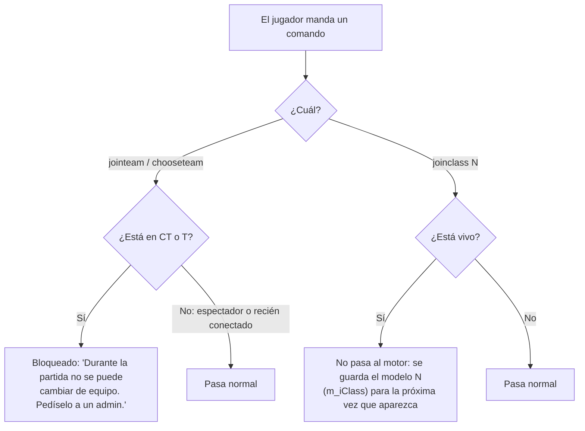
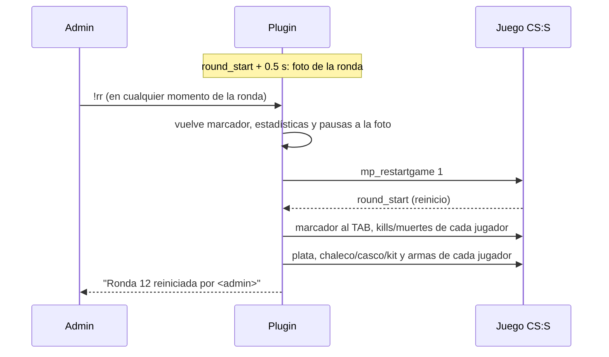

# Plan: QoL del servidor, segunda tanda (cambio de lado, créditos, `!rr` y contador de vivos)

> Planeación original, aprobada el 2026-10-12 (con el ajuste del contador de vivos: solo al inicio de la ronda y unos segundos después de cada muerte). Los cambios hechos durante la implementación están en [GUIA_IMPLEMENTACION.md](GUIA_IMPLEMENTACION.md#cambios-respecto-al-plan).

Cambios solo en el plugin `csstv_reporter` (CS:S v34, SourceMod 1.10 con compilador 1.8). No hay cambios en la base de datos, la web ni el Worker. Versión nueva: **1.4.0**.

## Decisiones tomadas

| # | Tema | Decisión | Por qué |
|---|---|---|---|
| 1 | Cambio de lado | Durante la partida se bloquea `jointeam` para quien ya está en CT o T, y `joinclass` de un jugador vivo solo cambia el modelo para la próxima vez que aparezca (no pasa por el motor). | Elegir modelo tarde en el menú que abre el cambio de lado es lo que deja muerto al jugador. Los espectadores y quien se reconecta pueden seguir uniéndose. |
| 2 | Créditos | Cada 12 minutos (configurable), en el chat de todos: `Plugin made by kyan & daniloev`. Siempre, también en calentamiento. | Pedido; 12 min queda en el rango 10-15. |
| 3 | `!rr` | Comando de **admin** (como `!live` y `!cancelmatch`). Vuelve todo al inicio de la ronda actual: marcador, estadísticas, kills/muertes del TAB, plata y equipamiento, y se juega de nuevo. | Un jugador no debería poder anular una ronda perdida. Si se quiere votación, se agrega después. |
| 4 | Contador de vivos | No hay un plugin mantenido para CS:S v34 (ver "Investigación"); se hace dentro del plugin: `CT 5 vs 4 T` arriba al centro, **solo al inicio de la ronda y 3 segundos después de cada muerte** (no fijo). | Son ~60 líneas y así comparte el estado de la partida y los cvars. Daniel prefiere que no esté siempre en pantalla. |

## 1. Cambio de lado: jugadores que aparecen muertos

**Qué pasa hoy.** En el medio tiempo el plugin cambia a cada jugador de equipo con `ChangeClientTeam`, le asigna el modelo equivalente del otro lado y lo marca activo (`m_iPlayerState = 0`) para que reaparezca con el reinicio. Con eso los bots funcionan, pero a los jugadores reales el juego les abre igual el menú de modelos. Si eligen rápido, no pasa nada; si se quedan unos segundos AFK y eligen después, el `joinclass` llega cuando ya aparecieron y el motor los deja muertos (el CS:S no deja aparecer dos veces en la misma ronda, ni pasados 20 s del inicio).

**Solución.** Un `AddCommandListener` sobre los comandos del cliente, solo mientras hay partida (iniciando, en vivo o medio tiempo) y con el cvar `csstv_lock_teams 1`:

- El modelo elegido se valida contra el equipo (T 1-4, CT 5-8); si no corresponde, se ignora.
- Los admins siguen pudiendo mover jugadores con `sm_team`/`sm_swap` (esos no pasan por `jointeam`).

**A verificar con un cliente real (no se puede con bots):** que el menú se cierre al elegir y que el jugador quede vivo con el modelo nuevo a la ronda siguiente. Se agrega un log de depuración (estado, vivo, segundos desde el reinicio) para confirmar la causa.

## 2. Mensaje de créditos

- Timer repetido según `csstv_credits_interval` (segundos, por defecto `720`; `0` lo desactiva).
- Mensaje en el chat de todos: `[v34frag] Plugin made by kyan & daniloev`, con los colores del chat del plugin.

## 3. `!rr`: repetir la ronda actual

### Qué se guarda al inicio de cada ronda en vivo

Se guarda medio segundo después de `round_start` (cuando la plata ya está acreditada), plata y equipamiento **en el mismo instante**, así si alguien compró en ese medio segundo la foto sigue siendo coherente.

| Qué | Detalle |
|---|---|
| Marcador del plugin | `g_iSegA/B`, `g_iTotA/B`, `g_iSegRound`, registro de rondas (`g_iRoundLogCount`) |
| Estadísticas | Copia completa de `g_Stats` (kills, muertes, daño, asistencias, multikills…) |
| TAB | Kills y muertes de cada jugador (por SteamID) |
| Por jugador (por SteamID) | Plata, chaleco, casco, kit, armas (primaria, secundaria, granadas con su cantidad) |
| Pausas | Pausas usadas por cada equipo |

### Flujo

- Solo con la partida **en vivo** y fuera de un reinicio (no en LO3, medio tiempo ni cambio a prórroga) y cuando ya hay una foto de esta ronda.
- La ronda no cuenta: `round_end` del reinicio se ignora como ya pasa hoy.
- Si un jugador no estaba al inicio de la ronda (entró después), queda con lo que le da el reinicio.
- El demo sigue grabando; la ronda repetida queda en el demo (no se puede cortar).

**Riesgo técnico (a probar primero con bots):** devolver las armas necesita `GivePlayerItem` y sacar la pistola por defecto `RemovePlayerItem`; los dos usan offsets de la gamedata de SourceMod, que puede no coincidir con v34 (ya pasó con `CS_SwitchTeam`). Si fallan, el plan B es **devolver el valor de las armas en plata** (precio de cada arma, hasta $16.000), para que cada uno las vuelva a comprar en el freezetime.

## 4. Contador de vivos arriba de la pantalla

### Investigación

- No encontré un plugin mantenido para esto en CS:S. Lo más cercano es un hilo de AlliedMods de 2016 ("Show alive player in players HUD") con un código parcial para la CS:S nueva.
- En CS:S hay tres formas de poner texto fijo en pantalla:

| Método | Dónde se ve | En v34 |
|---|---|---|
| `ShowSyncHudText` (HudMsg) | Donde se quiera; arriba al centro | Dudoso: en versiones viejas de CS:S no se ve por falta de una fuente. Hay que probarlo con ClientMod |
| `KeyHintText` | Caja arriba a la derecha | Debería andar |
| `PrintHintText` | Caja abajo al centro | Anda, pero hace un sonido en cada actualización |

### Diseño

- Texto: `CT 5 vs 4 T` (vivos de cada lado), arriba al centro.
- Solo durante la partida en vivo; lo ven todos (jugadores, muertos y espectadores).
- **No está siempre en pantalla:** aparece al empezar la ronda y cada vez que alguien muere, y se va solo a los `csstv_alive_hud_time` segundos (por defecto 3). Si hay otra muerte mientras se ve, se actualiza y vuelve a contar el tiempo.
- `csstv_alive_hud`: `0` desactivado, `1` HudMsg arriba al centro (por defecto), `2` KeyHintText arriba a la derecha (por si el 1 no se ve en v34).

## 5. Cvars nuevos

| Cvar | Por defecto | Qué hace |
|---|---|---|
| `csstv_lock_teams` | `1` | Bloquea cambiar de equipo y el `joinclass` de los vivos durante la partida |
| `csstv_credits_interval` | `720` | Segundos entre los mensajes de créditos (`0` = nunca) |
| `csstv_alive_hud` | `1` | Contador de vivos: 0 no, 1 arriba al centro, 2 arriba a la derecha |
| `csstv_alive_hud_time` | `3` | Segundos que se ve el contador después del inicio de la ronda o de una muerte |

## 6. Requisitos antes de empezar

- Servidor local de pruebas (`E:\CSS DEDICATED SERVER\server`) con `csstv_send 0` para no mandar partidas de bots a Supabase.
- Para los puntos 1 y 4: Daniel conectado con un cliente v34 real (con ClientMod) para ver el menú de modelos y el texto en pantalla.

## 7. Orden de implementación

1. Prueba rápida con bots: `GivePlayerItem` / `RemovePlayerItem` en v34 y el valor que devuelve `ShowSyncHudText`.
2. Créditos (punto 2).
3. Contador de vivos (punto 4).
4. Bloqueo de `jointeam` / `joinclass` (punto 1).
5. `!rr` (punto 3), con plan B si las armas no se pueden devolver.
6. Compilar, probar con bots en `$2000$` (3 vs 1) y con un cliente real para los puntos 1 y 4.
7. `DOCUMENTACION.md`, `GUIA_IMPLEMENTACION.md`, fila en el índice y actualizar `docs/GUIA_SERVIDOR.md`.
