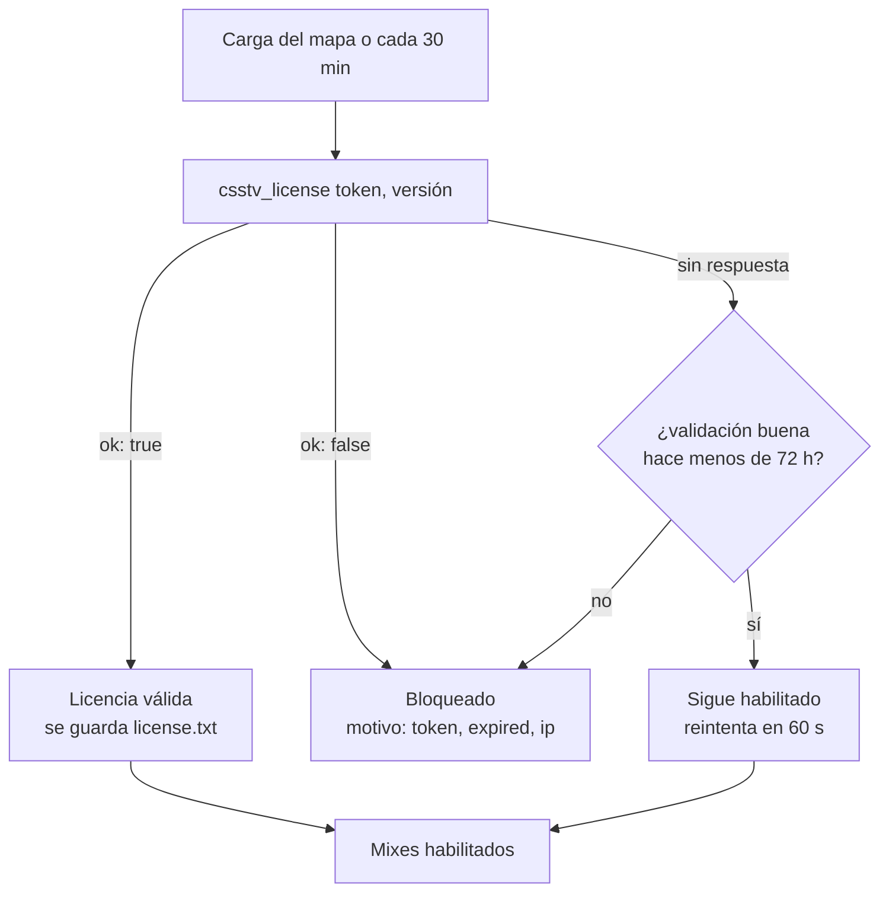
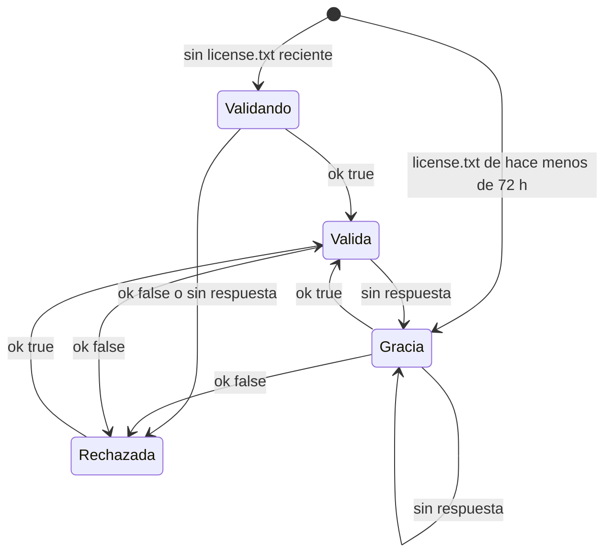

# Licencia por servidor: documentación

## Qué hace

Desde la versión 1.5.0, el plugin `csstv_reporter` solo deja jugar mixes si Supabase confirma que el servidor tiene una licencia válida. La licencia es el mismo `csstv_server_token` que ya usaba cada servidor para subir resultados: no hay una clave nueva.

Al cargar cada mapa y cada 30 minutos, el plugin llama a la función `csstv_license` de Supabase. Si la respuesta es "no" (token inválido, revocado, vencido o usado desde otra IP), el plugin no deja empezar partidas y avisa en el chat. Si Supabase no responde, se usa la última validación buena durante 72 horas, para que un corte de red no frene los mixes.

La protección importante está en Supabase, no en el `.smx`: aunque alguien descompile el plugin y le saque el chequeo, la ingesta (`ingest_server_chunk`) aplica las mismas reglas y no acepta resultados sin licencia. Sin eso no hay estadísticas, ELO, ranking ni demos en la web.



## Reglas

| Situación | Qué pasa |
|---|---|
| Token válido, activo, sin vencer y desde la IP permitida | Mixes habilitados. |
| Token inexistente o revocado (`active = false`) | Bloqueado, motivo `token`. |
| `license_expires_at` ya pasó | Bloqueado, motivo `expired`. |
| `allowed_ip` cargada y la conexión viene de otra IP | Bloqueado, motivo `ip`. |
| El `.smx` fue compilado para otro servidor (`CSSTV_LICENSE_ID`) | Bloqueado, motivo `build`. |
| Falta System2 o falta configurar URL, key o token | Bloqueado (no hay forma de validar). |
| Supabase no responde o devuelve un error HTTP | Si hubo una validación buena hace menos de 72 h, sigue habilitado; si no, bloqueado. Reintenta cada 60 s. |
| La licencia se pierde con un mix en curso | El mix termina normal. El bloqueo aplica desde el próximo calentamiento. Su resultado espera en la cola hasta que vuelva la licencia. |

### Qué se bloquea sin licencia

- Empezar partidas: `!ready` y `sm_live` responden "Este servidor no tiene una licencia válida de CSSTV (motivo)".
- El recordatorio del calentamiento (cada 30 s) muestra ese aviso en lugar de la lista de listos.
- `sm_team`.
- El envío de resultados: la cola espera, los archivos **no** se mueven a `failed/`. Cuando vuelve la licencia se envían solos.

Lo demás del plugin (pausas, `!rr`, `!hp`, HUD de vivos, daño, demo) solo actúa con una partida en curso, así que sin licencia tampoco se usa.

## Estados del plugin



`Válida` y `Gracia` habilitan los mixes; `Validando` y `Rechazada` no. `sm_csstv_status` muestra el estado en la línea "Licencia:".

## Base de datos

### Columnas nuevas en `game_servers`

| Columna | Tipo | Uso |
|---|---|---|
| `license_expires_at` | `timestamptz` | Vencimiento. `null` = no vence. |
| `allowed_ip` | `text` | Única IP desde la que se acepta el token. `null` = cualquiera. |
| `last_ip` | `text` | IP que vio Supabase en la última conexión válida (sirve para saber qué poner en `allowed_ip`). |
| `plugin_version` | `text` | Versión del plugin que informó el servidor. |

### Funciones

| Función | Quién la llama | Qué hace |
|---|---|---|
| `csstv_license(p_token, p_version)` | El plugin (`anon`) | Devuelve `{"ok": true, "server_id", "name", "expires_at"}` o `{"ok": false, "reason"}`. Siempre responde 200, así el plugin distingue un "no" de una falla de red. Guarda `plugin_version`. |
| `csstv_check_token(p_token)` | Interna | Devuelve `(sid, reason)`. Si todo está bien actualiza `last_seen_at` y `last_ip`. |
| `csstv_auth(p_token)` | `ingest_server_chunk`, `ingest_server_match` | Misma firma de antes; ahora con vencimiento e IP. Error `PT401` (HTTP 401) con un mensaje por motivo. |
| `csstv_request_ip()` | Interna | IP del que llama, de `request.headers`: `cf-connecting-ip` o el primer valor de `x-forwarded-for`. |

Solo `csstv_license` es pública. Un intento rechazado no actualiza `last_ip` ni `last_seen_at`.

## Plugin

| Qué | Detalle |
|---|---|
| URL | Se arma con `csstv_api_url` cambiando lo que sigue a `/rpc/` por `csstv_license`. El cfg de siempre sirve sin cambios. |
| Caché | `addons/sourcemod/data/csstv/license.txt`: la hora (Unix) de la última validación buena. Un "ok: false" la borra (escribe 0). Una fecha en el futuro no vale. |
| `sm_csstv_status` | Nueva línea "Licencia: válida · <nombre> · <vence>" o "NO VÁLIDA: <motivo>". |
| `sm_csstv_license` | (RCON) Vuelve a validar ahora, por ejemplo después de cambiar el vencimiento en la web. |
| Log | Cada cambio entre habilitado y bloqueado queda en el log de SourceMod; las fallas de red, en `errors_<fecha>.log`. |

### Build atado a un servidor

`csstv/license_id.inc` define `CSSTV_LICENSE_ID`. En el repo está vacío: el plugin acepta el token de cualquier servidor. Para un tercero se compila con su UUID (`game_servers.id`):

```bash
server/build_licenciado.sh <uuid> <nombre-corto>
# → server/licencias/<nombre-corto>/csstv_reporter.smx   (ignorado por git)
```

Ese `.smx` solo funciona con el token de ese servidor y lleva el UUID adentro: si aparece en otro lado, se sabe de dónde salió. El UUID no es secreto; el secreto es el token.

## Web (Admin > Servidores)

Cada servidor muestra una segunda línea: `Licencia: no vence | vence el … | VENCIDA el … · IP: cualquiera | solo … (última: …) · plugin 1.5.0`.

| Botón | Qué hace |
|---|---|
| **Vencimiento** | Pide una fecha `AAAA-MM-DD` (vence a las 23:59:59 de ese día, hora local del navegador). Vacío = no vence. |
| **IP** | Pide la IP permitida; propone la última IP vista. Vacío = cualquiera. |
| **Nuevo token** / **Revocar** | Como antes. Revocar bloquea el plugin en la próxima validación (como mucho 30 minutos, o al cambiar de mapa). |

## Límites conocidos

- Un `.smx` se puede descompilar y parchear para saltarse el chequeo local. Lo que no se puede saltar es Supabase: sin licencia no se sube nada. Lo que se puede robar así son las funciones locales (ready, LO3, pausas, `!rr`), no la plataforma.
- `license.txt` es un archivo de texto: alguien con acceso al servidor podría escribir una hora reciente y cortar la conexión a Supabase para tener 72 h más. Tampoco le sirve para subir resultados.
- `allowed_ip` depende de la IP que le llega a Supabase. Hay que mirar `last_ip` en la web antes de fijarla; si el servidor sale por otra IP, se bloquea.
- Sin la extensión System2 el plugin no puede validar y queda bloqueado (antes podía usarse con `csstv_uploader.py`).

## Dónde está cada cosa

| Qué | Archivo / ubicación |
|---|---|
| Migración | `supabase/migrations/20261013120000_licencia_servidores.sql` |
| Lógica de la licencia en el plugin | `server/addons/sourcemod/scripting/csstv/license.inc` |
| ID del build | `server/addons/sourcemod/scripting/csstv/license_id.inc` |
| Chequeos (`sm_live`, `!ready`, recordatorio, estado) | `server/addons/sourcemod/scripting/csstv_reporter.sp` |
| Chequeo de la cola | `server/addons/sourcemod/scripting/csstv/http.inc` (`Http_ProcessQueue`) |
| Chequeo de `sm_team` | `server/addons/sourcemod/scripting/csstv/qol.inc` (`Cmd_Team`) |
| Build para terceros | `server/build_licenciado.sh` → `server/licencias/` |
| Admin > Servidores | `index.html` (`rSrv`) |
| Caché en el servidor de juego | `addons/sourcemod/data/csstv/license.txt` |
