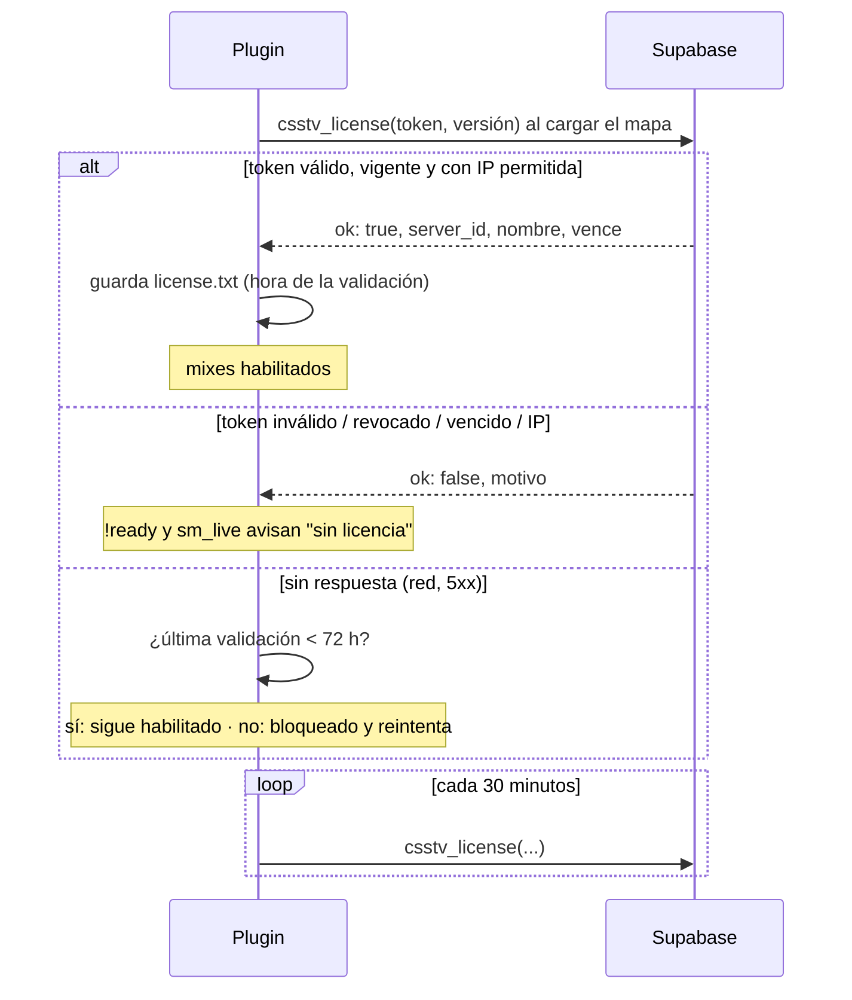

# Plan: Licencia por servidor (el plugin solo funciona con una key válida en Supabase)

> Planeación original. Estado: **aprobada** el 2026-10-13 ("Sí, impleméntalo con la bitácora").

## Contexto

Queremos poder compartir el plugin con servidores de terceros sin entregar el código y sin que funcione si no lo autorizamos. El `.smx` se puede descompilar (Lysis), así que la protección real tiene que estar en Supabase: el plugin pide permiso al arrancar y, si no lo tiene, no deja jugar mixes.

Restricción: **no cortar nuestro servidor real**, donde ya se juegan mixes.

## Decisiones tomadas

| Tema | Decisión | Por qué |
|---|---|---|
| Qué es la "key" | El `csstv_server_token` que ya existe (uno por servidor, se crea en *Admin > Servidores*). No se agrega otra clave. | Ya está en Supabase hasheado, se puede revocar y rotar. Nuestro servidor ya lo tiene configurado: no hay que tocar su cfg. |
| Dónde se valida | Nueva función `csstv_license(p_token, p_version)` en Supabase, que el plugin llama al cargar cada mapa y cada 30 minutos. | Es lo único que el tercero no puede falsificar sin un token válido. |
| Vencimiento | Columna nueva `game_servers.license_expires_at` (vacía = no vence). | Para dar licencias por tiempo a terceros. |
| IP permitida | Columna nueva `allowed_ip` (vacía = cualquiera) y `last_ip` (la IP que vio Supabase en la última conexión). | Evita que un token se use desde otra máquina. Opcional: se fija mirando `last_ip`. |
| La ingesta también controla | `csstv_auth` (usada por `ingest_server_chunk`) aplica las mismas reglas de vencimiento e IP. | Si alguien parchea el plugin para saltarse el chequeo, igual no sube nada. |
| Qué se bloquea sin licencia | Empezar partidas (`!ready`, `sm_live`), `sm_team` y el envío de resultados (la cola espera, no se mueve a `failed/`). | Casi todo lo demás del plugin (pausas, `!rr`, HUD, daño, demo) solo actúa con una partida en curso. |
| Partida en curso | Si la licencia se pierde a mitad de un mix, **el mix termina normal**. El bloqueo aplica desde el próximo calentamiento. | No arruinar una partida por un corte. |
| Fallas de red | Si Supabase no responde (timeout, 5xx), se usa la última validación buena guardada en `data/csstv/license.txt` durante **72 horas**. Solo un "no" explícito de Supabase bloquea. | Un corte de internet o de Supabase no debe frenar los mixes de nuestro servidor. |
| ID del servidor dentro del `.smx` | Opcional, al compilar: `csstv/license_id.inc` con `CSSTV_LICENSE_ID`. Vacío (nuestro build) = no se exige. Con un UUID, el `.smx` solo acepta el token de ese servidor. | Sirve de marca de agua: si una copia se filtra, sabemos de quién salió. |
| Web | En *Admin > Servidores*: ver vencimiento, última IP y versión del plugin; botones para fijar vencimiento e IP. | Administrar licencias sin entrar al SQL Editor. |
| Versión | Plugin 1.5.0. | |

## 1. El flujo completo

## 2. Base de datos (migración `20261013120000_licencia_servidores.sql`)

- `game_servers`: columnas `license_expires_at timestamptz`, `allowed_ip text`, `last_ip text`, `plugin_version text`.
- `csstv_request_ip()`: IP del que llama, leída de `request.headers` (`cf-connecting-ip` o el primer valor de `x-forwarded-for`).
- `csstv_check_token(p_token)`: devuelve `(sid, reason)`; `reason` es `token`, `expired` o `ip`. Si está todo bien actualiza `last_seen_at` y `last_ip`.
- `csstv_auth(p_token)`: misma firma; ahora usa `csstv_check_token` y da un mensaje distinto por motivo (siempre `PT401`).
- `csstv_license(p_token, p_version)`: para `anon`. Devuelve `{"ok": true, "server_id", "name", "expires_at"}` o `{"ok": false, "reason"}`.

Con las columnas nuevas vacías, el comportamiento para nuestro servidor es idéntico al de hoy.

## 3. Plugin (1.5.0)

- `csstv/license.inc`: estado de la licencia, llamada a `csstv_license` con System2, caché `license.txt` y `License_Allows()`.
- La URL se arma con `csstv_api_url` cambiando `ingest_server_chunk` por `csstv_license`: el cfg actual sirve sin cambios.
- Chequeos en `Cmd_Live`, `Cmd_Ready`/`CheckReadyStart`, `sm_team` y `Http_ProcessQueue`.
- `sm_csstv_status` muestra el estado de la licencia; `sm_csstv_license` fuerza una revalidación.
- `csstv/license_id.inc` (vacío en el repo) y `server/build_licenciado.sh <uuid> <nombre>` para compilar un `.smx` atado a un servidor.

## 4. Web

`index.html`, *Admin > Servidores*: estado de la licencia (vigente / vence / vencida), última IP, versión del plugin, y botones **Vencimiento** e **IP**.

## 5. Requisitos antes de empezar

- PostgreSQL local para probar la migración (como en el ELO).
- Servidor de pruebas local (`E:\CSS DEDICATED SERVER\server`) con `spcomp`. Ojo: envía a la Supabase real; vaciar la cola antes.

## 6. Orden de implementación (y de despliegue sin cortar el servidor real)

1. Migración y pruebas en PostgreSQL local.
2. Plugin 1.5.0 + compilación y prueba local.
3. Web.
4. Despliegue: **primero la migración** (compatible con el plugin 1.4.0, que no la usa), verificar con `curl` que `csstv_license` responde `ok: true` con el token del servidor real, **después** subir el `.smx` (se carga en el próximo cambio de mapa, sin reiniciar).
5. Si algo falla: volver al `.smx` 1.4.0 que queda respaldado en `plugins/disabled/`.
