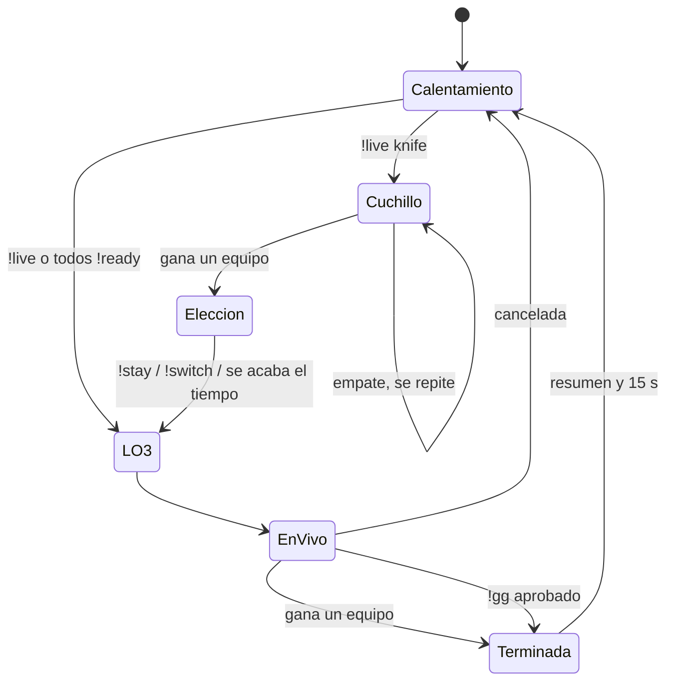
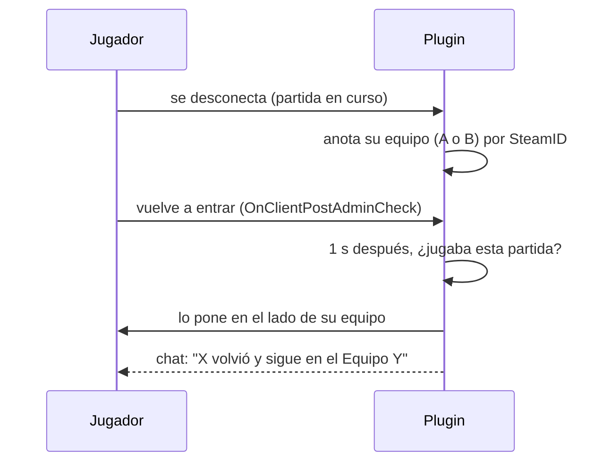

# Plugin 1.6.0: documentación

## Qué hace

La 1.6.0 agrega al plugin del servidor (`csstv_reporter`) herramientas para los admins y para los jugadores durante un mix:

- **Menú de admin:** una categoría **v34frag** dentro de `sm_admin` con las acciones de los comandos.
- **`!team` con grupos** (`@all`, `@ct`, `@t`, `@spec`…) y **`!swap`** para intercambiar los equipos en el calentamiento.
- **Ronda de cuchillo opcional** (`!live knife`), donde el ganador elige lado con `!stay` / `!switch`.
- **Nombres de equipo:** "Equipo <nick>", con un jugador al azar de cada lado, en el chat y en la web.
- **Resumen al terminar:** resultado, MVP, top 3 y una línea privada con los números de cada jugador.
- **Reconexión:** quien se cae durante la partida vuelve directo a su equipo.
- **Rendición (`!gg`):** el equipo que pierde por mucho puede rendirse por votación. La partida queda terminada, cuenta para el ELO y en la web lleva la etiqueta "Rendición".

Además, `!live` ahora empieza siempre con los jugadores como están, sin pedir el mínimo de jugadores.



## Inicio de la partida

| Cómo empieza | Cuchillo | Mínimo de jugadores |
|---|---|---|
| Todos escriben `!ready` | No | Sí (`csstv_min_players`) |
| `!live`, `!live mrN` | No | No (alcanza con 2 jugadores en los equipos) |
| `!live knife`, `!live knife mrN` | Sí | No |

Los argumentos de `!live` van en cualquier orden (`!live mr4 knife`). `force` se sigue aceptando para no romper binds viejos, pero ya no hace nada. `cuchillo` funciona igual que `knife`.

## Nombres de equipo

Al empezar la partida (`StartMatch`) se elige al azar un jugador de cada lado; si en un lado hay humanos, se elige entre los humanos. El equipo pasa a llamarse **"Equipo <nick>"**, con el nick cortado a 16 bytes y sin llaves (para que un nick no pueda meter colores). El nombre:

- queda **fijo toda la partida**, aunque ese jugador se vaya o cambie de lado;
- sigue al grupo de jugadores, no al lado: si en el cuchillo eligen `!switch`, el nombre los acompaña;
- reemplaza "Equipo A/B" en todos los mensajes: inicio, encabezado de ronda, marcador, `!score`, match point, pausas, cancelación, fin y `!gg`;
- se envía a la web en `team_names: {a, b}` (solo el nick). Supabase crea los equipos del mix con el nombre `Equipo <nick>` (máximo 20 caracteres de nick). Si el resultado no trae nombres (plugin anterior), sigue "Mix de <top fragger>".

Internamente el **equipo A** es el que empezó de CT, igual que antes.

## Ronda de cuchillo

1. `!live knife` anuncia la ronda y hace un `mp_restartgame`. El estado del plugin es `State_Knife`.
2. Cada vez que alguien aparece se le quita todo menos el cuchillo (también la C4 y la pistola), y no se puede comprar (`buy`, `autobuy`, `rebuy`, `buyammo1`, `buyammo2` bloqueados).
3. Si la ronda termina empatada, se repite. Si gana un equipo, el chat le pide `!stay` o `!switch`.
4. Solo puede elegir alguien del equipo ganador; vale el primero. Si nadie elige en `csstv_knife_time` segundos (60), el equipo se queda.
5. Con `!switch` se cambian los lados (`SwapTeams`) y después viene el anuncio "La partida empieza" y el LO3 de siempre.

La ronda de cuchillo no cuenta para las estadísticas, el marcador ni la demo: todo eso empieza con el LO3. Durante el cuchillo los equipos están bloqueados, `!cancelmatch` funciona (se descarta, porque no se jugó ninguna ronda) y el abandono también se controla.

## `!team` y `!swap`

`!team <a quién> <ct|t|spec>` usa `ProcessTargetString` de SourceMod:

| Ejemplo | Mueve a |
|---|---|
| `!team daniloev ct` · `!team danil ct` | Ese jugador (nick completo o parte) |
| `!team #12 t` | El jugador con userid 12 |
| `!team @all spec` | Todos |
| `!team @ct t`, `@t`, `@spec`, `@alive`, `@dead`, `@humans`, `@bots` | Ese grupo |

Si un nick coincide con varios jugadores, no se mueve a nadie y SourceMod avisa ("More than one client matched"). El bot de SourceTV nunca se mueve. Quien ya está en ese equipo se saltea. El chat dice "Un admin pasó a X a CT" o "Un admin pasó a N jugadores a espectador".

`!swap` (solo en el calentamiento) pasa los CT a T y los T a CT, y hace un `mp_restartgame 1` para que todos aparezcan en su lado nuevo.

## Reconexión



- El equipo se guarda como **A o B** (no CT o T), así respeta el medio tiempo, la prórroga y el `!switch` del cuchillo.
- Se anota al empezar la partida, al desconectarse y cuando un admin lo mueve con `!team`. Si un admin lo pasó a espectador, se olvida: al volver no se lo pone en ningún equipo.
- Si el jugador alcanza a elegir equipo antes de que el plugin lo mueva, el plugin lo coloca igual en su equipo.
- Las estadísticas y las kills/muertes del TAB ya se recuperaban desde versiones anteriores.
- Solo funciona con SteamID válido: con `NOSTEAM` (LAN, sin validar) la clave cambia al reconectarse.

## Rendición (`!gg`)

| Regla | Valor por defecto |
|---|---|
| Solo con la partida en vivo (no en LO3, medio tiempo ni cuchillo) | |
| Solo el equipo que pierde por `csstv_gg_min_diff` rondas o más | 8 (0 = desactivado) |
| Votos necesarios: jugadores del equipo menos `csstv_gg_missing` (mínimo 1) | 1 → 4 de 5 |
| Tiempo para juntar los votos | 30 s |

El primer `!gg` abre la votación; cada jugador vota una vez. Si se llega a los votos, la partida termina en el momento (aunque la ronda esté en curso) con el marcador que había: gana el que iba adelante. Las kills de esa ronda sin terminar quedan en las estadísticas, pero la ronda no se cuenta como jugada.

El resultado se envía como `status: "finished"` con `end_reason: "surrender"`. Supabase lo guarda en `matches.end_reason`; el ELO y las estadísticas del perfil se aplican igual que en cualquier partida terminada.

## Resumen final

Al terminar la partida (también por `!gg`; no en una cancelada):

```
[v34frag] Fin de la partida: Equipo daniloev 16 - 12 Equipo pepe. ¡Gana Equipo daniloev!
[v34frag] MVP: daniloev (27 kills, 98 ADR)
[v34frag] 1. daniloev  27/14/5  ADR 98  HS 52%
[v34frag] 2. pepe  22/18/3  ADR 85  HS 40%
[v34frag] 3. juanchi  19/15/7  ADR 79  HS 37%
[v34frag] Tu partida: 18/16/4 · ADR 82 · HS 44% · 3 primeras kills      ← privado, a cada jugador
```

Por rendición la primera línea es `Equipo pepe se rindió (gg). Equipo daniloev 13 - 4 Equipo pepe. ¡Gana Equipo daniloev!`. Con empate (sin prórroga): `Fin de la partida: Equipo X 15 - 15 Equipo Y. Empate.`

- Entran los jugadores que completaron al menos una ronda.
- MVP: el de más kills; si empatan, el de más daño. ADR = daño / rondas jugadas. HS% = headshots / kills.
- La parte de primeras kills de la línea privada solo aparece si tuvo alguna.

## Menú de admin

`sm_admin` → **v34frag** (el nombre sale de `csstv_chat_tag`). El orden de las opciones lo decide SourceMod; se puede fijar en `configs/adminmenu_sorting.txt` con los nombres internos (`v34frag_live`, `v34frag_cancel`, `v34frag_rr`, `v34frag_pause`, `v34frag_unpause`, `v34frag_team`, `v34frag_swap`, `v34frag_status`):

| Opción | Permiso (comando) | Qué hace |
|---|---|---|
| Cambiar de equipo | `sm_team` | Todos / Todos los CT / Todos los T / Todos los espectadores / cada jugador → CT, T o Espectador |
| Cancelar partida | `sm_cancelmatch` | Pide confirmación Sí/No |
| Estado del plugin | `sm_csstv_status` (rcon) | Estado, cola y licencia, solo para el admin |
| Iniciar partida | `sm_live` | Sin / con ronda de cuchillo → partida completa, MR12, MR10, MR8, MR5, MR4 o MR3 |
| Intercambiar equipos (!swap) | `sm_swap` | Directo |
| Pausa de admin | `sm_forcepause` | Directo |
| Quitar pausa | `sm_forceunpause` | Directo |
| Repetir ronda (!rr) | `sm_rr` | Pide confirmación Sí/No |

- Cada opción usa el permiso de su comando, así que respeta los overrides de `admin_overrides.cfg`.
- Las opciones que no aplican se ven deshabilitadas: iniciar e intercambiar solo en calentamiento, cancelar solo con partida en curso, `!rr` y pausa solo en vivo, quitar pausa solo si hay una.
- Las respuestas (errores incluidos) van al chat del admin que usó el menú.
- Si `adminmenu.smx` no está cargado, el plugin funciona igual, sin el menú.

## Cvars nuevos

| Cvar | Por defecto | Qué hace |
|---|---|---|
| `csstv_knife_time` | `60` | Segundos para elegir lado después del cuchillo |
| `csstv_gg_min_diff` | `8` | Rondas de diferencia para poder rendirse (0 = `!gg` desactivado) |
| `csstv_gg_missing` | `1` | Votos que pueden faltar en el equipo |

`csstv_min_players` ahora solo aplica al inicio automático por `!ready`.

## Web

- Detalle de la partida: "Estado: Terminada por rendición (gg)".
- Lista de mixes: etiqueta "Rendición" junto al marcador (como "Cancelada").
- Los equipos se ven como "Equipo <nick>" porque así se crean en Supabase.

## Dónde está cada cosa

| Qué | Archivo / ubicación |
|---|---|
| Estado `State_Knife`, `!live`, `!swap`, nombres de equipo, `GoLive` | `server/addons/sourcemod/scripting/csstv_reporter.sp` |
| Ronda de cuchillo, `!stay`, `!switch` | `server/addons/sourcemod/scripting/csstv/knife.inc` |
| `!gg` | `server/addons/sourcemod/scripting/csstv/gg.inc` |
| Resumen final | `server/addons/sourcemod/scripting/csstv/summary.inc` |
| Menú de admin | `server/addons/sourcemod/scripting/csstv/menu.inc` |
| `!team` con grupos, reconexión, nombres en los mensajes | `server/addons/sourcemod/scripting/csstv/qol.inc` |
| `Stats_ClientKey`, `Stats_FindRec` | `server/addons/sourcemod/scripting/csstv/stats.inc` |
| `team_names`, `end_reason` en el resultado | `server/addons/sourcemod/scripting/csstv/json.inc` |
| `matches.end_reason`, nombres en `csstv_ingest` | `supabase/migrations/20261013140000_rendicion_y_nombres.sql` |
| Etiqueta "Rendición" | `index.html` (`mixSurrenderTag`, detalle de la partida) |
| Cvars de ejemplo | `server/cfg/sourcemod/csstv_reporter.cfg` |
