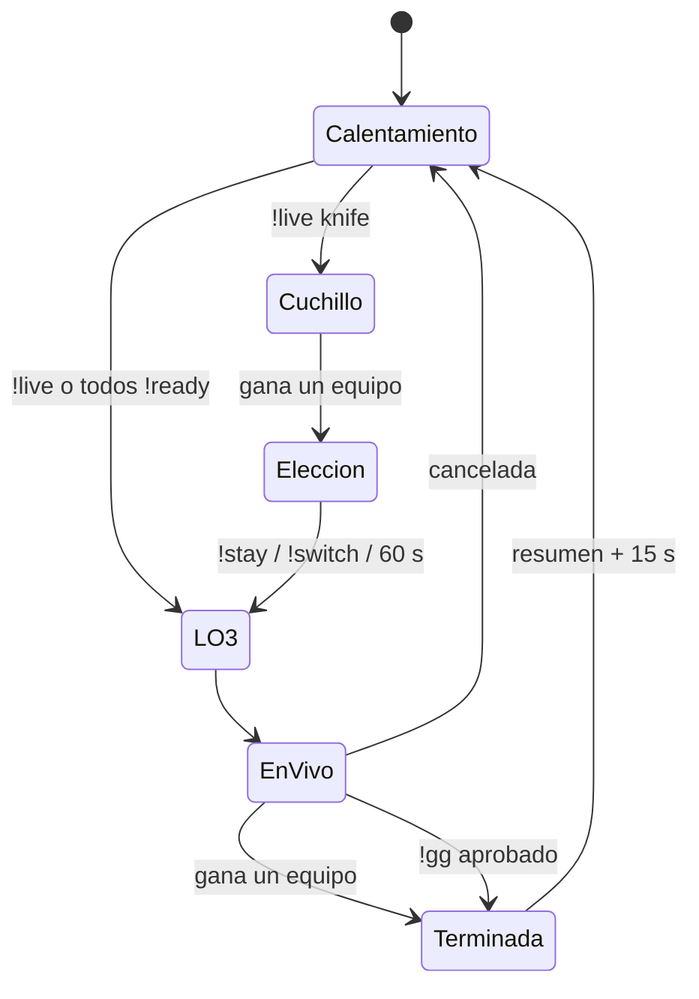

# Plan: plugin 1.6.0 (menú de admin, cuchillo, `!gg`, resumen, nombres de equipo y más)

> Planeación original, aprobada por Daniel el 2026-10-13.

## Decisiones tomadas

| Tema | Decisión |
|---|---|
| Menú de admin | Categoría **v34frag** dentro de `sm_admin`. Los comandos con parámetros se resuelven con submenús (jugador → equipo, formato de la partida). Cada opción respeta el permiso de su comando. |
| `!team` con grupos | `ProcessTargetString`: sigue funcionando con nick (o parte del nick) y `#userid`, y además `@all`, `@ct`, `@t`, `@spec`, `@alive`, `@dead`, `@humans`, `@bots`. Un nick que coincide con varios jugadores no mueve a nadie (ambiguo). |
| `!swap` | Admin, solo en calentamiento. Intercambia CT y T. |
| Quién falta en `!ready` | Ya existía (`Faltan: …` cada 30 s). No se toca. |
| `!live` | Empieza con los jugadores como están: no cambia lados, no hay cuchillo y **no pide el mínimo de jugadores**. `force` se sigue aceptando pero no hace nada. El inicio automático por `!ready` sigue exigiendo `csstv_min_players`. |
| Ronda de cuchillo | Parámetro opcional `knife` de `!live` (`!live knife mr4`). Nunca es automática. El equipo ganador elige con `!stay` / `!switch` (vale el primero; 60 s; si nadie elige, se quedan). No cuenta para estadísticas, marcador ni demo. |
| Nombres de equipo | Al empezar la partida se elige al azar un jugador de cada lado: "Equipo <nick>". Fijo toda la partida. Reemplaza "Equipo A/B" en el chat y se manda a la web. |
| Resumen final | Marcador, MVP (más kills; desempata el daño), top 3 (K/D/A, ADR, HS%) y una línea privada para cada jugador. No hay resumen en una cancelada. |
| Reconexión | Durante la partida, quien vuelve a entrar va directo a su equipo (por SteamID, como equipo A/B para respetar los cambios de lado). |
| `!gg` | Solo el equipo que pierde por al menos `csstv_gg_min_diff` rondas (8). Hace falta el voto de todos menos `csstv_gg_missing` (1) jugadores del equipo, en 30 s. La partida termina **terminada** (`finished`), gana el que iba adelante, suma/resta ELO y se ve como cualquier otra, con la etiqueta "Rendición". |
| Web | Columna nueva `matches.end_reason` (`surrender`) y nombres de equipo `Equipo <nick>` (antes "Mix de <top fragger>", que queda como respaldo para plugins viejos). |

## 1. El flujo de una partida

## 2. Menú de admin (`csstv/menu.inc`)

Se agrega con la API de `adminmenu` (opcional: si no está cargado, el plugin funciona igual).

| Opción | Comando y permiso | Qué hace |
|---|---|---|
| Iniciar partida | `sm_live` | Sin cuchillo / Con cuchillo → formato (completa, MR12, MR10, MR8, MR5, MR4, MR3) |
| Cancelar partida | `sm_cancelmatch` | Confirmación Sí/No |
| Repetir ronda | `sm_rr` | Confirmación Sí/No |
| Pausa de admin / Quitar pausa | `sm_forcepause` / `sm_forceunpause` | Directo |
| Cambiar de equipo | `sm_team` | Todos / CT / T / cada jugador → CT, T o Spec |
| Intercambiar equipos | `sm_swap` | Directo |
| Estado | `sm_csstv_status` | Respuesta solo al admin |

Las opciones que no aplican en el estado actual (por ejemplo, cancelar en calentamiento) se ven deshabilitadas. Las respuestas van al chat del admin que usó el menú.

## 3. Plugin

- `csstv_reporter.sp`: estado `State_Knife`, `!live knife`, sin mínimo en `!live`, nombres de equipo, `!swap`, resumen y rendición al terminar.
- `csstv/knife.inc` (nuevo): ronda de cuchillo (solo cuchillo, sin compras, sin C4) y `!stay` / `!switch`.
- `csstv/gg.inc` (nuevo): votación de rendición y cvars `csstv_gg_min_diff`, `csstv_gg_missing`.
- `csstv/summary.inc` (nuevo): resumen final.
- `csstv/qol.inc`: `!team` con grupos, reconexión al equipo, nombres en los mensajes.
- `csstv/json.inc`: `team_names: {a, b}` y `end_reason`.

## 4. Supabase

Migración `20261013140000_rendicion_y_nombres.sql`:

- `matches.end_reason text` con `check (end_reason is null or end_reason = 'surrender')`.
- `csstv_ingest`: guarda `end_reason` y usa `team_names` para el nombre de los equipos del mix (`Equipo <nick>`). Si no vienen (plugin viejo), sigue con "Mix de <top fragger>".
- El ELO no cambia: se aplica a toda partida `finished`.

## 5. Web

- Detalle de la partida: "Estado: Terminada por rendición (gg)".
- Lista de mixes: etiqueta "Rendición" junto al marcador.

## 6. Requisitos antes de empezar

- Servidor local de pruebas con `csstv_send 0` (envía a la Supabase real).
- `adminmenu.inc` y `topmenus.inc` en el include del compilador (están).

## 7. Orden de implementación

1. Plugin: nombres de equipo y `!live` sin mínimo.
2. `!team` con grupos y `!swap`.
3. Reconexión.
4. Ronda de cuchillo.
5. `!gg` y resumen final.
6. Menú de admin.
7. JSON, migración y web.
8. Compilar, probar con bots en `$2000$` (3 vs 1) y documentar.
