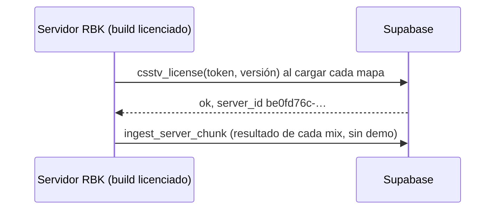

# Servidor RBK: documentación

## Qué es

Servidor de CS:S v34 de un tercero ("RBK SERVER -> SV V34frag #2" en Admin > Servidores), en el mismo panel que el nuestro (ExtremeHost, Pterodactyl, Linux). Corre `csstv_reporter` con un build licenciado: el `.smx` solo funciona con el token de ese servidor.

## Datos del servidor

| Qué | Valor |
|---|---|
| ID en Supabase (`game_servers.id`) | `be0fd76c-6bdc-477e-a843-6efc309b5ca9` |
| `csstv_server_tag` | `rbk` (los mixes se llaman `rbk-AAAAMMDDTHHMMSS-xxxx`) |
| Acceso SFTP | Variables `SERVER1_*` del `.env` (alias `RBK_SERVER`), raíz con `cstrike/` |
| SourceMod | 1.8.0.6040 (el nuestro es 1.10). El plugin se compila con los includes de 1.8, así que es compatible. |
| MetaMod | Idéntico al nuestro |
| Demos | Desactivadas (`csstv_demo 0`). La línea de arranque tampoco tiene `+tv_enable 1`. |
| Mapas para votar | Su `mapcycle.txt`: `$2000$`, `de_aztec`, `de_cache`, `de_cbble`, `de_cpl_mirage`, `de_cpl_strike`, `de_dust2`, `de_inferno`, `de_inferno_classic`, `de_mirage_csgo`, `de_nuke`, `de_nuke_old_blue_ep`, `de_season`, `de_train`, `de_tuscan` |

## Qué falta para tener demos

El Worker de R2 baja cada demo por la API del panel Pterodactyl de nuestra cuenta. Para RBK haría falta una API key de cliente de la cuenta de RBK (o acceso a su servidor desde la nuestra) y que el Worker sepa de qué panel bajar cada partida según el servidor. Después, `+tv_enable 1` en su arranque y `csstv_demo 1`.

## Dónde está cada cosa

| Qué | Archivo / ubicación |
|---|---|
| Plugin licenciado | `server/licencias/rbk/csstv_reporter.smx` (local, no va a git) → `cstrike/addons/sourcemod/plugins/` en RBK |
| Config (con token) | Solo en RBK: `cstrike/cfg/sourcemod/csstv_reporter.cfg` |
| Configs de partida | `server/cfg/csstv/` → `cstrike/cfg/csstv/` en RBK |
| System2 | `cstrike/addons/sourcemod/extensions/system2.ext.so` en RBK (copiada de nuestro servidor) |
