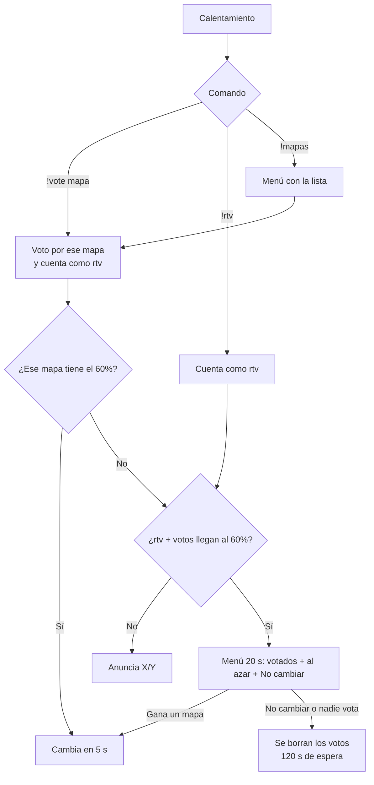
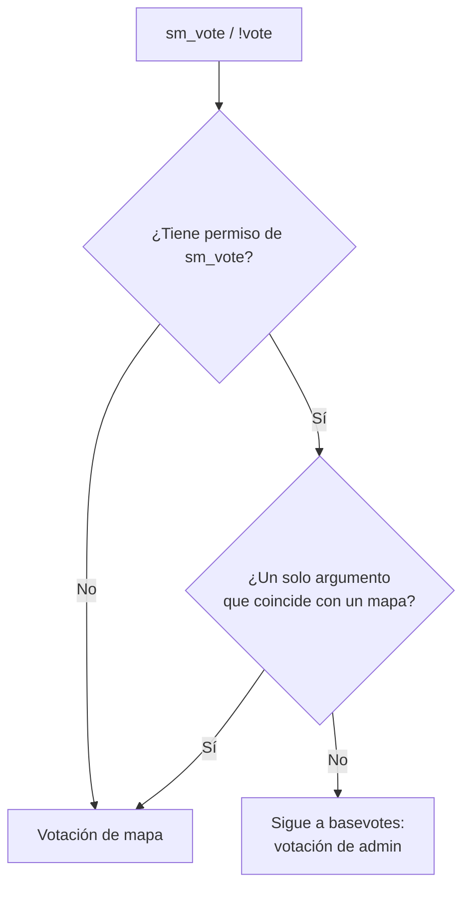

# Votación de mapa para jugadores: documentación

## Qué hace

Desde la versión 1.7.0 del plugin, los jugadores pueden cambiar de mapa sin un admin, pero **solo en el calentamiento**. Hay dos caminos:

- **`!vote <mapa>`**: votar un mapa concreto. Si ese mapa junta el 60 % de los jugadores, se cambia directo.
- **`!rtv`**: pedir un cambio sin elegir mapa. Cuando `!rtv` + `!vote` juntan el 60 %, se abre un menú de votación para todos.

Durante una partida (cuchillo, LO3, en vivo, medio tiempo, terminada) los comandos responden que solo se puede votar en el calentamiento. Así un cambio de mapa nunca cancela un mix.

## Comandos

| Comando | Qué hace |
|---|---|
| `!rtv` (o `rtv` escrito en el chat) | Pide cambiar de mapa. Repetirlo muestra el conteo. |
| `!unrtv` | Quita el `!rtv` y el voto de mapa de ese jugador. |
| `!vote <mapa>` / `!nominate <mapa>` | Vota un mapa. Acepta el nombre exacto o una parte (`!vote cache`). Si hay varias coincidencias (`!vote inferno`), abre el menú filtrado. Sin argumento, abre el menú. Cada jugador tiene un voto y lo puede cambiar. |
| `!mapas` / `!maps` | Menú con los mapas, sus votos y el voto propio ("- tu voto"). Elegir uno es igual a `!vote`. Fuera del calentamiento se ve con las opciones deshabilitadas. |

## Reglas

- **Quiénes cuentan:** todos los jugadores humanos conectados (CT, T y espectadores), sin bots ni SourceTV. Votos necesarios = `ceil(jugadores × csstv_rtv_ratio)`, mínimo 1. Con 10 jugadores, 6; con 5, 3.
- **Cambio directo:** cuando un mapa llega a los votos necesarios por `!vote`. Se anuncia y se cambia a los 5 s con `ForceChangeLevel`.
- **Votación con menú:** cuando los jugadores con `!rtv` (votar un mapa también cuenta) llegan a los votos necesarios. Dura 20 s y usa la votación estándar de SourceMod (`VoteMenuToAll`). Opciones: primero los mapas votados con `!vote` (de más a menos votos), después mapas al azar hasta `csstv_rtv_options` (5) y al final "No cambiar de mapa". Gana la opción con más votos. En un empate gana la que está más arriba, así que un empate entre un mapa y "No cambiar" lo gana el mapa.
- **Si no cambia** (gana "No cambiar", nadie vota o el menú no se pudo mostrar): se borran todos los votos y no se puede votar por `csstv_rtv_cooldown` segundos.
- **Esperas:** no se puede votar en los primeros `csstv_rtv_wait` segundos del mapa.
- **Con la partida:** al empezar una partida (`!live` o todos `!ready`) se borran los votos y se corta la votación en curso. Mientras el mapa está por cambiar (los 5 s), `!live` responde "El mapa está por cambiar" y el inicio por `!ready` no arranca.
- **Desconexiones:** el voto de quien se va se borra. Como baja la cantidad de jugadores, se vuelve a revisar si se alcanzó el umbral.
- **Otras votaciones:** si hay otra votación de SourceMod en curso (por ejemplo, `!votemap` de un admin), la de mapa se reintenta cada 5 s hasta que termine.

## `!vote` y `basevotes.smx`

`sm_vote` ya existe: es la votación de admin de `basevotes.smx` (`sm_vote <pregunta> [respuestas]`). El plugin lo intercepta con `AddCommandListener`:

`!votemap` (admin) no cambia.

## Lista de mapas

`ReadMapList` con la configuración `csstv`: si `addons/sourcemod/configs/maplists.cfg` tiene una sección `"csstv"`, se usa esa. Si no, SourceMod cae en `default`, es decir el `mapcycle.txt`. De esa lista se sacan el mapa actual, los repetidos y los que no existen en `maps/` (`IsMapValid`). La lista se vuelve a leer en cada cambio de mapa.

En el servidor real (2026-10-13) no hay sección `csstv`, así que se usa su `mapcycle.txt`: `$2000$`, `de_cache`, `de_cbble`, `de_dust2_ob`, `de_inferno`, `de_inferno_classic`, `de_mirage_rc1`, `de_nuke_old_blue_ep`, `de_season` y `de_tuscan`. `de_dust2` está en `maps/` pero no en la lista.

## Cvars

| Cvar | Por defecto | Qué hace |
|---|---|---|
| `csstv_rtv` | `1` | 0 desactiva `!rtv`, `!vote` y `!mapas`. |
| `csstv_rtv_ratio` | `0.6` | Parte de los jugadores que hace falta. |
| `csstv_rtv_wait` | `30` | Segundos desde que carga el mapa antes de poder votar. |
| `csstv_rtv_cooldown` | `120` | Segundos de espera después de una votación que no cambió el mapa. |
| `csstv_rtv_options` | `5` | Mapas en el menú de la votación (2 a 6), además de "No cambiar". |

## Dónde está cada cosa

| Qué | Archivo / ubicación |
|---|---|
| Comandos, conteo, menús, votación y cambio de mapa | `server/addons/sourcemod/scripting/csstv/maps.inc` |
| Integración (inicio, mapa, desconexión, bloqueo de `!live`) | `server/addons/sourcemod/scripting/csstv_reporter.sp` |
| Cvars | `server/cfg/sourcemod/csstv_reporter.cfg` |
| Guía para admins | `docs/GUIA_SERVIDOR.md`, sección "Votación de mapa" |
| Lista de mapas | `cstrike/mapcycle.txt` del servidor, o la sección `csstv` de `addons/sourcemod/configs/maplists.cfg` |
