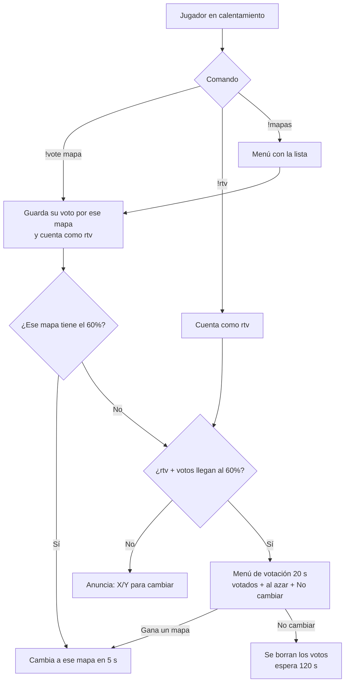

# Plan: votación de mapa para jugadores (`!rtv`, `!vote <mapa>`, `!mapas`)

> Planeación original, aprobada por Daniel el 2026-10-13 (solo calentamiento; 60 % contando a los espectadores; lista = `mapcycle.txt` del servidor real).

## Decisiones tomadas

| Tema | Decisión |
|---|---|
| Plugin propio o los de SourceMod | **Propio**, dentro de `csstv_reporter` (`csstv/maps.inc`). `rockthevote.smx` + `nominations.smx` + `mapchooser.smx` (están en `plugins/disabled`) cambian de mapa en cualquier momento, y un cambio de mapa a mitad de partida la cancela. Además están en inglés y `mapchooser` depende de `mp_timelimit`/`mp_maxrounds`, que el plugin pone en 0. |
| Cuándo se puede | **Solo en el calentamiento** (`State_Warmup`). Durante la partida (cuchillo, LO3, en vivo, medio tiempo, terminada) los comandos responden "solo en el calentamiento" y una votación abierta se corta al empezar la partida. |
| `!vote <mapa>` | Voto directo por un mapa (acepta parte del nombre: `!vote inf` → `de_inferno`). Cada jugador tiene un solo voto y lo puede cambiar. Si un mapa junta el `csstv_rtv_ratio` de los jugadores, **se cambia directo**, sin menú. Votar un mapa también cuenta como `!rtv`. Sin mapa, abre el menú de mapas. |
| `!rtv` | "Quiero cambiar de mapa" sin elegir cuál. Cuando `!rtv` + `!vote` juntan el `csstv_rtv_ratio` de los jugadores, se abre una **votación con menú** para todos. |
| Menú de la votación | Los mapas más votados con `!vote` primero, completado con mapas al azar de la lista hasta `csstv_rtv_options` (5), más "No cambiar de mapa". 20 s. Gana la opción con más votos (empate: la primera). Si gana un mapa, se avisa y se cambia a los 5 s. Usa la votación estándar de SourceMod (`VoteMenuToAll`), así que no se pisa con `!votemap` de un admin. |
| Quiénes cuentan | Jugadores humanos conectados (CT, T **y espectadores**), sin bots ni SourceTV. Mínimo 1 voto. Si alguien se va, el conteo se recalcula y puede alcanzar el umbral. |
| Lista de mapas | `ReadMapList` con la sección `csstv` de `configs/maplists.cfg`; si no existe, usa la `mapcyclefile` del servidor (lo estándar de SourceMod). Solo se pueden votar mapas de la lista que existan en el servidor; el mapa actual no aparece. |
| Esperas | `csstv_rtv_wait` (30 s) desde que carga el mapa antes de poder votar, y `csstv_rtv_cooldown` (120 s) después de una votación que terminó en "No cambiar". |
| `!votemap` de admin | Sigue igual (`basevotes.smx`). Si hay otra votación de SourceMod en curso, `!rtv` espera a que termine. |
| Idioma | Mensajes en español con el prefijo `[v34frag]`, como el resto del plugin. |

## 1. El flujo

Si la partida empieza (`!live` o todos `!ready`) se borran los votos y se corta una votación en curso.

## 2. Comandos

| Comando | Quién | Qué hace |
|---|---|---|
| `!rtv` (y `rtv` escrito en el chat sin `!`) | Jugadores | Pide cambiar de mapa. Repetirlo muestra el conteo. |
| `!unrtv` | Jugadores | Quita su `!rtv` y su voto de mapa. |
| `!vote <mapa>` / `!nominate <mapa>` | Jugadores | Vota un mapa. Sin argumento abre el menú. Varias coincidencias → abre el menú filtrado. |
| `!mapas` / `!maps` | Jugadores | Menú con la lista de mapas y cuántos votos tiene cada uno; elegir uno es igual a `!vote`. |

## 3. Cvars nuevas (`csstv_reporter.cfg`)

| Cvar | Por defecto | Qué hace |
|---|---|---|
| `csstv_rtv` | `1` | Activa `!rtv`, `!vote` y `!mapas`. |
| `csstv_rtv_ratio` | `0.6` | Parte de los jugadores que hace falta (0.6 = 6 de 10). |
| `csstv_rtv_wait` | `30` | Segundos desde que carga el mapa antes de poder votar. |
| `csstv_rtv_cooldown` | `120` | Segundos de espera después de una votación que no cambió el mapa. |
| `csstv_rtv_options` | `5` | Mapas en el menú de la votación (además de "No cambiar"). |

## 4. Archivos

- `csstv/maps.inc` (nuevo): comandos, conteo, menú de mapas, votación y cambio con `ForceChangeLevel`.
- `csstv_reporter.sp`: `#include`, `Maps_Init()`, `Maps_OnMapStart()`, `Maps_OnClientDisconnect()` y cortar la votación en `StartMatch()`. Versión **1.7.0**.
- `cfg/sourcemod/csstv_reporter.cfg`: sección nueva con las cvars.
- `docs/GUIA_SERVIDOR.md`: comandos de jugador y cómo armar la lista de mapas.

No hay cambios en Supabase ni en la web.

## 5. Requisitos antes de empezar

- Servidor local de pruebas con `csstv_send 0` (envía a la Supabase real).
- Saber qué mapas tiene el servidor real, para armar la sección `csstv` de `maplists.cfg` (o confirmar que sirve su `mapcycle.txt`).

## 6. Orden de implementación

1. `maps.inc`: lista de mapas, `!mapas`, `!vote` con búsqueda parcial.
2. `!rtv`, conteo y umbral; cambio directo por `!vote`.
3. Votación con menú y esperas.
4. Integración con el estado de la partida (solo calentamiento, cortar al empezar).
5. Compilar, probar en el servidor local (con bots no se puede votar: probar con un cliente y `csstv_rtv_ratio` bajo) y documentar.
