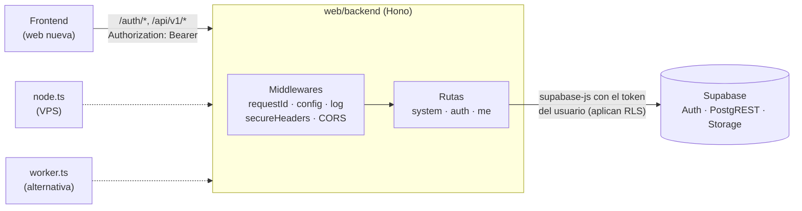
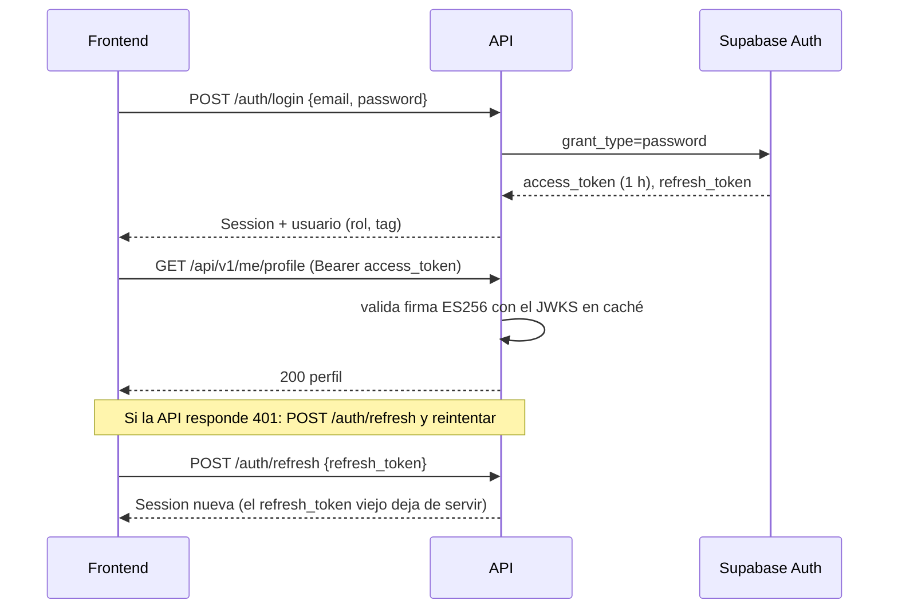
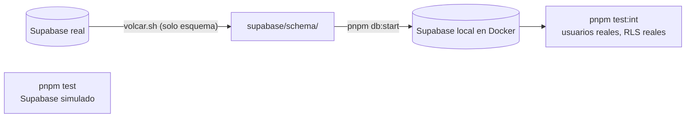

# Backend API (Node 24 + Hono + TypeScript): base, Auth y Mi perfil: documentación

## Qué hace

`web/backend` es la API REST por la que la web nueva va a hablar con Supabase. El frontend ya no necesita `supabase-js` ni conocer tablas, columnas o políticas RLS: consume endpoints documentados con OpenAPI.

Esta primera entrega cubre la **base** y dos dominios:

- **La base:** configuración, errores, CORS, documentación de la API, autenticación, límite de intentos y pruebas.
- **Auth:** registro, login, renovación de sesión, logout y usuario actual.
- **Mi perfil:** ver y editar los datos propios, subir el avatar y pedir el reclamo de un perfil de jugador.

Los demás dominios (jugadores, equipos, partidas, torneos, admin) van en entregas siguientes.

El código es **TypeScript con Hono** y corre igual en **Node 24**, el destino principal (un VPS de Hostinger), y en **Cloudflare Workers**, que queda como alternativa. Habla con Supabase por HTTPS con `supabase-js`, siempre **con el token del usuario**: las políticas RLS de la base siguen siendo la barrera, y el backend agrega validación de datos y reglas encima.



## Endpoints

| Método y ruta | Sesión | Qué hace |
|---|---|---|
| `GET /api/health` | No | Estado del servicio, entorno y versión. Con `?deep=1` además verifica Supabase. |
| `GET /api/openapi.json` | No | Especificación OpenAPI 3.1 (el contrato para el frontend). |
| `GET /api/docs` | No | Documentación interactiva (Scalar): se pueden probar los endpoints con un token. |
| `POST /auth/signup` | No | Crea la cuenta con su tag. Devuelve la sesión, o `needsConfirmation: true` si hay que confirmar el email. |
| `POST /auth/login` | No | Inicia sesión. Devuelve tokens y usuario (`id`, `email`, `tag`, `role`, `created_at`). |
| `POST /auth/refresh` | No | Cambia el `refresh_token` por una sesión nueva. |
| `POST /auth/logout` | Sí | Invalida el `refresh_token` de la sesión. |
| `GET /auth/me` | Sí | Usuario actual con rol y tag. |
| `GET /api/v1/me/profile` | Sí | Cuenta, detalles del perfil, jugador vinculado, equipo actual y partidas jugadas. |
| `PATCH /api/v1/me/profile` | Sí | Edita tag, nombre real, país, rol, Steam, FACEIT y Discord (solo lo enviado). |
| `POST /api/v1/me/avatar` | Sí | Sube el avatar (`multipart/form-data`, campo `file`). |
| `GET /api/v1/me/profile-requests` | Sí | Mis solicitudes de reclamo de perfil. |
| `POST /api/v1/me/profile-requests` | Sí | Pide reclamar un jugador (`{ player_id }`). |

## Sesión y autenticación



- **Tokens:** el frontend guarda `access_token` y `refresh_token` y manda `Authorization: Bearer <access_token>`. No hay cookies, porque el frontend y la API pueden estar en dominios distintos.
- **Validación de la firma:** Supabase firma los tokens con **ES256** (clave asimétrica). La API los valida con la clave pública, que guarda en caché, sin consultar a Supabase en cada request.
- **Qué se exige:** `role = authenticated` y un usuario (`sub`). La clave pública (`anon`) también es un JWT válido, pero no sirve como sesión.
- **Logout:** el `refresh_token` deja de servir al instante. El `access_token` sigue valiendo hasta que vence (1 hora), como en cualquier proyecto de Supabase.
- **`GET /auth/me`:** además de la firma, consulta a Auth, así que detecta una cuenta borrada.
- **Rutas de admin:** usan `requireAdmin`, que lee `profiles.role` con el token del usuario. En esta entrega todavía no hay rutas de admin.

## Límite de intentos

`POST /auth/login` y `POST /auth/signup` comparten un límite de **10 intentos por minuto por IP**. Al pasarlo, la API responde `429 RATE_LIMITED` con el header `Retry-After`.

- **En Node:** el contador vive en memoria. Es exacto con **un solo proceso**.
- **En Workers:** se usa el binding `RL_AUTH`.
- **De dónde sale la IP:** de `CLIENT_IP_HEADER`, un header que pone el proxy y que el cliente no puede falsear:
  - `x-forwarded-for` detrás de Caddy, en el VPS.
  - `cf-connecting-ip` en Workers.
  - Vacío, no se confía en ningún header, y todos los clientes comparten el mismo contador.

## Mi perfil: reglas

- **Equipo actual:** el equipo oficial (no `pcw` ni `mix`) donde juega el jugador vinculado. Si no hay, el equipo del que la cuenta es capitán o dueña.
- **Partidas jugadas:** las terminadas de ese equipo, sin byes y sin partidas huérfanas (con etapa de torneo pero sin torneo).
- **Edición:**
  - Solo cambia lo enviado. `null` o `""` borra un campo.
  - Las reglas son las del formulario de la web: tag de 2 a 24 caracteres; nombre real con letras, espacios, punto, apóstrofe y guion; país y rol de una lista; Steam como SteamID64, `STEAM_X:Y:Z`, link o nombre; FACEIT como nick o link; Discord sin espacios.
  - Los links se pasan a https.
  - El tag se cambia con la función `set_my_tag`; el resto va a `profile_details`.
- **Avatar:**
  - **Formato:** JPEG, PNG o WebP de hasta **1 MB**, los mismos límites que el bucket `avatars`. El tipo se detecta por el contenido del archivo, no por el nombre ni por el `Content-Type`.
  - **Recorte:** conviene que el frontend lo recorte a 256×256 antes de subirlo, como hace la web actual.
  - **Dónde se guarda:** en `avatars/<uid>/`. El avatar anterior se borra.
- **Reclamo de perfil:**
  - **404** si el jugador no existe.
  - **409** si ya tiene cuenta o si ya hay una solicitud pendiente igual.
  - La solicitud queda en `pending` hasta que un admin la aprueba.

## Errores

Todas las respuestas de error tienen el mismo formato:

```json
{ "error": { "code": "VALIDATION_ERROR", "message": "Los datos enviados no son válidos.", "details": [{ "path": "tag", "message": "..." }], "requestId": "..." } }
```

| Código | Status | Cuándo |
|---|---|---|
| `VALIDATION_ERROR` | 400 | Cuerpo, query o parámetros inválidos (`details` dice qué campo) |
| `BUSINESS_RULE` | 400 | Una función SQL rechazó la operación (el mensaje es para el usuario) |
| `INVALID_FILE` | 400 | El archivo no es una imagen permitida |
| `UNAUTHORIZED` | 401 | Sin token, token inválido o vencido |
| `INVALID_CREDENTIALS` | 401 | Email o contraseña incorrectos |
| `FORBIDDEN` | 403 | Sin permiso (rol o RLS) |
| `EMAIL_NOT_CONFIRMED` | 403 | Falta confirmar el email |
| `NOT_FOUND` | 404 | No existe |
| `CONFLICT` | 409 | Ya existe (email, solicitud, jugador reclamado) |
| `FILE_TOO_LARGE` | 413 | El archivo supera el máximo |
| `RATE_LIMITED` | 429 | Demasiados intentos (con `Retry-After`) |
| `CONFIG_INVALID`, `INTERNAL` | 500 | Error del servidor: el detalle solo va al log |

- **El `requestId`:** también viaja en el header `X-Request-Id`. Cada error 500 queda en el log como una línea JSON con ese id, sin cuerpos ni tokens.
- **Mensajes de la base:** nunca se devuelven crudos al cliente, salvo los de funciones SQL (`BUSINESS_RULE`), que están escritos para el usuario.

## Configuración

| Variable | Para qué |
|---|---|
| `APP_ENV` | `development`, `test`, `preview` o `production` |
| `SUPABASE_URL`, `SUPABASE_ANON_KEY` | Proyecto de Supabase y su clave pública |
| `CORS_ORIGINS` | Orígenes permitidos, separados por coma; `*` como subdominio (`https://*.dominio.com`) o puerto (`http://localhost:*`) |
| `FRONTEND_URL` | A dónde lleva el link del correo de confirmación |
| `CLIENT_IP_HEADER` | Header confiable con la IP del cliente |
| `GIT_SHA` | Versión que muestra `/api/health` |
| `SUPABASE_SERVICE_KEY` | Declarada, sin uso en esta entrega |

La configuración se valida al primer request. Si falta algo, la API responde `500 CONFIG_INVALID` y el log dice qué variable falla, nunca su valor.

## Esquema de la base y pruebas



- **El esquema real**, sin datos, está versionado en `supabase/schema/` (en la raíz del repo):
  - `public.sql`: tablas, políticas, funciones y permisos.
  - `auth_storage.sql`: el trigger de registro y los buckets con sus políticas.
  - `BASE`: la última migración que ya estaba aplicada en producción al volcar.
- **Supabase local:** `pnpm db:start` la levanta en Docker con ese esquema, más las migraciones posteriores a `BASE`. Las pruebas de integración corren ahí, nunca contra producción.
- **Tres niveles de prueba:**
  - **Unitarias** (`pnpm test`): sin red, con Supabase simulado.
  - **De integración** (`pnpm test:int`): con usuarios, RLS y Storage reales de la Supabase local.
  - **Humo** (`pnpm smoke <url>`): contra una API levantada.
- **Cobertura mínima: 60 %** en líneas, sentencias, funciones y ramas. `pnpm test:coverage` falla por debajo. Al cerrar la fase, con 161 pruebas, estaba en 96 % de sentencias y 89 % de ramas.

## Dónde está cada cosa

| Qué | Archivo / ubicación |
|---|---|
| Armado de la app (middlewares, rutas, OpenAPI, docs) | `web/backend/src/app.ts` |
| Entradas | `web/backend/src/node.ts` (Node), `web/backend/src/worker.ts` (Workers) |
| Configuración | `web/backend/src/env.ts`, `web/backend/.dev.vars.example`, `web/backend/wrangler.toml` |
| Autenticación | `web/backend/src/lib/auth.ts`, `web/backend/src/lib/supabase.ts` |
| Errores | `web/backend/src/lib/errors.ts` |
| CORS | `web/backend/src/lib/cors.ts` |
| Límite de intentos | `web/backend/src/lib/ratelimit.ts` |
| Validación de imágenes | `web/backend/src/lib/uploads.ts` |
| Rutas | `web/backend/src/routes/` (`system.ts`, `auth.ts`, `me.ts`) |
| Esquemas (contrato) | `web/backend/src/schemas/` |
| Tipos de la base | `web/backend/src/db/types.ts` (generado con `pnpm db:types`) |
| Pruebas | `web/backend/test/unit/`, `web/backend/test/integration/` |
| Humo | `web/backend/scripts/smoke.mjs` |
| Supabase local | `web/backend/supabase/config.toml`, `web/backend/scripts/db-local.sh`, `web/backend/scripts/local-overrides.sql` |
| Esquema real volcado | `supabase/schema/` |
| Guía para desarrolladores | `web/backend/README.md` |
