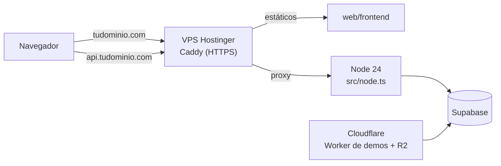
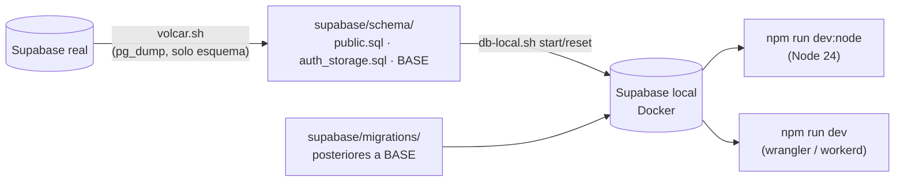

# Backend API (Node 24 + Hono + TypeScript): base, Auth y Mi perfil: guía de implementación

## Estado

**Fase terminada el 2026-10-14** (pasos 1 a 9). Probada en local: Node y Workers contra la Supabase local, 161 pruebas y cobertura por encima del mínimo. **Nada desplegado.** Commiteado en la rama `feat/backend-api-fase-1`, sin merge a `main`.

| Paso | Estado |
|---|---|
| 1. Volcado del esquema y Supabase local | Hecho |
| 2. Proyecto `web/backend` y configuración | Hecho |
| 3. Base de la app: config, errores, CORS, health, OpenAPI, docs, entradas Workers y Node | Hecho, con 43 pruebas unitarias |
| 4. Clientes de Supabase, `requireUser`, `requireAdmin`, límite de intentos | Hecho: 62 pruebas unitarias y 3 de integración en total |
| 5. Rutas `/auth/*` | Hecho: 85 pruebas unitarias y 14 de integración en total |
| 6. Rutas `/api/v1/me/*` | Hecho: 120 pruebas unitarias y 28 de integración en total |
| 7. Humo (`npm run smoke`) y `web/backend/README.md` | Hecho: 12 de 12 contra Node y contra Workers |
| 8. Documentación | Hecho: `DOCUMENTACION.md`, esta guía, `README.md` de la raíz, `docs/ARQUITECTURA.md`, `docs/MODELO_DATOS.md` y `docs/PENDIENTES.md` |
| 9. **Cobertura mínima** (agregado el 2026-10-14; umbral final **60 %**) | Hecho: 96 % de sentencias y 89 % de ramas con las dos suites; 93 % y 82 % solo con las unitarias |

**Paso 9, agregado por pedido de Daniel después de aprobar el plan.** El backend tiene que tener pruebas unitarias y una cobertura mínima. Daniel pidió primero el **75 %** y, al empezar el paso, lo bajó a **60 %**. Se mide con `@vitest/coverage-v8` y el umbral está en `vitest.config.ts`: `npm run test:coverage` falla si alguna métrica (líneas, sentencias, funciones o ramas) queda por debajo. Ese chequeo después entra al CI.

## Archivos

Todos nuevos, salvo los marcados como modificados.

| Archivo | Cambio |
|---|---|
| `supabase/schema/public.sql` | Esquema `public` de producción volcado (sin datos) |
| `supabase/schema/auth_storage.sql` | Trigger de registro, buckets y políticas de Storage, copiados de producción |
| `supabase/schema/BASE` | Última migración aplicada en producción al volcar (`20261013140000`) |
| `supabase/schema/volcar.sh` | Script de volcado y limpieza |
| `web/backend/package.json`, `package-lock.json`, `.nvmrc`, `.gitignore` | Proyecto, dependencias fijas, Node 24 |
| `web/backend/tsconfig.json`, `tsconfig.node.json`, `vitest.config.ts` | TypeScript (Workers y Node) y pruebas (proyectos `unit` e `integration`) |
| `web/backend/wrangler.toml` | Alternativa de Workers: producción y `preview`, `RL_AUTH` |
| `web/backend/.dev.vars.example` | Variables de desarrollo (Supabase local) |
| `web/backend/src/app.ts`, `env.ts`, `node.ts`, `worker.ts` | App y entradas |
| `web/backend/src/lib/*.ts` | `auth`, `background`, `cors`, `errors`, `middleware`, `ratelimit`, `router`, `supabase`, `types`, `uploads` |
| `web/backend/src/routes/*.ts` | `system`, `auth`, `me` |
| `web/backend/src/schemas/*.ts` | `common`, `auth`, `profile` |
| `web/backend/src/services/account.ts` | Rol y tag de la cuenta |
| `web/backend/src/db/types.ts` | Tipos generados de la base |
| `web/backend/supabase/config.toml`, `.gitignore` | Supabase local (`v34frag-api`) |
| `web/backend/scripts/db-local.sh`, `local-overrides.sql`, `smoke.mjs` | Base local y humo |
| `web/backend/test/**` | 8 archivos de pruebas unitarias, 3 de integración y ayudas (`helpers.ts`, `jwt.ts`, `integration/local.ts`) |
| `web/backend/README.md` | Guía para desarrolladores |
| `docs/bitacora/2026-10-14-backend-base-auth-perfil/*` | Plan, documentación y esta guía |
| `docs/bitacora/README.md` (modificado) | Fila del requerimiento |
| `README.md`, `docs/ARQUITECTURA.md`, `docs/MODELO_DATOS.md` (modificados) | Referencias al backend y al esquema versionado |
| `docs/PENDIENTES.md` (modificado, **no versionado**) | Sección 6 del backend. El archivo sigue fuera de git porque tiene lo pendiente de todos los requerimientos |

## Despliegue

**No se desplegó nada.**

- **Producción:** no cambió. No se tocó la base, ni la web publicada, ni los Workers existentes.
- **Lectura sobre la base real:** el único contacto fue el volcado del esquema (`pg_dump --schema-only`, solo lectura) y consultas de metadatos (`pg_policies`, `storage.buckets`, `pg_trigger`, conteo de filas).

El despliegue al VPS (build, servicio, Caddy, dominio, pipeline y SMTP de Supabase Auth) va en un requerimiento propio; ver "Cambio de hosting" más abajo.

## Cambio de hosting: VPS en vez de Workers (2026-10-14)

Después de aprobar el plan, Daniel decidió alojar la web y la API en un **VPS KVM 1 de Hostinger con dominio propio**, para tener el dominio y casi toda la infraestructura en un solo lugar. Cloudflare se queda solo con el Worker de demos y R2.



Qué cambia para el backend:

- **La entrada principal es `src/node.ts`.** `src/worker.ts` y `wrangler.toml` quedan como alternativa probada (el código es el mismo).
- **Límite de intentos:** en el VPS manda el contador en memoria (`MemoryRateLimiter`). Es exacto mientras corra **un solo proceso** de Node. El binding `RL_AUTH` de Workers sigue declarado para la alternativa.
- **IP del cliente:** en el VPS, `CLIENT_IP_HEADER=x-forwarded-for`, porque Caddy reemplaza ese header con la IP real (no confía en la que manda el cliente). Si se pone el proxy de Cloudflare delante del VPS, pasa a ser `cf-connecting-ip`.
- **Pendiente para el despliegue** (fuera de esta entrega): build a `dist/`, `npm start`, servicio (systemd o pm2), Caddy con HTTPS automático y el pipeline. Va en un requerimiento propio, que reemplaza la parte de Pages y Workers del plan general `2026-10-14-web-pages-worker`.
- **Correo:** el VPS no trae casillas. Para el SMTP de Supabase Auth hay que usar un servicio aparte (Resend, Brevo o Hostinger Email).



## Paso 1: esquema y Supabase local

1. **Conexión a la base real.** Va por el *Session pooler* (`aws-0-us-west-2.pooler.supabase.com:5432`) porque el host directo `db.<ref>.supabase.co` solo tiene IPv6 y la red local no. Las variables son las `PG_*` del `.env` de la raíz, no `SUPABASE_DB_URL` como decía el plan. En el pooler el usuario es `postgres.wmzfwsizashpszxlvpeb`, no `postgres`.
2. **Volcado.** `supabase/schema/volcar.sh <última migración en producción>` corre `pg_dump --schema-only --schema=public --no-owner` (pg_dump 18 contra Postgres 17.11) y limpia tres cosas que no se pueden cargar en una Supabase local:
   - las líneas `\restrict` / `\unrestrict` de pg_dump 18;
   - `CREATE SCHEMA public` y su comentario;
   - `ALTER DEFAULT PRIVILEGES FOR ROLE supabase_admin` (son de la plataforma; la local ya los trae).

   Se corrió con base `20261013140000`, la última migración aplicada en producción. Resultado: 26 tablas, 57 políticas, 51 funciones y los `GRANT`. Se revisó que no traiga datos, tokens ni contraseñas.
3. **Lo que está fuera de `public`** (`supabase/schema/auth_storage.sql`, copiado a mano de la base real): el trigger `on_auth_user_created` sobre `auth.users`, los 3 buckets con sus límites y las 10 políticas de `storage.objects`.
4. **Supabase local.** La configuración vive en `web/backend/supabase/config.toml` (`project_id = "v34frag-api"`, Postgres 17), separada de `supabase/migrations/` de la raíz para que la CLI no intente aplicar esas migraciones sobre una base vacía. Se apagaron Realtime, Edge Functions, Analytics y vectores. `scripts/db-local.sh` levanta los contenedores y carga `public.sql`, `auth_storage.sql` y las migraciones posteriores a `BASE` (hoy, `20261014120000_elo_participacion.sql`).
5. **Verificación.** La base local quedó con 26 tablas, 57 políticas de `public`, 3 buckets y 10 políticas de Storage. Un registro por la API de Auth local creó `profiles` (con el tag de los metadatos) y `profile_details`: el `pendingTag` del front no hace falta, como anticipaba el plan.

**Hallazgo.** El volcado deja versionadas por primera vez las tablas `matchmaking_*` y sus funciones, que existen en producción pero no tienen migración en el repo ni uso en la web o el plugin.

## Paso 2: proyecto

- **Versiones.** Se instalaron con `npm install --save-exact --before=2026-09-30`, para usar solo versiones con más de dos semanas publicadas. Quedaron fijas en `package.json` y `package-lock.json`: hono 4.13.11, @hono/zod-openapi 1.6.3, zod 4.6.5, @supabase/supabase-js 2.117.2, @scalar/hono-api-reference 0.12.7, @hono/node-server 2.1.3, vitest 5.0.2, tsx 4.23.15, supabase (CLI) 2.118.0.
- **TypeScript 6.0.3, no 7.** TypeScript 7 es el compilador nuevo (nativo); se prefirió la 6, que es la que usa el ecosistema de Workers hoy. Solo se usa para `tsc --noEmit`, porque wrangler y tsx compilan por su cuenta.
- **wrangler 4.146.0** (igual que el Worker de demos) exige `@cloudflare/workers-types >= 5.20261001.1`: se fijó esa.
- **Scripts de instalación.** npm 11 bloquea los `postinstall` por defecto. Se aprobaron solo `esbuild` y `workerd` (los dos de wrangler) con `npm approve-scripts`; quedan en `allowScripts` del `package.json`.
- **Dos `tsconfig`.** Los tipos de Workers y los de Node definen los mismos globales. `tsconfig.json` revisa el código con los tipos de Workers (sin `node.ts`) y `tsconfig.node.json` revisa `node.ts`, las pruebas y la config de Vitest con los de Node (sin `worker.ts`). `npm run typecheck` corre los dos. El código compartido solo usa APIs web estándar.
- **`wrangler.toml`.** `nodejs_compat`, `placement = smart`, `observability`, `account_id` fijo, vars de producción y `[env.preview]` (Worker `v34frag-api-preview`). Producción solo acepta `https://csstv.pages.dev` por CORS; preview también las previews de Pages y `localhost`.
- **`.dev.vars`.** Se crea copiando `.dev.vars.example`, que apunta a la Supabase **local** con su clave pública de demostración. Lo leen `wrangler dev` y `node.ts` (`process.loadEnvFile`).

## Paso 3: base de la app

| Archivo | Qué hace |
|---|---|
| `src/app.ts` | `createApp()`: middlewares, rutas, OpenAPI, Scalar, 404 y errores. Mensajes de zod en español (`z.locales.es()`). |
| `src/env.ts` | Esquema zod de la configuración. Se valida una vez por objeto `env` y se guarda en caché. Si falla, el error lista nombres de variables, nunca valores. |
| `src/lib/errors.ts` | `AppError`, traducción de errores de PostgREST, `onError` y log JSON de los 500. |
| `src/lib/cors.ts` | Orígenes con comodín de un nivel de subdominio y de puerto. |
| `src/lib/middleware.ts` | `withConfig` y el log de requests. |
| `src/lib/router.ts` | `createRouter()`: cada `OpenAPIHono` con el hook que convierte los errores de zod en 400 (el hook no se hereda al montar). |
| `src/routes/system.ts` | `GET /api/health` (con `?deep=1`). |
| `src/worker.ts` / `src/node.ts` | Las dos entradas. |

**Diferencias con el plan:**

- `APP_ENV` acepta también `test`, que apaga el log de requests en las pruebas.
- Además de los códigos del plan, `fromPostgrest` traduce `PGRST303` (JWT vencido) a 401, `23503` y `23514` (clave foránea y check) y la clase `22` (formato inválido) a 400 `VALIDATION_ERROR`, sin exponer el mensaje de la base.
- `GET /` redirige a `/api/docs`.

**Pruebas (`npm test`): 43, todas pasan.** Cubren health (normal, `deep=1` ok y caído, query inválido), OpenAPI 3.1 con `bearerAuth` y el esquema `Error`, la página de Scalar, 404, configuración inválida (sin filtrar valores en el log), CORS (13 orígenes permitidos y rechazados, patrones inválidos y preflight) y `onError` (AppError con headers, HTTPException, error inesperado sin filtrar el mensaje).

**Humo manual (2026-10-14):** `npm run dev:node` y `wrangler dev` respondieron igual: `/api/health?deep=1` con `supabase: "ok"` contra la Supabase local, `/api/docs`, `/api/openapi.json` y el preflight CORS de `http://localhost:5173`. `wrangler deploy --dry-run` arma el bundle (934 KiB, 158 KiB con gzip) sin desplegar.

## Paso 4: autenticación y límite de intentos

| Archivo | Qué hace |
|---|---|
| `src/db/types.ts` | Tipos de la base generados desde la Supabase local (`npm run db:types`). Las consultas quedan tipadas. |
| `src/lib/supabase.ts` | `anonClient` (nuevo en cada uso, para login, registro y refresh), `userClient(token)` (aplican las RLS del usuario) y `verifierClient`, uno por configuración, que guarda en caché las claves públicas. |
| `src/lib/auth.ts` | `requireUser` deja `c.var.user` y `c.var.sb`; `requireAdmin` lee `profiles.role` con el token del usuario. |
| `src/lib/ratelimit.ts` | Regla `auth` (10 por minuto por IP), `MemoryRateLimiter`, binding de Workers y middleware `rateLimit`. |

**Validación del token.** Los proyectos real y local firman con **ES256** (claves asimétricas, verificado en sus `/.well-known/jwks.json`). `getClaims` valida firma y vencimiento en local con el JWKS en caché, sin ir a Supabase en cada request. Además, `requireUser` exige `role = authenticated` y un `sub`, porque la clave pública también es un JWT válido (con `role = anon`).

**Consecuencia:** un `access_token` sigue valiendo hasta que vence (1 hora) aunque el usuario cierre sesión. Lo que el logout invalida al instante es el `refresh_token`. Es el comportamiento estándar de Supabase.

**Variable nueva:** `CLIENT_IP_HEADER` (vacía, `x-forwarded-for`, `cf-connecting-ip` o `x-real-ip`). Sin ella no se confía en ningún header y todos los clientes comparten el contador.

**Pruebas:**

- **Unitarias (19 nuevas):**
  - Las de `requireUser` usan tokens ES256 firmados de verdad, con un JWKS simulado. Cubren: válido, sin header, sin "Bearer", vencido, firmado con otra clave con el mismo `kid`, rol `anon`, sin `sub` y payload adulterado.
  - Las de `requireAdmin` cubren: admin (y que la consulta use el token del usuario), rol `user`, sin fila y sin sesión.
  - Las del límite de intentos cubren: ventana, reinicio, claves separadas, 429 con `Retry-After`, IP que no se puede falsear sin `CLIENT_IP_HEADER`, binding de Workers y header no soportado.
- **De integración (`npm run test:int`, 3):**
  - Con usuarios reales de la Supabase local, el cliente del usuario solo ve su fila de `profiles` (RLS).
  - La clave `anon` no sirve como sesión.
  - El admin pasa `requireAdmin` y el usuario común recibe 403.

## Paso 5: rutas `/auth/*`

`src/routes/auth.ts`, `src/schemas/auth.ts` y `src/lib/background.ts`.

| Endpoint | Resultado | Errores |
|---|---|---|
| `POST /auth/signup` | 201 `{ session, needsConfirmation }`. Con confirmación de email activa, `session: null`. | 400 (con `details` por campo), 409 si el email ya tiene cuenta, 429 |
| `POST /auth/login` | 200 `Session` con `user: { id, email, tag, role, created_at }` | 401 `INVALID_CREDENTIALS`, 403 `EMAIL_NOT_CONFIRMED`, 429 |
| `POST /auth/refresh` | 200 `Session` nueva | 401 si el token no existe, ya se usó o está mal formado |
| `POST /auth/logout` | 204 (también si la sesión ya no existía) | 401 sin sesión |
| `GET /auth/me` | 200 `AuthUser` | 401 |

**Detalles de implementación:**

- **Login y registro:** comparten el límite de 10 intentos por minuto por IP.
- **`last_seen`:** login y `me` actualizan `profile_details.last_seen` en segundo plano (lo que hacía `touchSeen()` en la web). Si falla, solo se registra en el log.
- **`/auth/me`:** además de validar el token, consulta a Auth con `getUser`, así que detecta un usuario borrado aunque su token siga firmado. Las demás rutas con sesión solo validan la firma.
- **`set_my_tag` después del registro:** se sigue llamando, como hacía la web, aunque el trigger ya aplica el tag. Si falla, el registro no falla: solo se registra.
- **Código de error nuevo:** `EMAIL_NOT_CONFIRMED` (403), para que el frontend pueda mostrar "revisa tu correo".
- **Traducción de errores de Auth:** `fromAuthError` traduce los `error_code` de GoTrue. Un refresh_token mal formado llega como `validation_failed`, y en `/auth/refresh` se responde 401, no 400.
- **Fallback del tag en el login:** el plan lo preveía por si el trigger no tomaba el tag de los metadatos. **No se implementó**, porque la prueba del paso 1 confirmó que el trigger sí lo toma.

**Pruebas:**

- **De integración (11 nuevas, contra la Supabase local):**
  - Registro con tag (recortado), email repetido, datos inválidos y JSON roto.
  - Login con rol y tag, y `last_seen` actualizado; contraseña equivocada; 429 al intento 11.
  - Refresh, y refresh con token inexistente.
  - `me` con fecha de registro, y `me` sin token.
  - Logout, que invalida el refresh_token y se puede repetir.
- **Unitarias (23 nuevas, con GoTrue simulado):**
  - Registro con confirmación de email (y el `redirect_to` al frontend); `set_my_tag` fallido; límite de correos.
  - Email sin confirmar; error desconocido sin filtrar detalles.
  - Logout tolerante y logout con Supabase caída.
  - Usuario borrado en `me`; falla de `last_seen` en segundo plano.
  - La tabla completa de `fromAuthError`.

## Paso 6: rutas `/api/v1/me/*`

`src/routes/me.ts`, `src/schemas/profile.ts`, `src/lib/uploads.ts` y `src/services/account.ts` (rol y tag de la cuenta, compartido con `/auth/*`).

| Endpoint | Qué hace |
|---|---|
| `GET /api/v1/me/profile` | `{ user, details, player, team, matches_played }`, con la misma regla que `rProfileView()`. |
| `PATCH /api/v1/me/profile` | Cambia solo los campos enviados; `null` o `""` borran. Si cambia el tag, usa `set_my_tag`; el resto va a `profile_details`. Devuelve el perfil completo. |
| `POST /api/v1/me/avatar` | `multipart/form-data` con `file`. Sube a `avatars/<uid>/<timestamp>.<ext>`, guarda la URL y borra el avatar anterior. |
| `GET /api/v1/me/profile-requests` | Mis solicitudes de reclamo, la más nueva primero, con el nick del jugador. |
| `POST /api/v1/me/profile-requests` | `{ player_id }`: solicitud `pending`. |

**Reglas copiadas de la web:**

- **`team`:** el equipo oficial (sin `pcw` ni `mix`) donde está el jugador vinculado. Si no hay, el equipo del que el usuario es capitán o dueño.
- **`matches_played`:** cuenta las partidas terminadas de ese equipo, sin byes y sin las huérfanas (con `stage` pero sin `event_id`, como `isOrph()`).
- **Validación de los campos:** son las de `prof-save`.
  - **Nombre real:** letras, espacios, punto, apóstrofe y guion.
  - **País y rol:** de las listas `COUNTRIES` y `ROLES`.
  - **Steam y FACEIT:** con `cleanSteam` y `cleanFaceit`, que pasan los links a https.
  - **Discord:** sin espacios.
- **`created_at` de `user`:** sale de `profile_details.joined_at`, que el trigger llena al registrarse. Así no hace falta consultar a Auth.

**Diferencias con el plan y con la web:**

- **Límites del avatar:** se ajustaron al bucket real, **1 MB y solo JPEG, PNG o WebP**, en vez de 5 MB y GIF.
  - El tipo se detecta por los primeros bytes y la extensión del archivo sale del tipo detectado.
  - `bodyLimit` corta el request antes de leer un cuerpo de más de 1 MB.
- **Avatar anterior:** el backend lo borra en segundo plano, y solo si está en la carpeta del usuario. La web no lo borraba y dejaba archivos sin uso en Storage.
- **Si falla guardar la URL en el perfil:** se borra el archivo recién subido.
- **Reclamo de perfil:**
  - Antes de insertar se verifica que el jugador exista (404) y que no tenga cuenta (409).
  - Una solicitud pendiente igual da 409. La base **no** tiene una restricción única para eso: la validación vive solo en el backend.
- **Ajuste solo local:** el check `avatar_url_propio` exige URLs `https://` y la Supabase local sirve por `http`. `scripts/local-overrides.sql` lo relaja **solo en la base local**, para probar el avatar de punta a punta.

**Pruebas:**

- **De integración (14 nuevas):**
  - Perfil nuevo; perfil con jugador, equipo oficial y equipo de mix ignorado; cinco partidas de las que valen dos; equipo por capitanía.
  - `PATCH` completo con normalización; parcial y borrado; inválido con detalle por campo; vacío; `user_id` ajeno ignorado.
  - Avatar: subida con lectura pública, detección por contenido, reemplazo con borrado del anterior, archivo disfrazado, GIF, más de 1 MB y sin archivo.
  - Reclamos: crear, listar solo los propios, duplicado, jugador con cuenta, inexistente y id inválido.
- **Unitarias (35 nuevas):**
  - Detección de imágenes (incluido un WAV, que también empieza con RIFF).
  - `readImage`, `storageError`, `cleanSteam` y `cleanFaceit`.
  - `ProfilePatch`: normalización, campos desconocidos y rechazos.
  - Avatar con Storage simulado: limpieza del archivo si falla el perfil, error 403 de Storage y avatar anterior ajeno.

## Paso 7: humo y README

- **`scripts/smoke.mjs`** (`npm run smoke -- <url>`): sin dependencias, sale con código 1 si algo falla. Prueba, en orden:
  1. `/api/health?deep=1`, incluido que llegue a Supabase y que devuelva `X-Request-Id`.
  2. `openapi.json` y `/api/docs`.
  3. Login, `/auth/me`, `/api/v1/me/profile` y logout.
  4. Que el refresh_token deje de servir después del logout.
  5. Que un login con la contraseña equivocada dé 401.

  En localhost crea una cuenta descartable; fuera de localhost exige `SMOKE_EMAIL` y `SMOKE_PASSWORD` y nunca crea cuentas. Queda listo para usarlo contra el VPS después de cada despliegue.
- **Resultado (2026-10-14):** 12 de 12 contra `npm run dev:node` y 12 de 12 contra `wrangler dev`, las dos con la Supabase local. Además se probó a mano el avatar por HTTP real (multipart) en las dos entradas: 200 con una imagen válida y 413 con una de 1,1 MB.
- **`web/backend/README.md`:** requisitos, arranque, scripts, estructura, cómo agregar un endpoint (con un ejemplo), formato de errores, variables y cómo actualizar el esquema.

## En qué se apartó del plan

1. **Hosting.** El plan decía Cloudflare Workers. Daniel eligió un **VPS de Hostinger con dominio propio**, y la entrada principal pasó a ser `src/node.ts`. La de Workers sigue funcionando como alternativa.
2. **Cobertura.** Se agregó el **paso 9, cobertura mínima**, por pedido de Daniel. Primero pidió 75 % y después lo bajó a **60 %**.
3. **Conexión a la base.** Se usaron las variables `PG_*`, por el *Session pooler* (IPv4), en vez de `SUPABASE_DB_URL`.
4. **Versiones.** Se usó TypeScript 6.0.3 y no la 7. Todas las dependencias tienen versiones publicadas hace más de dos semanas.
5. **Configuración.**
   - `APP_ENV` acepta `test`.
   - Variable nueva `CLIENT_IP_HEADER`.
   - `GET /` redirige a `/api/docs`.
6. **Errores.**
   - Códigos de PostgREST y de Auth traducidos además de los del plan.
   - Código nuevo `EMAIL_NOT_CONFIRMED`.
7. **Mi perfil.**
   - `PUT /me/tag` se integró en `PATCH /me/profile`.
   - `/me/photos` y `/me/steam` se movieron a admin. Esto ya lo decía el plan.
8. **Avatar.**
   - Límites del bucket real: 1 MB y solo JPEG, PNG o WebP, en vez de 5 MB y GIF.
   - El backend borra el avatar anterior y, si falla guardar el perfil, el archivo recién subido.
9. **Reclamo duplicado.** Lo controla el backend (409), porque la base no tiene restricción única.
10. **Fallback del tag en el login.** No se implementó, porque el trigger toma el tag de los metadatos (verificado).
11. **Supabase local.**
    - La configuración está en `web/backend/supabase/`, separada de `supabase/migrations/`.
    - El esquema lo carga `db-local.sh`.
    - `local-overrides.sql` relaja, **solo en local**, el check `https` del avatar.

## Incidentes durante las pruebas

- **El host directo de la base no resolvía.** `db.<ref>.supabase.co` solo tiene IPv6 y la red local no. Se resolvió con el *Session pooler*, cuyo usuario es `postgres.<ref>`.
- **El primer volcado no cargaba en local.** Fallaba con `permission denied to change default privileges` por los `ALTER DEFAULT PRIVILEGES FOR ROLE supabase_admin`. `volcar.sh` ahora los quita.
- **wrangler 4.146.0 no instalaba.** Pedía una versión de `@cloudflare/workers-types` más nueva que la fecha de corte; se fijó la `5.20261001.1`.
- **npm 11 bloquea los scripts de instalación.** Se aprobaron solo `esbuild` y `workerd`.
- **Un refresh_token mal formado devolvía 500.** Auth responde `validation_failed`, que no estaba mapeado. Se tradujo a 400 en general y a 401 en `/auth/refresh`.
- **Error de tipos con las respuestas de supabase-js.** Los helpers `must` y `mustHave` infirieron `null` por la unión éxito/error de `.single()`. Se tiparon sobre la respuesta completa.

## Cómo revertir

Esta entrega no toca producción, así que no hay nada que deshacer en la base, la web publicada ni los servidores. Para quitarla del repo:

```bash
# Antes del commit: borrar lo nuevo
rm -rf web/backend supabase/schema docs/bitacora/2026-10-14-backend-base-auth-perfil
git checkout -- docs/bitacora/README.md README.md docs/ARQUITECTURA.md docs/MODELO_DATOS.md docs/PENDIENTES.md

# Después del commit
git revert <commit>

# Apagar y borrar la Supabase local (contenedores y volúmenes)
cd web/backend && npx supabase stop --no-backup
```

## Cómo levantarlo

```bash
cd web/backend
npm ci
cp .dev.vars.example .dev.vars
npm run db:start        # Supabase local con el esquema (Docker Desktop corriendo)
npm run dev:node        # Node:    http://localhost:8787/api/docs
npm run dev             # Workers: http://localhost:8787/api/docs
npm run typecheck && npm test
```

Para actualizar el esquema cuando cambie la base real:

```bash
supabase/schema/volcar.sh <última migración aplicada en producción>
cd web/backend && npm run db:reset
```

## Paso 9: cobertura

- **Herramienta:** `@vitest/coverage-v8` 5.0.2, la misma versión que Vitest.
- **Umbral:** 60 % en líneas, sentencias, funciones y ramas (`vitest.config.ts`). Se verificó que falla de verdad: con un umbral temporal de 99 % en ramas, Vitest termina con código 1 y el mensaje `does not meet global threshold`.
- **Qué se mide:** todo `src/`, salvo:
  - `src/db/types.ts`, que es generado y solo tiene tipos;
  - las dos entradas (`node.ts` y `worker.ts`), que se cubren con el humo.
- **Scripts:**
  - `npm run test:coverage` corre las dos suites y necesita la Supabase local.
  - `npm run test:coverage:unit` corre solo las unitarias, sin Docker: es lo que va a poder correr el CI.
  - El reporte HTML queda en `coverage/`, que no se versiona.
- **Pruebas nuevas:** `test/unit/me-routes.test.ts` (13 pruebas). Cubre `/api/v1/me/*` con PostgREST simulado, para que la cobertura sin Docker no dependa de las de integración:
  - **Perfil:** cómo se arma, con equipo por membresía o por capitán, sin equipo y con un error de la base.
  - **Edición:** sin llamar a `set_my_tag` si el tag no cambió, solo con los campos enviados, y el mensaje de `set_my_tag` como `BUSINESS_RULE`.
  - **Reclamos:** listado, 404, los tres 409 y la creación.

| Medición | Sentencias | Ramas | Funciones | Líneas |
|---|---|---|---|---|
| Unitarias + integración (161 pruebas) | 96,3 % | 88,5 % | 95,6 % | 98,9 % |
| Solo unitarias (133 pruebas) | 93,0 % | 81,9 % | 93,3 % | 95,9 % |

En la medición solo con unitarias, `routes/me.ts` pasó de 37 % a 91 % de sentencias con las pruebas nuevas.

**Dependencias con avisos de seguridad:** `npm audit` marca 4 vulnerabilidades altas, todas en **herramientas de desarrollo**, que no corren en producción con Node:
- `sharp` y `miniflare`, que llegan con wrangler. Se corrigen pasando a wrangler 4.151 o superior; hoy está fijado en 4.146.0, igual que el Worker de demos.
- `source-map-js`, que llega con las herramientas de build y cobertura.

Se dejaron para cuando se actualice wrangler en los dos proyectos.

## Lo que viene después de esta fase

Daniel definió el orden el 2026-10-14:

1. ~~Terminar esta fase~~ (terminada el 2026-10-14).
2. **Fase de "replantear" módulos.** Antes de los endpoints de dominio (jugadores, equipos, partidas, resultados, torneos, admin), revisar el modelo de datos y sacar lo que ya no se usa. Candidatos vistos hasta ahora:
   - `player_claims`, reemplazada por `profile_requests`.
   - `profiles.player_id`, `match_chat.tag` y `player_medals.color`, columnas sin uso.
   - Las políticas RLS duplicadas en `events`, `matches` y `players`.
   - Las tablas `matchmaking_*`, que están en producción pero no en el repo.
3. **Endpoints de dominio**, cada uno con su plan, según el orden de la sección 12 del plan general.
