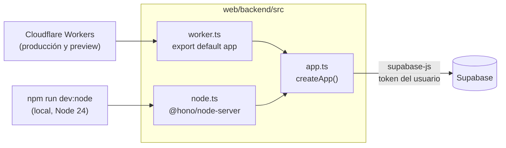
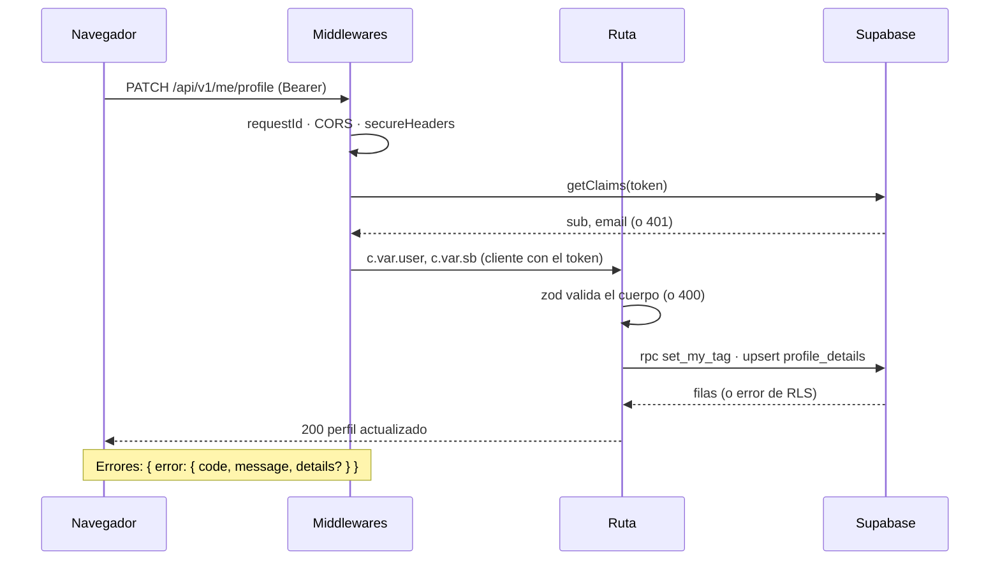
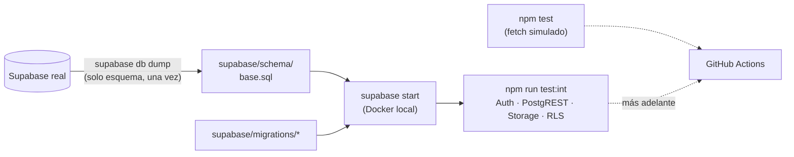

# Plan: backend API (Node.js 24 + Hono + TypeScript): base, Auth y Mi perfil

> Planeación original. Estado: **propuesta**, pendiente de aprobación.

Es la primera entrega del backend del plan general [`2026-10-14-web-pages-worker`](../2026-10-14-web-pages-worker/PLAN.md). Cubre el paso 2 (la base de `web/backend`) y el paso 7 (Auth y Mi perfil). El resto de los dominios (lecturas públicas, acciones de usuario, motor de torneos y admin) va en entregas siguientes, cada una con su plan.

Respecto al plan general, cambia tres cosas: el lenguaje (**TypeScript** en vez de JavaScript), el código **portable entre Workers y Node**, y algunos endpoints de Mi perfil, que se ajustan a lo que hace de verdad `index.html` (sección 5).

## Decisiones tomadas

| Tema | Decisión | Por qué |
|---|---|---|
| Lenguaje | **TypeScript** (`strict`), módulos ES. | Hono y `@hono/zod-openapi` sacan los tipos de los esquemas zod: `c.req.valid('json')` viene tipado y los errores aparecen al compilar. Wrangler y `tsx` compilan TS sin un paso de build aparte. |
| Versión de Node | **Node 24 LTS** (`.nvmrc` = `24`, `engines.node >= 24`). La misma en local y en GitHub Actions. | Es la LTS activa y tiene soporte hasta abril de 2028. Ya está instalada (24.18.0). Node 26 entra a LTS en estos días; conviene pasar a ella cuando el ecosistema (wrangler, vitest) la declare soportada. |
| Dónde corre en producción | **Cloudflare Workers, plan gratis**, con `compatibility_flags = ["nodejs_compat"]`. | Es gratis (100.000 requests/día, sin tarjeta), no tiene arranque en frío, ya tenemos la cuenta y el Worker de demos, y Hono nació para ese runtime. Ver la comparación en la sección 2. |
| Código portable | La app Hono no depende del runtime: `src/app.ts` arma la app; `src/worker.ts` la exporta para Workers y `src/node.ts` la levanta con `@hono/node-server`. | En local se puede correr con Node puro (`npm run dev:node`) o con el runtime de Workers (`npm run dev`). Si algún día hay que irse de Cloudflare (Cloud Run, Render, un VPS), es cambiar de entrada, no reescribir. |
| Acceso a datos | `@supabase/supabase-js` por HTTPS, un cliente **por request** con el token del usuario. Sin `service_role` en esta entrega. | Mientras conviva la web vieja, las RLS son la barrera (plan general, sección 4). Ningún endpoint de esta entrega necesita saltarse las RLS. |
| Validación del token | `supabase.auth.getClaims(token)`. | Si el proyecto usa claves de firma asimétricas, valida el JWT en local con el JWKS (sin ir a Supabase). Si usa el secreto HS256 de siempre, consulta a Auth. En los dos casos el código es el mismo. |
| Sesión | El backend devuelve `access_token` y `refresh_token` en el cuerpo. **No hay cookies.** | El front (Pages) y la API (`workers.dev`) son dominios distintos: una cookie ahí es de terceros y los navegadores la bloquean cada vez más. Ya lo fija el plan general (sección 3). |
| Documentación de la API | `GET /api/openapi.json` (OpenAPI 3.1, generado desde los esquemas) y `GET /api/docs` con **Scalar** (`@scalar/hono-api-reference`). | Scalar permite probar los endpoints con el token desde el navegador y es más liviano que Swagger UI. |
| Pruebas | **Vitest en Node** con `app.request()`. Unitarias con Supabase simulado e **integración contra una Supabase local** (`supabase start` en Docker) con el esquema real volcado. | La Supabase local trae Auth, PostgREST, Storage y RLS de verdad, aislada de la base real. Con Docker ya instalado no hace falta nada más. |
| Esquema de la base | Se vuelca **solo el esquema** (sin datos) a `supabase/schema/` con `supabase db dump`. | Hoy el esquema base (players, teams, events, matches, RLS) no está en el repo. Hace falta para las pruebas y además lo deja versionado por primera vez. |
| Límite de intentos | En Workers, el binding de *rate limiting* (`[[ratelimits]]`); en Node, un contador en memoria. Las dos implementaciones detrás de una misma interfaz. | El plan general lo pide para `/auth/login` y `/auth/signup`. |

## 1. El flujo completo



Un request autenticado dentro de la app:



## 2. Dónde alojarlo: comparación

Todas las opciones corren el mismo código, porque solo cambia la entrada (`worker.ts` o `node.ts`).

| Opción | Costo | Pros | Contras |
|---|---|---|---|
| **Cloudflare Workers (recomendado)** | Gratis: 100.000 req/día, 10 ms de CPU por request | Sin tarjeta, sin arranque en frío, Smart Placement cerca de Supabase, misma cuenta que el Worker de demos | No es Node completo: no hay `fs` ni conexiones TCP largas (para Postgres directo existe Hyperdrive). Alcanza porque todo va por HTTPS |
| Google Cloud Run | Capa gratis: 2 M req/mes | Node real en contenedor | Pide tarjeta. Arranque en frío de 1 a 3 s al escalar a cero |
| Render (Free) | Gratis | Node real, deploy desde GitHub | Se duerme tras 15 min sin uso y tarda unos 30 a 60 s en despertar: malo para la web |
| Azure for Students | 100 USD de crédito por año, sin tarjeta | App Service con Node real | Hay que validar la universidad. El crédito se acaba |
| GitHub Student Developer Pack | Crédito en DigitalOcean (200 USD por 1 año) y en Heroku | VPS o PaaS con Node real | Hay que validar la universidad. Vence; después se paga |
| Supabase Edge Functions | 500.000 invocaciones/mes | Al lado de la base. Hono funciona | Es Deno, no Node. Repartiría el backend entre dos plataformas |

Cloudflare cubre lo que necesitamos gratis y sin vencimiento. Los planes de estudiante quedan como alternativa si alguna vez hace falta Node completo, por ejemplo para procesar imágenes en el servidor o usar Postgres directo con transacciones largas.

## 3. Estructura de `web/backend`

```
web/backend/
├── src/
│   ├── app.ts                  ← createApp(): middlewares, rutas, /api/docs, onError, notFound
│   ├── worker.ts               ← entrada de Workers (env de los bindings)
│   ├── node.ts                 ← entrada de Node (@hono/node-server, lee .dev.vars)
│   ├── env.ts                  ← esquema zod de la configuración y tipo Bindings
│   ├── routes/
│   │   ├── system.ts           ← /api/health
│   │   ├── auth.ts             ← /auth/*
│   │   └── me.ts               ← /api/v1/me/*
│   ├── lib/
│   │   ├── supabase.ts         ← clientFor(token) y clientAnon()
│   │   ├── auth.ts             ← requireUser, requireAdmin (lee profiles.role)
│   │   ├── errors.ts           ← AppError, onError, traducción de errores de PostgREST
│   │   ├── cors.ts             ← orígenes con comodines (https://*.csstv.pages.dev, http://localhost:*)
│   │   ├── ratelimit.ts        ← interfaz + binding de Workers + memoria para Node
│   │   ├── uploads.ts          ← validación de imagen (tipo real por bytes, tamaño)
│   │   └── background.ts       ← waitUntil en Workers, "fire and forget" en Node
│   └── schemas/
│       ├── common.ts           ← ErrorResponse, Paginated<T>
│       ├── auth.ts             ← Session, AuthUser, SignupBody, LoginBody
│       └── profile.ts          ← MyProfile, ProfilePatch, ProfileRequest
├── test/
│   ├── unit/                   ← Supabase simulado (fetch falso)
│   └── integration/            ← contra la Supabase local (supabase start)
├── wrangler.toml
├── tsconfig.json
├── vitest.config.ts
├── .dev.vars.example
├── .nvmrc
├── package.json
└── README.md
```

**Dependencias.** Las versiones exactas se fijan al instalar y quedan en `package-lock.json`.

- **De ejecución:** `hono`, `@hono/zod-openapi`, `zod`, `@supabase/supabase-js`, `@scalar/hono-api-reference`.
- **De desarrollo:**
  - `typescript`, `@cloudflare/workers-types` y `@types/node`.
  - `wrangler` 4.146.0, la misma versión que el Worker de demos.
  - `@hono/node-server`, `tsx`, `vitest` y `supabase` (la CLI, por `npx`).

**Scripts de `package.json`:**

| Script | Qué hace |
|---|---|
| `dev` | `wrangler dev` (runtime de Workers en local) |
| `dev:node` | `tsx watch src/node.ts` (Node puro) |
| `typecheck` | `tsc --noEmit` |
| `test` | Vitest, solo las unitarias |
| `test:int` | Vitest, las de integración (requiere `db:start`) |
| `db:start` / `db:stop` | `supabase start` / `stop` con el esquema volcado |
| `deploy` / `deploy:preview` | `wrangler deploy` / `wrangler deploy --env preview` |

## 4. Lo transversal (la base)

### Configuración

Se valida con zod en el primer request. Si falta algo, el Worker responde 500 con `CONFIG_INVALID` y lo registra en el log, en vez de fallar más adelante con un error confuso.

| Variable | Tipo | Ejemplo / valor |
|---|---|---|
| `SUPABASE_URL` | var | `https://wmzfwsizashpszxlvpeb.supabase.co` |
| `SUPABASE_ANON_KEY` | var | La clave pública de `config.js` |
| `APP_ENV` | var | `development` / `preview` / `production` |
| `CORS_ORIGINS` | var | `https://csstv.pages.dev,https://*.csstv.pages.dev,http://localhost:*` |
| `FRONTEND_URL` | var | A donde redirige el correo de confirmación del registro |
| `GIT_SHA` | var | La pone el pipeline (en local, `dev`) |
| `SUPABASE_SERVICE_KEY` | secreto | **Opcional en esta entrega**; se declara en `env.ts` pero no se usa |

### Middlewares (en orden)

1. `requestId()`: un id por request, devuelto en `X-Request-Id`.
2. Logger mínimo: método, ruta, status y duración, en JSON. **Nunca** el cuerpo ni el header `Authorization`.
3. `secureHeaders()`.
4. `cors()` con la lista de `CORS_ORIGINS`, que admite comodines. Expone `X-Request-Id` y `ETag`.
5. Por ruta: `requireUser` (401 si no hay token o no es válido) y `requireAdmin` (403). Esta entrega no tiene rutas de admin, pero `requireAdmin` queda hecho y probado.

### Errores

Formato único: `{ error: { code, message, details?, requestId } }`.

| Origen | Status | `code` |
|---|---|---|
| zod (cuerpo, query o params inválidos) | 400 | `VALIDATION_ERROR` (`details` = campos con problema) |
| Sin token o token inválido/vencido | 401 | `UNAUTHORIZED` |
| Rol insuficiente o RLS (`42501`) | 403 | `FORBIDDEN` |
| PostgREST `PGRST116` (no hay fila) | 404 | `NOT_FOUND` |
| Única duplicada (`23505`) | 409 | `CONFLICT` |
| `raise exception` de una función SQL (`P0001`) | 400 | `BUSINESS_RULE` (con el mensaje de la función) |
| Credenciales incorrectas en login | 401 | `INVALID_CREDENTIALS` |
| Límite de intentos | 429 | `RATE_LIMITED` (con `Retry-After`) |
| Archivo no válido | 400 / 413 | `INVALID_FILE` / `FILE_TOO_LARGE` |
| Cualquier otro | 500 | `INTERNAL` (el detalle va solo al log, con el `requestId`) |

### Sistema

| Endpoint | Respuesta |
|---|---|
| `GET /api/health` | `{ status: "ok", env, version: GIT_SHA, time }`. Con `?deep=1` además consulta a Supabase y devuelve `supabase: "ok" | "error"`. |
| `GET /api/openapi.json` | La especificación OpenAPI 3.1, con el esquema de seguridad `bearerAuth`. |
| `GET /api/docs` | Scalar sobre `openapi.json`. |

## 5. Auth y Mi perfil

### Auth (`/auth/*`)

| Endpoint | Cuerpo | Hace | Responde |
|---|---|---|---|
| `POST /auth/signup` | `{ email, password (≥ 6), tag (2–24) }` | `auth.signUp` con `data: { tag }` y `emailRedirectTo: FRONTEND_URL`. El trigger `handle_new_user` crea `profiles` con ese tag. Si Supabase devuelve sesión (confirmación de correo apagada), también llama a `set_my_tag`, como hoy. | `201 { session \| null, needsConfirmation }` |
| `POST /auth/login` | `{ email, password }` | `signInWithPassword`, lee `profiles.role, tag` y actualiza `last_seen` en segundo plano. | `200 Session` |
| `POST /auth/refresh` | `{ refresh_token }` | `refreshSession`. | `200 Session` |
| `POST /auth/logout` | — (Bearer) | `POST /auth/v1/logout?scope=local` con el token del usuario. | `204` |
| `GET /auth/me` | — (Bearer) | Usuario actual con rol y tag. Actualiza `last_seen` en segundo plano, lo que hoy hace `touchSeen()`. | `200 AuthUser` |

`Session = { access_token, refresh_token, expires_at, user: AuthUser }` y `AuthUser = { id, email, tag, role, created_at }`.

**Rate limit:** 10 intentos por minuto por IP (`CF-Connecting-IP`) en `login` y en `signup`. Es una sola regla de Workers para los dos endpoints.

**Sobre el `pendingTag`:** hoy el front guarda el tag en `localStorage` cuando el registro pide confirmar el correo, y lo aplica en el primer login. Con el backend no hace falta, porque el tag viaja en los metadatos y el trigger lo usa. La prueba de integración lo verifica. Si el trigger no lo tomara, `login` aplicaría el tag de los metadatos cuando `profiles.tag` siga como `user_xxxxxx`.

### Mi perfil (`/api/v1/me/*`, todos con `requireUser`)

| Endpoint | Hace | Reemplaza en `index.html` |
|---|---|---|
| `GET /api/v1/me/profile` | Devuelve `{ user, details, player, team, matches_played }`: datos de la cuenta, la fila de `profile_details`, el jugador vinculado (`players.user_id = yo`), el equipo actual (por `members` del jugador, o del que es capitán o dueño) y las partidas terminadas de ese equipo. La misma regla que `rProfileView()`. | `rProfileView()` |
| `PATCH /api/v1/me/profile` | Campos opcionales: `tag`, `real_name`, `country`, `game_role`, `steam`, `faceit`, `discord`. Usa las mismas reglas que el front (regex de nombre real, Steam, FACEIT y Discord, y país y rol de las listas `COUNTRIES` y `ROLES`). Si cambia el tag, llama a `set_my_tag`; el resto va con `upsert` a `profile_details`. Devuelve el perfil actualizado. | `prof-save` |
| `POST /api/v1/me/avatar` | `multipart/form-data` con `file`. Valida el tipo **por los bytes** (JPEG, PNG, WebP o GIF; no se confía en el `Content-Type`) y un máximo de 5 MB. Lo sube a `avatars/<uid>/<timestamp>.<ext>` con el token del usuario y guarda la URL pública en `profile_details.avatar_url`. | `prepAvatar` + upload |
| `GET /api/v1/me/profile-requests` | Mis solicitudes de reclamo de perfil (para mostrar "pendiente"). | lectura de `profile_requests` en `loadImpl()` |
| `POST /api/v1/me/profile-requests` | `{ player_id }`: crea la solicitud `pending`. La RLS ya impide reclamar un jugador vinculado; si choca con una solicitud existente responde 409. | "Reclamar este perfil" |

**Cambios respecto al catálogo del plan general**, porque así funciona `index.html` hoy:

- `PUT /me/tag` se suma a `PATCH /me/profile`: el front lo cambia desde el mismo formulario.
- `POST /me/photos` y `POST /me/steam` **no son del usuario**. El bucket `photos` lo usa solo el admin para la foto del jugador, y `link_steam_id` es una función de admin. Pasan al dominio "Admin: jugadores". El campo `steam` del perfil de usuario es solo texto en `profile_details`, y va por `PATCH`.
- El recorte a 256×256 lo sigue haciendo el front antes de subir (Workers no tiene canvas). El backend no redimensiona: valida tipo y tamaño.

## 6. Esquema y pruebas



**Volcado del esquema:**

- Se corre `npx supabase db dump --db-url "$SUPABASE_DB_URL" -f supabase/schema/base.sql`, y lo mismo con `--role-only` si hace falta.
- Lo que hay en el dump queda versionado en `supabase/schema/`. Se revisa a mano que no traiga datos ni secretos.
- La Supabase local carga ese esquema base y después las migraciones de `supabase/migrations/` que no estén incluidas en él.

**Pruebas unitarias (`npm test`, sin red):**

- **Errores:** traducción de cada código de PostgREST, formato de la respuesta e inclusión del `requestId`.
- **CORS:** orígenes permitidos y rechazados, comodines y `localhost` con cualquier puerto.
- **Configuración:** env inválida → `CONFIG_INVALID`.
- **Validación de imágenes:** bytes de cada formato, archivo disfrazado (un `.exe` con `Content-Type: image/png`) y más de 5 MB.
- **Esquemas de perfil:** cada regex con casos válidos e inválidos, copiados del front.
- **Rate limit en memoria.**

**Pruebas de integración (`npm run test:int`, contra la Supabase local):**

- **Registro y sesión:** signup (con y sin confirmación de correo), con el tag aplicado; login correcto e incorrecto; refresh; logout que invalida el refresh; `/auth/me` con token vencido o adulterado (401).
- **Perfil:** `GET` de usuario nuevo, con jugador vinculado y con equipo; `PATCH` válido, inválido (400) y con tag fuera de rango.
- **Avatar:** subida válida y archivo inválido.
- **Reclamo:** crear, duplicar (409) y reclamar un jugador ya vinculado (403).
- **Seguridad:** un usuario no puede leer ni escribir el `profile_details` de otro, ni pasando un `user_id` en el cuerpo (que zod descarta).
- **Contrato:** `openapi.json` se genera y se valida como OpenAPI 3.1 válida.

**Humo con `wrangler dev`:** `GET /api/health` y un login, para confirmar que el bundle de Workers corre igual que en Node.

## 7. Qué no entra en esta entrega

- El `git mv` de la web actual a `web/frontend` y el proyecto de Pages (fase 1, pasos 1 y 3 a 6 del plan general).
- Los workflows de GitHub Actions. Se dejan listos los scripts que van a usar (`typecheck`, `test`, `deploy`), pero los YAML van con la infra.
- El deploy a Cloudflare. Se prueba en local; el primer deploy (`v34frag-api-preview`) se hace solo si Daniel lo pide.
- Los demás dominios de la API y el motor de torneos.

## 8. Requisitos antes de empezar

- **Node 24** (ya instalado) y **Docker Desktop** corriendo (para `supabase start`).
- **`SUPABASE_DB_URL`** (cadena de conexión con la contraseña de la base) en el `.env` de la raíz, solo para el volcado del esquema. Se saca de *Project Settings → Database → Connection string*. No se versiona.
- Nada más para esta entrega: no hace falta la `service_role` ni el token de Cloudflare hasta el deploy.

## 9. Orden de implementación

1. Volcar el esquema a `supabase/schema/`, revisarlo y levantar la Supabase local con esquema y migraciones.
2. Crear `web/backend` con `package.json`, `tsconfig.json`, `wrangler.toml` (`nodejs_compat`, `placement = smart`, `[env.preview]`, `account_id` fijo), `.nvmrc` y `.dev.vars.example`.
3. `env.ts`, `errors.ts`, `cors.ts`, `app.ts` con middlewares, `/api/health`, `openapi.json` y `/api/docs`. Las dos entradas (`worker.ts` y `node.ts`) andando.
4. `supabase.ts`, `requireUser`, `requireAdmin` y `ratelimit.ts`, con sus pruebas unitarias.
5. Rutas `/auth/*` y sus pruebas de integración.
6. Rutas `/api/v1/me/*`, con `uploads.ts`, y sus pruebas de integración.
7. Humo con `wrangler dev`. `web/backend/README.md` con cómo agregar un endpoint, correr pruebas y ver la OpenAPI.
8. `DOCUMENTACION.md` y `GUIA_IMPLEMENTACION.md` de esta carpeta, y la fila en `docs/bitacora/README.md` actualizada.
