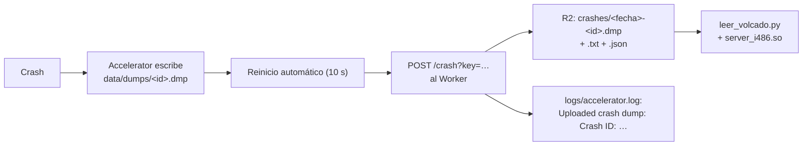

# Crashes del servidor real y Accelerator: documentación

## Qué hace

Cada vez que el servidor real (o el local) se cae, Accelerator escribe un volcado de memoria del proceso. Al arrancar de nuevo lo sube a nuestro Worker de Cloudflare, que lo guarda en R2. Con ese volcado y los binarios del servidor, que en Linux traen símbolos, se ve en qué función y en qué módulo murió el servidor.



## La investigación del crash del 2026-10-14

**El crash.** A las 16:41:45 el servidor imprimió "EVERYONE CAN BUY!" y enseguida `Segmentation fault (core dumped)`.
- Esa línea la imprime el juego (`server.dll` / `server_i486.so`) cuando reinicia la ronda.
- Era la ronda en la que iba a empezar la pausa que pidió flow con `!pause`. La pausa arranca 0,1 s después del inicio de ronda y lo primero que hace es alargar el freezetime (`GameRules_SetPropFloat("m_fRoundStartTime", …)`).
- No llegó a salir el mensaje "Pausa táctica…" ni el encabezado de ronda, que el plugin manda a los 0,5 s.

**Por qué la pausa probablemente no es la causa:**
- `!pause` ya había funcionado antes en el servidor real.
- Los logs de SourceMod muestran reinicios sin cierre limpio en momentos sin pausa. Los detecté buscando cada "session started" que no tiene un "session closed" antes:

| Fecha | Hora | Qué pasaba justo antes |
|---|---|---|
| 2026-10-12 | 02:18 | Recién cambiado el mapa |
| 2026-10-12 | 17:10 | `bot_add t` / `bot_add ct` |
| 2026-10-12 | 20:25 | `sm_slay` tres veces |
| 2026-10-12 | 21:32 | `bot_quota 2`, 8 minutos antes |
| 2026-10-13 | 00:24 | 3 jugadores |
| 2026-10-13 | 04:28 | A mitad de un mix en de_season |
| 2026-10-13 | 13:12, 13:24, 14:10 | Servidor casi vacío |
| 2026-10-13 | 22:36–22:42 y 22:55–22:56 | Se caía cada 10 s al arrancar, varias veces seguidas (esa noche se subió CSS:DM) |
| 2026-10-14 | 16:41 | El de la pausa |

**Lo que no se pudo saber:** no quedó `core` en el servidor ni nada en los logs en los segundos previos a ningún crash. Sin un volcado no hay forma de ver en qué función muere. Por eso se instaló Accelerator.

**Otras observaciones**, sin pruebas de que sean la causa:
- El jugador `STEAM_0:0:1222220035` ("...", antes "lorenzo el crack") se desconectó justo antes del crash del 14. También había entrado minutos antes del crash del 13 a las 13:12. No estaba en el del 13 a las 04:28.
- KACR registró baneos por spam de conexión y a un jugador ("SOPLAPOYA") expulsado tres veces por mandar un `cl_cmdrate` corrupto. La última expulsión fue a las 22:54 del 13 y el crash en bucle empezó a las 22:55.
- Mecha subió `SendFileExploitFixV3.3.smx` a las 16:52 del 14, después del crash. Si los crashes eran un ataque con ese exploit, deberían parar.
- "Timer Executed" lo imprime `extremehost.smx` (plugin del hosting). Es inofensivo.

## Accelerator

| Qué | Valor |
|---|---|
| Versión | 2.5.0, build 138 (`cd575aa`), de builds.limetech.io |
| Archivos | `extensions/accelerator.ext.so` (Linux) o `.dll` (Windows), `extensions/accelerator.autoload`, `gamedata/accelerator.games.txt` |
| Volcados | `addons/sourcemod/data/dumps/` (se borran después de subirlos) |
| Log | `addons/sourcemod/logs/accelerator.log` |
| Configuración | `addons/sourcemod/configs/core.cfg` |

```
"MinidumpUrl"        "https://v34frag-demos.agusb06-ab.workers.dev/crash?key=<ACCELERATOR_CRASH_KEY>"
"MinidumpPresubmit"  "no"
```

Qué se sube:
- El volcado (`.dmp`): hilos, registros, la pila y la lista de módulos cargados.
- Los metadatos (`.txt`): mapa, línea de arranque, rutas y versiones de SourceMod, Accelerator y el juego. En Windows no incluye la consola, porque la firma de `GetSpew` no coincide con la v34. En Linux puede incluir lo último de la consola (chat y comandos) si el motor exporta `GetSpew`.

## Ruta `/crash` del Worker

| Qué | Detalle |
|---|---|
| Ruta | `POST /crash?key=<CRASH_KEY>` en `v34frag-demos` (`cloudflare/demo-worker/src/index.js`, `saveCrash`) |
| Sin la clave | `403 Forbidden` |
| Formulario | `upload_file_minidump` (obligatorio, hasta 64 MB), `upload_file_metadata`, `GameDirectory`, `ExtensionVersion`, `ServerID` |
| Qué guarda | En el bucket `csstv-demos`: `crashes/<AAAAMMDDTHHMMSS>-<8 hex>.dmp`, `.txt` (metadatos) y `.json` (fecha, tamaño y campos) |
| Respuesta | `Crash ID: <AAAAMMDDTHHMMSS>-<8 hex>`; Accelerator la anota en `accelerator.log` |
| Vencimiento | Ninguno: la regla de 90 días del bucket es solo para `demos/` |

## Cómo leer un crash

1. En el servidor, por SFTP: `addons/sourcemod/logs/accelerator.log` dice `Uploaded crash dump: Crash ID: 20261014T…`.
2. Bajar el volcado de R2:
   ```bash
   cd cloudflare/demo-worker
   npx wrangler r2 object get csstv-demos/crashes/<id>.dmp --remote --file <id>.dmp
   npx wrangler r2 object get csstv-demos/crashes/<id>.txt --remote --file <id>.txt
   ```
3. Bajar por SFTP los binarios que aparecen en la pila: `cstrike/bin/server_i486.so`, `bin/engine_i486.so` y las extensiones o plugins de Metamod que figuren.
4. Leerlo en un entorno virtual con `minidump` y `pyelftools`:
   ```bash
   python docs/bitacora/2026-10-14-crash-servidor-accelerator/pruebas/leer_volcado.py <id>.dmp <carpeta con los .so>
   ```
   Muestra la excepción, el módulo y la función donde ocurrió, y las funciones que aparecen en la pila.

## Dónde está cada cosa

| Qué | Archivo / ubicación |
|---|---|
| Accelerator (Linux y Windows) | `server/addons/sourcemod/extensions/`, `server/addons/sourcemod/gamedata/accelerator.games.txt` |
| Inventario de plugins externos | `docs/PLUGINS_EXTERNOS.md` |
| Ruta del Worker | `cloudflare/demo-worker/src/index.js` (`saveCrash`) |
| Clave | Secreto `CRASH_KEY` del Worker; `ACCELERATOR_CRASH_KEY` en el `.env` |
| Lector de volcados | `pruebas/leer_volcado.py` |
| Cadenas de un `.smx` (para ver qué hace un plugin sin el código) | `pruebas/smx_strings.py` |
