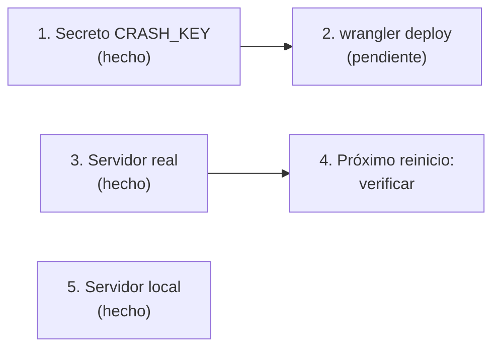

# Crashes del servidor real y Accelerator: guía de implementación

## Estado

Accelerator instalado en el servidor real, en RBK y en el local (2026-10-14); en el real y en RBK se carga en el próximo reinicio. **Falta el deploy del Worker** con la ruta `/crash` (`npx wrangler deploy`): el permiso de despliegue lo tiene que dar Daniel. Hasta entonces, un crash en el servidor real se pierde, porque Accelerator borra el volcado aunque falle la subida. Sin commit.

## Archivos

| Archivo | Cambio |
|---|---|
| `server/addons/sourcemod/extensions/accelerator.ext.so` | Nuevo: Accelerator 2.5.0 Linux (md5 `fd134fbaaca39f1793c557baf432e0ca`) |
| `server/addons/sourcemod/extensions/accelerator.ext.dll` | Nuevo: Windows, para el servidor local (md5 `b45836973bf640e428e5e03cbc348a47`) |
| `server/addons/sourcemod/extensions/accelerator.autoload` | Nuevo (vacío) |
| `server/addons/sourcemod/gamedata/accelerator.games.txt` | Nuevo (md5 `2d8a66f3aea2fa9279aa580a7363b357`) |
| `cloudflare/demo-worker/src/index.js` | Ruta `POST /crash` (`saveCrash`) |
| `docs/PLUGINS_EXTERNOS.md` | Nuevo: inventario de lo externo del servidor real |
| `.env` | `ACCELERATOR_CRASH_KEY` (no se versiona) |
| `pruebas/leer_volcado.py`, `pruebas/smx_strings.py` | Herramientas |

## Despliegue

1. **Secreto (hecho, 2026-10-14):** `printf '%s' "$ACCELERATOR_CRASH_KEY" | npx wrangler secret put CRASH_KEY` en `cloudflare/demo-worker`.
2. **Deploy (pendiente):** `cd cloudflare/demo-worker && npx wrangler deploy`. Para comprobarlo, `curl -X POST https://v34frag-demos.agusb06-ab.workers.dev/crash` debe responder `Forbidden` (403) y no `Not found` (404).
3. **Servidor real (hecho, 2026-10-14), por SFTP:**
   - Se verificó que no hubiera archivos de Accelerator.
   - Respaldo de `configs/core.cfg` como `configs/core.cfg.bak-accelerator`.
   - Se subieron `extensions/accelerator.ext.so`, `extensions/accelerator.autoload` y `gamedata/accelerator.games.txt`, con el md5 verificado.
   - Se agregaron `MinidumpUrl` y `MinidumpPresubmit` al final de `core.cfg`.
   - No se reinició.
4. **Verificar después del próximo reinicio:** `sm exts list` en la consola del panel debe mostrar `Accelerator (2.5.0): SRCDS Crash Handler`. En el próximo crash, `logs/accelerator.log` debe decir `Uploaded crash dump: Crash ID: …`.
5. **RBK (hecho, 2026-10-14), por SFTP (`SERVER1_FTP_*`), con la regla de desplegar también a los servidores externos:**
   - Se verificó que no hubiera archivos de Accelerator ni líneas `Minidump…` en `core.cfg`.
   - Respaldo de `configs/core.cfg` como `configs/core.cfg.bak-accelerator`.
   - Se subieron los mismos tres archivos (`accelerator.ext.so` md5 `fd134fbaaca39f1793c557baf432e0ca`, `accelerator.autoload` y `gamedata/accelerator.games.txt` md5 `2d8a66f3aea2fa9279aa580a7363b357`), con el md5 verificado al volver a bajarlos.
   - Se agregaron `MinidumpUrl` (mismo Worker y misma clave) y `MinidumpPresubmit "no"` antes de la llave final de `core.cfg`.
   - No se reinició ni se cambió de mapa.
   - **Riesgo:** RBK tiene SourceMod 1.8 y Accelerator 2.5.0 solo se probó con 1.10. Si no es compatible, lo esperable es que SourceMod no cargue la extensión (sin afectar al resto). Se confirma con `sm exts list` o con `logs/errors_*.log` después del próximo reinicio.
   - Los volcados de RBK llegan al mismo Worker que los nuestros; se distinguen por el `.dmp.txt` (ruta del servidor y lista de extensiones).
6. **Servidor local (hecho):** `accelerator.ext.dll`, `.autoload`, gamedata y las mismas dos líneas en `configs/core.cfg`, apuntando al Worker de producción. Respaldo del `core.cfg` anterior en el scratchpad de la sesión (solo cambiaron esas líneas).

## Pruebas (servidor local, 2026-10-14)

| Prueba | Resultado |
|---|---|
| Carga | `sm exts list`: `[01] Accelerator (2.5.0): SRCDS Crash Handler` |
| Crash provocado: bot con `pause` y `sv_pausable 1` (el crash conocido de la 1.2.0) | Volcado `data/dumps/<uuid>.dmp` (198 KB) + `.dmp.txt` |
| Subida con la configuración por defecto | `crash.limetech.org`: "Sorry, crash submission is currently disabled (capacity reached)", y el volcado local **se borró** |
| Ruta `/crash` con `wrangler dev --local` | Sin clave: 403. Con clave y el volcado: `Crash ID: 20261014T202109-eb00d9f0` |
| Circuito completo: `core.cfg` apuntando al Worker local, otro crash y reinicio | `accelerator.log`: `Uploaded crash dump: Crash ID: 20261014T202226-509f81f7` |
| Lectura del volcado con `leer_volcado.py` | `Excepción 0xc0000005 en engine.dll+0xd39c2`: el crash del comando `pause` del motor |

En las pruebas se usó la build de depuración del plugin. Después se dejó el `.smx` original, la cola de resultados vacía y el servidor local apagado.

## En qué se apartó del plan

Ninguno.

## Cómo revertir

- **Servidor real:** borrar los tres archivos de Accelerator y restaurar `configs/core.cfg.bak-accelerator` como `configs/core.cfg`. Vale en el próximo reinicio.
- **RBK:** lo mismo que en el servidor real (sus tres archivos y `configs/core.cfg.bak-accelerator`).
- **Servidor local:** lo mismo con `accelerator.ext.dll`, y sacar las dos líneas `Minidump…` de `core.cfg`.
- **Worker:** quitar la ruta `/crash` y `saveCrash`, volver a desplegar y `npx wrangler secret delete CRASH_KEY`.
