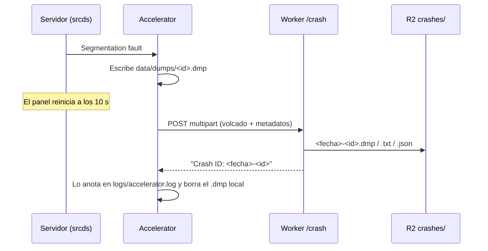

# Plan: rastrear los crashes del servidor real con Accelerator

> Planeación original. Estado: **aprobada** (2026-10-14). Daniel: "instala Accelerator pero también déjalo aquí en el repo (incluso en mi server local) para que quede traza de los plugins externos que estamos usando y no solo el nuestro".

## Contexto

El 2026-10-14 a las 16:41 el servidor real se cayó (`Segmentation fault`) al empezar una ronda en la que iba a arrancar una pausa pedida con `!pause`. La investigación (ver `DOCUMENTACION.md`) encontró que el servidor se viene cayendo desde hace días en momentos sin pausa, y que no queda ningún rastro de dónde muere: ni `core`, ni nada en los logs.

## Decisiones tomadas

| Tema | Decisión | Por qué |
|---|---|---|
| Herramienta | Accelerator, la extensión de SourceMod que escribe un volcado (minidump) en cada crash | Es la estándar. No requiere `gdb` en el contenedor ni cambiar el arranque |
| Versión | 2.5.0 (build 138) | La 2.6.0 pide glibc 2.7 y apunta a SourceMod 1.11+; la 2.5.0 pide glibc 2.3.4 y es la que se usa con 1.10 |
| Dónde se guardan los volcados | En nuestro Worker de Cloudflare (`POST /crash`), que los guarda en R2 (`crashes/`) | `crash.limetech.org` hoy rechaza los reportes ("capacity reached"), y Accelerator borra el volcado local después de intentar subirlo, aunque falle |
| Autenticación de la subida | Clave en la URL (`?key=`), secreto `CRASH_KEY` del Worker y `ACCELERATOR_CRASH_KEY` en el `.env` | Accelerator no permite cabeceras propias |
| `MinidumpPresubmit` | `no` | El presubmit consulta a `crash.limetech.org` |
| Repo | Los binarios de Accelerator en `server/addons/sourcemod/` (misma estructura que el servidor) e inventario de todo lo externo en `docs/PLUGINS_EXTERNOS.md` | Pedido por Daniel |
| Servidor local | También con Accelerator y el mismo `core.cfg` | Pedido por Daniel; sirvió para probar todo el circuito |

## Flujo

## Orden

1. Bajar Accelerator, probarlo en el servidor local con un crash provocado.
2. Ruta `POST /crash` en el Worker, probada con `wrangler dev` y con Accelerator real.
3. Secreto y deploy del Worker.
4. Instalar en el servidor real (extensión, gamedata, `core.cfg` con respaldo).
5. Inventario de plugins externos y documentación.
