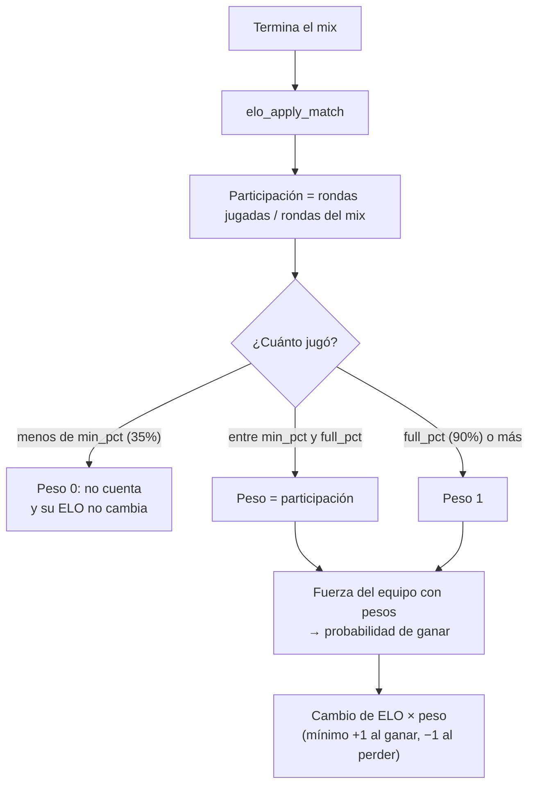

# ELO proporcional a las rondas jugadas: documentación

## Qué hace

Cada jugador gana o pierde ELO según la parte del mix que jugó. Con menos del 35% de las rondas, su ELO no cambia. Desde el 90% cuenta completo. En el medio, el cambio es proporcional: jugar 20 de 30 rondas da ±20 donde un jugador completo recibe ±30.

La misma proporción se usa para calcular la fuerza de cada equipo, que define la probabilidad de ganar. Por ejemplo, si un jugador se va en la ronda 6 y entra un reemplazo que juega 24 rondas, el equipo vale 4,8 jugadores y no 6.

Los dos porcentajes se configuran en *Admin → Servidores → ELO*. Las estadísticas del mix (kills, rating, etc.) se guardan igual para todos, aunque no reciban ELO.

## Rondas del mix y peso

- **Rondas del mix:** la mayor entre `score1 + score2` y las rondas del jugador que más jugó. Una ronda empatada no suma al marcador pero sí a las rondas de cada jugador, y así quien jugó todo sigue en 100%.
- **Rondas del jugador:** las cuenta el plugin al final de cada ronda si el jugador está en T o CT (`match_player_stats.rounds`). Se conservan si se reconecta.
- **Peso** (`elo_weight(rondas, total, min_pct, full_pct)`), calculado con enteros para que 27 de 30 sea exactamente 90%:

| Condición | Peso |
|---|---|
| `rondas × 100 < min_pct × total` | 0 |
| `rondas × 100 ≥ full_pct × total` | 1 |
| En el medio | `rondas / total` |

Con los valores por defecto en un MR15 de 30 rondas (cambio normal de ±30):

| Rondas | % | Peso | Cambio |
|---|---|---|---|
| 10 | 33% | 0 | sin cambio |
| 11 | 37% | 0.37 | ±11 |
| 15 | 50% | 0.5 | ±15 |
| 20 | 67% | 0.67 | ±20 |
| 26 | 87% | 0.87 | ±26 |
| 27 a 30 | 90–100% | 1 | ±30 |

## Qué se escala con el peso

| Parte | Antes | Ahora |
|---|---|---|
| Quién recibe ELO | SteamID64 con al menos 1 ronda | SteamID64 con peso > 0 |
| Fuerza del equipo (μ) | Σ μ | Σ peso × μ |
| Incertidumbre del partido (c²) | n × β² + Σ (σ² + τ²) | Σ peso² × (σ² + τ² + β²) |
| Cambio de ELO | base + bonus | `round((base + bonus) × peso)`, con mínimo +1 / −1 |
| μ del jugador | ± σ²/c × v | ± peso × σ²/c × v |
| σ del jugador | σ² × (1 − σ²/c² × w) | σ² × (1 − peso² × σ²/c² × w) |
| `player_elo.matches` | +1 | +1 solo si peso > 0 |

Es TrueSkill con "juego parcial": quien jugó la mitad aporta la mitad al equipo y se mueve la mitad. Si todos tienen peso 1, el resultado es exactamente el de antes.

Los jugadores sin SteamID64 (y los bots, si se incluyen) siguen contando como un jugador nuevo (μ 25, σ 8.33) en la fuerza de su equipo, ahora con su peso. Si a un equipo no le queda nadie con peso > 0, el mix no mueve el ELO de nadie.

Quien no llega al mínimo queda con `elo_before`, `elo_after`, `elo_delta` y `win_prob` vacíos en `match_player_stats`. La web muestra "-" en la columna ELO.

## Configuración

| Columna de `elo_config` | Default | Rango | Campo en la web |
|---|---|---|---|
| `min_pct` | 35 | 1 – 100 | Mínimo de rondas jugadas (%) |
| `full_pct` | 90 | `min_pct` – 100 | Cuenta completo desde (%) |

`elo_set_config(p_base, p_bonus_max, p_bonus_factor, p_floor, p_start_elo, p_recompute, p_min_pct, p_full_pct)`: solo admin. Si `p_min_pct` o `p_full_pct` llegan vacíos, conserva lo guardado (la web anterior no los manda). Rechaza un mínimo fuera de 1–100 o un "completo" menor que el mínimo.

Con `full_pct = 100` el cálculo es puramente proporcional. Con `min_pct = full_pct` todos los que llegan al mínimo cuentan completo.

El ejemplo debajo del formulario muestra la regla con los valores escritos, por ejemplo: "Con menos del 35% de las rondas no cambia su ELO; desde el 90% cuenta completo y en el medio, proporcional: jugando 20 de 30 rondas, ±20."

**Historial:** la regla aplica a los mixes que llegan después de la migración. Los anteriores no se recalcularon. Si un admin guarda con "Recalcular todos los mixes" marcado (viene marcado por defecto) o usa **Recalcular ELO**, la regla nueva se aplica también a todos los mixes anteriores.

## Dónde está cada cosa

| Qué | Archivo / ubicación |
|---|---|
| Migración | `supabase/migrations/20261014120000_elo_participacion.sql` |
| Peso | `public.elo_weight(integer, integer, integer, integer)` (interna) |
| Cálculo del ELO | `public.elo_apply_match(uuid)` |
| Configuración | `public.elo_config` (`min_pct`, `full_pct`) y `public.elo_set_config(...)` |
| Formulario | `index.html`, Admin → Servidores → ELO (`elo-minp`, `elo-fullp`, `eloPart`) |
| Pruebas | `pruebas/pruebas_participacion.sql` |
