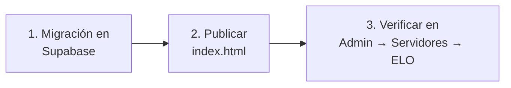

# ELO proporcional a las rondas jugadas: guía de implementación

## Estado

**Pendiente por desplegar.** Implementado y probado en PostgreSQL local (2026-10-14), sin commit. Falta la migración en Supabase y publicar `index.html`.

## Archivos

| Archivo | Cambio |
|---|---|
| `supabase/migrations/20261014120000_elo_participacion.sql` | Nuevo: `elo_config.min_pct` / `full_pct`, `elo_weight`, `elo_set_config` con 8 parámetros (se borra la de 6), `elo_apply_match` con pesos |
| `index.html` | Dos campos en Admin → Servidores → ELO, ejemplo con 20 de 30 rondas y los dos parámetros nuevos en la llamada a `elo_set_config` |
| `docs/FUNCIONALIDADES.md`, `docs/MODELO_DATOS.md` | La regla nueva y la migración |
| `docs/bitacora/2026-10-14-elo-participacion-y-sourcetv/pruebas/pruebas_participacion.sql` | Nuevo: pruebas P1–P12 |

El plugin no cambia: ya manda `rounds` de cada jugador.

## Despliegue (hecho el 2026-10-14)



1. **Supabase → SQL Editor**: pegar todo `20261014120000_elo_participacion.sql` y ejecutar. **No** ejecutar `elo_recompute_all()`: se decidió no recalcular los mixes anteriores.
2. **Publicar `index.html`**. Hay que hacerlo después de la migración: la web nueva manda `p_min_pct` y `p_full_pct`, que la función anterior no conoce. La web anterior sigue funcionando con la migración aplicada, porque los parámetros nuevos son opcionales.
Hecho el 2026-10-14: Daniel corrió la migración en el SQL Editor (sin `elo_recompute_all()`) y después se publicó `index.html` por FTP en `/htdocs` (157241 bytes, md5 `bb407a8c8dd64fef7c862d2c78df316b`). Antes se comprobó que el publicado era el de `HEAD`; copia del anterior en el scratchpad de la sesión.

**Cambio extra al publicar:** la casilla "Recalcular todos los mixes" (`elo-rec`) ahora **viene desmarcada**, para que guardar la configuración no recalcule el historial por accidente.

3. **Verificar**: Admin → Servidores → ELO muestra 35 y 90 en los campos nuevos, y el ejemplo dice "…jugando 20 de 30 rondas, ±20". La casilla "Recalcular todos los mixes" viene desmarcada; marcarla solo si se quiere recalcular el historial.

## Pruebas

### Base de datos (PostgreSQL 18 local, 2026-10-14)

Base vacía en el puerto 55433 con `stub_supabase.sql` y **todas** las migraciones en orden (de `20261011120000` a `20261014120000`):

```bash
initdb -D pgdata -U postgres -A trust -E UTF8
pg_ctl -D pgdata -o "-p 55433" start
psql -p 55433 -U postgres -c "create database t"
psql -p 55433 -U postgres -d t -v ON_ERROR_STOP=1 -f docs/bitacora/2026-10-11-elo-jugadores/pruebas/stub_supabase.sql
for f in supabase/migrations/*.sql; do psql -p 55433 -U postgres -d t -v ON_ERROR_STOP=1 -f "$f"; done
psql -p 55433 -U postgres -d t -f docs/bitacora/2026-10-11-elo-jugadores/pruebas/pruebas_elo.sql
psql -p 55433 -U postgres -d t -f docs/bitacora/2026-10-14-elo-participacion-y-sourcetv/pruebas/pruebas_participacion.sql
pg_ctl -D pgdata stop && rm -rf pgdata
```

Las 18 pruebas anteriores (T1–T18 de `pruebas_elo.sql`) pasan sin cambios: con todos los jugadores completos el resultado es el mismo que antes. Pruebas nuevas:

| # | Prueba | Resultado |
|---|---|---|
| P1 | Valores por defecto | 35 / 90 |
| P2 | Pesos | 10/30 = 0, 11/30 = 0.367, 26/30 = 0.867, 27/30 = 1, 7/20 = 0.35 exacto |
| P3 | 3v3 parejo con 30, 20 y 10 rondas por lado | +30 / +20 / sin cambio y −30 / −20 / sin cambio; los de 10 rondas no entran a `player_elo` |
| P4 | TrueSkill escalado | Δμ 3.4992 (30 rondas) y 2.3328 (20 rondas, exactamente 2/3); σ baja menos |
| P5 | Reemplazo: 4 completos + uno de 6 rondas + uno de 24 contra 5 completos | El equipo vale 4,8: probabilidad 0.4314 (no favorito por tener 6). El que se fue no recibe ELO; el reemplazo +27 (0,8 de +34) |
| P6 | Ronda empatada: marcador 15-14 y jugadores con 30 rondas | Rondas del mix = 30; 30 y 27 rondas dan +34, 26 rondas +29 |
| P7 | Mínimo +1 después de escalar | Favorito completo +12, con 11 rondas +4 |
| P8 | Un equipo sin nadie que llegue al mínimo | Nadie recibe ELO |
| P9 | Configuración | Parámetros vacíos conservan 50/80; rechaza completo < mínimo y mínimo 0; con 50/80, 14 de 30 no cuenta y 24 de 30 cuenta completo |
| P10 | Permisos | `elo_weight` sin acceso público; `elo_set_config` de 8 parámetros solo para `authenticated`; la de 6 ya no existe |
| P11 | Usuario no admin | Rechazado |
| P12 | `elo_recompute_all()` dos veces | Mismo estado |

La migración se aplicó dos veces seguidas sin error (re-ejecutable).

### Web

Revisada la sintaxis de los scripts de `index.html` con Node y la función del ejemplo: 10 → 0, 11 → 11, 15 → 15, 20 → 20, 26 → 26, 27 y 30 → 30. **No se probó en el navegador** con un admin logueado.

## En qué se apartó del plan

- La primera versión del plan incluía la SourceTV en primera persona y la retransmisión sin voz. Daniel la cambió antes de aprobarla: la primera persona se analiza más adelante y la voz queda como está. El `PLAN.md` aprobado ya no las incluye (detalle al principio del plan).
- P12 compara dos recálculos seguidos en lugar de comparar contra el estado anterior: las pruebas insertan filas de `player_elo` a mano (T9, P7) que un recálculo borra.

## Incidentes durante las pruebas

- La primera corrida de P3 falló porque usaba SteamID que ya tenían ELO de `pruebas_elo.sql`. Se cambiaron por IDs sin uso.

## Cómo revertir

Volver a ejecutar `20261011230000_elo_config.sql`: restaura `elo_apply_match` sin pesos y `elo_set_config` de 6 parámetros. Antes, borrar la de 8 para que no queden dos versiones:

```sql
drop function if exists public.elo_set_config(integer, integer, numeric, integer, integer, boolean, integer, integer);
drop function if exists public.elo_weight(integer, integer, integer, integer);
alter table public.elo_config drop column if exists full_pct, drop column if exists min_pct;
```

Después, publicar el `index.html` anterior. Los mixes que se aplicaron con pesos conservan su ELO hasta que se recalcule (`select elo_recompute_all();`).
