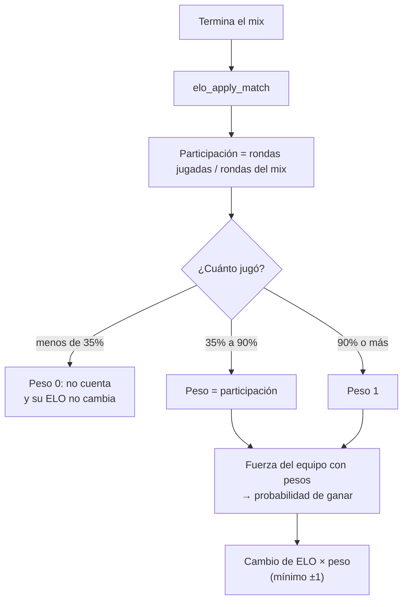

# Plan: ELO proporcional a las rondas jugadas

> Planeación original. Estado: **aprobada** (2026-10-14).

Un jugador recibe ELO solo si jugó al menos el 35% de las rondas del mix, y lo que gana o pierde es proporcional a lo que jugó. Desde el 90% cuenta completo. Los dos porcentajes se configuran desde la web.

La carpeta se llama `elo-participacion-y-sourcetv` porque la primera versión del plan también incluía dos cambios en la SourceTV. Quedaron fuera:

- **Primera persona en la SourceTV:** se analiza más adelante. El motor v34 no tiene una cvar para esto: haría falta un parche en memoria del director (`StartChaseCameraShot` / `StartFixedCameraShot`).
- **Sin voz en la retransmisión:** no se hace. La demo se graba con lo mismo que se transmite y `tv_relayvoice 0` quitaría la voz también de la demo, que es donde Daniel la quiere. Queda como está (`tv_delay` por defecto, sin cambios).

## Decisiones tomadas

| Tema | Decisión | Por qué |
|---|---|---|
| Participación | `rondas del jugador / rondas del mix`, con tope de 1 | |
| Rondas del mix | La mayor entre `score1 + score2` y las rondas del jugador que más jugó | Si hubo una ronda empatada (no suma al marcador), el que jugó todo sigue en 100% |
| Peso | Menos del 35%: 0 (no cambia). Entre 35% y 90%: el porcentaje. Desde 90%: 1 | Lo propuesto y aprobado. Desde 90% nadie pierde por una reconexión o una ronda perdida |
| Qué se escala | El cambio de ELO completo (base + bonus por rating), redondeado. Se mantiene el mínimo +1 al ganar y −1 al perder | |
| Fuerza del equipo | Cada jugador aporta según su peso (TrueSkill con juego parcial): μ del equipo = Σ peso × μ; varianza = Σ peso² × (σ² + τ² + β²) | Un reemplazo que jugó el 40% aporta el 40% de su nivel; un equipo con un cambio no cuenta como de 6 |
| TrueSkill del jugador | μ se mueve `peso ×` lo de siempre y σ baja `peso² ×` lo de siempre | Quien juega poco cambia poco también su nivel interno |
| Con peso 1 para todos | Mismo resultado que hoy | Las pruebas anteriores del ELO tienen que seguir pasando sin cambios |
| Configurable | `elo_config.min_pct` (35, rango 1–100) y `elo_config.full_pct` (90, rango `min_pct`–100), editables en Admin → Servidores → ELO | Pedido por Daniel |
| Historial | No se recalcula. Aplica a los mixes nuevos | Decisión de Daniel. Ojo: si un admin usa "Recalcular", la regla nueva se aplica también a los mixes viejos |
| Plugin | Sin cambios | Ya manda `rounds` de cada jugador |

## 1. El flujo completo

Ejemplo, MR15 de 30 rondas y un cambio normal de ±30:

| Rondas | % | Cambio |
|---|---|---|
| 10 | 33% | 0 |
| 11 | 37% | ±11 |
| 15 | 50% | ±15 |
| 20 | 67% | ±20 |
| 27 a 30 | 90–100% | ±30 |

## 2. Base de datos

Migración `supabase/migrations/20261014120000_elo_participacion.sql`, re-ejecutable:

- `elo_config`: columnas `min_pct` y `full_pct` con sus checks.
- `elo_set_config`: dos parámetros nuevos, `p_min_pct` y `p_full_pct`. Si llegan vacíos se conserva el valor guardado, para que la web anterior (que no los manda) no los pise. Se borra la versión de 6 parámetros.
- `elo_apply_match`: la de `20261011230000_elo_config.sql` con los pesos.

## 3. Web (`index.html`)

En Admin → Servidores → ELO, dos campos nuevos: "Mínimo de rondas jugadas (%)" y "Cuenta completo desde (%)". El ejemplo de abajo agrega una línea con 20 de 30 rondas.

## 4. Pruebas

PostgreSQL 18 local, como en los requerimientos anteriores del ELO: las pruebas de `pruebas_elo.sql` sin cambios, más un archivo nuevo con jugadores parciales (menos del mínimo, en el medio, desde el completo, reemplazo, ronda empatada, configuración y re-ejecución de la migración).

## 5. Requisitos antes de empezar

Ninguno. El despliegue (SQL Editor de Supabase y publicar `index.html`) lo hace Daniel, o se hace después con su visto bueno.

## 6. Orden de implementación

1. Migración.
2. Pruebas SQL locales.
3. Web.
4. `DOCUMENTACION.md`, `GUIA_IMPLEMENTACION.md`, `CHANGELOG_DISCORD.txt` y fila en el índice.
