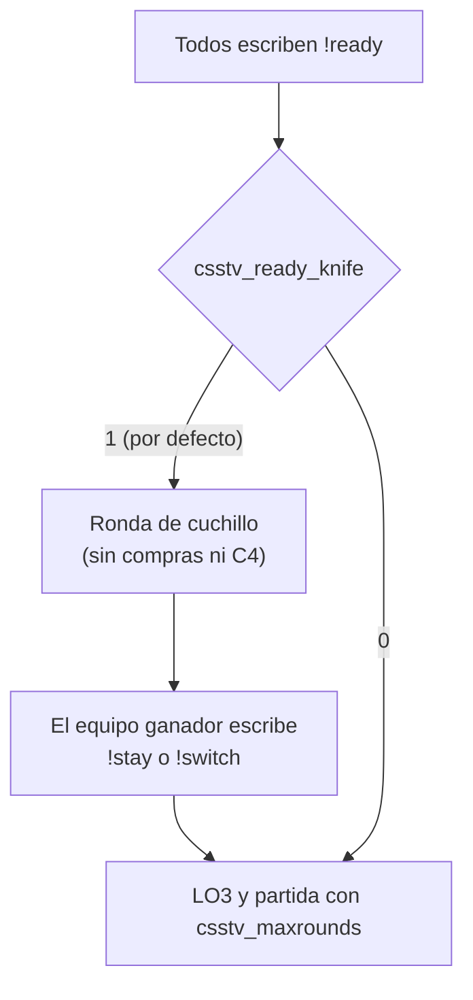

# Inicio por `!ready` con ronda de cuchillo: documentación

## Qué hace

Desde la 1.8.0, cuando todos los jugadores de CT y T escriben `!ready` (y hay al menos `csstv_min_players`), la partida empieza con una **ronda de cuchillo**, igual que con `!live knife`. Antes, el inicio por `!ready` iba directo al LO3.

## Reglas

- La ronda de cuchillo es la misma de `!live knife` (ver la [bitácora de la 1.6.0](../2026-10-13-plugin-1-6-0/DOCUMENTACION.md)). Se juega solo con cuchillo y sin compras ni C4. El equipo que gana elige lado con `!stay` o `!switch`, y vale el primero que lo escribe. Si nadie elige en `csstv_knife_time` segundos (60), el equipo se queda en su lado.
- No cuenta para estadísticas, marcador ni demo: todo eso empieza con el LO3.
- La partida usa el formato de `csstv_maxrounds`, como antes.
- `!live` sin argumentos sigue yendo directo al LO3 y `!live knife` sigue teniendo cuchillo. Los admins pueden elegir así.

## Configuración

| Cvar | Default | Efecto |
|---|---|---|
| `csstv_ready_knife` | `1` | `1`: el inicio por `!ready` empieza con ronda de cuchillo. `0`: va directo al LO3 (lo de antes de la 1.8.0) |

## Dónde está cada cosa

| Qué | Archivo |
|---|---|
| Cvar y llamada | `server/addons/sourcemod/scripting/csstv_reporter.sp` (`g_cvReadyKnife`, `CheckReadyStart`) |
| Ronda de cuchillo | `server/addons/sourcemod/scripting/csstv/knife.inc` (sin cambios de lógica) |
| Configuración | `server/cfg/sourcemod/csstv_reporter.cfg` |
| Guía del servidor | `docs/GUIA_SERVIDOR.md`, flujo de la partida |
