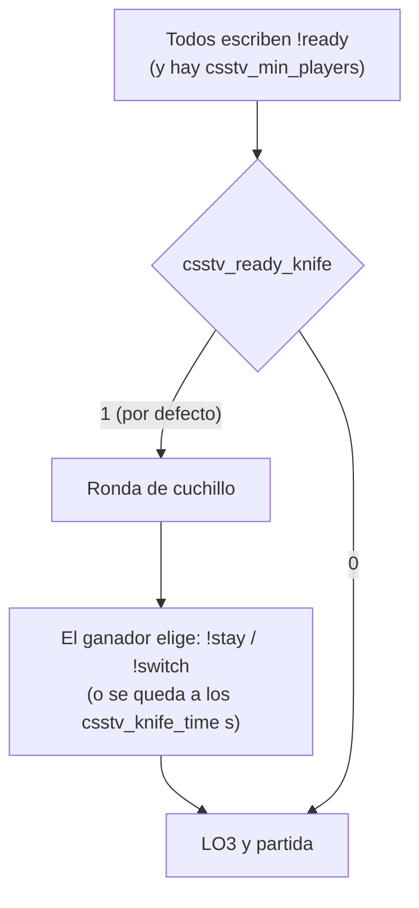

# Plan: el inicio por `!ready` empieza con ronda de cuchillo

> Planeación original. Estado: **aprobada** (2026-10-14). Daniel lo pidió directamente: "cuando todos los jugadores usen !ready por defecto debe mandar el match con ronda cuchillo, como si fuera !live knife".

## Decisiones tomadas

| Tema | Decisión | Por qué |
|---|---|---|
| Comportamiento | Cuando todos están listos, la partida arranca igual que con `!live knife`: ronda de cuchillo, el ganador elige con `!stay` / `!switch` y después el LO3 | Es lo pedido |
| Configurable | Cvar nueva `csstv_ready_knife`, por defecto `1`. Con `0` vuelve a lo de antes (directo al LO3) | "Por defecto" en el pedido; los servidores de terceros pueden apagarlo |
| `!live` | Sin cambios: `!live` solo va directo y `!live knife` tiene cuchillo | Lo usan los admins para elegir |
| Formato | El de `csstv_maxrounds` (como antes con `!ready`) | |
| Versión | Plugin 1.8.0 | |

## 1. El flujo completo

## 2. Plugin

- `csstv_reporter.sp`: cvar `csstv_ready_knife` y `CheckReadyStart` llama a `StartMatch(0, g_cvReadyKnife.BoolValue)`. La ronda de cuchillo ya existe (`csstv/knife.inc`), no cambia.
- `server/cfg/sourcemod/csstv_reporter.cfg`: la cvar nueva.
- `docs/GUIA_SERVIDOR.md`: el inicio y la ronda de cuchillo.

## 3. Pruebas

Servidor local, `$2000$`, 2 bots T y 1 CT, compilado con `CSSTV_DEBUG=` (los bots escriben `!ready` con `csstv_debug_fakecmd`): con `1`, cuchillo y mix completo; con `0`, directo al LO3.

## 4. Orden de implementación

1. Cvar y llamada en el plugin; versión 1.8.0.
2. Compilar y probar con bots.
3. Documentación, `CHANGELOG_DISCORD.txt` y fila en el índice.
4. Subir al servidor real cuando Daniel lo apruebe.
