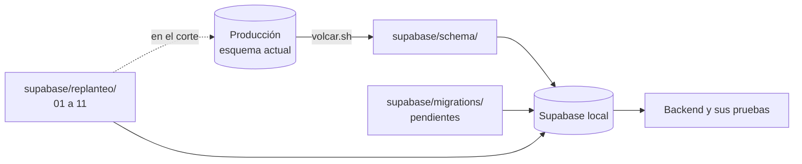

# Replantear el modelo de datos (fase 2 del backend): documentación

## Qué hace

La fase deja el modelo de datos listo para el backend y la web nueva: saca lo que no se usaba, deja de crear equipos falsos para los mixes, pasa los planteles a una tabla propia, calcula las stats solo desde las partidas jugadas y suma `!match` (vincular un juego del servidor a una partida de torneo o PCW) y los formatos de PCW que decide el admin.

Son doce migraciones en `supabase/replanteo/` (la `09`, la `10`, la `11` y la `12`, de las entregas de jugadores y equipos, de partidas, torneos y PCW, de los listados y del admin de servidores). **No se aplican en producción hasta el corte**, porque la web vieja depende del esquema actual. Mientras tanto viven solo en la Supabase local, donde el backend se desarrolla y se prueba sobre el esquema nuevo.

Cada migración verifica que la base esté en el estado esperado y aborta sin cambiar nada si no lo está. Cada una tiene su inversa, que deja la estructura idéntica a la de antes, y sus pruebas. Un ensayo con la copia de producción demuestra que el ELO, las victorias y derrotas y las stats de todos los jugadores quedan **idénticos**.

## Las migraciones

| # | Archivo | Qué cambia |
|---|---|---|
| 01 | `01_limpieza.sql` | Borra `player_claims`, `profiles.player_id`, `player_medals.color`, `matches.demo_url` y `matches.video_url`, las políticas duplicadas y el formato de torneo `swiss` |
| 02 | `02_privacidad.sql` | La privacidad de un jugador es `public` o `private` (sale `members`). Privado oculta los datos personales (`profile_details`), no la ficha ni las stats |
| 03 | `03_matchmaking.sql` | Borra el matchmaking viejo: 4 tablas, 11 funciones y sus columnas en `game_servers` y `matches`. Aborta si hay matchmaking activo |
| 04 | `04_mixes_bandos.sql` | Los mixes guardan sus bandos en la partida y se borran los equipos `mix`. `winner_side` en todas las partidas |
| 05 | `05_team_members.sql` | Tabla `team_members` en lugar de `teams.members` |
| 06 | `06_vistas_stats.sql` | Vistas `player_stats` y `player_map_stats`; se borran las stats manuales |
| 07 | `07_match_vincular.sql` | `!match` y reglas de plantel (ver [`2026-10-15-match-y-status`](../2026-10-15-match-y-status/DOCUMENTACION.md)) |
| 08 | `08_formatos_pcw.sql` | Formatos de PCW habilitados por el admin (ver [`2026-10-15-formatos-pcw`](../2026-10-15-formatos-pcw/DOCUMENTACION.md)) |
| 09 | `09_jugadores_equipos.sql` | Alias único, palabras bloqueadas, plantel con invitaciones, ranking y vistas para los listados (ver [`2026-10-15-api-jugadores-equipos`](../2026-10-15-api-jugadores-equipos/DOCUMENTACION.md)) |
| 10 | `10_partidas_torneos.sql` | Organizadores, plantillas de torneo y motor en la base, inscripción con jugadores, veto, chat y PCW como equipo (ver [`2026-10-15-api-partidas-torneos-pcw`](../2026-10-15-api-partidas-torneos-pcw/DOCUMENTACION.md)) |
| 11 | `11_listados.sql` | Vistas para los listados paginados, filtrados y ordenados en el servidor (ver [`2026-10-15-get-paginacion-filtros`](../2026-10-15-get-paginacion-filtros/DOCUMENTACION.md)) |
| 12 | `12_servidores.sql` | Admin de servidores: nombre único, IP permitida válida, alta con id y token, borrar solo sin partidas, listado del admin y solo servidores con licencia vigente para asignar partidas (ver [`2026-10-16-api-admin-servidores`](../2026-10-16-api-admin-servidores/DOCUMENTACION.md)) |

## Mixes sin equipos y `winner_side`

Antes, cada mix del servidor creaba dos equipos `mix` que aparecían mezclados con los equipos reales. Ahora los bandos van dentro de la partida:

| Columna de `matches` | Qué guarda |
|---|---|
| `side1_name`, `side2_name` | Nombre de cada bando: "Equipo X" con `!team`, "Mix de <jugador con más kills>" o, si el mix está vinculado con `!match`, el nombre del equipo |
| `lineup1`, `lineup2` | Jugadores vinculados de cada bando (ids de `players`) |
| `side1_guests`, `side2_guests` | Invitados sin jugador vinculado (nicks) |
| `winner_side` | 1, 2 o null (empate o sin resultado), en **todas** las partidas |

- En los mixes, `winner_side` lo escribe la ingesta. En PCW y torneos lo mantiene el trigger `matches_winner_side` a partir de `winner`.
- El ELO (`elo_apply_match`) y las victorias usan `winner_side`. La fórmula no cambió.
- Al vincular un SteamID (`link_steam_id`), el jugador pasa de invitado al plantel de su bando en cada mix, y al revés al desvincular.
- `teams.kind` solo admite `official` o `pcw`, y un mix no puede tener `team1`, `team2` ni `winner`.

## Planteles: `team_members`

| Columna | Qué guarda |
|---|---|
| `team_id`, `player_id` | Equipo y jugador (`on delete cascade`) |
| `role` | `player`, `sub` o `coach` |
| `joined_at` | Alta (null en los miembros migrados, porque el arreglo no guardaba fecha) |
| `left_at` | Baja; null = sigue en el equipo |

- Un jugador está activo una sola vez por equipo, pero puede volver después de una baja.
- Todos leen; el admin gestiona; los usuarios escriben a través de las funciones (`pcw_make_side`, `accept_pcw`, `set_team_captain`, `validate_report`), que ahora usan el plantel **activo**.
- El historial de equipos de un jugador puede salir de esta tabla. `players.team_history` queda como texto libre.

## Stats solo desde partidas

| Vista | Qué devuelve |
|---|---|
| `player_stats` | Por jugador: mapas, rondas, kills, muertes, asistencias, daño, rating, K/D, HS %, ADR, victorias y derrotas |
| `player_map_stats` | Por jugador y mapa: mapas, rating, K/D, ADR, victorias y derrotas |

- Salen de `match_player_stats` de las partidas **terminadas**: mixes, y PCW y torneos cuando se juegan en el servidor con `!match`. Una cancelada no cuenta.
- Fórmulas iguales a las de la vieja `recompute_player_stats` (`csstv_rating`).
- Siempre están al día: no hay nada que recalcular.
- Son `security_invoker` y públicas.
- Se perdieron las stats cargadas a mano de 2 jugadores sin partidas (de 72, al 2026-10-15). Quedan en el respaldo del corte.

## Cómo se trabaja en esta fase

| Qué | Cómo |
|---|---|
| Levantar la base local con el replanteo | `pnpm db:reset` en `web/backend` (`scripts/db-local.sh`: esquema de producción, migraciones pendientes, `supabase/replanteo/` y `scripts/local-overrides.sql`). Sin el replanteo: `REPLANTEO=0 pnpm db:reset` |
| Probar las migraciones | `docs/bitacora/2026-10-14-replanteo-modelo-datos/pruebas/correr.sh`: por cada una la aplica, corre su prueba, verifica que una segunda aplicación aborte, aplica la inversa, compara la estructura (tablas, funciones y triggers) y la vuelve a aplicar |
| Ensayo del ELO | `pruebas/ensayo_elo.sh` con la copia de producción en `~/.v34frag/prod-copy/` (fuera del repo, tiene datos personales). Al terminar, `pnpm db:reset` para no dejar la copia cargada |
| Tipos del backend | `pnpm db:types` después de cambiar el esquema local |
| Cambiar una función existente | `pg_temp.reemplazar(función, pares)`: reemplaza fragmentos exactos y aborta si no los encuentra. El texto nuevo tiene que ser único (un comentario `-- (replanteo NN) …`) para que la inversa encuentre el mismo lugar |

## Backend

- `GET /api/v1/me/profile` busca el equipo actual en `team_members` (plantel activo) y solo entre equipos `official`.
- `/api/v1/me/profile-requests` (GET y POST) sigue funcionando, pero está marcado `deprecated` en la OpenAPI: el reclamo de perfil va a pasar al juego con `!claim` (plan [`2026-10-11-reclamo-perfil-servidor`](../2026-10-11-reclamo-perfil-servidor/PLAN.md), sin aprobar).
- `GET /api/v1/pcw/formats` y `PUT /api/v1/admin/pcw/formats` (formatos de PCW).
- Los endpoints de dominio se construyen directamente sobre el esquema nuevo.

## Dónde está cada cosa

| Qué | Archivo / ubicación |
|---|---|
| Migraciones y advertencia de no aplicarlas | `supabase/replanteo/` y su `README.md` |
| Inversas | `docs/bitacora/2026-10-14-replanteo-modelo-datos/reversas/` |
| Pruebas, `correr.sh` y ensayo del ELO | `docs/bitacora/2026-10-14-replanteo-modelo-datos/pruebas/` |
| Copia de producción para el ensayo | `~/.v34frag/prod-copy/` (fuera del repo) |
| Carga de la base local | `web/backend/scripts/db-local.sh` |
| Resumen del modelo antes y después | `docs/MODELO_DATOS.md`, sección "Después del corte" |
| Lo que cambia para el frontend | `docs/frontend/2026-10-14-decisiones-para-frontend.md` |
| El corte (respaldo, migraciones, plugin, web) | Plan propio, todavía sin escribir. Lista de pasos en `docs/PENDIENTES.md`, punto 1.5 |
