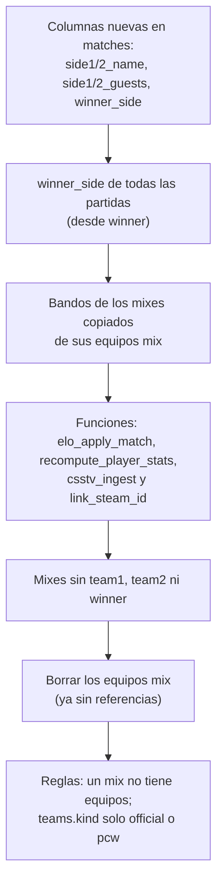

# Replantear el modelo de datos (fase 2 del backend): guía de implementación

## Estado

**En curso.** Plan aprobado el 2026-10-14. **Producción sin tocar:** todo se aplicó y se probó solo en la Supabase local.

| Paso del plan | Estado |
|---|---|
| 1. `supabase/replanteo/` y carga en `db-local.sh` | Hecho |
| 2. Ensayo del ELO: copia de datos y medición "antes" | Hecho (2026-10-15): `ensayo_elo.sh`, idéntico con 01 y 02 |
| 3. Limpieza (2.6) | Hecho: `01_limpieza.sql` |
| 4. Privacidad (2.4) | Hecho: `02_privacidad.sql` |
| — Borrar el matchmaking viejo (fuera del plan, decisión del 2026-10-15) | Hecho: `03_matchmaking.sql` |
| 5. Mixes sin equipos y `winner_side` (2.1) | Hecho: `04_mixes_bandos.sql`. Ensayo del ELO idéntico; la inversa con datos reales también deja el ELO idéntico |
| 6. `team_members` (2.2) | Hecho: `05_team_members.sql`. Ensayo del ELO idéntico; 89 de 89 miembros migrados |
| 7. Vistas de stats (2.3) | Hecho: `06_vistas_stats.sql`. Ensayo idéntico, incluidas las stats de los 32 jugadores con partidas |
| 8. `!match` en la base (2.5) | Hecho: `07_match_vincular.sql` (el plugin va en el paso 9) |
| 9. Plugin con `!match` | Hecho: plugin 2.0.0 (`!match` y `!status`), probado con bots contra la Supabase local (2026-10-15). Ver [`2026-10-15-match-y-status`](../2026-10-15-match-y-status/). Se despliega en el corte |
| 10. Ajustes del backend de la fase 1 | Parcial: tipos regenerados con el esquema nuevo; falta `team_members` y marcar `profile-requests` como deprecado |
| 11. Inversas y documentación | Al día para los pasos hechos |

## Paso 1: carpeta y carga local

- **`supabase/replanteo/README.md`:** advierte que las migraciones **no se aplican en producción** hasta el corte, y explica el formato.
- **Formato de cada migración:**
  - Corre en una transacción.
  - Empieza con un bloque que verifica el estado esperado. Si no lo encuentra, aborta sin cambiar nada; por ejemplo, si ya se aplicó o si hay datos que se perderían.
- **`web/backend/scripts/db-local.sh`:** carga `supabase/replanteo/[0-9]*.sql` después de las migraciones pendientes y antes de `local-overrides.sql`. Con `REPLANTEO=0` no las carga, para tener la base con el esquema actual de producción; lo va a usar el ensayo del ELO.
- **Inversas:** en `reversas/`, una por migración, con el mismo nombre.
- **Pruebas:** en `pruebas/`, una por migración, más `estructura.sql` (foto ordenada de columnas, restricciones, políticas, RLS, índices y permisos) y `correr.sh`.

**`pruebas/correr.sh`** (desde la raíz del repo) levanta la base local sin replanteo y, para cada migración:
1. La aplica y corre su prueba.
2. Verifica que una segunda aplicación aborte.
3. Aplica la inversa y compara la estructura con la de antes, que tiene que ser **idéntica**.
4. La vuelve a aplicar.

## Paso 3: `01_limpieza.sql`

| Qué | Verificación previa (si falla, aborta) |
|---|---|
| `drop table player_claims` | Que esté vacía |
| `profiles.player_id`, `player_medals.color`, `matches.demo_url`, `matches.video_url` | Que no tengan datos (salvo `color`, que tiene un valor por defecto y nunca se mostró) |
| Políticas duplicadas: `admin gestiona eventos`, `todos ven eventos`, `admin gestiona partidas`, `todos ven partidas`, `Permitir lectura pública de jugadores` | Se comprobó antes que su `qual` y su `with_check` son idénticos a los de las que quedan |
| `events_format_check`: `playoffs`, `single`, `double`, `rr` o `groups` | Que no haya torneos `swiss` |

**Revisado antes de borrar:**
- Ninguna función usa esas columnas ni tablas.
- La única vista que depende de `profiles` (`public_profiles`) usa solo `id` y `tag`.

## Paso 4: `02_privacidad.sql`

- **`members` pasa a `private`** (no había ninguno), y el check queda en `public` o `private`.
- **La política `perfil: ver segun privacidad` de `profile_details`** se recrea sin la rama de `members`:
  - El dueño y el admin siempre ven los detalles.
  - El resto, solo si el jugador vinculado es público.
  - Una cuenta sin jugador vinculado sigue visible, como antes.
- **La ficha del jugador** (`players`) sigue siendo pública aunque sea privado, como decidió Daniel: privado oculta los datos personales, no las stats.

**Prueba con usuarios simulados** (`request.jwt.claims` y los roles `authenticated` y `anon`, todo dentro de un `rollback`):
- `members` se rechaza.
- **Perfil público:** otro usuario y un anónimo ven los detalles.
- **Perfil privado:**
  - Otro usuario y un anónimo no ven los detalles.
  - El dueño sí los ve.
  - La ficha del jugador sigue visible.
- **La prueba detecta fallas de verdad:** corrida sin la migración, falla con "se aceptó privacy = members".

## Resultado de las pruebas (2026-10-14)

```
== 01_limpieza.sql
   NOTICE:  replanteo 01: ok
   ok: una segunda aplicación aborta
   ok: la inversa deja la estructura idéntica
   ok: se vuelve a aplicar después de la inversa
== 02_privacidad.sql
   NOTICE:  replanteo 02: ok
   ok: una segunda aplicación aborta
   ok: la inversa deja la estructura idéntica
   ok: se vuelve a aplicar después de la inversa
== Todo ok
```

**Backend sobre el esquema nuevo:**
- `pnpm db:types` regeneró `src/db/types.ts` sin las columnas borradas.
- El chequeo de tipos no da errores.
- Pasan las **161 pruebas**, con 96,3 % de sentencias y 88,5 % de ramas.

## Paso 2: ensayo del ELO (2026-10-15)

Daniel autorizó copiar la base de producción completa el 2026-10-15.

- **Scripts en `pruebas/`:**
  - **`copiar_datos.sh`:** `pg_dump --data-only` de todo `public` y de `auth.users` (lo necesitan las claves foráneas de `profiles` y `players`), en solo lectura. Queda **fuera del repo**, en `~/.v34frag/prod-copy/` (o `$PROD_COPY_DIR`), porque tiene emails y hashes de contraseñas: así no puede terminar en un commit ni en un stash al cambiar de rama. Al principio estuvo en `web/backend/.prod-copy/` (ignorada por git solo en esta rama) y se movió el 2026-10-15; el `.gitignore` de la raíz igual la ignora por si acaso. La copia es del 2026-10-15 02:31 UTC.
  - **`cargar_datos.sh`:** la base local con el esquema de producción (`REPLANTEO=0`) más la copia. Carga como superusuario local con `session_replication_role = replica`, para que no se disparen triggers (como el que crea `profiles`) ni se chequeen claves foráneas durante la carga.
  - **`foto_elo.sql`:** corre `elo_recompute_all()` y saca una foto ordenada:
    - ELO por SteamID, con `mu` y `sigma` como texto completo, para compararlos bit a bit.
    - `elo_before`, `elo_after`, `elo_delta` y `win_prob` de cada fila de cada mix.
    - Victorias y derrotas por jugador.
    - Conteos.
  - **`ensayo_elo.sh`:** carga la copia, saca la foto "antes", aplica todo `supabase/replanteo/`, saca la foto "después" y compara.
- **Resultado con 01 y 02:** **idéntico**. 14 partidas, 135 filas de stats de mixes y 32 SteamIDs, con las mismas victorias y derrotas.
- **El ensayo detecta cambios de verdad:** invertir el ganador de un solo mix en la base local cambia 324 líneas del ELO y 20 de victorias y derrotas.

**Producción cambió durante la fase y se volvió a volcar el esquema.**
- **El cambio:** el 2026-10-15 la migración `20261014120000_elo_participacion` ya estaba aplicada en producción y commiteada en `main` (`d24114a`). La copia de datos traía `elo_config.min_pct`, que el esquema volcado no tenía.
- **Lo que se hizo:**
  - Se corrió `volcar.sh 20261014120000`. `supabase/schema/` ahora incluye `elo_weight`, `min_pct`, `full_pct` y el `elo_set_config` nuevo.
  - Se repitieron las pruebas de las migraciones (todo ok) y el ensayo.
- **Consecuencia para el ensayo:** la fórmula de participación ya es la de producción, así que "antes" y "después" usan la misma fórmula que se usará en el corte.

## Matchmaking: se borra en vez de coordinar (2026-10-15)

**Se aparta del plan.** El plan decía que el matchmaking era de otro desarrollador, que seguía, y que había que coordinar con él (opción A: adaptar su código; opción B: dejar sus partidas como excepción).
- **De quién era:** al revisar git apareció que lo desarrolla **mchssj** (dueño del repo) en la rama `origin/feat/matchmaking-5v5`. Esa rama tiene 141 commits que no están en `main` y se separó desde `b0f6df6`. Trae migraciones propias, un plugin aparte (`csstv_matchmaking_dispatcher.sp`), cambios en `csstv_reporter.sp` y un reordenamiento de `index.html` en `js/`.
- **Decisión de Daniel:** ese matchmaking **es muy inestable y no se toma en cuenta**. Si se vuelve a hacer, es desde cero y con su propio plan.
- **Consecuencia:** sus funciones usan `teams.members` y crean equipos `mix`, dos cosas que el replanteo elimina. Dejarlas habría significado funciones rotas después del corte, así que se **borra en el corte**, con el resto del replanteo.

`03_matchmaking.sql`:
- **Verificación previa:** que exista; y que no haya cola en espera ni envíos `assigned` o `live`, para no cortar una partida en curso.
- **Borra:**
  - Las 11 funciones `matchmaking_*`.
  - Las 4 tablas, con sus índices, políticas y permisos.
  - `game_servers.matchmaking_enabled` y `last_assigned_at`.
  - `matches.matchmaking_mode` (con su check).
- **Se quedan**, por decisión de Daniel:
  - `game_servers.connect_address`, para un futuro "Conectarse".
  - `game_servers.panel_server_id`, que **lo usa el Worker de demos** para ubicar las demos en el panel.
  - `matches.lineup1/lineup2`, que van a guardar los jugadores de cada bando de los mixes.
- **Revisado antes:** ninguna otra función, vista ni índice usa el matchmaking. Solo dependía `matches_matchmaking_mode_check`.
- **Inversa:** `reversas/03_matchmaking.sql` se **generó automáticamente** extrayendo las 55 secciones del matchmaking de `supabase/schema/public.sql`. Recrea la estructura, no los datos.

**Mejora de la comparación de estructura:** `pruebas/estructura.sql` ahora incluye también las **funciones** (firma, hash de la definición completa y permisos) y los **triggers**. Antes no los comparaba. Con eso, `correr.sh` verificó que la inversa de `03` recrea las 11 funciones idénticas, y las tres migraciones volvieron a pasar el ciclo completo.

**Ensayo del ELO con 01, 02 y 03:** **idéntico** (32 SteamIDs y 135 filas de mixes). La verificación previa de `03` pasó con los datos reales copiados.

**Antes del corte:** si el dispatcher de mchssj (`csstv_matchmaking_dispatcher`) está instalado en algún servidor, hay que sacarlo antes de aplicar el replanteo.

## Paso 5: `04_mixes_bandos.sql` (2026-10-15)



**Por qué el plantel se guarda en la partida y no se saca de `match_player_stats`.** Con los datos reales, 27 de los 28 bandos coinciden exactamente con sus filas de stats. En uno ("Mix de Lukas", 13/10) el equipo tenía un jugador más (notions) sin fila de stats. Para no perder ese dato, el plantel se copia tal cual:
- **Jugadores vinculados:** van a `lineup1` y `lineup2` (ids de `players`). Esas columnas ya existían y estaban vacías en los mixes.
- **Invitados sin jugador vinculado:** van a `side1_guests` y `side2_guests` (nicks).

**`winner_side`** (`smallint`, 1 o 2, o null para empate o sin resultado):
- **En todas las partidas:** se llena desde `winner`.
- **En PCW y torneos**, que tienen equipos, lo mantiene el trigger `matches_winner_side` a partir de `winner`, `team1` y `team2`. Así no hubo que tocar `autoapply_pcw` ni lo que escribe el admin.
- **En los mixes** lo escribe la ingesta.

**Funciones:** se cambian solo fragmentos puntuales de su definición actual (`pg_temp.reemplazar`). Si un fragmento no está tal cual, la migración aborta, lo que protege contra cambios en producción.

| Función | Cambio |
|---|---|
| `elo_apply_match` | El resultado sale de `winner_side` (`1 → 1`, `2 → 0`, `null → 0,5`) en vez de comparar `winner` con `team1`. La fórmula no cambia |
| `recompute_player_stats` | Victoria si `winner_side = s.team`; derrota si `winner_side` no es null y es distinto |
| `csstv_ingest` | No crea equipos. Escribe los nombres de los bandos, los dos planteles y `winner_side`. Los nombres son los de siempre: "Equipo X" con `!team`, o "Mix de <jugador con más kills>" |
| `link_steam_id` | Al vincular un SteamID, mueve al jugador de invitado al plantel de su bando en cada mix; al desvincular, al revés. Antes lo hacía sobre los equipos `mix` |

**Verificación previa (si algo falla, aborta):**
- Que no esté aplicada.
- Que todo `winner` sea `team1` o `team2`.
- Que todo mix tenga sus dos equipos `mix`.
- Que ningún equipo `mix` se use fuera de su partida (PCW, inscripciones, vetos, reportes ni campeón). Si se usara, borrarlo arrastraría otras filas por la cascada.
- Que los mixes tengan `lineup1` y `lineup2` vacíos.

Al final compara los conteos de partidas y stats con los del principio.

**Resultados:**
- **Con la copia de producción:**
  - Los 14 mixes quedaron con bandos y sin equipos, y los 13 terminados tienen `winner_side`. El que falta es el cancelado.
  - Los 34 equipos `mix` se borraron (incluidos los 8 huérfanos) sin perder ninguna partida ni fila de stats.
  - El ganador coincide con el marcador.
- **Ensayo del ELO con 01 a 04:** **idéntico** (32 SteamIDs y 135 filas de mixes).
- **Inversa con datos reales:** recrea los 28 equipos de los 14 mixes con su ganador, y el ELO queda **idéntico al original**.
- **`correr.sh`:** las cuatro migraciones pasan el ciclo completo. La inversa deja la estructura idéntica, incluidas las 4 funciones restauradas. La inversa se **generó desde la migración**, invirtiendo sus pares de reemplazo, con `gen_reversa_04.mjs` (un script descartable, no versionado).
- **`pruebas/04_mixes_bandos.sql`**, dentro de un rollback:
  - Las reglas nuevas.
  - Una ingesta de punta a punta: bandos, plantel con jugador e invitado, `winner_side`, que no cree equipos, y victorias y derrotas.
  - El trigger en una partida oficial.
  - Vincular y desvincular un SteamID como admin: el invitado pasa al plantel y vuelve.
- **Backend:**
  - Tipos regenerados.
  - Una prueba de integración de Mi perfil insertaba un equipo `mix` (que ahora la base rechaza) para comprobar que se ignoraba; ahora usa un equipo `pcw`.
  - Pasan las 161 pruebas, con 96,3 % de sentencias y 88,5 % de ramas.

## Paso 6: `05_team_members.sql` (2026-10-15)

**Tabla `team_members`:**

| Columna | Qué guarda |
|---|---|
| `id` | Clave |
| `team_id`, `player_id` | Equipo y jugador. Las dos son claves foráneas con `on delete cascade`, así que no puede quedar un id colgado |
| `role` | `player`, `sub` o `coach` |
| `joined_at` | Alta. Es null en los miembros migrados, porque el arreglo no guardaba la fecha |
| `left_at` | Baja. Null = sigue en el equipo |

- **Un jugador figura activo una sola vez por equipo** (índice único parcial `where left_at is null`), pero puede volver después de una baja.
- **Fechas:** la baja no puede ser anterior al alta.
- **RLS:** todos leen y el admin gestiona. Los usuarios escriben a través de las funciones (`security definer`), como antes.
- **El historial de equipos de un jugador sale de esta tabla.** `players.team_history` se queda como texto libre, por decisión de Daniel.
- **`teams.guests`** (invitados sin jugador en los equipos PCW) se queda.

**Funciones adaptadas** (con el mismo mecanismo de reemplazos puntuales que `04`). Al final, la migración verifica que ninguna función siga usando `members` y recién entonces borra la columna.

| Función | Cambio |
|---|---|
| `pcw_make_side` | El roster del equipo PCW se inserta en `team_members` con `joined_at = now()` |
| `accept_pcw` | "Hay jugadores que están en los dos rosters" se calcula con `team_members` activos |
| `set_team_captain` | El nuevo capitán tiene que estar en el plantel **actual** |
| `validate_report` | La alineación del reporte tiene que salir del plantel actual |

**Resultados:**
- **Con la copia de producción:** los 89 ids de `teams.members` (17 equipos) pasaron a 89 filas de `team_members`. No faltó ninguno y no había ids colgados.
- **Ensayo del ELO con 01 a 05:** **idéntico**.
- **`correr.sh`:** las cinco migraciones pasan el ciclo completo. La inversa de `05` vuelve a llenar `teams.members` con el plantel activo y restaura las funciones; se generó desde la migración con `invertir_reemplazos.mjs`, un script descartable que generaliza el de `04`.
- **`pruebas/05_team_members.sql`**, dentro de un rollback, con usuarios simulados:
  - Un jugador no puede estar activo dos veces en un equipo, pero sí volver después de una baja.
  - Se rechazan una baja anterior al alta y un rol inválido.
  - Publicar una PCW arma el roster en `team_members` y conserva los invitados.
  - Aceptarla con un jugador repetido falla con el mensaje de siempre; con otro jugador crea la partida.
  - Pasar la capitanía a alguien de otro equipo falla.
  - Un reporte con un jugador ajeno en la alineación falla.
- **Backend:**
  - **`GET /api/v1/me/profile`:** busca el equipo actual en `team_members` (plantel activo) y filtra `kind = 'official'`, porque ya no existen equipos `mix`.
  - **Pruebas:** la unitaria y la de integración se adaptaron. Pasan las 161, con 96,3 % de sentencias y 88,2 % de ramas.
  - **Esto cubre el ajuste de la fase 1** que preveía el paso 10 del plan para `team_members`.

## Paso 7: `06_vistas_stats.sql` (2026-10-15)

Las stats de los jugadores salen **solo de las partidas**: mixes, y PCW y torneos cuando se vinculen con `!match`.

| Vista | Qué devuelve |
|---|---|
| `player_stats` | Por jugador: mapas, rondas, kills, muertes, asistencias, daño, rating, K/D, HS %, ADR, victorias y derrotas |
| `player_map_stats` | Por jugador y mapa: mapas, rating, K/D, ADR, victorias y derrotas. Reemplaza a la tabla del mismo nombre, que era para cargar a mano y estaba vacía |

- **Fórmulas:** son las mismas de `recompute_player_stats` (`csstv_rating`, K/D con dos decimales, HS % y ADR con uno). Las victorias y derrotas salen de `winner_side`.
- **Qué partidas cuentan:** solo las terminadas. Una cancelada no cuenta.
- **Permisos:** las vistas son `security_invoker`, así que aplican las RLS de quien consulta. Todos pueden leerlas, porque `match_player_stats` y `matches` son públicas.

**Se borran:**
- Las columnas `rating`, `kd`, `hs`, `adr`, `maps`, `wins`, `losses` y `stats_auto` de `players`.
- La tabla `player_map_stats`. La migración aborta si tiene filas.
- `recompute_player_stats`, y sus llamadas en `csstv_ingest` (después de cada mix) y en `link_steam_id` (al vincular). La vista siempre está al día, así que no hay nada que recalcular.

**Consecuencia aceptada:** se pierden las stats cargadas a mano de jugadores sin partidas. Al 2026-10-15 eran **2 de 72** jugadores (conteo de solo lectura en producción). Quedan en el respaldo previo al corte.

**El ensayo del ELO ahora compara también las stats.** `foto_elo.sql` saca, para cada jugador con partidas terminadas, sus mapas, rating, K/D, HS %, ADR, victorias y derrotas:
- **Antes:** de `players`, después de `recompute_player_stats`.
- **Después:** de la vista.

El formato queda igual en los dos casos y se compara todo (`\if` de psql). **Resultado con 01 a 06: idéntico** (32 SteamIDs, 135 filas de mixes y stats de 32 jugadores).

**Se encontraron dos problemas en la inversa, y el ciclo de `correr.sh` los detectó:**
1. **`link_steam_id` no quedaba igual.** La migración borraba `perform recompute_player_stats(p_player);` junto con el `end` siguiente, y al invertirla se reemplazaba el **primer** `end` de la función, que era otro. Se corrigió haciendo que cada reemplazo deje un comentario único, `-- (replanteo 06) …`, así la inversa encuentra exactamente el mismo lugar. Queda como regla para los próximos reemplazos: **el texto nuevo tiene que ser único en la función**.
2. **Faltaba el índice `idx_mapstats_jugador`.** Su sección del volcado no nombra la tabla en el título. El generador de la inversa ahora toma también las secciones que crean algo `ON public.player_map_stats`.

**La inversa** (`gen_reversa_06.mjs`, un script descartable) se armó así:
- Extrae del volcado las 14 secciones de `player_map_stats` (tabla, secuencia, índice, políticas y permisos) y de `recompute_player_stats`.
- A la función le aplica los reemplazos de `04`, porque tiene que volver como estaba después de `04`, ya con `winner_side`.
- Invierte los reemplazos de `06`.
- Recalcula las stats de todos los jugadores.

**Pruebas (`pruebas/06_vistas_stats.sql`, dentro de un rollback):**
- La estructura.
- Dos mixes ingeridos se reflejan en las vistas sin recalcular nada: mapas, victorias y derrotas, K/D 1,67, HS 50 %, ADR 100, por mapa.
- Un jugador sin SteamID no aparece hasta vincularlo; al vincularlo como admin, su mix aparece.
- Un anónimo puede leer las dos vistas.

**Backend:** tipos regenerados (sin las columnas borradas y con las vistas). Pasan las 161 pruebas.

## Paso 8: `07_match_vincular.sql`, `!match` en la base (2026-10-15)

```mermaid
sequenceDiagram
  participant A as Admin en el servidor
  participant P as Plugin
  participant DB as Supabase
  A->>P: !match K7Q2M
  P->>DB: csstv_match_lookup(token, código)
  DB-->>P: Alfa vs Beta, BO3, 0-0
  A->>P: !ready / !live (como siempre)
  P->>DB: ingest_server_match(payload + link_code)
  DB->>DB: guarda el juego como mix (stats, demo, ELO)
  DB->>DB: csstv_link_game: ¿qué equipo jugó en cada bando?
  DB->>DB: la partida suma el mapa; termina si alguien ganó la serie
```

**Se aparta del plan (decisión técnica, para que Daniel la revise).** El plan decía que el juego vinculado actualizaba la partida oficial "en vez de crear un mix". En cambio:
- **El juego del servidor se sigue guardando como su propia fila** (`kind = 'mix'`, con stats, demo y ELO, como cualquier mix), **vinculada** con `parent_match_id` (la partida oficial) y `parent_side1` (qué equipo de la partida jugó en el bando 1).
- **La partida oficial acumula el resultado mapa por mapa.**

Por qué:
- **Series:** funcionan los BO3 y BO5, con un juego del servidor por mapa.
- **Demos:** cada mapa conserva la suya, porque el Worker de demos sube una por fila.
- **Stats y ELO:** se calculan como siempre, sin contarlos dos veces, porque la partida oficial no tiene filas de stats propias.

**Piezas:**

| Pieza | Qué hace |
|---|---|
| `matches.link_code` | Código de 5 caracteres sin ambiguos (sin 0, O, 1 ni I), único. Lo pone el trigger `matches_link_code` al crear una partida de torneo o PCW. Un mix no puede tener código. Las partidas que ya existen reciben uno al aplicar la migración |
| `csstv_match_lookup(token, código)` | Para el plugin, con el token del servidor. Devuelve los equipos, el BO y el marcador. Falla con "No hay ninguna partida con ese código", "Esa partida ya terminó o fue cancelada" o "La partida todavía no tiene los dos equipos". Acepta el código en minúscula |
| `csstv_link_game(juego, código)` | Interna (no se puede llamar desde la API). La llama la ingesta cuando el payload trae `link_code` y el juego terminó |
| `csstv_ingest` | Un solo agregado, con comentario único: si hay `link_code` y el juego terminó, llama a `csstv_link_game` |

**Qué equipo jugó en cada bando.** Se cuentan las coincidencias de cada orientación:
- **Directa:** los jugadores del bando 1 que están en el plantel activo de `team1`, más los del bando 2 que están en `team2`.
- **Cruzada:** lo mismo, al revés.

Los invitados se comparan por nick, sin distinguir mayúsculas, contra `teams.guests`. Gana la orientación con más coincidencias. **Si empatan (por ejemplo, 0 contra 0), el juego queda como mix común y la partida oficial no se toca.** La función lo avisa con un `notice`.

**Cómo queda la partida oficial**, igual que hace `autoapply_pcw`:
- **`maps`:** suma `{map, r1, r2, game_id}`, orientado a `team1` y `team2`.
- **`score1` y `score2`:** mapas ganados.
- **`map`:** la lista de mapas.
- **Estado y ganador:** cuando un equipo llega a `best_of / 2 + 1` mapas, la partida queda `finished` con su `winner` (el trigger de `04` pone `winner_side`). Si no, queda `live`.

**Límites que quedan para después:**
- **Torneos:** el ganador de una partida de torneo **no avanza solo en la llave**. Hoy eso lo hace el motor de torneos del navegador cuando el admin carga el resultado, y va a pasar al backend en la entrega del motor de torneos.
- **Web vieja:** no muestra el código. La web nueva lo tiene que mostrar en el detalle de las partidas de torneo y PCW, a admin y capitanes, como ya dice el resumen para el frontend.

**Pruebas (`pruebas/07_match_vincular.sql`, dentro de un rollback):**
- **Códigos:** automáticos y con el formato correcto; un mix no acepta código.
- **Lookup:** funciona con un token válido (también con el código en minúscula). Falla con un token inválido, un código inexistente y una partida terminada.
- **BO1 con los bandos cruzados:** Beta en el bando 1 gana 13-7. El juego queda vinculado con `parent_side1 = 2`, la partida queda 0-1, terminada, con ganador Beta, `winner_side = 2`, `maps` orientado (7-13) y `map = 'nuke'`.
- **Stats:** las del juego cuentan una sola vez.
- **Reenvío del mismo juego:** no suma el mapa otra vez.
- **BO3:** un invitado se reconoce por su nick. Después del primer mapa queda `live` 1-0, y después del segundo, `finished` 2-0.
- **Sin mayoría:** queda como mix y no toca la partida.
- **Juego cancelado:** no se vincula.

**Resultados:**
- Las 7 migraciones pasan el ciclo completo de `correr.sh`.
- Ensayo del ELO con 01 a 07: **idéntico**.
- Backend: tipos regenerados y 161 pruebas en verde.

**Revisión del 2026-10-15** (plan propio: [`2026-10-15-match-y-status`](../2026-10-15-match-y-status/)). Lo de arriba describe la primera versión. La `07` se ajustó, sin sumar otra migración porque no tenía commit:
- **Quién vincula:** propone un inscrito de un equipo y confirma uno del otro (un admin, solo).
- **Lookup en texto `clave=valor`:** con título, planteles en `STEAM_0:X:Y` y reglas (`csstv_steam2`).
- **Bandos:** el plugin manda `link_side_a` y la base lo verifica contra los planteles. Ya no se usa la mayoría de nicks de invitados, salvo para deducir el lado cuando no viene `link_side_a`.
- **Reglas:** torneo sin stand-ins; PCW con al menos 3 inscritos por bando; 5 jugadores para inscribirse a un torneo; 4 con cuenta para una PCW.
- **Nombres:** el mix vinculado lleva el nombre de cada equipo en `side1_name` y `side2_name`.

La documentación vigente es la de ese requerimiento.
