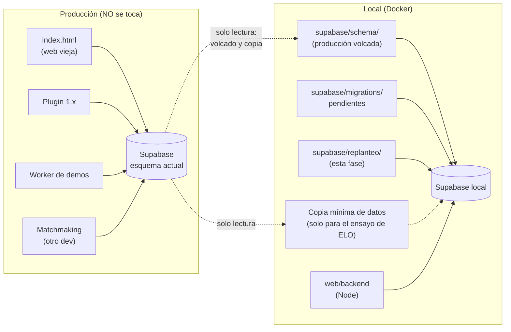
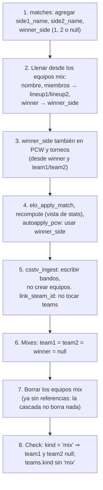
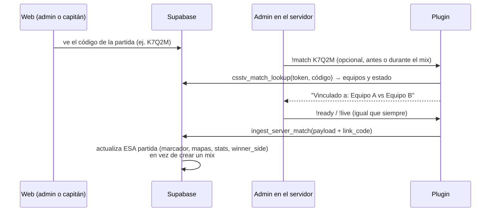

# Plan: replantear el modelo de datos (fase 2 del backend)

> Planeación original. Estado: **propuesta**, pendiente de aprobación.

Antes de construir los endpoints de dominio (jugadores, equipos, partidas, torneos, PCW, admin), se limpia y se ordena el modelo de datos con lo que decidió Daniel en la entrevista del 2026-10-14:
- **Mixes:** sus bandos dejan de ser equipos.
- **Equipos:** pasan a tener una tabla de miembros.
- **Stats:** salen solo de las partidas.
- **Privacidad:** queda en público o privado.
- **Sin uso:** se borra lo que ya no se usa.
- **Partidas de torneo y PCW:** se pueden vincular a una partida jugada en el servidor con `!match`.

**Regla central: no se toca la base de producción.** La web actual (`index.html`, la de InfinityFree) sigue funcionando contra ella hasta que la reemplace la web nueva. Todo lo de esta fase se construye y se prueba en local. Producción se cambia una sola vez, en el **corte**, junto con la web nueva, el backend y la versión nueva del plugin.

## Decisiones tomadas

| Tema | Decisión | Por qué |
|---|---|---|
| Producción | **Solo lectura durante toda la fase.** Ninguna migración, función ni dato nuevo. | La web vieja depende del esquema actual: `teams.members`, equipos `mix`, stats manuales, `video_url`. Cambiarlo la rompería. |
| Dónde viven las migraciones | En una carpeta nueva, **`supabase/replanteo/`**, no en `supabase/migrations/`. Tiene su propio `README.md`: "no aplicar en producción hasta el corte". | `supabase/migrations/` es la lista de lo que se aplica a mano en producción. Separarlas evita que alguien las aplique antes de tiempo. |
| Cómo se prueban | En la Supabase local de `web/backend`: esquema de producción + migraciones pendientes + `supabase/replanteo/`. `db-local.sh` las carga en ese orden. | Es el entorno que ya existe, con Auth, RLS y Storage reales. |
| Corte | **Todo junto:** migraciones de replanteo + backend con los endpoints de dominio + web nueva + plugin nuevo (servidor real y RBK). La web vieja se retira ese mismo día. | El esquema nuevo no es compatible con la web vieja, y mantener las dos a la vez costaría más que el corte. El corte tiene su propio plan. |
| Bandos de un mix | En la partida: `side1_name`, `side2_name`, `lineup1`, `lineup2` (ya existen) y **`winner_side`** (1, 2 o null = empate). Los mixes no tienen `team1`, `team2` ni `winner`. | Los equipos `mix` (34 de 51) son descartables. El ELO ya usa el bando de cada jugador (`match_player_stats.team`); solo el ganador dependía de los equipos. |
| Ganador en general | `winner_side` en **todas** las partidas: mixes, PCW y torneos. `winner` (id de equipo) se mantiene en PCW y torneos para el motor de llaves. | ELO y stats preguntan "¿ganó el bando del jugador?" de una sola forma, sin comparar ids de equipo. |
| Equipos `mix` existentes | Se pasan a los bandos de sus partidas y se **borran** (los 34, incluidos 8 huérfanos). | Decisión de Daniel. Se hace desvinculando primero, porque `matches.team1/team2` tienen `ON DELETE CASCADE`. |
| ELO | **No debe cambiar ni un punto.** Se verifica con un ensayo sobre una copia de los datos (sección 7). | Decisión de Daniel. |
| Miembros de equipos | Tabla **`team_members`**: equipo, jugador, rol y fechas de alta y baja. Reemplaza a `teams.members`. | Clave foránea real (sin ids colgados) e historial automático de equipos. |
| Stats | **Solo desde partidas** (mixes, PCW y torneos). Vista `player_stats` calculada desde `match_player_stats`. Se borran las columnas manuales de `players`, `stats_auto`, `player_map_stats` y `recompute_player_stats`. | Decisión de Daniel. Una vista siempre está al día; con el volumen actual no hace falta guardarlas. |
| Privacidad | Solo `public` o `private`. Privado oculta los datos personales (`profile_details`), no las stats ni los mixes. | Decisión de Daniel. Hoy todos los jugadores son `public`. |
| Vincular con `!match` | Cada partida de torneo y PCW tiene un **código corto**. En el servidor, un admin hace `!match <código>` **antes o durante** el mix. No inicia nada: la partida sigue empezando con `!live` / `!ready`. Al terminar, el plugin reporta a esa partida en vez de crear un mix nuevo. | Decisión de Daniel. Así PCW y torneos también suman stats y ELO. |
| Reclamo de perfil | `player_claims` se borra. `profile_requests` y `/api/v1/me/profile-requests` siguen, **deprecados**, hasta que exista `!claim`. `!claim` **no** es parte de esta fase: tiene su propio plan (`2026-10-11-reclamo-perfil-servidor`). | Decisión de Daniel. |
| Matchmaking | Lo desarrolla **otra persona**. Sus tablas ya quedaron versionadas en `supabase/schema/public.sql`. Esta fase **no cambia su lógica**, pero sí lo que comparte con ella: `matches`, `lineup1/lineup2` y equipos `mix`. | Hay que coordinar con quien lo desarrolla antes de cerrar la sección 2.1. |
| Chat | `match_chat.user_email` se queda en la base. La API no lo devuelve y el backend nuevo no lo escribe. | Decisión de Daniel. |
| Sin cambios | Torneos, PCW, `team_requests` (con aprobación), ficha del jugador (bio, historial, logros, medallas), `profile_details.steam` y `players.steam_id`, `matches.server_ip`. | Decisiones de Daniel. |

## 1. Entornos durante la fase



Producción solo se **lee**: el volcado del esquema (ya hecho) y la copia mínima de datos para el ensayo del ELO (sección 7).

## 2. Cambios en la base (`supabase/replanteo/`)

Una migración por tema, en este orden. Cada una con su migración inversa en la carpeta de la bitácora.

### 2.1 Mixes sin equipos y `winner_side`



- **`winner_side`:** `check (winner_side in (1, 2))`, con null para empate o sin resultado. Para los mixes sale de `winner = team1 → 1`, `winner = team2 → 2`. Antes de borrar se verifica que ningún mix terminado quede con `winner` distinto de null y `winner_side` null.
- **Funciones que cambian:**
  - `elo_apply_match`: `res1` pasa a salir de `winner_side`. El resto de la fórmula no cambia.
  - `csstv_ingest`: escribe `side1_name`, `side2_name`, `lineup1`, `lineup2` y `winner_side`, y no inserta equipos.
  - `link_steam_id`: deja de actualizar `teams.members` de los mixes.
  - `autoapply_pcw`: calcula también `winner_side`.
- **Matchmaking:** `matchmaking_try_match_unchecked` también crea equipos `mix`.
  - **Opción A:** que quien lo desarrolla lo adapte a los bandos.
  - **Opción B:** dejar su función como está y que el check del punto 8 no aplique a sus partidas (`matchmaking_mode is not null`).
  - Se decide con esa persona; hasta entonces esta sección no se cierra.

### 2.2 `team_members`

```sql
create table team_members (
  team_id   uuid not null references teams(id) on delete cascade,
  player_id uuid not null references players(id) on delete cascade,
  role      text not null default 'player' check (role in ('player', 'sub', 'coach')),
  joined_at timestamptz,          -- null = desconocida (miembros migrados)
  left_at   timestamptz,
  primary key (team_id, player_id, joined_at)
);
-- Un jugador figura activo una sola vez por equipo.
create unique index on team_members (team_id, player_id) where left_at is null;
```

- **Migración:** cada id de `teams.members` (oficiales y PCW) pasa a una fila activa, con `joined_at` null. Los ids que ya no existen en `players` se descartan y se cuentan en el log.
- **Funciones que cambian:**
  - Las que usan `members`: `accept_pcw`, `pcw_make_side`, `set_team_captain` y `validate_report`. `csstv_ingest` y `link_steam_id` ya no lo necesitan después de 2.1.
  - `matchmaking_try_match_unchecked` también lo usa: entra en la coordinación con quien desarrolla el matchmaking.
  - `teams.guests` (invitados de PCW) se queda.
- **Después:** se borra `teams.members`.
- **Historial de equipos:** sale de `team_members`. `players.team_history` se mantiene como texto libre, por decisión de Daniel.

### 2.3 Stats solo desde partidas

- **Vista `player_stats`** (por jugador) y **vista `player_map_stats`** (por jugador y mapa). Se calculan desde `match_player_stats` unido a `matches` terminadas y no canceladas: mapas, K/D, HS %, ADR, rating (`csstv_rating`), victorias y derrotas con `winner_side`.
- **Se borran:**
  - Columnas `rating`, `kd`, `hs`, `adr`, `maps`, `wins`, `losses` y `stats_auto` de `players`.
  - La tabla `player_map_stats` (vacía; su nombre queda para la vista).
  - La función `recompute_player_stats`, y su llamada desde `link_steam_id` y la ingesta.
- **Consecuencia aceptada:** se pierden las stats cargadas a mano de jugadores que nunca jugaron un mix (hoy hay 34 jugadores con stats manuales; los que tienen mixes ya se recalculan). Quedan en el respaldo previo al corte.

### 2.4 Privacidad

- `players.privacy`: `check (privacy in ('public', 'private'))`. Lo que esté en `members` pasa a `private`; hoy no hay ninguno.
- La política `perfil: ver segun privacidad` de `profile_details` queda: dueño y admin siempre; el resto, solo si el jugador vinculado es `public`.

### 2.5 `!match`: vincular una partida del servidor



- **`matches.link_code`:** texto corto único (5 caracteres sin ambiguos: sin 0/O ni 1/I). Se genera al crear partidas de torneo y PCW.
- **`csstv_match_lookup(token, código)`:** función nueva para el plugin. Valida el token del servidor y devuelve la partida si está `upcoming` o `live`.
- **`csstv_ingest`:** si el payload trae `link_code`, actualiza esa partida. El bando del juego (1 o 2) se asocia a `team1` o `team2` por **mayoría de jugadores**, usando `team_members` y `teams.guests`. Si no hay mayoría clara, el mix se guarda como mix común y la partida queda sin resultado, para revisión del admin. No se pierde nada.
- **Plugin:** comando `!match <código>` (admin), mensaje de confirmación, el código se manda en el payload y se limpia al terminar. Detalle en la sección 3.

### 2.6 Limpieza

| Qué | Cómo |
|---|---|
| `player_claims` | `drop table` |
| `profiles.player_id`, `player_medals.color` | `drop column` |
| `matches.demo_url`, `matches.video_url` | `drop column` (0 partidas los usan) |
| Políticas duplicadas | `events` y `matches`: quedan `torneos/partidas: todos ven` y `…: admin gestiona`. `players`: queda una de lectura |
| Formato `swiss` | `check (format in ('playoffs', 'single', 'double', 'rr', 'groups'))` en `events` (hoy 0 filas) |
| `profile_requests` | Sin cambios en la base; deprecado en la API |

## 3. Plugin (`csstv_reporter`)

- **Versión nueva** con:
  - `!match <código>` (solo admin, opcional): consulta `csstv_match_lookup`, confirma en el chat y guarda el código.
  - El código va en el payload de la ingesta, y `!match` sin código lo borra.
  - Nada más cambia: los nombres de los bandos ya los manda hoy (`!team`).
- **Se despliega solo en el corte**, en el servidor real y en RBK (build licenciado) en la misma tanda, como pide `CLAUDE.md`. Antes del corte, el plugin de producción sigue siendo el actual.
- **Pruebas:** servidor local con bots, contra la Supabase **local**. El cfg de pruebas apunta a la URL local y no a producción. Hoy el servidor local de pruebas manda a la Supabase real; para esta fase se cambia de destino.

## 4. Backend (`web/backend`)

- **Base de desarrollo:** la Supabase local con `supabase/replanteo/` aplicado, y `npm run db:types` regenera los tipos.
- **Ajustes de la fase 1:**
  - `GET /api/v1/me/profile` busca el equipo actual en `team_members`.
  - `/api/v1/me/profile-requests` se marca `deprecated: true` en la OpenAPI.
- **Endpoints de dominio** (próximas entregas): se construyen directamente sobre el esquema nuevo. Las stats salen de las vistas `player_stats` y `player_map_stats`, y los mixes se devuelven con sus bandos.
- **Pruebas:** las de integración corren sobre el esquema nuevo.

## 5. Web vieja

**No se toca.** Sigue en producción con el esquema actual hasta el corte y se retira ese día.

## 6. Coordinación con el matchmaking

Antes de cerrar las secciones 2.1 y 2.2 hay que hablar con quien desarrolla el matchmaking:
- Su función `matchmaking_try_match_unchecked` crea equipos `mix` y usa `teams.members` y `lineup1/lineup2`.
- Hay un envío trabado en `assigned` desde el 2026-10-12, y un servidor con `matchmaking_enabled = true`.
- Hay que definir si adapta su lógica a los bandos y a `team_members` (opción A) o si sus partidas quedan como excepción (opción B).

## 7. Ensayo del ELO (sin tocar producción)

Objetivo: demostrar que la migración no cambia el ELO ni las victorias y derrotas de nadie.

1. **Copia mínima, solo lectura:** `pg_dump --data-only` de producción, únicamente de `matches`, `match_player_stats`, `player_elo`, `elo_config`, `teams` (incluye los `mix`), `players` y `game_servers` (solo id y nombre, sin tokens).
   - **Sin datos personales:** `players.user_id`, `teams.owner_id` y `teams.captain_id` se ponen en null al cargar.
   - **No se copian** `auth.users`, `profiles`, `profile_details` ni el chat.
   - La copia queda solo en el Docker local y no se versiona.
2. **Medición "antes":** sobre el esquema actual más las migraciones pendientes, `elo_recompute_all()` y una foto de `player_elo` (elo, peak, mu, sigma, matches) y del `elo_before/after/delta` de cada fila de `match_player_stats`.
3. Aplicar `supabase/replanteo/`.
4. **Medición "después":** `elo_recompute_all()` y otra foto.
5. **Comparar:** tienen que ser **idénticas**. Además, las victorias y derrotas de la vista `player_stats` tienen que coincidir con las que daba `recompute_player_stats` antes.
6. Verificar que no se borró ninguna partida ni fila de stats (conteos antes y después) y que no queda ningún equipo `mix`.

**Por qué se compara contra la base local y no contra los valores de producción:** la migración pendiente de ELO por participación (`20261014120000`) cambia la fórmula. Comparar contra producción mezclaría ese cambio con el de esta fase.

El ensayo queda como script en `docs/bitacora/2026-10-14-replanteo-modelo-datos/pruebas/` y se repite antes del corte con una copia nueva.

## 8. Corte (fuera de esta fase, con plan propio)

Se hace cuando estén listos el backend con los endpoints de dominio y la web nueva:

1. Respaldo completo de producción (`pg_dump` del esquema y los datos de `public` y `storage`).
2. Ensayo del ELO con una copia fresca.
3. Migraciones pendientes y `supabase/replanteo/`.
4. Plugin nuevo en el servidor real y en RBK.
5. Backend y web nueva en el VPS.
6. Retirar la web vieja.

**Vuelta atrás:** restaurar el respaldo y volver al plugin anterior.

## 9. Riesgos

| Riesgo | Mitigación |
|---|---|
| Borrar un equipo `mix` con partidas borra partidas y stats (cascada) | Se desvinculan primero (2.1, paso 6). La migración aborta si algún equipo `mix` sigue referenciado al momento de borrar. Conteos antes y después en el ensayo |
| El ELO cambia | Ensayo de la sección 7, obligatorio antes del corte |
| El matchmaking se rompe | Coordinación previa (sección 6). Hasta tener respuesta, 2.1 y 2.2 no se cierran |
| Producción cambia mientras dura la fase (por ejemplo, hoy se borraron 2 partidas de matchmaking) | Las migraciones no dependen de ids ni de conteos fijos. Antes del corte se vuelve a volcar el esquema (`volcar.sh`) y se repite el ensayo con datos frescos |
| Alguien aplica `supabase/replanteo/` en producción antes de tiempo | Carpeta separada con `README.md` de advertencia. Las migraciones abortan si no detectan el estado esperado (por ejemplo, si ya existe `winner_side`) |
| `!match` asocia mal los bandos | Asociación por mayoría con caso de duda: queda como mix común, sin tocar la partida oficial. Se prueba con bots |
| Se pierden stats manuales históricas | Consecuencia aceptada (2.3). Quedan en el respaldo del corte |
| El servidor local de pruebas manda a producción | Para esta fase, su cfg apunta a la Supabase local. Se verifica antes de cada prueba |

## 10. Requisitos antes de empezar

- **Aprobación de este plan.**
- **Permiso para la copia mínima de datos de producción** (sección 7), de solo lectura y sin datos personales, que queda solo en el Docker local.
- **Contacto con quien desarrolla el matchmaking** (sección 6).
- Docker y la Supabase local (ya funcionando).

## 11. Orden de implementación

1. `supabase/replanteo/` con su `README.md`, y `db-local.sh` cargándolo.
2. Script del ensayo del ELO y copia mínima de datos. Medición "antes".
3. 2.6 Limpieza.
4. 2.4 Privacidad.
5. 2.1 Mixes sin equipos y `winner_side` (con la opción de matchmaking acordada). Medición "después" y comparación.
6. 2.2 `team_members` y adaptación de funciones.
7. 2.3 Vistas de stats y borrado de lo manual. Comparación de victorias y derrotas.
8. 2.5 `!match`: `link_code`, `csstv_match_lookup` e ingesta vinculada.
9. Plugin con `!match`, probado con bots contra la Supabase local.
10. Ajustes del backend de la fase 1 y tipos regenerados. Todas las pruebas en verde, con cobertura mínima del 60 %.
11. Migraciones inversas. `DOCUMENTACION.md`, `GUIA_IMPLEMENTACION.md`, actualización de `docs/MODELO_DATOS.md` y del resumen para el frontend.
