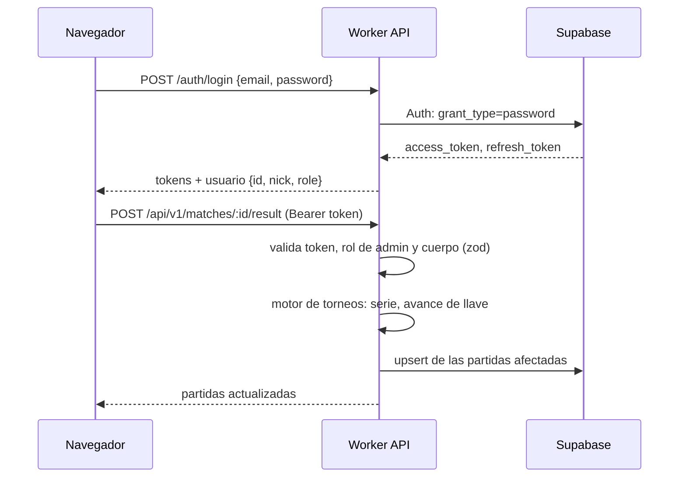
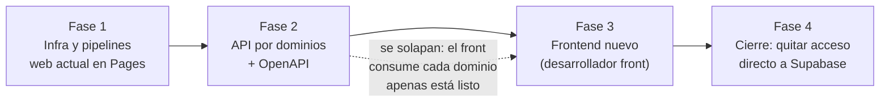
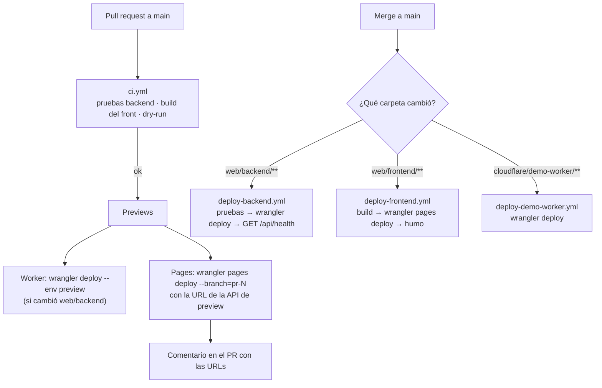

# Plan: migración de la web a frontend (Cloudflare Pages) y backend API (Cloudflare Worker), con despliegue desde GitHub

> Planeación original. Estado: **propuesta**, pendiente de aprobación.

Hoy la web son tres archivos sueltos en la raíz del repo (`index.html`, `config.js`, `csstv-theme.css`) que se suben a mano por FTP a InfinityFree (`csstv.gamer.gd`). El navegador habla **directo con Supabase**: hay 93 llamadas en `index.html` a ~25 tablas y vistas, 14 funciones RPC, 3 buckets de Storage y Auth. Además, el navegador corre el motor de torneos (genera llaves, avanza ganadores, calcula tablas) y escribe el resultado en la base.

El objetivo:

1. **Backend** (`web/backend`): una API REST en un **Cloudflare Worker** por la que pasen **todas** las peticiones que hoy hace el navegador a Supabase, incluyendo login y subida de archivos. La lógica de negocio (motor de torneos, permisos) vive ahí.
2. **Frontend** (`web/frontend`): se publica en **Cloudflare Pages** y consume solo la API. Cómo se rehace (framework, estructura, legibilidad) **lo define el desarrollador front**. Este plan solo fija lo que el frontend tiene que cumplir para encajar.
3. **Pipelines** en GitHub Actions: pruebas y previsualización en cada PR, y producción al hacer merge a `main`.
4. **Cierre**: cuando ningún cliente web hable con Supabase directo, se le quitan los permisos de acceso a las tablas a la clave pública. Desde ahí el backend es el único camino.

## Decisiones tomadas

| Tema | Decisión | Por qué |
|---|---|---|
| Qué pasa por el backend | **Todo lo que hoy hace el navegador**: lecturas, escrituras, RPC, login y registro, y subida de archivos. | Un solo lugar para reglas y validaciones. El frontend depende de un contrato (la API) y no del esquema de la base, así que el desarrollador front trabaja sin conocer Supabase. |
| Qué **no** pasa por el backend | El plugin de SourceMod (`ingest_server_match`, `ingest_server_chunk`, licencia) y el Worker de demos (`demo_pending`, `demo_mark`, `demo_expire`) siguen llamando a Supabase directo con sus tokens. La **lectura** de imágenes públicas (avatares, fotos) sigue con la URL pública de Storage. | Ya funcionan, se autentican con tokens propios y no son "la web". Las imágenes son archivos estáticos con CDN: pasarlas por el Worker solo agrega costo. |
| Lenguaje y framework del backend | **JavaScript (módulos ES)** con **Hono** + **`@hono/zod-openapi`**. | Mismo lenguaje que la web y el Worker de demos. Con `zod-openapi` cada endpoint declara su entrada y salida, y de eso sale validación automática y la especificación **OpenAPI** que usa el frontend como contrato. |
| Motor de torneos | Se mueve de `index.html` al backend (`src/services/torneos/`), como funciones puras con pruebas. | Es la lógica más delicada. Hoy la ejecuta el navegador del admin y escribe lo que calcula; en el backend queda validada, probada y en un solo lugar. |
| Acceso a la base desde el backend | **Durante la migración**: cliente con el **token del usuario** (aplican las RLS de hoy). **Al cierre**: cliente con la **`service_role`**, con la autorización hecha en el backend. | Mientras el front viejo siga hablando directo con Supabase, las RLS son la barrera y el backend no puede ser menos estricto. Al cierre, el backend pasa a ser la única puerta y la autorización se prueba ahí. |
| Login | El backend expone `/auth/*` y por dentro usa Supabase Auth. Los usuarios y contraseñas actuales siguen sirviendo. | El frontend no necesita `supabase-js` ni la clave pública. Nadie tiene que volver a registrarse. |
| Subida de archivos | `multipart/form-data` al backend, que valida tipo y tamaño (imágenes, máx. 5 MB) y sube a Storage. | Hoy cualquier usuario sube lo que quiera a los buckets. El backend puede rechazar archivos que no correspondan. |
| Cómo llega el frontend a la API | **Directo** a `https://v34frag-api.<subdominio>.workers.dev` (después, `api.<dominio>` si se compra uno), con **CORS** limitado a los orígenes de Pages y `localhost`. | Con todo el tráfico por la API, un proxy en Pages contaría **dos** invocaciones por llamada contra el límite gratis. |
| Frontend | Lo define el desarrollador front. Mientras tanto se publica en Pages **la web actual tal cual**, que sigue hablando directo con Supabase. | Así se deja InfinityFree desde el principio, sin esperar al frontend nuevo. |
| Base de datos | **La misma Supabase** (`wmzfwsizashpszxlvpeb`), sin migrar, para producción y previsualizaciones. El Worker se conecta por HTTPS (`supabase-js` / PostgREST), igual que el Worker de demos. | Funciona sin configuración extra. Migrar implicaría reemplazar Auth, Storage, RLS y las funciones SQL sin ganar nada. No hay proyecto de pruebas: se anota como riesgo (sección 9). |
| Ubicación del Worker | **Smart Placement** (`[placement] mode = "smart"`). | Un endpoint hace varias consultas seguidas a la base, que está en una sola región. Con Smart Placement el Worker corre cerca de Supabase y la distancia hasta el usuario se paga una sola vez por request. |
| Postgres directo | No por ahora. Queda como opción **Hyperdrive** (pool de conexiones de Cloudflare) si algún endpoint necesita SQL complejo o transacciones. | PostgREST y las RPC alcanzan para todo lo que hace hoy la web. |
| Worker de demos | Se queda en `cloudflare/demo-worker` sin cambios de código, pero **entra al pipeline**. | Funciona y no es parte de la web. |
| Pipelines | **GitHub Actions + `wrangler`** (`cloudflare/wrangler-action`). | Un solo lugar para los tres despliegables. Las pruebas bloquean el despliegue y los filtros por carpeta funcionan en el monorepo. |
| Entornos | `production` (rama `main`) y `preview` (PRs): Worker `v34frag-api` y `v34frag-api-preview`, proyecto Pages `csstv`. | Un cambio de backend se prueba en preview sin tocar producción. |

### ¿Hace falta pasar todo por el backend?

Sí, en este caso. Lo que se gana:

- **Contrato estable para el frontend nuevo.** El desarrollador front consume `/api/v1/...` con documentación OpenAPI, sin conocer tablas, columnas, políticas RLS ni el motor de torneos.
- **La lógica de negocio deja de estar en el navegador.** Hoy un admin con la consola abierta puede escribir cualquier cosa en `matches` (las RLS validan quién, no qué). En el backend se valida qué.
- **Menos datos al navegador.** `loadImpl()` baja **todas las tablas completas** en cada carga. Con endpoints por vista y paginados, eso desaparece.
- **Libertad para cambiar la base** (esquema, índices, hasta el proveedor) sin tocar el frontend.

Lo que cuesta:

- **Trabajo**: unos 55 endpoints (sección 4) y reescribir en el backend las reglas que hoy están en RLS.
- **Latencia**: un salto más (navegador → Worker → Supabase). Es poco, porque el Worker corre cerca del usuario, pero existe.
- **Límite del plan gratis de Workers** (100.000 requests/día, ver sección 7). Con todo el tráfico por el Worker hay que medirlo. El plan pago cuesta 5 USD/mes e incluye 10 millones.

Una migración parcial (solo escrituras y lógica de torneos al backend, lecturas directas a Supabase) costaría menos, pero deja dos caminos a la base y obliga al frontend a conocer las dos cosas. Como el frontend se va a rehacer de todos modos, es el mejor momento para hacerlo completo.

## 1. Arquitectura final

```mermaid
flowchart LR
  U[Navegador] -->|"HTML, CSS, JS"| P[Cloudflare Pages<br/>web/frontend]
  U -->|"/auth/*, /api/v1/*<br/>Bearer token"| W[Worker v34frag-api<br/>web/backend]
  U -.->|"solo imágenes públicas"| ST[(Supabase Storage)]
  W -->|"Auth · PostgREST · RPC · Storage"| S[(Supabase)]
  PL[Plugin SourceMod] -->|"RPC con token de servidor<br/>(sin cambios)"| S
  D[Worker v34frag-demos<br/>(sin cambios)] --> S
  D --> R2[(R2 csstv-demos)]
```

Un request típico:



## 2. Fases



| Fase | Resultado | Depende de |
|---|---|---|
| 1. Infra | `web/frontend` con la web actual publicada en Pages, `web/backend` con la base del Worker (`health`, auth, errores, OpenAPI), los 4 workflows andando y `csstv.gamer.gd` redirigiendo. | — |
| 2. API | Los endpoints de la sección 4, dominio por dominio, con pruebas. Cada dominio terminado queda documentado en `/api/docs`. | Fase 1 |
| 3. Frontend | El frontend nuevo publicado en Pages, consumiendo solo la API. | Cada dominio de la fase 2 |
| 4. Cierre | Migración SQL que quita a `anon`/`authenticated` el acceso a tablas, vistas y RPC de la web. El backend pasa a `service_role`. | Fase 3 completa en producción |

## 3. Frontend (`web/frontend`)

**Pendiente de definir por el desarrollador front:** framework (o ninguno), estructura de carpetas, build, estilos y cómo se rehace la legibilidad del código actual.

Lo que este plan fija para que encaje con el resto:

| Requisito | Detalle |
|---|---|
| Ubicación | Todo dentro de `web/frontend/`. |
| Salida | Archivos estáticos en una carpeta de salida (`dist/`, `public/`, la que elija) que se publica en Pages. Si hay build, se corre con `npm run build`. |
| Datos | **Solo** a través de la API (`/auth/*`, `/api/v1/*`). Nada de `supabase-js` ni de la clave pública de Supabase. |
| URL de la API | Configurable por entorno (variable de build o `config.js`), porque producción y preview usan Workers distintos. |
| Sesión | Guarda `access_token` y `refresh_token` que devuelve `/auth/login`, manda `Authorization: Bearer` y renueva con `/auth/refresh` cuando la API responde 401. |
| Contrato | La especificación OpenAPI en `/api/docs` (y `openapi.json`). Desde ahí se pueden generar tipos o cliente si lo quiere. |
| Ruteo | Si usa rutas sin `#`, agregar `_redirects` con `/* /index.html 200` para Pages. |

**Mientras tanto (fase 1):** `index.html`, `config.js` y `csstv-theme.css` se mueven con `git mv` a `web/frontend/public/` sin cambios de código y se publican en Pages. Si el desarrollador front prefiere migrar este código de a poco en vez de reescribirlo, también es válido, siempre que al final cumpla la tabla de arriba.

**Supabase Auth:** en *Authentication → URL Configuration* se agregan las URLs de Pages (`https://csstv.pages.dev` y `https://*.csstv.pages.dev`) y se cambia el *Site URL* al cortar. Si no, los correos de confirmación mandan a InfinityFree.

## 4. Backend (`web/backend`)

### Estructura

```
web/backend/
├── src/
│   ├── index.js                ← app Hono: CORS, errores, montaje de rutas, /api/docs
│   ├── routes/                 ← un archivo por dominio (auth.js, players.js, matches.js…)
│   ├── services/
│   │   └── torneos/            ← motor puro movido desde index.html (genKO, genDE, genGroups,
│   │                              applyRes, settle, standings, genPlayoffs, champOf…)
│   ├── lib/
│   │   ├── supabase.js         ← cliente con token de usuario y cliente service_role
│   │   ├── auth.js             ← middlewares requireUser / requireAdmin / requireCaptain
│   │   ├── errors.js           ← { error: { code, message } } con status correcto
│   │   └── uploads.js          ← validación de imágenes y subida a Storage
│   └── schemas/                ← esquemas zod compartidos (Player, Team, Match…)
├── test/                       ← Vitest + @cloudflare/vitest-pool-workers
├── wrangler.toml               ← v34frag-api y [env.preview] → v34frag-api-preview
├── .dev.vars.example
└── package.json
```

### Convenciones

- Rutas públicas de datos bajo `/api/v1/...`. Login bajo `/auth/...`. `/api/health` y `/api/docs` sin versión.
- JSON siempre. Errores `{ error: { code, message, details? } }` con 400, 401, 403, 404, 409 o 500.
- Listados paginados: `?page=1&per=20&q=texto` → `{ items, total, page, per }`.
- Cada endpoint declara su esquema de entrada y salida con zod. Lo que no valida se rechaza con 400 antes de tocar la base.
- Los endpoints públicos (lecturas sin sesión) devuelven `Cache-Control` corto donde aplique.
- Se registra en el log del Worker cada error 500 con el id del request, para verlo con `wrangler tail`.

### Catálogo de endpoints

Agrupado por dominio, a partir de las llamadas actuales de `index.html`. Es el alcance de la fase 2: los nombres finales y los detalles de cada cuerpo se fijan en la OpenAPI al implementar.

| Dominio | Endpoints | Reemplaza (hoy) |
|---|---|---|
| **Auth** | `POST /auth/signup`, `POST /auth/login`, `POST /auth/refresh`, `POST /auth/logout`, `GET /auth/me` | `sb.auth.*`, `profiles.role` |
| **Mi perfil** | `GET/PATCH /api/v1/me/profile`, `PUT /api/v1/me/tag`, `POST /api/v1/me/avatar`, `POST /api/v1/me/photos`, `POST /api/v1/me/steam`, `POST /api/v1/me/profile-requests` | `profile_details`, `set_my_tag`, buckets `avatars` y `photos`, `link_steam_id`, `profile_requests` |
| **Jugadores** | `GET /api/v1/players`, `GET /api/v1/players/:nick` (perfil, ELO, stats por mapa, medallas, últimos mixes) | `players`, `public_profiles`, `player_elo`, `player_map_stats`, `player_medals`, `match_player_stats` |
| **Equipos** | `GET /api/v1/teams`, `GET /api/v1/teams/:id`, `POST /api/v1/teams/:id/requests`, `PUT /api/v1/teams/:id/captain` | `teams`, `team_requests`, `set_team_captain` |
| **Torneos** | `GET /api/v1/events`, `GET /api/v1/events/:id` (llave, grupos, **tabla calculada en el backend**), `POST /api/v1/events/:id/registrations`, `GET /api/v1/palmares` | `events`, `tournament_registrations`, `standings()` del navegador |
| **Partidas** | `GET /api/v1/matches` (filtros: estado, torneo, mixes), `GET /api/v1/matches/:id`, `GET /api/v1/matches/:id/live`, `POST /api/v1/matches/:id/vetos`, `POST /api/v1/matches/:id/reports` (con prueba adjunta), `POST /api/v1/matches/:id/chat` | `matches`, `match_vetos`, `result_reports`, bucket `proofs`, `match_chat`, `pollMatch()` |
| **PCW** | `GET /api/v1/pcw`, `POST /api/v1/pcw`, `DELETE /api/v1/pcw/:id`, `POST /api/v1/pcw/:id/accept`, `POST /api/v1/pcw/matches/:id/cancel` | `pcw_posts`, `create_pcw_post`, `cancel_pcw_post`, `accept_pcw`, `cancel_pcw_match` |
| **Ranking** | `GET /api/v1/ranking` | `player_elo`, `players` |
| **Admin: jugadores** | CRUD `/api/v1/admin/players`, medallas, stats manuales, `GET/POST /api/v1/admin/verifications` (aprobar o rechazar), SteamID sin vincular | `players`, `player_medals`, `player_map_stats`, `profile_requests` |
| **Admin: equipos** | CRUD `/api/v1/admin/teams`, solicitudes pendientes | `teams`, `team_requests` |
| **Admin: torneos** | CRUD `/api/v1/admin/events`, `POST /api/v1/admin/events/:id/generate` (llave o grupos), `POST /api/v1/admin/events/:id/playoffs`, `POST /api/v1/admin/events/:id/finish` | `events`, `genKO`/`genDE`/`genGroups`/`genPlayoffs`/`finishE` en el navegador |
| **Admin: partidas** | CRUD `/api/v1/admin/matches`, `POST /api/v1/admin/matches/:id/result` (aplica resultado y avanza la llave), pendientes de revisión | `matches`, `applyRes`/`routeOne`/`unroute`/`settle` en el navegador |
| **Admin: ELO y stats** | `GET/PUT /api/v1/admin/elo/config`, `POST /api/v1/admin/elo/recompute`, `POST /api/v1/admin/stats/recompute` | `elo_config`, `elo_set_config`, `elo_recompute_all`, `recompute_player_stats` |
| **Admin: servidores** | CRUD `/api/v1/admin/servers`, `POST /api/v1/admin/servers/:id/token` (crear o rotar) | `game_servers`, `create_server_token`, `rotate_server_token` |
| **Sistema** | `GET /api/health`, `GET /api/docs`, `GET /api/openapi.json` | — |

`GET /api/v1/matches/:id/live` junta en una sola respuesta partida, vetos, reportes y últimos 50 mensajes, y devuelve un `etag`. Si nada cambió, contesta `304` sin cuerpo. Reemplaza las 4 consultas que hoy hace `pollMatch()` cada 5 s.

### Autorización

- **Durante la migración** cada endpoint usa el **token del usuario**, así que las RLS actuales siguen aplicando. Además se agregan los chequeos de rol y de pertenencia (por ejemplo, "es capitán de este equipo") en el middleware, para que la autorización ya esté en el backend antes del cierre.
- **Al cierre** el backend pasa a `service_role`. Antes del corte, cada regla de RLS tiene que tener su prueba equivalente en el backend (lista en la guía de implementación).
- Las RPC que usan `auth.uid()` (`set_my_tag`, `link_steam_id`, `accept_pcw`, `set_team_captain`, `create_pcw_post`, `cancel_pcw_*`) siguen llamándose **con el token del usuario** también después del cierre. Así no hay que reescribirlas, pero les queda el permiso `EXECUTE` a `authenticated`, y eso es aceptable porque cada una valida al usuario por dentro.
- Límite de intentos en `/auth/login` y `/auth/signup` con el binding de *rate limiting* de Workers.

### Configuración

| Variable | Tipo | Valor |
|---|---|---|
| `SUPABASE_URL` | var | `https://wmzfwsizashpszxlvpeb.supabase.co` |
| `SUPABASE_ANON_KEY` | var | La clave pública (la misma de `config.js`) |
| `APP_ENV` | var | `production` / `preview` |
| `CORS_ORIGINS` | var | Orígenes de Pages y `http://localhost:*` |
| `GIT_SHA` | var | La pone el pipeline en cada despliegue |
| `SUPABASE_SERVICE_KEY` | **secreto** | `wrangler secret put SUPABASE_SERVICE_KEY` (y `--env preview`) |

Además, en `wrangler.toml` (los dos entornos):

```toml
[placement]
mode = "smart"
```

Smart Placement necesita unos minutos de tráfico para decidir dónde ubicar el Worker. Su efecto se verifica en el panel de Cloudflare (*Metrics → Placement*), comparando la duración de los requests con y sin la opción.

### Pruebas

- **Motor de torneos**: pruebas unitarias sobre las funciones puras: llaves de 2 a 64 equipos, *byes*, doble eliminación, grupos ida y vuelta, desempates, corrección de un resultado ya cerrado y bloqueo cuando la siguiente partida ya se jugó. Es lo que más importa probar, porque hoy no tiene ninguna prueba.
- **Endpoints**: con Vitest dentro del runtime de Workers, con `fetch` a Supabase simulado. Por cada endpoint se prueba el caso feliz, la entrada inválida (400), sin sesión (401) y sin permiso (403).
- **Humo contra preview**: después de desplegar, `GET /api/health` y un login con una cuenta de prueba.

## 5. Cierre (fase 4)

Solo se hace cuando el frontend nuevo está en producción y **ningún** cliente web usa la clave pública para datos.

1. Migración SQL: `REVOKE` de `SELECT/INSERT/UPDATE/DELETE` sobre las tablas y vistas de la web para `anon` y `authenticated`. **Se excluyen** las RPC del plugin (`ingest_server_match`, `ingest_server_chunk`, licencia), las del Worker de demos (`demo_*`) y las RPC de usuario listadas en la sección 4.
2. Políticas de Storage: subir a `avatars`, `photos` y `proofs` queda solo para `service_role`. La lectura pública se mantiene.
3. El backend pasa a `service_role` para lecturas y escrituras.
4. Verificación: con la clave pública y un token de usuario, un `select` directo a `matches` debe fallar, y la web debe seguir funcionando.
5. Rollback: la migración inversa con los `GRANT` originales, guardada en la carpeta de la bitácora.

## 6. Pipelines (GitHub Actions)



| Workflow | Disparador | Pasos |
|---|---|---|
| `ci.yml` | `pull_request` a `main` | Backend: `npm ci`, `npm test`, `wrangler deploy --dry-run`. Frontend: `npm ci && npm run build` si tiene `package.json` (lo que defina el desarrollador front; hoy no hay build). Worker de demos: `--dry-run`. Después, deploy de preview y comentario en el PR. |
| `deploy-backend.yml` | `push` a `main` con cambios en `web/backend/**`, o manual | Pruebas, `wrangler deploy --var GIT_SHA:<sha>`, y verificar que `/api/health` devuelva ese commit. |
| `deploy-frontend.yml` | `push` a `main` con cambios en `web/frontend/**`, o manual | Build (si hay), `wrangler pages deploy <salida> --project-name=csstv --branch=main`, `curl` a `/`. |
| `deploy-demo-worker.yml` | `push` a `main` con cambios en `cloudflare/demo-worker/**`, o manual | `wrangler deploy`. Conserva secretos y crons. |

Detalles:

- **Orden cuando cambian los dos**: el backend se despliega primero. Cada cambio de API tiene que ser compatible con el frontend publicado. Si hay que romper algo, se crea `/api/v2` y el `v1` se mantiene hasta que el front migre.
- **Entorno `production` en GitHub** con los secretos `CLOUDFLARE_API_TOKEN` y `CLOUDFLARE_ACCOUNT_ID`. Permite exigir aprobación manual más adelante.
- `concurrency` por workflow, para que dos merges seguidos no se pisen.
- Versiones fijas de `wrangler` (como el Worker de demos, `4.146.0`) y de las acciones.
- La especificación `openapi.json` se publica como artefacto en cada PR del backend, para que el desarrollador front vea qué cambió.
- **Protección de `main`**: exigir que `ci.yml` pase antes del merge.
- **Rollback**: Pages vuelve a cualquier despliegue anterior desde el panel; el Worker, con `wrangler rollback`.
- **Fuera del pipeline**: las migraciones de Supabase se siguen aplicando a mano. Automatizarlas toca la base real y merece su propio requerimiento.

## 7. Costos y límites

| Recurso | Plan gratis | Estimación |
|---|---|---|
| Pages (estáticos) | Ilimitado | Sin problema. |
| Workers: requests | 100.000/día | Lo que más consume es el detalle de partida en vivo: 1 request cada 5 s por espectador, o sea **720 por hora**. 20 personas mirando un mix de 1 h son ~14.400. Sumando navegación normal, el plan gratis alcanza para el tráfico de hoy, pero no sobra. |
| Workers: CPU | 10 ms por request | Alcanza: esperar a Supabase no cuenta. Si generar una llave grande o el `/live` se acercan al límite, se ve en las métricas. |
| Plan pago de Workers | 5 USD/mes | 10 millones de requests y 30 s de CPU. **Se pasa a este plan si las métricas superan el 70 % del límite diario.** |
| Supabase: base de datos | 500 MB | Pasar por el backend no la hace crecer. Revisar el tamaño en el panel una vez por mes. |
| Supabase: Storage | 1 GB | Avatares, fotos y pruebas. El límite de 5 MB por imagen del backend ayuda a no llenarlo. Las demos están en R2 y no cuentan. |
| Supabase: tráfico de salida | 5 GB/mes | **Baja** con la migración: hoy cada carga de la web descarga todas las tablas completas, y con la API cada vista pide solo lo suyo, paginado. |
| Supabase: usuarios activos | 50.000/mes | Muy lejos del uso actual. |
| Supabase: pausa por inactividad | Se pausa tras 1 semana sin actividad | No debería pasar con el uso actual (el plugin y el Worker de demos la consultan seguido). |
| Supabase Pro | 25 USD/mes | Solo si se supera alguno de los límites anteriores. Sigue siendo más barato que migrar la base. |

El desarrollador front puede bajar el consumo subiendo el intervalo de `/live` cuando la partida no está en curso, o pausándolo con la pestaña oculta (como ya hace `pollMatch()`).

## 8. Corte desde InfinityFree (dentro de la fase 1)

1. Con la web actual publicada y probada en Pages, se avisa en Discord la dirección nueva.
2. Durante unos días conviven las dos. Como usan la misma base, no hay nada que sincronizar.
3. En InfinityFree se reemplaza el contenido por un `.htaccess` con `Redirect 301 / https://csstv.pages.dev/`, y se cambia el *Site URL* de Supabase.
4. Las variables `FTP_WEB_*` del `.env` quedan sin uso y se borran al cerrar la cuenta.

El dominio propio queda fuera de este plan. Cuando se compre, se agrega en Pages y como `api.<dominio>` en el Worker, se actualizan `CORS_ORIGINS` y Supabase Auth, y nada más cambia.

## 9. Riesgos

| Riesgo | Mitigación |
|---|---|
| Las previsualizaciones escriben en la **base real**. | Avisarlo en el comentario del PR y probar con cuentas de prueba. Un proyecto Supabase de staging sería otro requerimiento. |
| Una regla de RLS no se replica en el backend antes del cierre y queda un hueco. | Lista de reglas de RLS con su prueba equivalente en el backend, revisada antes de la fase 4. La fase 4 tiene migración de vuelta. |
| El motor de torneos cambia de comportamiento al moverlo. | Se mueve sin reescribirlo, y primero se escriben pruebas con resultados del motor actual (llaves reales ya jugadas) como referencia. |
| El frontend nuevo se demora y el backend queda sin uso. | El backend se puede consumir de a un dominio a la vez, incluso desde la web actual si el desarrollador front prefiere migrarla. |
| Se pasa el límite gratis de Workers en un torneo grande. | Alertas en Cloudflare, pasar al plan de 5 USD (sección 7). |
| Endpoints lentos por la distancia entre el Worker y la base. | Smart Placement (sección 4). Si no alcanza, juntar consultas en una RPC o usar Hyperdrive. |
| Se llega a un límite del plan gratis de Supabase. | Revisión mensual del uso (sección 7). Pasar a Pro antes de pensar en migrar. |
| El nombre `csstv` ya está tomado en `pages.dev`. | Usar `csstv-web` o `v34frag`. |
| Token de Cloudflare con demasiados permisos en GitHub. | Permisos mínimos: *Workers Scripts: Edit*, *Cloudflare Pages: Edit*, *Account Settings: Read*, solo para esta cuenta. |
| La sesión local de wrangler ve más de una cuenta. | `account_id` fijo en cada `wrangler.toml`. |

## 10. Documentación a actualizar

- `README.md`: cómo correr y desplegar.
- `docs/ARQUITECTURA.md`: la arquitectura nueva (sección 1) y el motor de torneos en el backend.
- `docs/SEGURIDAD.md`: autorización en el backend y el cierre.
- `docs/GUIA_SERVIDOR.md`: donde dice "Subí el `index.html` nuevo al hosting", pasa a ser "merge a `main`".
- `web/backend/README.md`: cómo agregar un endpoint, correr pruebas y ver la OpenAPI.

## 11. Requisitos antes de empezar

- **Cuenta de Cloudflare**: la del Worker de demos (`account_id = fedc1b8398e60e62e1b42b4711104404`).
- **Token de API de Cloudflare** para GitHub, con los permisos de la sección 9.
- **Acceso de admin al repo `mchssj/v34frag`** para los secretos, el entorno `production` y la protección de rama.
- **`service_role` key de Supabase** para el secreto del Worker. Hace falta desde la fase 2 para las acciones de admin, y en todo desde la fase 4.
- **Acceso al panel de Supabase** para las URLs de Auth y las migraciones.
- **Acceso a InfinityFree** para el `.htaccess` del corte.
- **Desarrollador front** con el contrato de la sección 3.

## 12. Orden de implementación

**Fase 1: infra**
1. `git mv` de la web actual a `web/frontend/public/`.
2. `web/backend` con Hono, `zod-openapi`, `health`, `docs`, errores, CORS y los clientes de Supabase. Pruebas en local.
3. Despliegue manual de `v34frag-api`, `v34frag-api-preview` y el proyecto Pages `csstv`. URLs en Supabase Auth.
4. Probar la web en `csstv.pages.dev`: login, registro, vistas públicas, perfil, admin y descarga de demo.
5. Token y secretos en GitHub, y los cuatro workflows. PR de prueba: CI, preview y comentario. Merge y deploy de producción.
6. Corte de InfinityFree (sección 8).

**Fase 2: API**, en este orden (de lo que más desbloquea al front a lo que más riesgo tiene):

7. Auth y Mi perfil.
8. Lecturas públicas: jugadores, equipos, ranking, torneos, palmarés, partidas y `/live`.
9. Acciones de usuario: vetos, reportes con prueba, chat, solicitudes de equipo, PCW, inscripciones.
10. Motor de torneos al backend, con pruebas de referencia, y los endpoints de admin de torneos y partidas.
11. El resto de admin: jugadores, equipos, verificaciones, ELO, stats y servidores.

**Fase 3: frontend** (desarrollador front), consumiendo cada dominio apenas está listo.

**Fase 4: cierre** (sección 5), cuando el frontend nuevo esté en producción.

Al terminar cada fase se actualiza la guía de implementación, y al final la documentación de la sección 10.
