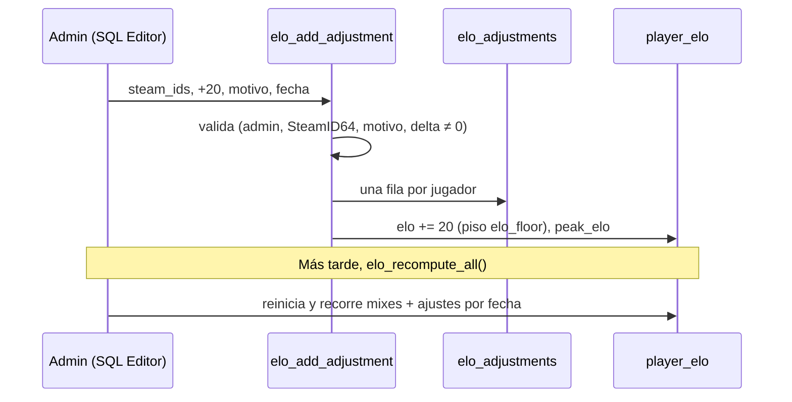

# Ajustes manuales de ELO: documentación

## Qué hace

Permite dar o quitar ELO a jugadores sin una partida. Se usa cuando un mix no llega a la base, por ejemplo porque el servidor se cayó en medio de la partida.

Cada ajuste es una fila de `elo_adjustments` con el jugador, el delta, el motivo y la fecha en que cuenta. Al crearlo se suma al ELO actual. Como `elo_recompute_all()` vuelve a aplicar los ajustes en orden cronológico entre los mixes, **el ajuste no se pierde al recalcular**.

El primer uso fue el 2026-10-15: +20 para rbk, kyansuke, flow y honzzq por el mix que se cayó cerca de las 21:04.

## Reglas

- Un ajuste **solo mueve `elo` y `peak_elo`**. No toca μ/σ de TrueSkill ni `matches` (partidas jugadas), y no aparece en `match_player_stats`, así que no cambia las victorias, los mapas ni las stats.
- Respeta el piso `elo_config.elo_floor`. Si el jugador no tenía ELO, se crea con `start_elo` y se le suma el delta.
- En `elo_recompute_all()`, los mixes (por `coalesce(played_at, starts_at)`) y los ajustes (por `applied_at`) se aplican en orden de fecha. Si coinciden en la hora, va primero el ajuste. Los mixes sin fecha quedan al final, como antes.
- Como el ELO no entra en el cálculo de TrueSkill, el orden solo importa por el piso y por `peak_elo`.

## Datos

| Columna de `elo_adjustments` | Contenido |
|---|---|
| `id` | bigint identity |
| `steam_id` | SteamID64 válido (`7656119` + 10 o `765612` + 11 dígitos) |
| `delta` | Entero distinto de 0 |
| `reason` | Motivo, no vacío |
| `applied_at` | Cuándo cuenta (para ordenarlo entre los mixes) |
| `created_by` | `auth.uid()` de quien lo creó; `null` desde el SQL Editor |
| `created_at` | Fecha de creación |

Seguridad (RLS): lectura pública, como `player_elo`. Sin escritura directa: solo a través de las funciones.

## Funciones

| Función | Quién | Qué hace |
|---|---|---|
| `elo_add_adjustment(p_steam_ids text[], p_delta int, p_reason text, p_at timestamptz = now())` | Admin o SQL Editor | Valida, inserta una fila por jugador y aplica el delta. Rechaza listas vacías, SteamID64 inválidos o repetidos, delta 0 y motivo vacío. Devuelve la cantidad. |
| `elo_remove_adjustment(p_id bigint)` | Admin o SQL Editor | Resta el delta (con piso) y borra la fila. No recalcula el historial. |
| `elo_apply_adjustment(steam_id, delta)` | Interna | Suma el delta a `player_elo`. |
| `elo_recompute_all()` | Admin o SQL Editor | Redefinida: intercala los ajustes con los mixes. |

## Dónde está cada cosa

| Qué | Archivo / ubicación |
|---|---|
| Migración | `supabase/migrations/20261015210000_elo_ajustes.sql` |
| Ajuste del 2026-10-15 | `docs/bitacora/2026-10-15-ajustes-elo/ajuste_2026-10-15_mix_caido.sql` |
| Pruebas | `docs/bitacora/2026-10-15-ajustes-elo/pruebas/pruebas_ajustes.sql` |
| Modelo de datos | `docs/MODELO_DATOS.md`, sección ELO de jugadores |
