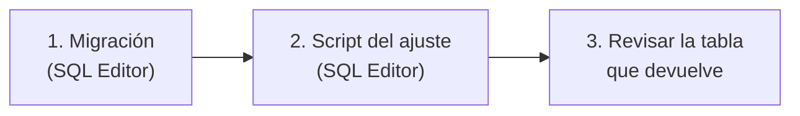

# Ajustes manuales de ELO: guía de implementación

## Estado

Hecho y probado en PostgreSQL 18 local (2026-10-15). **Pendiente:** que Daniel corra la migración y el script del ajuste en el SQL Editor de Supabase.

## Archivos

| Archivo | Cambio |
|---|---|
| `supabase/migrations/20261015210000_elo_ajustes.sql` | Nuevo: tabla `elo_adjustments`, `elo_apply_adjustment`, `elo_add_adjustment`, `elo_remove_adjustment` y `elo_recompute_all` redefinida |
| `docs/bitacora/2026-10-15-ajustes-elo/ajuste_2026-10-15_mix_caido.sql` | Nuevo: +20 a rbk, kyansuke, flow y honzzq |
| `docs/bitacora/2026-10-15-ajustes-elo/pruebas/pruebas_ajustes.sql` | Nuevo: pruebas A1–A6 y datos para probar el script |
| `docs/MODELO_DATOS.md`, `docs/PENDIENTES.md`, `docs/bitacora/README.md` | Fila nueva |

## Despliegue

Solo base de datos. No hay cambios en el plugin, así que no aplica la regla de desplegar en todos los servidores (nuestro y RBK).



1. **Supabase → SQL Editor:** pegar todo `20261015210000_elo_ajustes.sql` y ejecutar. **No** correr `elo_recompute_all()`: sigue en pie la decisión del 2026-10-14 de no recalcular los mixes anteriores.
2. **Supabase → SQL Editor:** pegar todo `ajuste_2026-10-15_mix_caido.sql` y ejecutar.
   - Busca a los 4 jugadores por nick en `players`, sin distinguir mayúsculas. Si alguno no aparece, no tiene `steam_id` o su nick está repetido, aborta sin cambiar nada y dice cuál.
   - En ese caso, cambiar el nick en el arreglo `nicks` por el exacto de la web, o armar el ajuste a mano con los SteamID64.
   - Si ya se aplicó, aborta.
3. Revisar la tabla que devuelve: 4 filas con `delta` 20 (flow 1000, honzzq 1045, kyansuke 1078, rbk 1028, según el ELO del 2026-10-15 a las 21:30).

## Pruebas

### PostgreSQL 18 local

```bash
initdb -D pgdata -U postgres -A trust -E UTF8
pg_ctl -D pgdata -o "-p 55437" start
psql -p 55437 -U postgres -c "create database t"
psql -p 55437 -U postgres -d t -v ON_ERROR_STOP=1 -f docs/bitacora/2026-10-11-elo-jugadores/pruebas/stub_supabase.sql
for f in supabase/migrations/*.sql; do psql -p 55437 -U postgres -d t -v ON_ERROR_STOP=1 -f "$f"; done
psql -p 55437 -U postgres -d t -f docs/bitacora/2026-10-11-elo-jugadores/pruebas/pruebas_elo.sql
psql -p 55437 -U postgres -d t -f docs/bitacora/2026-10-14-elo-participacion-y-sourcetv/pruebas/pruebas_participacion.sql
psql -p 55437 -U postgres -d t -f docs/bitacora/2026-10-15-ajustes-elo/pruebas/pruebas_ajustes.sql
psql -p 55437 -U postgres -d t -v ON_ERROR_STOP=1 -f docs/bitacora/2026-10-15-ajustes-elo/ajuste_2026-10-15_mix_caido.sql
pg_ctl -D pgdata stop && rm -rf pgdata
```

Resultados:

- Las anteriores siguen pasando con la `elo_recompute_all` nueva: T1–T18 y P1–P12.
- A1: +20 exacto y jugador nuevo creado en 1020, sin tocar μ ni `matches`.
- A2: rechaza un SteamID64 inválido, delta 0, motivo vacío, repetidos y a quien no es admin.
- A3: respeta el piso.
- A4: recalcular dos veces da lo mismo y el ajuste sigue.
- A5: un mix posterior al ajuste arranca con el ELO ajustado (`elo_before` 1050).
- A6: `elo_remove_adjustment` resta, borra y falla con un id que no existe.
- Script real, con nicks de prueba en mayúsculas y minúsculas (`RBK`, `KyanSuke`, `flow`, `honzzq` y un `Naukky` que no debe ajustarse): 4 filas en 1020, Naukky sin tocar. Con el primer borrador de 5 nicks se probó además que la segunda corrida aborta ("Este ajuste ya se aplicó") y que después de `elo_recompute_all()` siguen en 1020.

No se probó en la base real.

## En qué se apartó del plan

- El script del ajuste también aborta si ya se había aplicado. El plan no lo decía.
- Son 4 jugadores, no 5: los nicks exactos son `rbk`, `kyansuke`, `flow` y `honzzq` (verificados en la base real el 2026-10-15). Naukky se descartó por decisión de Daniel (además, no está en `players`).

## Cómo revertir

- **Solo el ajuste:** `select id from elo_adjustments where reason like 'Mix caído 2026-10-15%';` y `select elo_remove_adjustment(<id>);` por cada fila (4).
- **Toda la migración** (después de quitar los ajustes):
  1. Volver a crear la `elo_recompute_all` de `20261011180000_player_elo.sql` (sección 3).
  2. Correr `drop function elo_add_adjustment(text[], integer, text, timestamptz), elo_remove_adjustment(bigint), elo_apply_adjustment(text, integer); drop table elo_adjustments;`.
