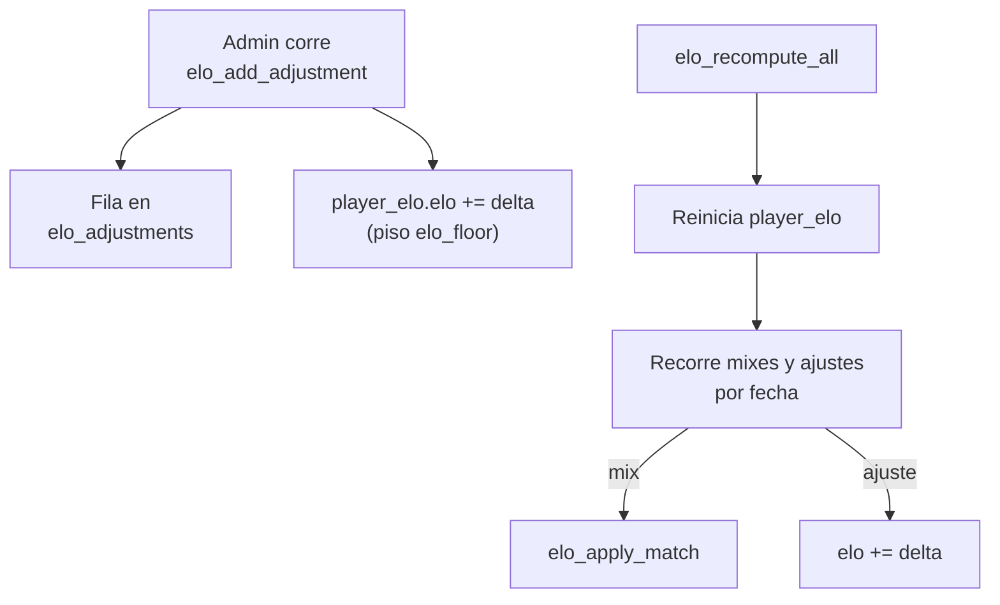

# Plan: ajustes manuales de ELO

> Planeación original. Estado: **aprobada** por Daniel el 2026-10-15.

El 2026-10-15, cerca de las 21:04 (hora de Colombia), el servidor se cayó en medio de un mix y la partida no quedó en la base. Hay que darles +20 de ELO a los ganadores (rbk, kyan, flow, nauky y honzq) sin que se pierda si después se recalcula el ELO con `elo_recompute_all()`.

## Decisiones tomadas

| Tema | Decisión | Por qué |
|---|---|---|
| Cómo registrar el ELO | Tabla nueva `elo_adjustments` (un ajuste por jugador: `steam_id`, `delta`, `reason`, `applied_at`) | Una partida falsa no da +20 exacto (TrueSkill, bonus y peso por rondas), suma victorias y mapas fantasma a las stats y mueve μ/σ |
| Rival | Ninguno: no hacen falta jugadores falsos (`Elo_Fix1`…) | El ajuste no simula una partida |
| Qué toca el ajuste | Solo `elo` y `peak_elo` de `player_elo`. No toca μ/σ ni `matches` | Ajustar TrueSkill sin una partida real no tiene sentido, y `matches` cuenta partidas jugadas |
| Recálculo | `elo_recompute_all()` mezcla mixes y ajustes en orden cronológico (`played_at` / `applied_at`) | El ajuste sobrevive al recálculo y respeta el piso igual que una partida |
| Altas | `elo_add_adjustment(steam_ids[], delta, reason, at)`, solo admin (o SQL Editor) | Queda quién, cuándo y por qué |
| Bajas | `elo_remove_adjustment(id)` deshace el delta y borra la fila, sin recalcular | Se decidió no recalcular los mixes anteriores (2026-10-14); borrar y recalcular cambiaría el ELO de todos |
| Lectura | Pública, como `player_elo` | Transparencia: cualquiera puede ver por qué cambió un ELO |
| Replanteo | No choca: el replanteo solo reemplaza `elo_apply_match` | `elo_recompute_all` sigue siendo la de esta migración después del corte |

## 1. El flujo completo

## 2. Base de datos (migración `20261015210000_elo_ajustes.sql`)

- Tabla `elo_adjustments`: `id` identity, `steam_id` (SteamID64 válido), `delta` (≠ 0), `reason` (no vacío), `applied_at`, `created_by` (`auth.uid()`), `created_at`. RLS con lectura pública y sin escritura directa.
- `elo_apply_adjustment(steam_id, delta)` (interna): crea la fila de `player_elo` con `start_elo` si no existe y suma el delta con el piso `elo_floor`. Actualiza `peak_elo`.
- `elo_add_adjustment(p_steam_ids text[], p_delta int, p_reason text, p_at timestamptz default now())`: valida, inserta una fila por jugador, aplica y devuelve la cantidad.
- `elo_remove_adjustment(p_id bigint)`: resta el delta (con piso) y borra la fila.
- `elo_recompute_all()`: misma lógica, pero recorre la unión de mixes terminados y ajustes ordenados por fecha. Sigue devolviendo la cantidad de mixes.

## 3. El ajuste de hoy

Script `ajuste_2026-10-15_mix_caido.sql`: busca los `steam_id` de los 5 nicks en `players` (sin distinguir mayúsculas), aborta si falta alguno o si hay nicks repetidos, y llama a `elo_add_adjustment(..., 20, 'Mix caído…', '2026-10-15 21:04-05')`.

## 4. Requisitos antes de empezar

- PostgreSQL 18 local para las pruebas (ya instalado).
- Acceso al SQL Editor de Supabase (lo corre Daniel).

## 5. Orden de implementación

1. Migración y pruebas en PostgreSQL local, con el stub y las migraciones de ELO.
2. Daniel corre la migración en el SQL Editor y después el script del ajuste.
3. Verificar el ELO de los 5 jugadores.
4. Documentación, guía y fila en el índice.
