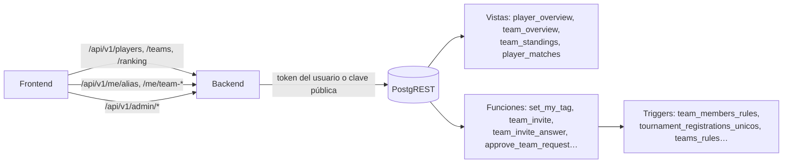
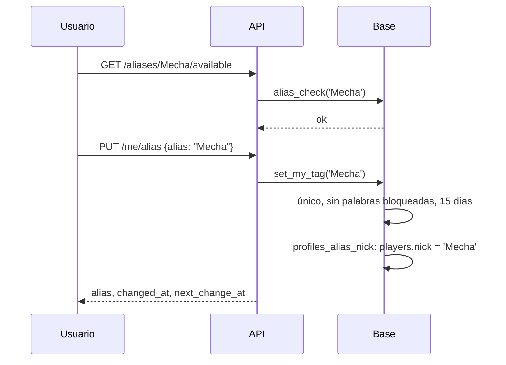
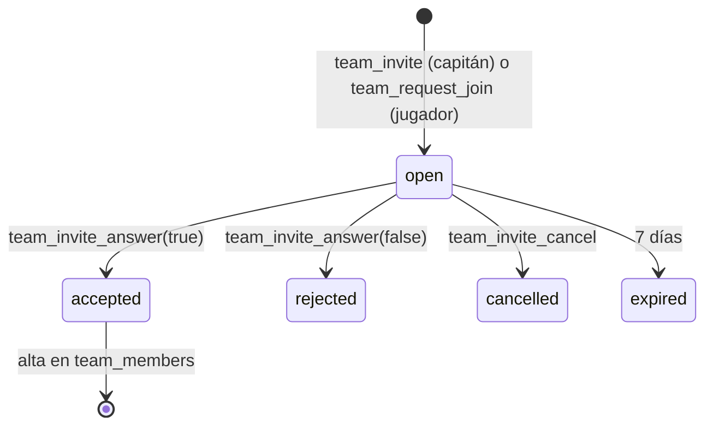

# Endpoints de jugadores y equipos (API de dominio, primera entrega): documentación

## Qué hace

Es la primera entrega de endpoints de dominio del backend (`web/backend`). Cubre todo lo que la web vieja hace con **jugadores y equipos**, más las tres cosas nuevas que pidió Daniel:

- **Alias web único:** un solo nombre por jugador en toda la web. Lo cambian el usuario (cada 15 días) y el admin (siempre). Hay una lista de palabras bloqueadas.
- **Plantel estilo FACEIT:** el capitán invita y los jugadores piden entrar, con un tope de 10 y el SteamID obligatorio. Un jugador puede estar en varios equipos, pero no en dos inscritos en el mismo torneo ni en los dos lados de una partida pendiente.
- **Ranking de equipos:** cuenta los puntos por partida ganada. Por defecto solo cuentan los torneos; con `pcw=1` suman también las PCW jugadas "como equipo".

La base cambia con la migración `supabase/replanteo/09_jugadores_equipos.sql`, que se aplica en el corte con las 01 a 08. Todas las reglas viven en la base. El backend valida el formato, arma las respuestas y traduce los errores.

## Alias

| Regla | Detalle |
|---|---|
| Dónde se guarda | `profiles.tag`. El `players.nick` de un jugador vinculado es una copia del alias que mantienen dos triggers: `players_nick_alias`, al vincular o al editar el nick, y `profiles_alias_nick`, al cambiar el alias |
| Único | Índice `profiles_tag_unico` sobre `lower(trim(tag))` |
| Formato | De 2 a 24 caracteres, sin `<`, `>` ni caracteres de control |
| El usuario | `set_my_tag`: una vez cada 15 días (`profiles.tag_changed_at`). Cambiar solo mayúsculas no cuenta como cambio |
| El admin | `set_user_tag(usuario, alias, force)`: sin espera. Con una palabra bloqueada falla, salvo con `force` |
| Disponibilidad | `alias_check(alias)` devuelve `ok`, `length`, `chars`, `blocked` o `taken`. El alias propio no cuenta como tomado |
| Registro | El backend llama a `alias_check` antes de crear la cuenta (`409` si está tomado). Si igual llega uno tomado o bloqueado, `handle_new_user` pone `user_<8 hex>` |
| Jugadores sin cuenta | El nick lo pone el admin y no se reserva: puede coincidir con un alias. Al vincular la cuenta, pasa a mostrar el alias |

## Palabras bloqueadas

- **Tabla `blocked_words`:** la gestiona solo el admin. Guarda cada palabra normalizada con `name_norm`: minúsculas, sin tildes, con el leetspeak traducido (0→o, 1→i, 3→e, 4→a, 5→s, 7→t, @→a, $→s) y solo letras.
- **`name_blocked(texto)`:** devuelve la primera palabra bloqueada que contiene el texto normalizado. Es interna.
- **Dónde se aplica:**
  - El alias: `set_my_tag` y `set_user_tag`.
  - El nombre y la sigla de un equipo: trigger `teams_rules`, que cubre también los bandos de PCW.
  - La solicitud de equipo nuevo: trigger `team_requests_rules`.
- **El admin no queda frenado por los triggers.** El backend revisa el nombre con `admin_name_blocked` y, si la lista lo bloquea, pide `force: true`. Las cargas sin usuario (mantenimiento) tampoco se frenan.
- **`blocked_names_hits()` (admin):** lista los alias, los nicks de jugadores sin cuenta y los nombres o siglas de equipos oficiales que hoy contienen una palabra bloqueada.

## Plantel

| Tabla o función | Qué hace |
|---|---|
| `team_invites` | `kind` es `invite` (el capitán invitó) o `request` (el jugador pidió). Estados: `open`, `accepted`, `rejected`, `cancelled` y `expired`. Una sola abierta por jugador y equipo. Vence a los 7 días. RLS: la ven el jugador, el capitán y el admin. Nadie escribe directo |
| `team_invite(equipo, jugador o alias)` | Solo el capitán o el admin. El jugador necesita cuenta y SteamID |
| `team_request_join(equipo)` | El usuario, con SteamID |
| `team_invite_answer(id, aceptar)` | La invitación la responde el invitado; el pedido, el capitán (o el admin) |
| `team_invite_cancel(id)` | La invitación la cancela el capitán; el pedido, quien lo hizo (o el admin) |
| `team_leave(equipo)` | El capitán tiene que ceder antes la capitanía |
| `team_kick(equipo, jugador)` | Capitán o admin. Al capitán no se lo puede sacar |
| `team_invites_expire()` | Marca las vencidas. La llaman todas las funciones de arriba. Si una acción falla, la marca se deshace con ella. Por eso la API filtra además por `expires_at` |

**Reglas que la base hace cumplir siempre**, con el trigger `team_members_rules` en cada alta (incluidas las del admin):

| Regla | Mensaje |
|---|---|
| Hasta 10 activos en un equipo oficial | "El equipo ya tiene 10 jugadores, el máximo" |
| SteamID obligatorio en un equipo oficial (los miembros que ya estaban sin SteamID se quedan) | "X no tiene el SteamID vinculado: hace falta para entrar a un equipo" |
| No entrar a un equipo inscrito en un torneo sin campeón donde ya está con otro equipo | "X ya está inscrito en el torneo T con E" |
| No entrar al plantel del rival de una partida pendiente o en vivo | "X está en el plantel de E, rival de este equipo en una partida pendiente" |
| Bando de PCW "como equipo": solo jugadores de ese plantel | "X no es del plantel de E" |

**Inscripción a un torneo:** el trigger `tournament_registrations_unicos` rechaza la inscripción si un jugador del plantel ya está inscrito con otro equipo en ese torneo: "X ya está inscrito en este torneo con E. Uno de los dos equipos tiene que sacarlo de su plantel". Se suma a la regla de la `07`, que pide 5 jugadores.

**PCW con un jugador en los dos bandos:** `accept_pcw` ya la rechazaba antes de esta entrega ("Hay jugadores que están en los dos rosters").

## Bando de PCW "como equipo"

Un bando de PCW (`teams.kind = 'pcw'`) puede tener `parent_team_id`, el equipo oficial con el que juega:
- Todos los jugadores del roster tienen que ser del plantel de ese equipo. Lo controlan los triggers `teams_rules` y `team_members_rules`.
- La PCW ganada suma al equipo oficial en el ranking.
- **Elegir el equipo al publicar o aceptar la PCW llega con la entrega de PCW.** Hoy la columna solo la escriben el admin y las funciones de la base.

## Ranking

| Objeto | Qué tiene |
|---|---|
| `ranking_config` | Una fila: `win_official` (30) y `win_pcw` (5), los puntos por partida ganada. Lectura pública; la cambia `set_ranking_config` (admin, de 0 a 1000) |
| Vista `team_standings` | Por cada equipo oficial: PJ, G, P y puntos de torneo y de PCW, por separado |

- **De torneo:** cuentan las partidas `kind = 'official'` terminadas, con ganador (`winner_side`), sin byes y sin partidas huérfanas, igual que la web vieja.
- **De PCW:** cuentan las terminadas con ganador en las que un bando juega como ese equipo.
- `GET /api/v1/ranking/teams?pcw=0|1` suma los dos bloques según `pcw` y ordena por puntos, victorias y derrotas. Los empatados comparten posición.

## Vistas para los listados

| Vista | Para qué |
|---|---|
| `player_overview` | Listado y ficha: nick (alias), si tiene cuenta y SteamID, foto (la del admin o el avatar si la privacidad lo deja), ELO, stats, equipos oficiales actuales (`jsonb`) y `search` (nick y equipos sin tildes) |
| `team_overview` | Listado de equipos: capitán (su jugador y alias), jugadores activos, `parent_team_id` y `search` |
| `player_matches` | Partidas terminadas de cada jugador vinculado: bandos, resultado, si ganó, nombre en el juego, stats y cambio de ELO |
| `steam_unlinked` | SteamIDs con partidas y sin jugador (último nombre, partidas, última vez) |

Todas son `security_invoker`: aplican las RLS de quien consulta. `admin_users(q)` (admin) lista los usuarios con su alias, rol y jugador, porque `profiles` solo deja leer el propio.

## Bajas seguras

- **Jugador:** el trigger `players_safe_delete` impide borrarlo si tiene partidas (`match_player_stats` o los bandos de un mix).
- **Equipo:** `teams_safe_delete` impide borrarlo si tiene partidas o inscripciones.
- **Antes:** el borrado arrastraba esas filas por cascada.

## Solicitudes de equipo nuevo

- El usuario necesita el SteamID vinculado, porque va a ser el primer miembro. El nombre y la sigla pasan por las palabras bloqueadas.
- `approve_team_request(usuario)` (admin) crea el equipo oficial con el usuario como dueño, capitán y primer miembro, todo en una transacción.
- `reject_team_request(usuario)` la rechaza.

## Endpoints

**Públicos** (con `optionalUser`: sin sesión actúan como anónimo y con token, como el usuario):

| Endpoint | Devuelve |
|---|---|
| `GET /api/v1/players?q=&sort=elo\|alias&page=&per=` | Jugadores con nivel (1 a 10 según los tramos 0, 501, 751, 901, 1051, 1201, 1351, 1531, 1751 y 2001) |
| `GET /api/v1/players/{id}` | Ficha: ELO, stats, stats por mapa, medallas, equipos, historial y `details` (null y `private: true` si la privacidad los oculta) |
| `GET /api/v1/players/{id}/matches` | Partidas del jugador |
| `GET /api/v1/teams?kind=&q=&page=&per=` | Equipos |
| `GET /api/v1/teams/{id}` | Equipo: plantel, ex integrantes, récord, últimas 10 partidas y `viewer` |
| `GET /api/v1/ranking/teams?pcw=0\|1` | Ranking |
| `GET /api/v1/aliases/{alias}/available` | Si el alias está libre y por qué no |

**Con sesión:**

| Endpoint | Quién |
|---|---|
| `PUT /api/v1/me/alias` | Usuario |
| `GET`/`PUT /api/v1/me/team-request` | Usuario |
| `GET /api/v1/me/team-invites` | Usuario |
| `POST /api/v1/teams/{id}/join-requests` | Usuario |
| `POST /api/v1/team-invites/{id}/accept` / `reject` | Invitado |
| `DELETE /api/v1/join-requests/{id}` | Quien pidió |
| `POST /api/v1/teams/{id}/leave` | Miembro |
| `GET /api/v1/teams/{id}/pending` | Capitán o admin |
| `POST /api/v1/teams/{id}/invites` (`player_id` o `alias`) | Capitán o admin |
| `DELETE /api/v1/team-invites/{id}` | Capitán o admin |
| `POST /api/v1/join-requests/{id}/accept` / `reject` | Capitán o admin |
| `DELETE /api/v1/teams/{id}/members/{playerId}` | Capitán o admin |
| `POST /api/v1/teams/{id}/captain` (`player_id`) | Capitán o admin |

**Admin:**

| Grupo | Endpoints |
|---|---|
| Jugadores | `POST`, `PATCH`, `DELETE /api/v1/admin/players[/{id}]`, `POST …/{id}/photo`, `POST …/{id}/medals`, `DELETE /api/v1/admin/medals/{id}` |
| SteamID | `GET /api/v1/admin/steam/unlinked`, `POST /api/v1/admin/steam/link` |
| Usuarios | `GET /api/v1/admin/users?q=`, `PUT /api/v1/admin/users/{id}/alias` |
| Palabras bloqueadas | `GET`, `POST /api/v1/admin/blocked-words`, `DELETE …/{id}`, `GET …/hits` |
| Equipos | `POST`, `PATCH`, `DELETE /api/v1/admin/teams[/{id}]`, `POST …/{id}/members`, `PATCH …/{id}/members/{playerId}` |
| Solicitudes de equipo | `GET /api/v1/admin/team-requests`, `POST …/{userId}/approve`, `POST …/{userId}/reject` |
| Ranking | `GET`, `PUT /api/v1/admin/ranking/config` |
| Reclamos (deprecados) | `GET /api/v1/admin/profile-requests`, `POST …/{id}/approve`, `POST …/{id}/reject` |

**Cambios en endpoints que ya existían:**
- **`GET /api/v1/me/profile`:** `team` pasa a ser `teams`, una lista con `is_captain` e `is_member`. `matches_played` cuenta las partidas del jugador.
- **`PATCH /api/v1/me/profile`:** el `tag` sigue las reglas del alias.
- **`POST /auth/signup`:** valida el alias antes de crear la cuenta.
- **Errores:** un `403` o un `409` que viene de un `raise` de la base conserva su mensaje.

## Dónde está cada cosa

| Qué | Archivo / ubicación |
|---|---|
| Migración, inversa y pruebas | `supabase/replanteo/09_jugadores_equipos.sql`, `docs/bitacora/2026-10-14-replanteo-modelo-datos/reversas/09_jugadores_equipos.sql` y `…/pruebas/09_jugadores_equipos.sql` |
| Rutas | `web/backend/src/routes/players.ts`, `teams.ts` (con el ranking), `roster.ts`, `account.ts`, `admin-players.ts` y `admin-teams.ts` |
| Esquemas | `web/backend/src/schemas/players.ts`, `teams.ts` y `admin.ts` |
| Paginado, búsqueda y nivel | `web/backend/src/lib/db.ts` |
| `optionalUser`, `currentUser` e `isAdmin` | `web/backend/src/lib/auth.ts` |
| Pruebas del backend | `web/backend/test/unit/db.test.ts` y `test/integration/players-teams.test.ts` |
| Contrato para el frontend | `docs/frontend/contract.md` |
