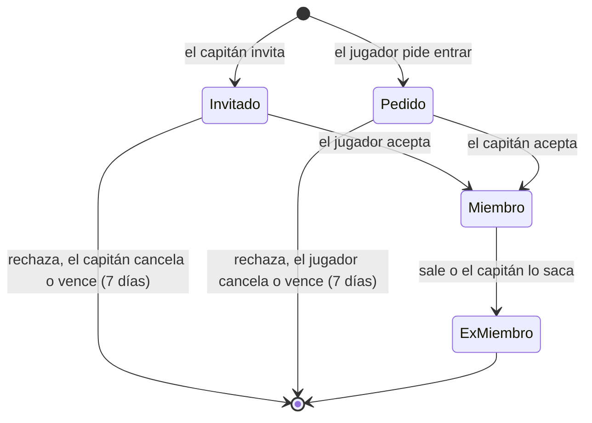

# Plan: endpoints de jugadores y equipos (API de dominio, primera entrega)

> Planeación original. Estado: **aprobado** por Daniel el 2026-10-15.

Primera entrega de los endpoints de dominio del backend (`web/backend`), sobre el esquema del replanteo (01 a 08). Cubre todo lo que la web vieja hace con **jugadores y equipos**: listados, ranking, ficha del jugador, página del equipo, solicitud de equipo, capitanía y los paneles de admin. Además suma tres cosas nuevas que pidió Daniel:
- **Plantel estilo FACEIT:** el capitán invita y los jugadores piden entrar.
- **Ranking de equipos con PCW opcionales**, que suman menos que los torneos.
- **Alias web único:** un solo nombre por jugador en la web, que pueden cambiar el usuario y el admin (para moderar), con una lista de palabras bloqueadas.

Partidas, torneos, PCW (salvo los formatos, ya hechos) y servidores van en entregas siguientes.

Como el backend se publica recién en el corte, puede apoyarse en lo que agrega el replanteo. Lo que falte en la base va como migración `09` en `supabase/replanteo/`.

## Qué hace hoy la web vieja

| Pantalla | Qué hace | Datos |
|---|---|---|
| Jugadores | Lista paginada con búsqueda (nick o equipo), ordenada por ELO: avatar, nivel, ELO, equipo, rating, K/D | `players`, `player_elo`, `teams.members` |
| Ficha del jugador (`#jugador/<nick>`) | Datos, nivel y ELO, stats, stats por mapa, medallas, historial de equipos, mixes; datos personales si el perfil es público | Lo anterior más `profile_details`, `player_medals`, `match_player_stats` |
| Ranking de equipos | Partidas de torneo terminadas: PJ, G, P y 3 puntos por victoria (las PCW no cuentan) | `teams`, `matches` |
| Equipos | Lista y plantel | `teams`, `players` |
| Solicitar equipo | Un usuario pide crear un equipo (nombre y sigla); el admin lo aprueba | `team_requests` |
| Mi capitanía | El capitán cede la capitanía a un jugador del plantel con cuenta | `set_team_captain` |
| Mi perfil | El usuario cambia su "nickname" (`profiles.tag`) | `set_my_tag` |
| Admin → Jugadores | Alta, edición (nick, foto, bio, logros, historial, privacidad, cuenta vinculada) y baja; medallas; SteamID sin vincular; solicitudes de reclamo | `players`, bucket `photos`, `player_medals`, `link_steam_id`, `profile_requests` |
| Admin → Equipos | Alta, edición (nombre, sigla, capitán, jugadores) y baja; aprobar o rechazar solicitudes | `teams`, `team_requests` |

## Los nombres de hoy (contexto de la decisión del alias)

Hoy un jugador tiene **tres nombres distintos**:

| Nombre | Dónde se guarda | Quién lo elige | Dónde se ve |
|---|---|---|---|
| **Tag de la cuenta** ("nickname") | `profiles.tag` | El usuario, al registrarse; lo cambia en Mi perfil | Menú de la cuenta, Mi perfil, chat de partida, listas de admin, selector de capitán |
| **Nick del jugador** | `players.nick` | El admin (el usuario no puede cambiarlo) | Jugadores, ranking, ficha, URL `#jugador/<nick>`, plantel de los equipos |
| **Nombre en el juego** | `match_player_stats.nick` (uno por partida) | El jugador, en CS:S | Stats de cada partida. El jugador se identifica por SteamID |

Datos de producción (copia del 2026-10-14, solo conteos):
- **Tags:** 40 cuentas, sin tags repetidos.
- **Nicks:** 72 jugadores, sin nicks repetidos; 19 vinculados a una cuenta.
- **Vinculados:** 6 tienen el nick del jugador distinto del tag de su cuenta.
- **Sin vincular:** 10 jugadores tienen como nick el tag de una cuenta. Probablemente son la misma persona, todavía sin vincular.

## Decisiones

| Tema | Decisión | Origen |
|---|---|---|
| Plantel | **Estilo FACEIT:** el capitán invita jugadores y los jugadores piden entrar; el otro lado acepta o rechaza. El admin puede todo | Daniel |
| Tamaño del plantel | **Hasta 10** jugadores activos por equipo | Daniel |
| Inscripción a torneos | El creador del torneo define cuántos del plantel se inscriben (máximo 10). **No va en esta entrega**: queda anotado para el plan de torneos (`docs/PENDIENTES.md`) | Daniel |
| Ranking de equipos | Por defecto **solo torneos**. Con la opción "Contar también PCW" suman las PCW, **con muchos menos puntos**. Los puntos son **por partida ganada**: cada partida de torneo ganada suma (por ejemplo 30) y cada PCW ganada suma mucho menos (por ejemplo 5). No es por ganar el torneo entero | Daniel |
| Puntos según la fase del torneo | Que una partida valga más o menos según la fase (grupos, playoffs, semifinal, final) **se decide en el plan de torneos**. Esta entrega usa un valor único por partida de torneo | Daniel |
| Puntos del ranking | **Configurables por el admin** (`ranking_config`, como `pcw_config`): 30 por partida de torneo ganada y 5 por PCW ganada al principio | Propuesta: así se ajustan sin migración |
| Alias web | **Se unifican el tag de la cuenta y el nick del jugador:** un jugador con cuenta tiene un solo nombre en la web, el alias. Se guarda en `profiles.tag`, es único (sin distinguir mayúsculas ni espacios de los bordes) y lo pueden cambiar **el usuario y el admin** (el admin, para moderar nombres inapropiados). La ficha, el ranking, el chat y los planteles muestran el alias | Daniel |
| Palabras bloqueadas | Tabla `blocked_words` que gestiona el admin. Un alias, un nombre o sigla de equipo (solicitud de equipo nuevo y edición) o un nombre de bando de PCW que contenga una palabra bloqueada se rechaza. La comparación ignora mayúsculas, tildes, espacios y los reemplazos típicos (0→o, 1→i, 3→e, 4→a, 5→s, 7→t, @→a, $→s). El admin también ve qué nombres existentes contienen una palabra bloqueada, para corregirlos | Daniel (tabla); propuesta (alcance y comparación) |
| Nick del jugador | En un jugador **vinculado** se sincroniza con el alias (al vincular y cada vez que cambia el alias). En uno **sin cuenta** lo sigue poniendo el admin y no se reserva: un alias nuevo puede coincidir con el nick de un jugador sin cuenta, y al vincularlo queda el alias | Propuesta |
| Nombre en el juego | Libre. El servidor identifica por SteamID | Daniel |
| Identificador en las URLs | El **id** del jugador y del equipo. El alias es cambiable, así que no sirve como enlace permanente | Propuesta |
| Nivel | Lo calcula el backend con la tabla de la web vieja (10 niveles: 0, 501, 751, 901, 1051, 1201, 1351, 1531, 1751 y 2001 de ELO) | Propuesta |
| Stats | De las vistas `player_stats` y `player_map_stats` | Replanteo |
| Varios equipos | **Un jugador puede estar en varios equipos a la vez.** Lo que no puede es estar inscrito en un mismo torneo con dos equipos (ver "Torneos y jugadores en varios equipos") | Daniel |
| SteamID para entrar a un equipo | **Obligatorio:** sin SteamID vinculado no se puede invitar a alguien, pedir entrar ni sumarlo como admin a un equipo oficial. Los miembros actuales sin SteamID se quedan | Daniel (regla); propuesta (también para el admin, y los actuales se quedan) |
| Cambio de alias | El usuario, **una vez cada 15 días**. El admin, siempre | Daniel |
| Los 6 vinculados con nick distinto del tag | Pasan a mostrar el tag de su cuenta | Daniel |
| PCW con un jugador compartido | No se puede jugar: aceptar la PCW falla | Daniel |
| Equipos actuales | Los equipos oficiales donde está activo en `team_members` (una lista, no uno solo). `GET /me/profile` pasa de `team` a `teams` | Consecuencia de "varios equipos" |
| Privacidad | La aplica la base (RLS de `profile_details`). Privado oculta los datos personales, no la ficha ni las stats | Replanteo |
| Listados | Paginados en el servidor, con búsqueda `q` sin distinguir tildes ni mayúsculas | Propuesta |
| Reclamo de perfil | Los endpoints de admin de `profile_requests` entran deprecados, como los del usuario | Replanteo |
| `contract.md` | Al cerrar las decisiones se escribe `docs/frontend/contract.md` con todas las decisiones de diseño que afectan al frontend, incluidas las de las fases anteriores | Daniel |

### Torneos y jugadores en varios equipos

Regla de Daniel: un jugador no puede estar inscrito en un mismo torneo con dos equipos. Si el equipo B intenta inscribirse a un torneo donde ya está inscrito el equipo A, y comparten un jugador, la inscripción de B falla con un mensaje que nombra al jugador y al equipo A. Se destraba cuando B saca al jugador de su plantel o cuando A lo saca del suyo.

- **Torneos en curso:** la regla vale mientras el torneo no tenga campeón.
- **Inscripción:** hoy un equipo se inscribe con todo su plantel activo, así que la regla compara planteles. Cuando el plan de torneos defina cuántos jugadores inscribe cada equipo, la comparación pasa a hacerse sobre los inscritos (anotado en `docs/PENDIENTES.md`).
- **Entrar a un equipo ya inscrito:** si el equipo B ya está inscrito en un torneo junto con el A, el jugador del A no puede entrar al B (ni por invitación, ni por pedido, ni por el admin) hasta que el torneo termine o salga del A. Si no, la regla se esquivaría inscribiendo primero y sumando después.

**PCW entre equipos que comparten un jugador** (Daniel): no se puede jugar. Aceptar una PCW falla si un jugador está en el roster de los dos bandos, con un mensaje que lo nombra. Tampoco se puede sumar a un jugador al plantel de un equipo que tiene una PCW o una partida de torneo pendiente o en vivo contra otro equipo donde ese jugador ya está. Así `!match` nunca recibe un jugador en las dos listas y el plugin 2.0.0 no cambia. Los invitados sin jugador (solo un nick) no se pueden comparar y no cuentan.

## 1. El flujo del plantel

- **Tope de 10:** aceptar falla si el equipo ya tiene 10 activos. Invitar y pedir entrar también fallan con el equipo lleno.
- **SteamID obligatorio:** invitar, pedir entrar y aceptar fallan si el jugador no tiene SteamID vinculado. Una cuenta sin jugador no puede entrar a un equipo.
- **Varios equipos:** se permite. Aceptar falla solo si choca con un torneo (ver "Torneos y jugadores en varios equipos").
- **El capitán no puede salir** sin ceder antes la capitanía. El admin puede sacar a cualquiera.
- **Salir o ser sacado** pone `left_at` (no borra la fila), así queda el historial.
- **Invitaciones y pedidos abiertos:** como máximo uno por jugador y equipo. Vencen a los 7 días.
- **Equipos PCW:** no usan este flujo. Se arman al publicar o aceptar la PCW, como hoy.

## 2. Endpoints públicos (sin sesión; con sesión, aplican las RLS del usuario)

| Endpoint | Devuelve |
|---|---|
| `GET /api/v1/players?q=&page=&per=&sort=elo\|alias` | Jugadores: id, alias (o nick si no tiene cuenta), si tiene cuenta, foto, ELO, nivel, partidas, equipos actuales, rating y K/D. Por defecto ordenado por ELO |
| `GET /api/v1/players/{id}` | Ficha: datos públicos, ELO (actual, pico, partidas) y nivel, `player_stats`, `player_map_stats`, medallas, equipos actuales, historial de equipos (`team_members` con alta y baja) y `profile_details` si la RLS lo deja ver (si no, `details: null` y `private: true`) |
| `GET /api/v1/players/{id}/matches?page=&per=` | Partidas jugadas, la más nueva primero: fecha, mapa, tipo, bandos, resultado, si ganó, sus stats, su cambio de ELO y el nombre que usó en el juego |
| `GET /api/v1/teams?kind=official\|pcw&q=&page=&per=` | Equipos: id, nombre, sigla, tipo, capitán (alias), jugadores activos (de 10). Por defecto `official` |
| `GET /api/v1/teams/{id}` | Equipo: datos, capitán y dueño, plantel activo (jugador, rol, ELO, nivel), ex integrantes, récord y últimas partidas |
| `GET /api/v1/ranking/teams?pcw=0\|1` | Ranking: posición, equipo, PJ, G, P y puntos. `pcw=0` (por defecto) cuenta solo torneos; `pcw=1` suma las PCW con sus puntos. Incluye los puntos vigentes por victoria |

El ranking de jugadores es `GET /players` ordenado por ELO.

## 3. Endpoints con sesión

| Endpoint | Quién | Qué hace |
|---|---|---|
| `PUT /api/v1/me/alias` | Usuario | Cambia su alias (2 a 24 caracteres, único, una vez cada 15 días). Responde 409 si está tomado. Reemplaza al `tag` de `PATCH /me/profile`, que queda como alias del mismo cambio |
| `GET /api/v1/aliases/{alias}/available` | Cualquiera | Si un alias está libre (para el formulario de registro y de Mi perfil) |
| `GET`/`PUT /api/v1/me/team-request` | Usuario | Su solicitud de equipo nuevo (nombre y sigla), una por usuario, como hoy |
| `GET /api/v1/me/team-invites` | Usuario | Invitaciones recibidas y pedidos enviados, abiertos |
| `POST /api/v1/teams/{id}/join-requests` | Usuario | Pedir entrar al equipo |
| `POST /api/v1/team-invites/{id}/accept` / `…/reject` | El invitado | Aceptar o rechazar una invitación |
| `DELETE /api/v1/join-requests/{id}` | Quien pidió | Cancelar su pedido |
| `POST /api/v1/teams/{id}/leave` | Miembro | Salir del equipo (el capitán, solo después de ceder la capitanía) |
| `GET /api/v1/teams/{id}/pending` | Capitán o admin | Invitaciones enviadas y pedidos recibidos, abiertos |
| `POST /api/v1/teams/{id}/invites` | Capitán o admin | `{ user_id }` o `{ alias }`: invitar |
| `DELETE /api/v1/team-invites/{id}` | Capitán o admin | Cancelar una invitación |
| `POST /api/v1/join-requests/{id}/accept` / `…/reject` | Capitán o admin | Aceptar o rechazar un pedido |
| `DELETE /api/v1/teams/{id}/members/{playerId}` | Capitán o admin | Sacar a un jugador |
| `POST /api/v1/teams/{id}/captain` | Capitán o admin | `{ user_id }`: ceder la capitanía (`set_team_captain`) |

## 4. Endpoints de admin

| Endpoint | Qué hace |
|---|---|
| `POST`/`PATCH`/`DELETE /api/v1/admin/players[/{id}]` | Alta, edición y baja de jugadores. El nick solo se edita en jugadores sin cuenta. La baja falla con mensaje si tiene partidas |
| `POST /api/v1/admin/players/{id}/photo` | Foto (bucket `photos`, JPEG/PNG/WebP, 1 MB) |
| `POST /api/v1/admin/players/{id}/medals` / `DELETE /api/v1/admin/medals/{id}` | Medallas |
| `GET /api/v1/admin/steam/unlinked` / `POST /api/v1/admin/steam/link` | SteamID sin vincular y `link_steam_id` |
| `PUT /api/v1/admin/users/{id}/alias` | Cambiar el alias de cualquiera (moderación), sin espera. Respeta la unicidad. El admin puede guardar un nombre con una palabra bloqueada solo con `force: true` (por si la lista da un falso positivo) |
| `GET`/`POST /api/v1/admin/blocked-words` / `DELETE …/{id}` | Lista de palabras bloqueadas |
| `GET /api/v1/admin/blocked-words/hits` | Alias, nicks de jugadores sin cuenta y nombres de equipos que hoy contienen una palabra bloqueada |
| `POST`/`PATCH`/`DELETE /api/v1/admin/teams[/{id}]` | Alta, edición y baja de equipos. La baja falla si tiene partidas o inscripciones |
| `POST /api/v1/admin/teams/{id}/members` / `PATCH …/members/{playerId}` | Sumar a un jugador directamente (sin invitación) y cambiar su rol (`player`, `sub`, `coach`) |
| `GET /api/v1/admin/team-requests` / `POST …/{userId}/approve` / `…/reject` | Solicitudes de equipo nuevo. Aprobar crea el equipo con el usuario como dueño, capitán y primer miembro |
| `GET`/`PUT /api/v1/admin/ranking/config` | Puntos por victoria de torneo y de PCW |
| `GET /api/v1/admin/profile-requests` / `POST …/{id}/approve` / `…/reject` | **Deprecados** |

## 5. Base de datos (`supabase/replanteo/09_jugadores_equipos.sql`)

1. **Alias:**
   - Índice único sobre `lower(trim(profiles.tag))`. Hoy no hay repetidos.
   - `profiles.tag_changed_at`.
   - `set_my_tag` aplica la espera de 15 días.
   - `set_user_tag` para el admin.
   - **Palabras bloqueadas:** tabla `blocked_words` (palabra normalizada, única; quién y cuándo), solo admin; `name_blocked(text)` normaliza y busca coincidencias; la usan `set_my_tag`, `set_user_tag` (salvo `force`), las solicitudes de equipo nuevo, la edición de equipos y `pcw_make_side`.
   - Trigger que copia el alias a `players.nick` del jugador vinculado. Al aplicar la migración se sincronizan los 6 que difieren.
   - `link_steam_id` y la vinculación de cuenta también sincronizan.
2. **Plantel:**
   - Tabla `team_invites`: equipo, jugador, `kind` (`invite` o `request`), estado (`open`, `accepted`, `rejected`, `cancelled`, `expired`), quién la creó, fechas y vencimiento.
   - RLS: cada uno ve las suyas; el capitán, las de su equipo; el admin, todas.
   - Funciones `security definer` para invitar, pedir, aceptar, rechazar, cancelar, salir y sacar, con las reglas de la sección 1: tope de 10, SteamID obligatorio, capitán y vencimiento.
   - Trigger en `team_members` para equipos oficiales: no más de 10 activos, SteamID obligatorio en las altas nuevas y el choque de torneo al entrar a un equipo inscrito.
   - Trigger en `tournament_registrations`: falla si un jugador del plantel ya está inscrito con otro equipo en ese torneo (sin campeón).
   - `accept_pcw` falla si un jugador está en el roster de los dos bandos. El trigger de `team_members` (para todo tipo de equipo) falla si el jugador ya está en el plantel del rival de una partida pendiente o en vivo del equipo.
   - `pcw_make_side` ya limita a 7 los equipos PCW.
3. **Ranking:**
   - `ranking_config` (una fila: `win_official` 30 y `win_pcw` 5, puntos por partida ganada; solo admin, con `set_ranking_config`).
   - Vista `team_standings` con PJ, G, P y puntos, por separado para torneo y PCW, con `winner_side` y la misma regla de la web vieja: sin byes ni partidas huérfanas.
4. **Listado de jugadores:** vista `player_overview` (`security_invoker`): alias o nick, ELO, partidas, equipo oficial actual, rating y K/D.
5. **Solicitudes de equipo nuevo:** `approve_team_request` y `reject_team_request` (admin), en una transacción.
6. **Bajas seguras:** borrar un jugador o un equipo con partidas falla con mensaje en vez de arrastrar filas por cascada.

Con su inversa, sus pruebas (`correr.sh`) y el ensayo del ELO repetido.

## 6. Backend

- **Archivos:** `routes/players.ts`, `routes/teams.ts`, `routes/roster.ts` (invitaciones y pedidos), `routes/ranking.ts`, `routes/admin-players.ts`, `routes/admin-teams.ts` y sus `schemas/`.
- **Cliente de Supabase:**
  - Público: la clave pública, o el token del usuario si viene (middleware `optionalUser`, nuevo).
  - Con sesión y admin: el token del usuario.
  - Nada usa la `service_role`.
- **`GET /me/profile`:** `team` pasa a `teams` (lista de equipos oficiales activos).
- **Reglas:** todas en la base. El backend valida formato (zod) y traduce errores (`BUSINESS_RULE`, `CONFLICT` para alias tomado).
- **OpenAPI:** etiquetas **Jugadores**, **Equipos**, **Plantel**, **Ranking** y **Admin**.
- **Pruebas:**
  - Unitarias con PostgREST simulado.
  - De integración contra la Supabase local: privacidad, permisos, invitación y pedido de punta a punta, tope de 10, alias único y su espera, y ranking con y sin PCW.
  - Cobertura mínima del 60 %.

## 7. Frontend

- Se suma al resumen para el frontend.
- Al cerrar las decisiones se escribe **`docs/frontend/contract.md`**: un contrato único con todas las decisiones de diseño que afectan al frontend (de esta entrega y de las anteriores: Auth, Mi perfil, replanteo, `!match`, formatos de PCW). Lo pidió Daniel.

## 8. Requisitos antes de empezar

- **Aprobación de este plan** (hecha).
- La Supabase local con 01 a 08 (ya funcionando).

## 9. Orden de implementación

1. **Base:** `09` (alias, plantel, regla de torneos, PCW sin jugadores compartidos, ranking, vistas, solicitudes, bajas seguras), con inversa, pruebas, `correr.sh` y ensayo del ELO. Tipos regenerados.
2. **Alias:** `PUT /me/alias`, disponibilidad, admin y palabras bloqueadas.
3. **Públicos:** jugadores (listado, ficha, partidas), equipos (listado, página) y ranking.
4. **Plantel:** invitaciones, pedidos, salir, sacar y capitanía.
5. **Solicitud de equipo nuevo.**
6. **Admin:** jugadores, equipos, ranking y reclamos (deprecados).
7. **Documentación:** `DOCUMENTACION.md`, `GUIA_IMPLEMENTACION.md`, fila de la `09`, `docs/frontend/contract.md` y `docs/PENDIENTES.md`.
