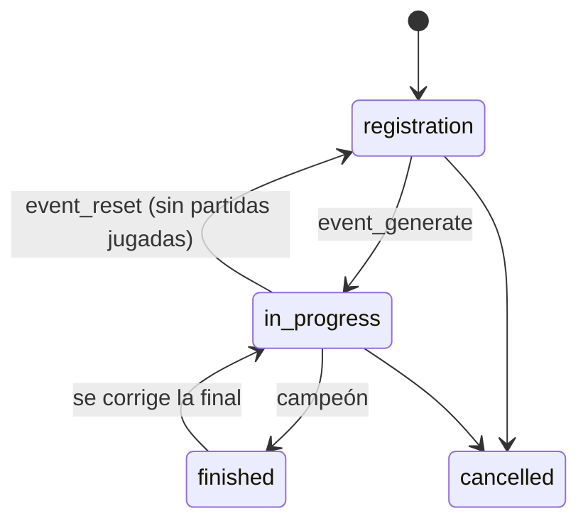

# Endpoints de partidas, torneos y PCW (API de dominio, segunda entrega): documentación

## Qué hace

Segunda entrega de endpoints de dominio del backend. Cubre **partidas** (listados, detalle, veto y chat), **torneos** (organizadores, plantillas, inscripción con jugadores, fixture y resultados) y **PCW** (publicar, aceptar "como equipo", cancelar).

El cambio de fondo es que **el motor de torneos vive en la base**:
- Genera el fixture, lleva ganadores y perdedores, resuelve los byes y arma las rondas del suizo, la fase siguiente y los playoffs.
- Marca el campeón.
- Lo dispara cualquier resultado, venga del servidor con `!match`, del organizador o del admin. Nadie tiene que tocar nada para que el torneo avance.

La base cambia con `supabase/replanteo/10_partidas_torneos.sql`, que se aplica en el corte con las 01 a 09. El plugin 2.0.0 no cambia: lo que necesita `!match` (inscritos, mínimo por torneo y mapa de ventaja) lo resuelven las funciones de la base que ya consulta.

```mermaid
sequenceDiagram
  participant O as Organizador
  participant API
  participant DB as Base (motor)
  participant S as Servidor (!match)
  O->>API: POST /events (plantilla y configuración)
  Note over API,DB: los capitanes inscriben con PUT /events/{id}/registrations/{teamId}
  O->>API: POST /events/{id}/generate
  API->>DB: event_generate
  S->>DB: mapa terminado (csstv_ingest → csstv_link_game)
  DB->>DB: suma el mapa; serie ganada → partida terminada
  DB->>DB: event_progress: avanza la llave, arma la ronda o fase siguiente, campeón
  O->>API: POST /matches/{id}/result (caída, W.O. o corrección)
  API->>DB: event_set_result → deshace y rehace el avance
```

## Roles

| Rol | Qué puede |
|---|---|
| `user` | Inscribir su equipo si es capitán, vetar en su turno, escribir en el chat de sus partidas, publicar y aceptar PCW |
| `organizer` | Lo de `user` más crear torneos y, **en los suyos**, todo lo del admin: configurar, inscribir equipos, sembrar, generar, cargar o corregir resultados, marcar W.O., resolver empates, asignar hora y servidor, reiniciar el veto |
| `admin` | Todo. Nombra organizadores (`set_user_role`), gestiona el pool de mapas y carga resultados de PCW |

- `can_manage_event(evento)` es la regla única: el admin, o el organizador que creó el torneo y sigue siendo organizador.
- El rol `admin` se da en la base. `PUT /api/v1/admin/users/{id}/role` solo cambia entre `user` y `organizer`.

## Torneos

### Plantillas

| `template` | Fases | Configuración (`config`) y valores por defecto |
|---|---|---|
| `single` | Eliminación directa | `bo` 3 (rondas), `bo_semi` 3, `bo_final` 3, `third_place` false, `bo_third` 3 |
| `double` | Upper, lower, final del upper, final del lower y gran final (sin reset) | `bo` 3, `bo_upper_final` 3, `bo_lower_final` 3, `bo_grand_final` 5, `advantage` false (mapa de ventaja) |
| `groups` | Grupos de todos contra todos → playoffs | `groups` 2, `advance` 2, `double_rr` false, `bo_group` 1, `playoffs` {como `single`} |
| `swiss` | 1 a 3 fases suizas → playoffs | `stages` 1, `size` 16 (u 8), `wins` 3 (o 2; las derrotas para quedar afuera son las mismas), `bo` 1, `bo_decisive` 3, `playoffs` {como `single`} |

- **Para todas las plantillas:** `decider_versions`, la versión del mapa decisivo cuando tiene varias (por ejemplo `{"de_inferno": "de_inferno_classic"}`).
- **Normalización:** `event_config` completa los valores por defecto, descarta claves desconocidas y valida (BO 1, 3 o 5, rangos).
- **Cambios de formato:** la plantilla, la configuración y los inscritos por equipo solo se cambian antes de generar el fixture (trigger `events_guard`).

**Grupos:**
- Reparto en serpentina por siembra. Todos contra todos con el método del círculo.
- Victoria 3 puntos, derrota 0.
- **Orden (`event_group_order`):**
  1. Puntos.
  2. Diferencia de rondas.
  3. Mini tabla entre los empatados.
  4. Rondas ganadas.
  5. Orden que fija el organizador.
- **Empates sin resolver:** si dos equipos siguen empatados en todo cerca del corte de clasificación, `events.tie_pending` marca el grupo y los playoffs esperan hasta `event_resolve_tie`.
- **Cruce de playoffs:** los clasificados se siembran evitando cruces del mismo grupo en la primera ronda.
- **Liga:** con 1 grupo y 1 clasificado, el primero es campeón directo.

**Suizo (como el Major de CS2):**
- **Cada fase tiene `size` equipos.** La fase 1 la forman los que empiezan en ella; las siguientes, los que entran directo más los clasificados de la anterior.
- **Equipos que hacen falta:** `size + (stages - 1) × size/2`, con exactamente `size/2` que empiezan en cada fase posterior (`tournament_registrations.start_stage`).
- **Primera ronda:** 1 contra n/2+1, 2 contra n/2+2…
- **Rondas siguientes:** mismo récord y sin repetir rival, con el mejor Buchholz contra el peor.
- **BO:** las partidas donde alguno está a una victoria o derrota del final usan `bo_decisive`.
- **Tabla:** `event_swiss_standings` (récord, Buchholz, diferencia de rondas y estado `active`, `qualified` o `eliminated`).

**Doble eliminación:** con `advantage`, la gran final nace con `advantage_side = 1` y marcador 1-0. `csstv_link_game`, el resultado a mano y el lookup del plugin lo respetan.

### Estados



- **Quién cambia el estado:**
  - El estado y el campeón solo los cambia el motor. Las funciones del motor marcan la transacción con `v34.engine`.
  - El organizador solo puede cancelar.
- **Borrar un torneo** con partidas jugadas falla (`events_safe_delete`); se cancela.

### Inscripción

- `tournament_registration_players(event_id, team_id, player_id)` tiene clave primaria `(event_id, player_id)`: un jugador, un equipo por torneo.
- **`event_register(evento, equipo, jugadores, fase de inicio)`:**
  - **Quién:** el capitán mientras el torneo está en inscripciones; el organizador, también después de generar (solo para cambiar jugadores).
  - **Jugadores:** del plantel activo, con SteamID y entre `players_min` y `players_max`.
  - **Cupo:** respeta `max_teams`.
  - **Choque:** si un jugador ya está inscrito con otro equipo, falla con un mensaje que nombra al jugador y al equipo.
- **Generar** exige que cada equipo tenga al menos `players_min` inscritos.
- **Salir de un equipo** saca al jugador de las inscripciones de los torneos sin terminar (trigger `team_members_unregister`).
- **Reglas que salen:** las de la 07 (5 en el plantel) y la 09 (comparar planteles), reemplazadas por la inscripción con jugadores.

### Motor

| Función | Qué hace |
|---|---|
| `event_generate` | Valida cupo, inscritos y fases del suizo; arma la primera fase y llama a `event_progress` |
| `event_progress` | Idempotente. Lleva ganadores (`next_win`) y perdedores (`next_lose`) a partidas que no empezaron y resuelve byes. Con los grupos terminados arma los playoffs (o marca el empate); con la ronda suiza terminada arma la siguiente, la fase siguiente o los playoffs. Marca campeón y estado |
| Trigger `matches_event_progress` | Llama a `event_progress` cuando una partida de torneo cambia de estado o ganador (también por `!match`), salvo que lo haya hecho el propio motor |
| `event_set_result` | Resultado a mano (mapas sin empate, W.O. o `clear`). Si la partida estaba terminada, deshace su avance (`event_unroute`); falla si ya se jugaron partidas que dependían de ella o si ya se armó la fase o ronda siguiente |
| `event_reset` | Borra el fixture si no hay partidas jugadas |
| `event_resolve_tie` | Orden manual de un grupo empatado |
| `match_schedule` | Hora y servidor de una partida (copia la dirección a `server_ip`) |

**W.O.:** `end_reason = 'walkover'`. Cuenta para la llave y para la tabla de grupos (3 puntos, sin rondas), pero **no suma al ranking** (`team_standings` lo excluye).

## Partidas

- **Código de `!match`:** `anon` y `authenticated` no pueden leer `matches.link_code` (permisos por columna). `match_link_code(partida)` lo devuelve a los participantes (`is_match_participant`: plantel activo o roster del bando, capitán o dueño), al organizador y a los admins.
  - **Ojo:** una columna nueva en `matches` hay que agregarla a mano al `grant select` por columnas.
- **Servidores:** `game_servers_public` muestra id, nombre y dirección de los servidores activos, para que el organizador elija.
- **Veto:**
  - **Pool de mapas:** `map_pool` (nombre, versiones, orden, activo) arranca con `de_dust2_ob`, `de_cache`, `de_cbble`, `de_inferno` (con `de_inferno_classic`), `de_mirage_rc1`, `de_nuke_old_blue`, `de_season` y `de_tuscan`.
  - **`veto_act`:** valida turno (impar el equipo 1, par el 2), capitán, mapa activo y libre y la acción según `veto_sequence(bo, mapas)`. Un pick de un mapa con versiones exige elegir la versión (`match_vetos.version`).
  - **Reinicio:** `veto_reset` es solo del organizador o el admin. Nadie inserta vetos directo.
- **Chat:**
  - **Quién escribe:** en torneos y PCW, los participantes, el organizador y los admins (`match_chat_can_write`); en los mixes, cualquiera con sesión.
  - **Alias:** `match_chat_public` muestra el alias del autor sin el email.
  - **Límites:** 300 caracteres y un mensaje cada 2 segundos.

## PCW

- **"Jugar como equipo":** `create_pcw_post` y `accept_pcw` suman `p_team` (por `pcw_side_team`, solo el capitán o el dueño de ese equipo oficial). El roster con cuenta tiene que ser de ese plantel, y la PCW ganada suma al ranking del equipo con `pcw=1`.
- **Cancelar:** `cancel_pcw_match` ya no deja cancelar una PCW con mapas jugados.
- **Vencimiento:** `pcw_cleanup` cancela las PCW sin mapas jugados 48 h después de su hora (o de la publicación, si no tiene hora). Como en una cancelación normal, se borran la partida, los bandos y el anuncio.
- **Resultado a mano:** `pcw_set_result` es solo del admin.
- **Sin `!match` no hay resultado:** se quitan `result_reports`, `validate_report`, `autoapply_pcw` y las políticas del bucket `proofs`.

## Endpoints

**Públicos** (con `optionalUser`):

| Endpoint | Devuelve |
|---|---|
| `GET /api/v1/matches?kind=&status=&event=&team=&page=&per=` | Partidas sin byes, la más nueva primero, con la fase ("Semifinal", "Grupo A · fecha 2"…) |
| `GET /api/v1/matches/{id}` | Detalle con `ETag` (`304` si no cambió) |
| `GET /api/v1/matches/{id}/chat?after=` | Últimos 50 mensajes o los nuevos |
| `GET /api/v1/events?status=&page=&per=` | Torneos con equipos inscritos, campeón y organizador |
| `GET /api/v1/events/{id}` | Torneo con `ETag`: configuración completa, inscritos con jugadores y siembra, grupos, suizo, partidas, `tie_pending` y `viewer.can_manage` |
| `GET /api/v1/pcw/posts` | Anuncios abiertos de los últimos 7 días con el roster y "como equipo" |
| `GET /api/v1/maps` | Pool activo con versiones |

**Qué trae el detalle de una partida:**
- Bandos con equipo y marcador, fase y servidor.
- `demo_url` (con `DEMO_BASE_URL`).
- `link_code`, solo si corresponde.
- Rosters: en torneo los inscritos, en PCW el roster con invitados.
- `maps_detail` y `games`, los mixes vinculados con su marcador en el orden de la partida.
- En un mix, `players` y `mvp`.
- `veto`: pool, acciones, secuencia, `next` y `maps_to_play` con la versión del decisivo.
- `viewer`.

**Con sesión:**

| Endpoint | Quién |
|---|---|
| `POST /api/v1/matches/{id}/veto` | Capitán en su turno |
| `POST /api/v1/matches/{id}/chat`, `DELETE /api/v1/chat/{id}` | Participantes (o cualquiera en un mix); borrar, el propio o el admin |
| `PUT`/`DELETE /api/v1/events/{id}/registrations/{teamId}` | Capitán (u organizador) |
| `GET /api/v1/me/pcw` | Mi anuncio abierto y mis PCW |
| `POST /api/v1/pcw/posts`, `POST /api/v1/pcw/posts/{id}/accept` | Usuario |
| `DELETE /api/v1/pcw/posts/{id}`, `POST /api/v1/pcw/matches/{id}/cancel` | Quien publicó, capitanes o admin |
| `GET /api/v1/servers` | Organizador o admin |

**Organizador del torneo o admin:** `POST /api/v1/events`, `PATCH`/`DELETE /api/v1/events/{id}`, `POST …/cancel`, `PUT …/seeds`, `POST …/generate`, `POST …/reset`, `POST …/ties`, `PATCH /api/v1/matches/{id}` (hora y servidor), `POST /api/v1/matches/{id}/result` y `DELETE /api/v1/matches/{id}/veto`.

**Solo admin:** `PUT /api/v1/admin/users/{id}/role`, `PUT /api/v1/admin/maps`, `POST /api/v1/admin/pcw/matches/{id}/result` y `DELETE /api/v1/admin/matches/{id}` (sin stats).

**Cambios en lo que ya existía:** `user.role` puede ser `organizer`. Hay una variable nueva, `DEMO_BASE_URL`, cargada en `wrangler.toml` y documentada en `.dev.vars.example`.

## Dónde está cada cosa

| Qué | Archivo / ubicación |
|---|---|
| Migración, inversa y pruebas | `supabase/replanteo/10_partidas_torneos.sql`, `docs/bitacora/2026-10-14-replanteo-modelo-datos/reversas/10_partidas_torneos.sql` y `…/pruebas/10_partidas_torneos.sql` |
| Rutas | `web/backend/src/routes/matches.ts`, `events.ts` y `pcw-play.ts` |
| Esquemas | `web/backend/src/schemas/matches.ts`, `events.ts` y `pcw.ts` |
| Resumen de partidas, demo y veto | `web/backend/src/services/matches.ts` |
| Nombres de fase | `web/backend/src/services/stages.ts` |
| `ETag` | `web/backend/src/lib/etag.ts` |
| Pruebas del backend | `web/backend/test/integration/tournaments.test.ts` y `test/unit/tournament-services.test.ts` |
| Contrato para el frontend | `docs/frontend/contract.md` |
