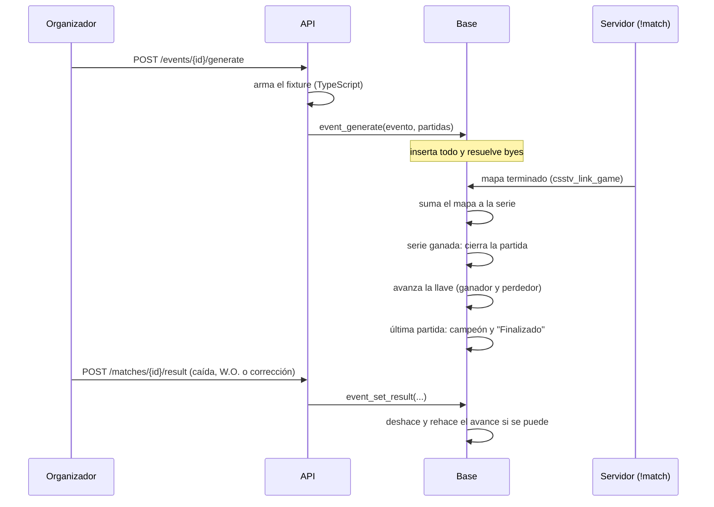
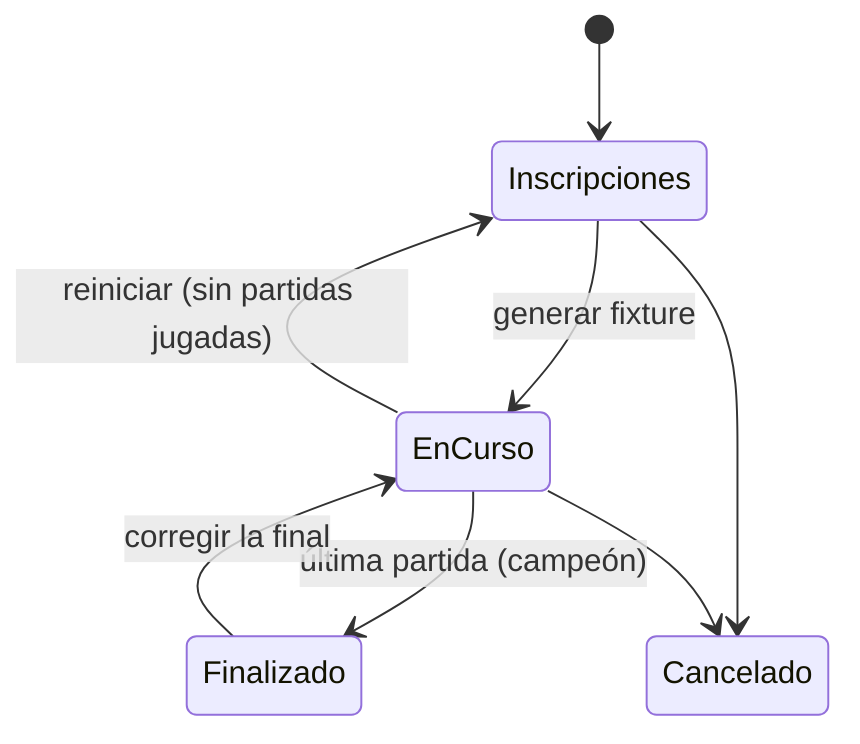
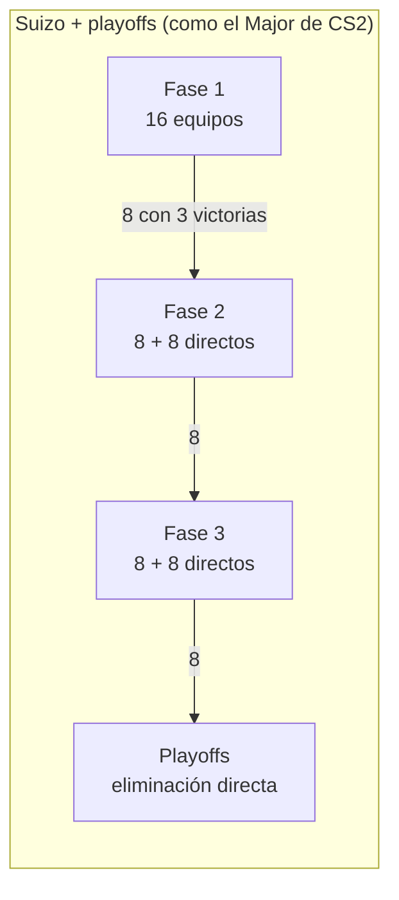
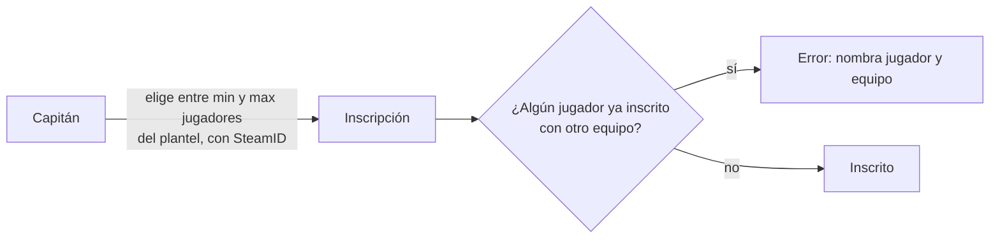

# Plan: endpoints de partidas, torneos y PCW (API de dominio, segunda entrega)

> Planeación original. Estado: **aprobado** por Daniel el 2026-10-15.

Segunda entrega de endpoints de dominio del backend (`web/backend`), sobre el esquema del replanteo (01 a 09). Cubre todo lo que la web vieja hace con **partidas, torneos y PCW**:
- Listados y detalle de partidas, con los mixes.
- Torneos: creación, inscripción, fixture, llaves, grupos y resultados.
- Veto de mapas y chat de partida.
- Publicar, aceptar y cancelar PCW.

Además resuelve un problema de fondo. Hoy **el navegador del admin arma y avanza las llaves**. Cuando una partida de torneo termina por `!match` en el servidor, la base marca el ganador, pero nadie lo pasa a la ronda siguiente. Esta entrega mueve el avance de la llave a la base: funciona igual si el resultado llega del servidor o lo carga el organizador.

Lo que falte en la base va en la migración `supabase/replanteo/10_partidas_torneos.sql`. El plugin 2.0.0 **no cambia**: lo nuevo que necesita `!match` (jugadores inscritos y mínimo por torneo) se resuelve en las funciones de la base que ya consulta.

## Qué hace hoy la web vieja

| Pantalla | Qué hace | Dónde vive la lógica |
|---|---|---|
| Partidas, Resultados y Mixes | Listados de partidas de torneo, PCW y mixes, con marcador, mapa, demo y MVP | Navegador (trae tablas enteras) |
| Detalle de partida | Marcador, botón "Conectar", demo, stats por jugador, veto, resultado, reportes y chat (consulta cada 5 s) | Navegador |
| Torneos | Lista, detalle con llaves, tabla de grupos, equipos y partidas; botón "Inscribir equipo" (dueño del equipo) | Navegador |
| Admin → Torneos | Crear y editar (formato, BO, BO de la final, grupos, clasificados, ida y vuelta, cupo, fechas, premio, reglas), siembra, generar fixture, reiniciar, generar playoffs, cargar resultados, borrar | **El motor de llaves corre en el navegador** (`genKO`, `genDE`, `genGroups`, `applyRes`, `settle`, `champOf`) |
| Admin → Partidas | Crear y editar partidas sueltas, borrar partidas huérfanas | Navegador |
| Veto | Los capitanes banean y eligen por turnos, sobre una lista fija de 9 mapas | Navegador + RLS de `match_vetos` |
| Resultados | Cada capitán carga mapas, rondas, alineación y capturas; las PCW se cierran solas si coinciden; los torneos los aprueba un admin | Trigger `validate_report`, `autoapply_pcw`, navegador |
| PCW | Publicar anuncio con roster (de 1 a 7, con al menos 4 con cuenta), aceptar, cancelar anuncio o práctica | `create_pcw_post`, `accept_pcw`, `cancel_pcw_*` |

Datos de producción (copia del 2026-10-14): **no hay torneos, ni partidas de torneo, ni PCW.** Los cambios de estructura no tienen datos que migrar.

## Decisiones

| Tema | Decisión | Origen |
|---|---|---|
| Quién crea torneos | **El admin y los organizadores.** El admin nombra organizadores | Daniel |
| Qué hace un organizador | En **sus** torneos, todo lo del admin: configurar, inscribir equipos, sembrar, generar el fixture, cargar o corregir resultados, marcar W.O. y resolver problemas. No toca torneos ajenos ni otras áreas | Daniel |
| Resultados de torneos y PCW | **Llegan del servidor con `!match`.** Cuando un equipo gana la serie, la partida se cierra sola y la llave avanza | Daniel |
| Resultado a mano | **Solo el organizador del torneo o el admin** (caída del servidor, W.O., corrección). **Se quitan los reportes y las capturas de los capitanes** | Daniel |
| PCW sin `!match` | **No tiene resultado.** Solo el admin le puede cargar uno | Daniel |
| Puntos del ranking | **Valor único** por partida de torneo ganada (30, configurable). No cambia según la fase | Daniel |
| Chat de partida | Lo leen todos; **escriben los integrantes de los dos equipos, el organizador del torneo y los admins** | Daniel |
| Jugadores por equipo en un torneo | El organizador define el mínimo y el máximo de inscritos por equipo (máximo 10) | Daniel (2026-10-15) |
| Formato de las partidas | Lo decide el organizador (BO1, BO3, BO5 y BO de la final) | Daniel (2026-10-15) |
| Un jugador, un equipo por torneo | Se compara contra los **inscritos**, no contra el plantel completo | Daniel (2026-10-15) |
| PCW "como equipo" | Al publicar o aceptar, el bando puede elegir uno de sus equipos oficiales; su roster tiene que ser de ese plantel y la PCW ganada suma al ranking de ese equipo | Daniel (2026-10-15) |
| Formatos de torneo | **Plantillas:** eliminación directa, doble eliminación, grupos + playoffs y suizo + playoffs (al estilo del Major de CS2). Ver la sección 2 | Daniel |
| Dónde corre el motor de torneos | **Todo en la base:** generar el fixture, avanzar la llave, armar la ronda siguiente del suizo, pasar de grupos o suizo a playoffs y calcular el campeón. Los resultados llegan solos del servidor, así que todo lo que dependa de un resultado tiene que pasar solo, sin que nadie toque nada | Propuesta (cambió al sumar el suizo) |
| BO de cada fase | **El organizador elige BO1, BO3 o BO5 en cada fase** de la plantilla. Valores por defecto en la sección 2 | Daniel |
| Gran final de doble eliminación | **Sin reset:** una sola serie. Opción **"mapa de ventaja"** (apagada por defecto): el campeón del upper empieza la gran final 1-0 (en BO3 o BO5; en BO1 no aplica) | Daniel |
| Partido por el 3.er puesto | Opcional, apagado por defecto. Si se activa, BO3 | Daniel |
| Empates en un mapa | **Overtime obligatorio** en torneos y PCW: no hay mapas empatados. Si igual llega uno empatado, lo resuelve el organizador (o el admin en una PCW) | Daniel |
| W.O. | El organizador marca qué equipo no se presentó: el otro gana y la llave avanza. Queda `end_reason = 'walkover'`. **Cuenta para avanzar, pero no suma puntos en el ranking** (no se jugó) | Propuesta |
| Pool de mapas | `de_dust2_ob`, `de_cache`, `de_cbble`, `de_inferno`, `de_mirage_rc1`, `de_nuke_old_blue`, `de_season` y `de_tuscan`. Configurable por el admin | Daniel (mapas); propuesta (configurable) |
| Mapas con versiones | Inferno es **un solo mapa en el veto** con dos versiones (`de_inferno` y `de_inferno_classic`). Banearlo banea las dos. Quien lo elige elige la versión. Si queda como decisivo, la versión la fija **el organizador** en la configuración del torneo; en una PCW se juega `de_inferno` | Daniel (torneos); propuesta (PCW) |
| Veto | Se valida en la base: el turno, la acción (ban o pick según el BO) y que el mapa esté en el pool y libre. El organizador o el admin lo reinician | Propuesta |
| Código de `!match` | Lo ven solo los integrantes de los dos equipos, el organizador y los admins. **Hoy cualquiera lo puede leer** desde la tabla: la `10` lo oculta | Propuesta (cumple la decisión de `!match`) |
| Partidas sueltas | Toda partida oficial pertenece a un torneo: **se quita "crear partida suelta"**. Las huérfanas que existan las puede borrar el admin | Propuesta |
| Borrar un torneo | Solo si no tiene partidas jugadas (terminadas sin bye). Si no, se puede cancelar | Propuesta |
| PCW vencidas | Una PCW sin mapas jugados a las 48 h de su hora de inicio se cancela sola (`pcw_cleanup`) | Propuesta |
| Actualización en vivo | El detalle se consulta con `ETag`: si no cambió, la API responde `304` sin cuerpo. El frontend puede consultar cada pocos segundos sin costo | Propuesta |
| Demo | La API arma el link de descarga (`demo_url`) con la variable `DEMO_BASE_URL` | Propuesta |

## 1. Flujo de una partida de torneo

## 2. Torneos

### Plantillas de formato

Un torneo tiene **una o varias fases** y termina en playoffs. El organizador elige una plantilla y ajusta los números.

| Plantilla | Fases | Qué se configura |
|---|---|---|
| Eliminación directa | Playoffs | BO por ronda y partido por el 3.er puesto |
| Doble eliminación | Upper, lower, final del upper, final del lower y gran final | BO por ronda y mapa de ventaja en la gran final |
| Grupos + playoffs | Grupos de todos contra todos → playoffs | Cantidad de grupos (A, B, C, D…), equipos por grupo (4 por defecto), clasificados por grupo (2 por defecto), ida y vuelta, BO de grupos y de cada ronda de playoffs |
| Suizo + playoffs | 1 a 3 fases suizas → playoffs | Fases, equipos por fase (16 u 8), victorias para clasificar y derrotas para quedar afuera (3 y 3 con 16; 2 y 2 con 8), BO normal y BO de las partidas decisivas, y en qué fase empieza cada equipo |

**BO por defecto** (el organizador cambia cada uno por BO1, BO3 o BO5):

| Plantilla | Fase | BO |
|---|---|---|
| Eliminación directa | Todas las rondas, incluida la final | BO3 |
| Doble eliminación | Upper, lower, final del upper y final del lower | BO3 |
| | Gran final | BO5 |
| Grupos + playoffs | Grupos | BO1 |
| | Playoffs y final | BO3 |
| Suizo + playoffs | Partidas normales del suizo | BO1 |
| | Partidas para clasificar o quedar afuera | BO3 |
| | Playoffs y final | BO3 |
| Todas | Partido por el 3.er puesto (si se activa) | BO3 |

**Doble eliminación:** la final del upper la juegan los dos invictos; el perdedor baja a la final del lower contra el que viene ganando en el lower. La gran final enfrenta a los ganadores de las dos finales y es una sola serie (sin reset). Con **mapa de ventaja**, el campeón del upper empieza 1-0: en un BO3 le alcanza con ganar un mapa y en un BO5, dos. El veto se hace igual que en cualquier serie de ese BO, y se juegan los mapas en orden hasta que alguien gana. Se guarda en `matches.advantage_side` y lo respetan `csstv_link_game` (la serie de `!match` arranca 1-0), el resultado a mano y la vista del marcador.

**Grupos:**
- Cada equipo juega contra los demás de su grupo. Victoria 3 puntos, derrota 0.
- **Desempate, en orden:**
  1. Puntos.
  2. Diferencia de rondas (ganadas menos perdidas).
  3. Resultado entre los empatados.
  4. Rondas ganadas.
  5. Si siguen empatados, decide el organizador.
- Los clasificados se cruzan en playoffs evitando que dos del mismo grupo se crucen en la primera ronda (A1 contra B2, B1 contra A2…).

**Suizo:**
- **Primera ronda de cada fase:** por siembra (1 contra 9, 2 contra 10…).
- **Rondas siguientes:** se cruzan equipos del mismo récord (2-0 con 2-0, 1-1 con 1-1…), sin repetir rival. Dentro de cada récord, primero el de rivales más difíciles (Buchholz: suma de las diferencias de victorias y derrotas de sus rivales) y después por siembra.
- Con las victorias configuradas, el equipo clasifica; con las derrotas, queda afuera.
- **Equipos que empiezan en una fase posterior** (invitados o mejor sembrados): por defecto todos empiezan en la fase 1. La cantidad de equipos que pide el torneo sale de las fases y de los que entran directo; por ejemplo, 3 fases con 8 directos en las fases 2 y 3 suman 16 + 8 + 8 = 32.
- **Desempate de la siembra para la fase siguiente o los playoffs:** récord, Buchholz y diferencia de rondas.

**Todo sucede solo:** cuando termina la última partida de una ronda del suizo, la base arma la siguiente. Cuando termina una fase, arma la próxima o los playoffs. Cuando termina la final, marca el campeón. El organizador solo interviene en los empates que no se pueden resolver o para corregir.

### Configuración (`events`)

Se mantienen las columnas actuales (nombre, fechas, cupo mínimo y máximo, premio, reglas, siembra). Se suman:

| Columna | Qué guarda |
|---|---|
| `organizer_id` | Quien creó el torneo (organizador o admin) |
| `template` | `single`, `double`, `groups` o `swiss` |
| `config` | Los números de la plantilla (`jsonb` validado por la base): BO de cada fase, grupos, clasificados, fases suizas, victorias y derrotas, 3.er puesto, mapa de ventaja y versión de los mapas decisivos con versiones |
| `players_min`, `players_max` | Inscritos por equipo: por defecto 5 y 7; máximo 10 |
| `status` | `registration`, `in_progress`, `finished` o `cancelled`. Reemplaza al texto libre `stage` |

Inscripción a una fase posterior del suizo: `tournament_registrations.start_stage` (1 por defecto).

### Inscripción

- **Quién:** el capitán del equipo, mientras el torneo esté en inscripciones y haya cupo.
- **Tabla nueva `tournament_registration_players`:** evento, equipo y jugador. Valida:
  - Que el jugador esté en el plantel activo y tenga SteamID.
  - Que la cantidad esté entre `players_min` y `players_max`.
  - Que el jugador no esté inscrito con otro equipo en el mismo torneo.
- **Cambiar los inscritos:** el capitán, hasta que se genera el fixture. Después, solo el organizador o el admin.
- **Si un inscrito sale del equipo,** deja de estar inscrito en los torneos sin terminar del equipo. La web avisa al capitán si quedan menos que el mínimo.
- **Sale el control de la `09`:** el que comparaba planteles completos al entrar a un equipo ya no hace falta, porque entrar a un equipo no inscribe a nadie.
- **`!match` en torneos:** `csstv_match_lookup` y `csstv_link_game` usan los **inscritos** en vez del plantel. `min_roster` pasa a ser `players_min`. El plugin no cambia.

### Fixture y avance

Todo en la base (plpgsql), con pruebas en SQL de cada plantilla:

| Función o trigger | Qué hace |
|---|---|
| `event_generate(evento)` | Arma la primera fase según la plantilla y la siembra: llaves con byes, grupos o primera ronda del suizo. Falla si el torneo ya está generado o no cumple el cupo |
| Trigger al terminar una partida de torneo | Pasa el ganador (y el perdedor en doble eliminación) a la partida siguiente y encadena los byes. En grupos y en el suizo, al terminar la ronda o la fase, arma la siguiente o los playoffs. Con la final, marca el campeón y pasa el torneo a `finished` |
| `event_set_result(partida, mapas o W.O.)` | Resultado a mano del organizador o del admin. Si cambia el ganador, deshace el avance; falla con un mensaje si ya se jugaron partidas que dependían de esa |
| `event_resolve_tie(evento, fase, orden)` | El organizador fija el orden de equipos empatados que los criterios no resolvieron |
| `event_reset(evento)` | Borra el fixture si no hay partidas jugadas |
| Vistas `event_group_standings` y `event_swiss_standings` | Tablas de grupos (puntos, rondas y desempates) y del suizo (récord y Buchholz) |

### Permisos

- **Función nueva `can_manage_event(evento)`:** es verdadera para el admin, o para el organizador que creó el torneo.
- **Sobre ella se apoyan:** las RLS de `events`, de las partidas del torneo y de las inscripciones, y todas las funciones de gestión.
- **`profiles.role`** suma `organizer`. Solo el admin cambia roles, y solo entre `user` y `organizer`. El rol `admin` se sigue dando en la base.

## 3. Partidas

- **Una partida de torneo o PCW** es la serie. Cada mapa jugado con `!match` es un mix vinculado (`parent_match_id`), con sus stats y su demo.
- **El detalle muestra:**
  - Los mapas de la serie con el marcador de cada uno.
  - Los jugadores y stats de cada mapa.
  - El veto y el chat.
  - La dirección del servidor.
  - El código de `!match`, solo a quien puede verlo.
- **Un mix suelto:** bandos, marcador, stats por jugador, MVP (el mejor rating), demo, y el motivo si se canceló o terminó por rendición.
- **Hora y servidor:** el organizador los asigna a cada partida de su torneo.

## 4. Veto

- **Pool de mapas:** tabla `map_pool`, con nombre en el veto, versiones (los nombres de mapa del servidor; Inferno tiene `de_inferno` y `de_inferno_classic`), orden y si está activo. La gestiona el admin y arranca con los 8 mapas de la tabla de decisiones.
- **Versión del mapa:** cuando un equipo elige un mapa con versiones, elige también cuál. El mapa decisivo usa la versión que fijó el organizador (en PCW, la primera).
- **`veto_act(partida, mapa)`:**
  - Calcula de quién es el turno y si toca ban o pick, con la secuencia de la web vieja: en BO1 solo bans, en BO3 dos bans y dos picks, en BO5 dos bans y cuatro picks.
  - Valida que quien vota sea el capitán de ese equipo.
  - Se termina cuando queda un mapa, que es el decisivo.
- **`veto_reset(partida)`:** solo el organizador o el admin.
- **Cuándo se puede vetar:** mientras la partida no empezó, en torneos y en PCW.

## 5. Chat

- **Leer:** todos.
- **Escribir:**
  - Los integrantes de los dos equipos: el plantel activo y, en PCW, el roster.
  - El organizador del torneo.
  - Los admins.
- **Límites:** 300 caracteres y un mensaje cada 2 segundos (como hoy). Se ve el alias del autor; el email no se devuelve.
- **Borrar:** cada uno lo suyo, y el admin cualquier mensaje.

## 6. PCW

| Acción | Cambio |
|---|---|
| Publicar y aceptar | `create_pcw_post` y `accept_pcw` suman un parámetro opcional, `p_team` ("jugar como equipo"). Lo puede usar el capitán o el dueño de ese equipo, y todo el roster con cuenta tiene que ser de su plantel |
| Reglas que siguen | Roster de 1 a 7 con al menos 4 con cuenta, formatos habilitados por el admin, un anuncio abierto por usuario, nadie en los dos rosters |
| Resultado | Solo por `!match`. Si no se juega, a las 48 h de su hora se cancela sola. Solo el admin carga un resultado a mano |
| Cancelar | Quien publicó o aceptó (los capitanes de los dos bandos) o el admin, mientras no haya mapas jugados |

## 7. Lo que se quita

| Qué | Por qué |
|---|---|
| Tabla `result_reports`, triggers `validate_report` y `autoapply_pcw`, y el bucket `proofs` | Los resultados llegan del servidor; a mano carga el organizador o el admin. En producción no hay reportes |
| "Crear partida suelta" | Toda partida oficial pertenece a un torneo |
| `events.stage` (texto) | Lo reemplaza `events.status`. Los nombres de fase de cada partida se calculan |
| Control de planteles de torneos de la `09` | Pasa a los inscritos |

## 8. Endpoints

### Públicos (con sesión, la respuesta suma lo que el usuario puede ver o hacer)

| Endpoint | Devuelve |
|---|---|
| `GET /api/v1/matches?kind=&status=&event=&team=&player=&page=&per=` | Partidas (torneo, PCW o mix), la más nueva primero |
| `GET /api/v1/matches/{id}` | Detalle: bandos, serie, mapas jugados, stats, veto, servidor, demo, código (si corresponde) y `viewer` (si puede vetar, escribir o gestionar). Con `ETag` |
| `GET /api/v1/matches/{id}/chat?after=` | Mensajes (los últimos 50, o los nuevos desde un id) |
| `GET /api/v1/events?status=&page=&per=` | Torneos |
| `GET /api/v1/events/{id}` | Torneo: configuración, inscritos con sus jugadores, llaves, tabla de grupos, partidas y campeón. Con `ETag` |
| `GET /api/v1/pcw/posts` | Anuncios abiertos |
| `GET /api/v1/maps` | Pool de mapas activo |

### Con sesión

| Endpoint | Quién |
|---|---|
| `POST /api/v1/matches/{id}/veto` (`{ map }`) | Capitán en su turno |
| `POST /api/v1/matches/{id}/chat` / `DELETE /api/v1/chat/{id}` | Participantes, organizador o admin |
| `PUT`/`DELETE /api/v1/events/{id}/registrations/{teamId}` (`{ players }`) | Capitán (inscribir, cambiar inscritos, darse de baja) |
| `GET /api/v1/me/pcw` | Mis PCW y anuncios |
| `POST /api/v1/pcw/posts` / `POST /api/v1/pcw/posts/{id}/accept` | Usuario (con `team_id` opcional) |
| `DELETE /api/v1/pcw/posts/{id}` / `POST /api/v1/pcw/matches/{id}/cancel` | Quien publicó, capitanes o admin |

### Organizador del torneo o admin

| Endpoint | Qué hace |
|---|---|
| `POST`/`PATCH`/`DELETE /api/v1/events[/{id}]` | Crear, editar (formato y BO, solo antes de generar), borrar (sin partidas jugadas) o cancelar |
| `PUT /api/v1/events/{id}/seeds` | Orden de siembra |
| `PUT`/`DELETE /api/v1/events/{id}/registrations/{teamId}` | Inscribir o quitar un equipo |
| `POST /api/v1/events/{id}/generate`, `…/reset` | Fixture (las fases siguientes y los playoffs se arman solos) |
| `POST /api/v1/events/{id}/ties` | Resolver un empate que los criterios no definieron |
| `PATCH /api/v1/matches/{id}` | Hora y servidor |
| `POST /api/v1/matches/{id}/result` | Resultado a mano: mapas y rondas, o W.O. (`{ walkover: teamId }`) |
| `DELETE /api/v1/matches/{id}/veto` | Reiniciar el veto |

### Solo admin

| Endpoint | Qué hace |
|---|---|
| `PUT /api/v1/admin/users/{id}/role` (`user` u `organizer`) | Nombrar o quitar organizadores |
| `GET`/`PUT /api/v1/admin/maps` | Pool de mapas |
| `POST /api/v1/admin/pcw/matches/{id}/result` | Resultado a mano de una PCW |
| `DELETE /api/v1/admin/matches/{id}` | Borrar una partida huérfana |

## 9. Base de datos (`supabase/replanteo/10_partidas_torneos.sql`)

1. **Organizadores:** `profiles.role` admite `organizer`; `events.organizer_id`; `can_manage_event`; `set_user_role` (admin); RLS de `events`, `matches` (las de torneo) y `tournament_registrations`.
2. **Torneos:**
   - `events.status`, `players_min` y `players_max`.
   - Tabla `tournament_registration_players`, con sus reglas.
   - Se ajustan `tournament_registrations_plantel` y `tournament_registrations_unicos`, y sale el control de torneo de `team_members_rules`.
   - `events.template` y `config`, `tournament_registrations.start_stage` y `matches.advantage_side` (mapa de ventaja, también en `csstv_link_game`).
   - Funciones `event_generate`, `event_reset`, `event_set_result` y `event_resolve_tie`.
   - Trigger de avance, rondas del suizo, paso a playoffs y campeón.
   - Vistas `event_group_standings` y `event_swiss_standings`.
   - `matches.end_reason` admite `walkover`; `team_standings` no cuenta los W.O.
3. **`!match`:** `csstv_match_lookup` y `csstv_link_game` usan los inscritos y `players_min` en torneos.
4. **Código oculto:** sin `select` sobre `matches.link_code` para `anon` y `authenticated`; `match_link_code(partida)` lo devuelve a quien corresponde.
5. **Veto:** tabla `map_pool`, `veto_act` y `veto_reset`; la RLS de `match_vetos` queda solo de lectura.
6. **Chat:** la RLS de escritura de `match_chat` pasa a participantes, organizador y admin, con un largo máximo de 300.
7. **PCW:** `p_team` en `create_pcw_post` y `accept_pcw`; cancelación por 48 h en `pcw_cleanup`; `pcw_set_result` (admin).
8. **Lo que se quita:** `result_reports`, `validate_report`, `autoapply_pcw` y las políticas del bucket `proofs`; `events.stage` pasa a `status`.

Con su inversa, sus pruebas (`correr.sh`) y el ensayo del ELO repetido.

## 10. Backend

- **Archivos:** `routes/matches.ts`, `routes/events.ts`, `routes/pcw.ts` (se amplía) y `routes/admin-matches.ts`. El motor está en la base, así que el backend solo valida la configuración y llama a sus funciones.
- **`ETag`:** en el detalle de partida y de torneo (hash del cuerpo), con `304` para `If-None-Match`.
- **Variable nueva `DEMO_BASE_URL`:** la URL pública del Worker de demos.
- **Pruebas de integración:**
  - Torneo de punta a punta en las cuatro plantillas, incluido un suizo de 3 fases con equipos que empiezan en la 2 y la 3.
  - Una serie BO3 terminada por `!match` (simulando `csstv_link_game`) que avanza la llave.
  - W.O., corrección bloqueada por partidas posteriores, veto completo, permisos del organizador sobre torneos ajenos, chat y PCW como equipo.
- **Cobertura:** mínima del 60 %.

## 11. Frontend

Al terminar, se actualizan las secciones de partidas, torneos y PCW de `docs/frontend/contract.md`, con el rol de organizador y el registro de decisiones.

## 12. Requisitos antes de empezar

- **Aprobación de este plan.** En especial, de las propuestas de la tabla de decisiones:
  - El motor en la base, el W.O. y el pool configurable.
  - Las partidas sueltas, borrar un torneo y las PCW vencidas.
  - El `ETag` y el link de la demo.
- La Supabase local con 01 a 09 (ya funcionando).
- **Overtime:** confirmar que el plugin juega overtime en un mapa empatado. Si no, queda anotado en `docs/PENDIENTES.md` para la tanda de plugins; mientras tanto, un mapa empatado lo resuelve el organizador.

## 13. Orden de implementación

1. **Base:** `10`, con inversa, pruebas, `correr.sh` y ensayo del ELO. Tipos regenerados.
2. **Motor de torneos** en la base: plantillas, avance, suizo y playoffs, con pruebas de cada una.
3. **Torneos:** endpoints públicos, de inscripción y del organizador.
4. **Partidas:** listados, detalle con `ETag`, veto y chat.
5. **PCW:** anuncios, aceptar "como equipo", cancelar y resultado del admin.
6. **Admin:** organizadores, pool de mapas y partidas huérfanas.
7. **Documentación:** `DOCUMENTACION.md`, `GUIA_IMPLEMENTACION.md`, `docs/frontend/contract.md`, `docs/PENDIENTES.md` y changelog.
